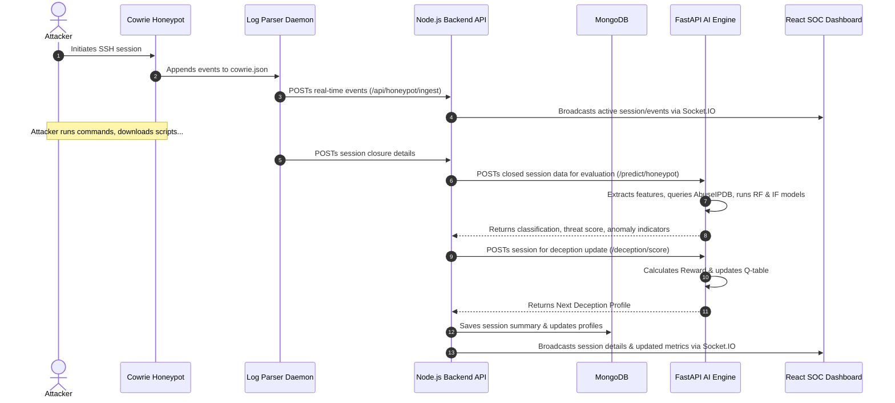

# SentinelAI - Autonomous AI Cyber Defence Platform

SentinelAI is an end-to-end, autonomous threat detection, deception engineering, and incident response platform. It integrates real-time network flow analysis, interactive SSH honeypots, reinforcement learning deception control, and local machine learning models to identify, confuse, and mitigate network intrusion attempts.

This project runs as independently managed frontend, backend, and AI services with MongoDB. Start with [native development](docs/NATIVE_DEVELOPMENT.md), [architecture](docs/ARCHITECTURE.md), and [validation results](docs/VALIDATION.md). The old Docker deployment was removed after a verified project backup; Docker is postponed while native application development and validation continue. No Docker configuration is retained in the active project.

Current handoff (15 October 2026): [Docker preflight is blocked](docs/DOCKER_PREFLIGHT_20261015.md); no new deployment was built or started. [Enrollment is administrator-only](docs/ENROLLMENT_POLICY_20261015.md). Public registration is disabled. See the [acceptance report](docs/DOCKER_ACCEPTANCE_REPORT_20261015.md) and [improvement backlog](docs/PROJECT_IMPROVEMENT_BACKLOG.md) for current results and unresolved work; earlier reports remain historical evidence.

---

Session-backed authentication and UTC-storage/Asia-Kolkata reporting are now
implemented. Existing users must sign in again. See the
[implementation, regression results and remaining limits](docs/AUTH_TIMEZONE_IMPLEMENTATION.md).

## 🏗️ System Architecture & Interaction Flow

SentinelAI utilizes a distributed, multi-service architecture. The diagram below illustrates how an attacker's actions are intercepted, parsed, evaluated by the machine learning engine, used to adapt deception profiles dynamically, and propagated to the SOC dashboard in real time.

---

## 🌟 Key Features & Services

The platform consists of **5 containerized services** working in orchestration:

1. **Cowrie SSH Honeypot**: A medium-interaction decoy host that traps intrusion sessions and registers attacker keyboard input inside a custom, monitored file system.
2. **Log Parser Daemon**: A lightweight daemon that monitors and parses Cowrie events, streaming connection states and terminal inputs directly to the backend.
3. **Node.js Express Backend API**: The API gateway and real-time dispatcher. It coordinates prediction endpoints, stores analytics, manages users, and uses Socket.IO to broadcast events instantly.
4. **FastAPI AI Engine**: The core intelligence hub. It hosts the machine learning pipelines, queries AbuseIPDB threat intelligence, computes local SHAP feature explanations, and runs the Q-learning reinforcement model.
5. **React 18 SOC Dashboard**: A high-fidelity, responsive monitoring interface containing live telemetry, threat maps, incident lists, explainable AI charts, and deception profile status.

### Differentiators

* **MITRE ATT&CK Mapping**: Attacks and individual shell command inputs are mapped in real time to MITRE ATT&CK techniques (e.g., `T1110 - Brute Force`, `T1059 - Command and Scripting Interpreter`), which are visually flagged as badges on the dashboard logs.
* **Q-Learning Deception**: The honeypot profile (e.g., Ubuntu database, legacy CentOS, legacy Windows controller) adjusts dynamically between sessions. A Q-learning reinforcement agent modifies decoy environments to maximize attacker engagement time, capturing more indicators of compromise (IOCs).
* **Analyst Triage & Audit Governance**: Security analysts can review and verify ML predictions directly from the SOC UI, recording immutable triage decisions and ground-truth classifications for audit accountability.
* **Self-Labeling Honeypot Pipeline**: Passive network flow sniffers feed the AI Engine. When an anomaly is flagged, the platform can auto-route the IP to the deception environment to capture commands and build labeled training datasets.

---

## 📊 Real-world Results & Performance

SentinelAI is validated against the standardized **CICIDS2017** network intrusion dataset:

### Machine Learning Metrics
* **Random Forest Classifier** (Production loaded: `rf_classifier_cicids_v2.pkl`)
  * **Accuracy**: **98.43%**
  * **Weighted F1-Score**: **98.62%**
  * **Macro F1-Score**: **84.48%**
* **XGBoost Classifier** (Production model: `xgb_classifier_cicids_v2.pkl`)
  * **Accuracy**: **99.13%**
  * **Weighted F1-Score**: **99.24%**

### 🔍 Scientific Rigor: The False-Positive Challenge
In keeping with scientific integrity, we do not hide the limitations of our ML model under production class imbalances:
* **Precision Collapse at Scale**: In environments where benign traffic vastly outnumbers attacks, the model's precision degrades. Under production testing, precision collapses to **5%** for `SSH Brute Force` and **3%** for `Malware Beacon`.
* **Impact**: The majority of production alerts raised for these categories will be false positives. SentinelAI handles this via analyst verification loops and secondary correlation filters.

[SCREENSHOT: AI Analytics performance metrics dashboard]

---

## 🛑 Known Limitations & Technical Gaps

SentinelAI lists its known limitations, providing a transparent look at real-world deployments:

1. **Profile-Aligned Proxy Feature Mapping**:
   Honeypot sessions evaluated by the machine learning classifiers do not use raw, live network packet flows. Instead, they rely on statistical averages matching specific attack behaviors (e.g., simulated averages for flow duration, packet counts, and packet lengths). While this allows the honeypot to run through the same network-trained classifier, it uses simulated proxies rather than genuine, low-level network-flow features.
2. **Extreme Class Imbalance Precision Collapse**:
   As documented in the results section, the system suffers from precision degradation when deployed in real networks where benign records are orders of magnitude more frequent than active threat flows.
3. **Decoy Reconnection Boundary**:
   Because profile switches (e.g., Ubuntu 22.04 LTS $\rightarrow$ legacy Windows Server) occur between sessions, a highly sophisticated attacker who retains a persistent TCP socket or performs multi-channel comparisons might detect the deception state boundary transition.

---

## 🖼️ User Interface Preview

### SOC Threats Log & MITRE Badges
The main threat logs list maps automated network classifications alongside MITRE ATT&CK technique IDs (like `T1110 - Brute Force`) as visual badges.

[SCREENSHOT: SOC Threat Log table highlighting MITRE badges]

### Campaigns & IP Rotation Dashboard
The campaigns view groups multiple coordinated attacks. Rotated source IPs are flagged with an indicator showing the number of IPs rotated. Drill-down details expose SSH HASSH fingerprints and an interactive, replayed terminal console.

[SCREENSHOT: Campaigns dashboard showing IP rotation indicators and terminal replay console]
