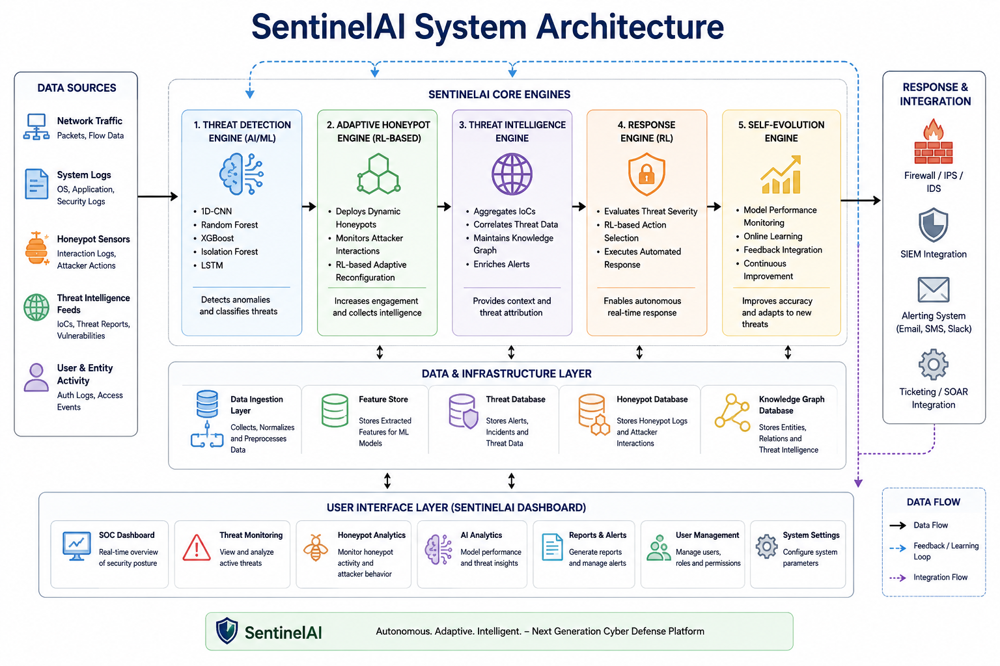
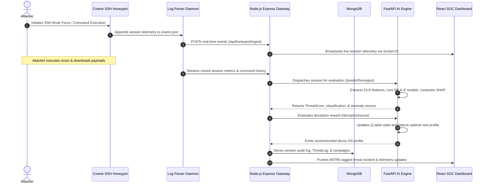
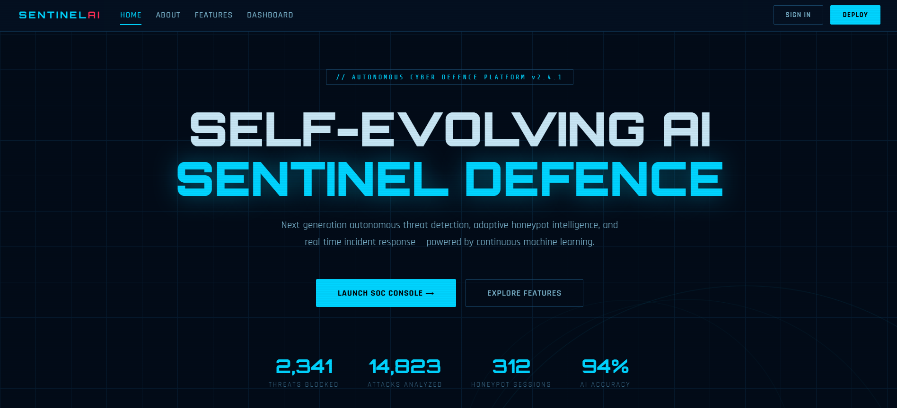
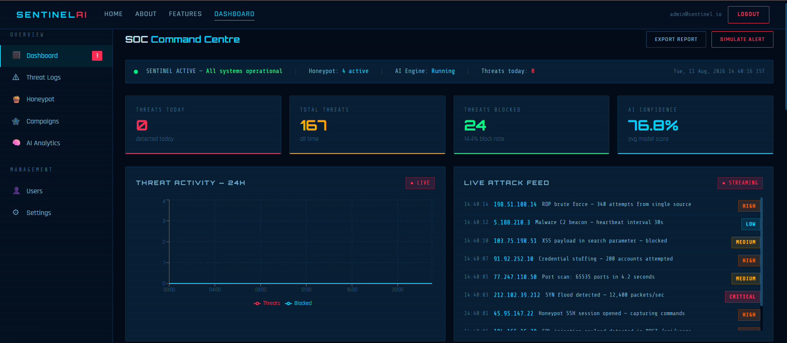

# SentinelAI: Adaptive Cyber Defence Platform

<p align="center">
  
</p>

<p align="center">
  <strong>An Adaptive Cyber Defence Platform with Explainable Intrusion Detection and Q-Learning Honeypot Intelligence</strong>
</p>

<p align="center">
  <a href="#system-architecture"></a>
  <a href="#technology-stack"></a>
  <a href="#technology-stack"></a>
  <a href="#technology-stack"></a>
  <a href="#technology-stack"></a>
  <a href="#technology-stack"></a>
  <a href="LICENSE"></a>
</p>

---

## 📌 Executive Summary & Research Abstract

Modern enterprise networks face an onslaught of sophisticated, automated intrusions, Advanced Persistent Threats (APTs), and zero-day vulnerabilities. Conventional Intrusion Detection and Prevention Systems (IDS/IPS) remain predominantly static and signature-bound, leaving them vulnerable to polymorphic payloads and novel evasion tactics.

**SentinelAI** is an autonomous, full-stack cyber defence platform designed to shift enterprise security from passive defense to proactive, adaptive deception and automated threat mitigation. SentinelAI bridges the gap between machine learning research and frontline SOC operations by delivering:
1. **Multi-Model Anomaly & Intrusion Detection:** Scikit-learn Random Forest, XGBoost, and Isolation Forest models trained on verified **CICIDS2017** network traffic.
2. **Explainable AI (XAI):** Real-time **SHAP** (SHapley Additive exPlanations) attribution that visualizes feature weights directly for SOC security analysts.
3. **Reinforcement Learning Honeypot Deception:** A tabular **Q-learning** reinforcement agent that dynamically reconfigures Cowrie SSH deception environments based on attacker interaction depth, maximizing dwell time to extract critical Indicators of Compromise (IOCs).
4. **Live SOC Operations Interface:** A high-throughput React dashboard with real-time Socket.IO telemetry, automated MITRE ATT&CK technique mapping, and analyst triage governance.

> **Academic Attribution:**  
> Developed at the **Department of Information Science and Engineering, RNS Institute of Technology (RNSIT), Bengaluru, India**.  
> **Authors:** Dr. Bhagyashree Ambore, M. Sri Snigdha, M. H. Ullasa, Jayanth M, Kumari Pallavi.  
> *Reference Document:* [`paper_text.txt`](paper_text.txt) / [`IMPLIMENTATION.pdf`](IMPLIMENTATION.pdf)

---

## 🌟 Key Features

* **🛡️ Dual-Tier ML Intrusion Classifier:** Combines supervised Random Forest/XGBoost classification with unsupervised Isolation Forest anomaly scoring across 53 engineered network-flow dimensions to compute a balanced `ThreatScore`.
* **🧠 Explainable AI (SHAP):** Deploys tree-based SHAP explainers to demystify black-box predictions, presenting analysts with top positive and negative contributing flow features per incident.
* **🎯 Reinforcement Learning Deception (Q-Learning):** Dynamically switches Cowrie honeypot decoy OS profiles (e.g., Ubuntu database server, legacy CentOS server, Windows controller) between attacker sessions to adaptively optimize entrapment rewards.
* **🏷️ MITRE ATT&CK Matrix Tagging:** Classifies shell commands and packet behavior in real time against MITRE ATT&CK techniques (e.g., `T1110 - Brute Force`, `T1059 - Command and Scripting Interpreter`, `T1082 - System Information Discovery`).
* **⚡ High-Throughput Real-Time Dispatcher:** Real-time event propagation via Socket.IO from backend ingestion pipelines to analyst dashboards with sub-second latency.
* **🔒 Enterprise Security & Session Management:** Session-backed authentication architecture featuring 15-minute access JWTs, 30-day absolute refresh token rotation, strict CORS isolation, and Asia/Kolkata timezone normalization.
* **🚨 Automated Containment Loop:** Configurable containment engine capable of automatically enforcing firewall IP isolation once a threat score exceeds designated safety thresholds.

---

## 🏗️ System Architecture & Interaction Flow

SentinelAI operates across four decoupled services: the **React SOC Dashboard**, the **Node.js/Express API Gateway**, the **FastAPI AI Engine**, and the **Cowrie Deception Honeypot**.



---

## 💻 User Interface Showcase

| Homepage & Platform Overview | SOC Analyst Threat Intelligence Dashboard |
| :---: | :---: |
|  |  |

---

## 📂 Project Structure

```text
sentinelai/
├── .github/workflows/ci.yml       # GitHub Actions CI workflow (Node 24, Python 3.11)
├── ai-engine/                     # FastAPI AI & Reinforcement Learning Engine
│   ├── inference/                 # REST endpoints, predictor, & deception scoring
│   ├── models/                    # Serialized models (.pkl) & Q-table seed states
│   ├── modular/                   # Modular detector interfaces & safety contracts
│   ├── rl_engine/                 # Q-learning tabular reinforcement learning agent
│   ├── tests/                     # Pytest test suite (features, safety, predictor)
│   ├── utils/                     # 53-dimension feature pipeline & preprocessing
│   ├── requirements.txt           # Python dependency manifest
│   └── .env.example               # AI Engine environment variable template
├── backend/                       # Node.js Express & Socket.IO API Gateway
│   ├── controllers/               # Threat, honeypot, user, & settings controllers
│   ├── middleware/                # JWT session auth, sanitization, rate limiting
│   ├── models/                    # Mongoose schemas (ThreatLog, User, Session, etc.)
│   ├── routes/                    # REST API route handlers
│   ├── services/                  # AI client, containment manager, event bus
│   ├── tests/                     # Jest & Supertest integration test suite
│   ├── server.js                  # Gateway bootstrap & WebSocket coordinator
│   └── .env.example               # Backend environment variable template
├── frontend/                      # React 18 + Vite SOC Dashboard
│   ├── src/                       # React components, pages, hooks, & state
│   ├── tests/                     # Node test runner suite
│   ├── vite.config.js             # Vite configuration with /api reverse proxy
│   └── .env.example               # Frontend environment variable template
├── honeypot/                      # Cowrie SSH Decoy & Telemetry Collection
│   ├── cowrie/                    # Cowrie honeypot config & filesystem decoy templates
│   ├── parsers/                   # Real-time event streaming daemon
│   └── switch_profile.py          # Dynamic deception profile reconfigurator
├── docs/                          # Comprehensive technical & architecture runbooks
├── scripts/                       # Database seed scripts & acceptance smoke runners
├── LICENSE                        # Open-source MIT License
└── CONTRIBUTING.md                # Development, linting, & pull request guidelines
```

---

## 📊 Model Evaluation & Scientific Rigor

SentinelAI is evaluated on the **CICIDS2017** benchmark. How the data is split changes the numbers a lot,
so each figure says which split it comes from (full method and results:
[docs/C1_EVALUATION_PLAN_AND_RESULTS.md](docs/C1_EVALUATION_PLAN_AND_RESULTS.md)).

### Multi-Class Performance Metrics (production Random Forest, `rf_classifier_cicids_v2.pkl`)
| Split | Accuracy | Macro F1 | What it measures |
|---|---|---|---|
| Random 80/20 rows (as in the model metadata) | 98.43% (re-run: 98.69%) | 0.84 (re-run: 0.88) | Optimistic: flows from the same attack burst land in train and test |
| **Chronological per class** (train on earlier flows, test on later ones) | **97.57%** | **0.74** | Honest in-distribution estimate; rare classes (bot/C2, XSS, SQLi) are weak |
| Leave one capture day out | 59–94% | 0.19–0.29 | Attacks from a day never trained on are almost all missed |

The XGBoost candidate (99.13% accuracy) was measured on the same random split and is not deployed.

### Alerting (backend threat/alert creation)
The alert line (threat score at which a non-BENIGN prediction becomes a threat) is **0.90** (`ALERT_THRESHOLD`),
the lowest line meeting a 0.1% benign-alert target on a chronological validation split of the de-duplicated
data. On the later, held-out traffic it alerts on **78.6% of attacks** with **0.154% of benign flows** raising
an alert (95% CI 0.136–0.174%). Attacks from a capture day never seen in training are essentially not
detected. See `docs/CRITICAL_FIXES_REPORT.md`.

### 🔍 Scientific Transparency: Addressing Real-World Class Imbalance
In alignment with academic honesty and scientific rigor, SentinelAI documents performance boundaries when deploying models into live networks:
* **The Base-Rate Challenge:** In production environments where benign traffic vastly outnumbers malicious flows, precision on rare attack classes (such as SSH Brute Force or Infiltration) can degrade due to the class imbalance base-rate effect.
* **SentinelAI Mitigation Strategy:** SentinelAI prevents automated false-positive overreactions by employing an **Analyst Verification Loop** and requiring multi-event correlation before executing irreversible containment actions.

---

## 🚀 Getting Started Locally

### Prerequisites
* **Node.js**: `v24.x` (or LTS `v20+`)
* **Python**: `v3.11.x`
* **MongoDB Community Server**: `v7.0+`
* **Git**: `v2.40+`

---

### Step 1: Clone the Repository
```bash
git clone https://github.com/srisnigdha-08/SentinalAI.git
cd SentinalAI
```

---

### Step 2: Configure & Start MongoDB
Ensure MongoDB is running locally on its standard port:
```bash
# Verify MongoDB service is active
mongosh --eval "db.adminCommand('ping')"
```

---

### Step 3: Setup & Run the Backend API
```bash
cd backend

# Install dependencies
npm install

# Configure environment variables
cp .env.example .env
# Edit .env to set secure JWT_SECRET and SENTINEL_KEY values

# Start the development server
npm run dev
# Backend runs on http://localhost:5000
```

---

### Step 4: Setup & Run the AI Inference Engine
```bash
cd ../ai-engine

# Create and activate Python virtual environment
python -m venv .venv

# Windows:
.venv\Scripts\activate
# Linux / macOS:
source .venv/bin/activate

# Install dependencies
pip install -r requirements.txt

# Configure environment variables (SENTINEL_KEY must match backend/.env)
cp .env.example .env

# Launch FastAPI inference server. --env-file is required: the engine does not read .env itself.
# Bind to loopback; only the backend needs to reach it.
uvicorn inference.main:app --host 127.0.0.1 --port 8000 --env-file .env --reload
# API documentation available at http://localhost:8000/docs
```

---

### Step 5: Setup & Run the Frontend SOC Dashboard
```bash
cd ../frontend

# Install dependencies
npm install

# Start Vite development server
npm run dev
# Dashboard opens on http://localhost:3000
```

---

## ⚙️ Environment Configuration

### Backend (`backend/.env`)
| Variable | Description | Default / Example |
| :--- | :--- | :--- |
| `PORT` | Node.js Express server port | `5000` |
| `MONGO_URI` | MongoDB connection connection string | `mongodb://localhost:27017/sentinel-db` |
| `JWT_SECRET` | Secret for signing access tokens | Generate with `openssl rand -hex 32` |
| `JWT_REFRESH_SECRET` | Secret for signing refresh tokens | Generate with `openssl rand -hex 32` |
| `SENTINEL_KEY` | Shared internal authentication key | Generate with `openssl rand -hex 32` |
| `HONEYPOT_API_KEY` | Secret for authenticating honeypot daemon | Generate with `openssl rand -hex 32` |
| `AI_ENGINE_URL` | Base URL of FastAPI AI engine | `http://localhost:8000` |
| `CLIENT_URL` | Trusted CORS client origin | `http://localhost:3000` |

### AI Engine (`ai-engine/.env`)
| Variable | Description | Default / Example |
| :--- | :--- | :--- |
| `MODEL_DIR` | Directory containing serialized `.pkl` models | `./models` |
| `SENTINEL_API` | Backend API URL for threat callbacks | `http://localhost:5000/api` |
| `SENTINEL_KEY` | Shared internal key (matches backend) | Required |
| `SCORE_THRESHOLD` | ThreatScore trigger threshold | `0.7` |
| `CORS_ORIGINS` | Permitted cross-origin endpoints | `http://localhost:3000,http://localhost:5000` |

---

## 🧪 Testing & Quality Assurance

SentinelAI incorporates comprehensive automated test suites across all tiers:

```bash
# Run Backend integration & unit tests
cd backend
npm test

# Run AI Engine Pytest suite
cd ../ai-engine
pytest

# Run Frontend routing & smoke tests
cd ../frontend
npm test
```

Continuous integration is enforced on every pull request via **GitHub Actions** ([`.github/workflows/ci.yml`](.github/workflows/ci.yml)).

---

## 🔮 Future Roadmap

* **Deep Q-Networks (DQN):** Transitioning from tabular Q-learning to DQN for continuous-action autonomous defensive response selection.
* **Elastic Weight Consolidation (EWC):** Meta-learning algorithms to allow on-the-fly model adaptation without catastrophic forgetting of historical threat signatures.
* **NLP Threat Intelligence Correlation:** BERT-based threat extraction to ingest unstructured CVE feeds and automated OSINT sources.

---

## 📄 License & Attribution

This project is licensed under the **MIT License** - see the [`LICENSE`](LICENSE) file for details.

Developed with pride by the SentinelAI Research Team at **RNS Institute of Technology**, Bengaluru, India.
