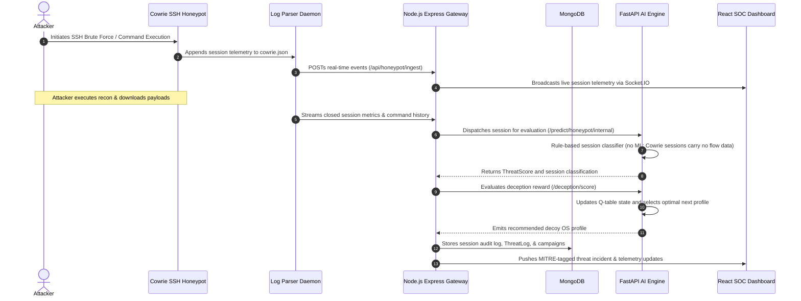

# SentinelAI: Adaptive Cyber Defence Platform

<p align="center">
  
</p>

<p align="center">
  <strong>An Adaptive Cyber Defence Platform with Explainable Intrusion Detection and Q-Learning Honeypot Intelligence</strong>
</p>

<p align="center">
  <a href="#system-architecture"></a>
  <a href="#technology-stack"></a>
  <a href="#technology-stack"></a>
  <a href="#technology-stack"></a>
  <a href="#technology-stack"></a>
  <a href="#technology-stack"></a>
  <a href="LICENSE"></a>
</p>

---

## 📌 Executive Summary & Research Abstract

Modern enterprise networks face an onslaught of sophisticated, automated intrusions, Advanced Persistent Threats (APTs), and zero-day vulnerabilities. Conventional Intrusion Detection and Prevention Systems (IDS/IPS) remain predominantly static and signature-bound, leaving them vulnerable to polymorphic payloads and novel evasion tactics.

**SentinelAI** is a full-stack cyber defence prototype, designed toward autonomous operation, that combines ML threat detection, adaptive honeypot deception and a policy-governed containment workflow (enforcement is simulated by default). SentinelAI bridges the gap between machine learning research and frontline SOC operations by delivering:
1. **Multi-Model Anomaly & Intrusion Detection:** XGBoost (served) and Random Forest classifiers plus an Isolation Forest, trained on **CICIDS2017** flow records. Input is flow records sent on demand or replayed from CICIDS2017 (`ai-engine/demo/replay_cicids.py`); there is no live packet capture.
2. **Explainable AI (XAI):** **SHAP** (SHapley Additive exPlanations). Analysts and admins can open **Explain** on a threat from a scored flow: the backend re-scores the feature vector stored with that threat's prediction and shows per-feature contributions only if it reproduces the same class, score and model version (otherwise it says why not). The AI Analytics page shows the global view over recent decisions. SHAP covers the XGBoost classifier, not the Isolation Forest part of the threat score.
3. **Reinforcement Learning Honeypot Deception:** A tabular **Q-learning** agent scores each Cowrie session and recommends the next decoy persona; `honeypot/deception_rotator.py` applies it to Cowrie. Persona switching was exercised against a live Cowrie instance in WSL by the integration harness (`run_integration.cjs --cowrie`); whether learned rotation keeps attackers engaged longer than a fixed persona has **not** been established for real attackers (`audit/RL001_DESIGN.md`; the Deception Arena below compares the two strategies only on scripted and simulated attackers).
4. **Live SOC Operations Interface:** A React dashboard with Socket.IO telemetry, MITRE ATT&CK technique mapping of honeypot sessions, and analyst triage governance.
5. **Investigation tools:** an Attack Time Machine that replays recorded honeypot sessions, an AI Trust Meter that shows what limits each stored ML prediction, and a Deception Arena that compares static and adaptive personas under controlled conditions (see [Investigation features](#-investigation-features)).

> **Academic Attribution:**  
> Developed at the **Department of Information Science and Engineering, RNS Institute of Technology (RNSIT), Bengaluru, India**.  
> **Authors:** Dr. Bhagyashree Ambore, M. Sri Snigdha, M. H. Ullasa, Jayanth M, Kumari Pallavi.  
> *Reference Document:* [`paper_text.txt`](paper_text.txt) / [`IMPLIMENTATION.pdf`](IMPLIMENTATION.pdf)

---

## 🌟 Key Features

* **🛡️ Dual-Tier ML Intrusion Classifier:** Combines supervised classification (XGBoost `xgb_cicids_v1` is the served model, pinned in `ai-engine/models/registry.json`) with Isolation Forest anomaly scoring over 53 network-flow features (two time-of-day features are always zero for CICIDS2017) to compute a `ThreatScore`.
* **🧠 Explainable AI (SHAP):** On-demand per-threat explanations (Threat Logs → Explain): positive and negative contributions of all 53 features for the classifier's decision, computed from the stored vector and verified against the stored prediction; plus a global summary on AI Analytics.
* **🎯 Reinforcement Learning Deception (Q-Learning):** A tabular Q-learning recommender scores sessions by engagement and recommends the next decoy persona (five Linux personas; the Windows persona is unsupported because Cowrie emulates only a Linux shell); the rotator switches the Cowrie persona between sessions (exercised against live Cowrie in the integration harness). Effectiveness versus a fixed persona against real attackers has not been established: 12,087 of its 12,106 episodes are the synthetic seed and every learning update now records its evidence source ([docs/QLEARNING_EVIDENCE.md](docs/QLEARNING_EVIDENCE.md)); the Deception Arena compares the two only on simulated attacker profiles. Persona policy v2 runs in shadow and is NOT READY.
* **🏷️ MITRE ATT&CK Matrix Tagging:** Maps honeypot shell commands to MITRE ATT&CK techniques (e.g., `T1110 - Brute Force`, `T1059 - Command and Scripting Interpreter`, `T1082 - System Information Discovery`).
* **⚡ Real-Time Dispatcher:** Event propagation via Socket.IO from backend ingestion to analyst dashboards (end-to-end latency not yet measured).
* **🔒 Enterprise Security & Session Management:** Session-backed authentication architecture featuring 15-minute access JWTs, 30-day absolute refresh token rotation, strict CORS isolation, and Asia/Kolkata timezone normalization.
* **⏪ Attack Time Machine** (`/dashboard/attack-time-machine`): select a recorded Cowrie session and replay its stored events in order (play, pause, step, seek, 0.5–4×), with event details, per-command MITRE mapping and only reference-linked detection and containment records.
* **⚖ AI Trust Meter** (`/dashboard/ai-trust-meter`): for each stored ML prediction, classifier confidence, threat score, anomaly signal, input completeness and the model's known limitations, summarised as a categorical assessment with reasons. There is no trust percentage.
* **🎭 Deception Arena** (`/dashboard/deception-arena`): paired static-vs-adaptive persona experiments run by a local runner on a throwaway copy of the Q-learner, with side-by-side metrics, decisions and rule-based conclusions.
* **📡 Network capture:** Demo B replays recorded CICIDS2017 flows (labelled as a dataset replay). `ai-engine/capture` adds PCAP replay and opt-in, receive-only live capture of one named interface; every prediction records where its flow came from, and the dashboard never labels a replay as live ([docs/CAPTURE.md](docs/CAPTURE.md)).
* **✓ Capability Status** (`/dashboard/capabilities`): what is implemented, enabled, simulated, shadow-only, experimental or blocked, read from the running system; the reference table is [docs/CAPABILITIES.md](docs/CAPABILITIES.md).
* **🚨 Policy-Governed Containment:** Auto-blocks (off by default) and analyst blocks go through a policy check and a pluggable containment adapter. The default adapter is a **mock** (no firewall change). Windows Firewall and Linux iptables adapters exist, verify every rule after applying it, and need a host-bound confirmation to enable; they have only been tested with mocked commands ([docs/CONTAINMENT_ENFORCEMENT.md](docs/CONTAINMENT_ENFORCEMENT.md)).

---

## 🏗️ System Architecture & Interaction Flow

SentinelAI operates across four decoupled services: the **React SOC Dashboard**, the **Node.js/Express API Gateway**, the **FastAPI AI Engine**, and the **Cowrie Deception Honeypot**.



---

## 💻 User Interface Showcase

| Homepage & Platform Overview | SOC Analyst Threat Intelligence Dashboard |
| :---: | :---: |
|  |  |

---

## 📂 Project Structure

```text
sentinelai/
├── .github/workflows/ci.yml       # GitHub Actions CI workflow (Node 24, Python 3.11)
├── ai-engine/                     # FastAPI AI & Reinforcement Learning Engine
│   ├── inference/                 # REST endpoints, predictor, & deception scoring
│   ├── models/                    # Serialized models (.pkl) & Q-table seed states
│   ├── modular/                   # Modular detector interfaces & safety contracts
│   ├── rl_engine/                 # Q-learning tabular reinforcement learning agent
│   ├── tests/                     # Pytest test suite (features, safety, predictor)
│   ├── utils/                     # 53-dimension feature pipeline & preprocessing
│   ├── requirements.txt           # Python dependency manifest
│   └── .env.example               # AI Engine environment variable template
├── backend/                       # Node.js Express & Socket.IO API Gateway
│   ├── controllers/               # Threat, honeypot, user, & settings controllers
│   ├── middleware/                # JWT session auth, sanitization, rate limiting
│   ├── models/                    # Mongoose schemas (ThreatLog, User, Session, etc.)
│   ├── routes/                    # REST API route handlers
│   ├── services/                  # AI client, containment manager, event bus
│   ├── tests/                     # Jest & Supertest integration test suite
│   ├── server.js                  # Gateway bootstrap & WebSocket coordinator
│   └── .env.example               # Backend environment variable template
├── frontend/                      # React 18 + Vite SOC Dashboard
│   ├── src/                       # React components, pages, hooks, & state
│   ├── tests/                     # Node test runner suite
│   ├── vite.config.js             # Vite configuration with /api reverse proxy
│   └── .env.example               # Frontend environment variable template
├── honeypot/                      # Cowrie SSH Decoy & Telemetry Collection
│   ├── cowrie/                    # Cowrie honeypot config & filesystem decoy templates
│   ├── parsers/                   # Real-time event streaming daemon
│   └── switch_profile.py          # Dynamic deception profile reconfigurator
├── docs/                          # Comprehensive technical & architecture runbooks
├── scripts/                       # Database seed scripts & acceptance smoke runners
├── LICENSE                        # Open-source MIT License
└── CONTRIBUTING.md                # Development, linting, & pull request guidelines
```

---

## 📊 Model Evaluation & Scientific Rigor

SentinelAI is evaluated on the **CICIDS2017** benchmark. How the data is split changes the numbers a lot,
so each figure says which split it comes from (full method and results:
[docs/C1_EVALUATION_PLAN_AND_RESULTS.md](docs/C1_EVALUATION_PLAN_AND_RESULTS.md)).

### Multi-Class Performance Metrics (Random Forest `rf_classifier_cicids_v2.pkl`, the model reported in the paper)
| Split | Accuracy | Macro F1 | What it measures |
|---|---|---|---|
| Random 80/20 rows (as in the model metadata) | 98.43% (re-run: 98.69%) | 0.84 (re-run: 0.88) | Optimistic: flows from the same attack burst land in train and test |
| **Chronological per class** (train on earlier flows, test on later ones) | **97.57%** | **0.74** | Honest in-distribution estimate; rare classes (bot/C2, XSS, SQLi) are weak |
| Leave one capture day out | 59–94% | 0.19–0.29 | Attacks from a day never trained on are almost all missed |

The **served** model is XGBoost `xgb_cicids_v1` (`ai-engine/models/registry.json`). Measured 2026-11-02 (`audit/ML_EVAL_PLAN.md` §5–5c):

| Served XGBoost recipe | Attack recall (classifier decision) | Benign false-positive rate | What it measures |
|---|---|---|---|
| Random 80/20 split (P5, the served model, split reproduced exactly) | 99.8% (95.2% at the 0.90 alert line) | 0.36% (0.23% at the alert line) | In-distribution: same capture sessions in train and test; accuracy 98.97%, macro F1 0.874 |
| Train Mon–Wed, test Thu+Fri (P3) | **50.6%** | 0.12% | Forward in time; 5 of the test attack classes were never trained on |
| Leave one calendar day out (P4, 4 days with attacks) | **3.1–33.4%** | 0.24–4.1% | Unseen days and tools; even trained classes from a new tool are missed (DDoS LOIC → DoS tools: 0%) |

**The model does not generalise to capture days or attack tools it has not seen.** Several classes have very little data (SQL Injection 21 flows in total, RCE 11, Lateral Movement 36, Data Exfiltration none), so per-class results for them are not meaningful.

**Cross-dataset development (not deployed).** Pre-registered experiments on CICIDS2017 plus six CSE-CIC-IDS2018
development days ([`audit/ML_DEV_RESULTS.md`](audit/ML_DEV_RESULTS.md)) found one candidate (two-stage XGBoost, both
datasets, infiltration excluded from training) that meets the development false-positive limits, after a verified
correction of 2017-Thursday port-scan labels that was decided after earlier results were seen. Held to a 0.1 % false-alarm line its
recall on unseen 2018 days drops to about 7–13 % (served recipe: 4–6 %), it has no infiltration class, and its recall
is unstable across retraining. It is **not** deployed; four 2018 days are kept untouched for a one-shot external test
that has not been run.

**Domain-balanced candidates (protocol v4, 2026-11-13, not deployed).** Pre-registered before running: weighting every capture day equally with stronger regularisation (C5, C5E) raised recall on unseen 2018 development days over the served recipe (+34 pp, paired 95 % CI 7–64 pp) but with more false alarms, and did not beat the earlier candidate; under the pre-registered rule no candidate is eligible ([`audit/ML_DEV_RESULTS.md`](audit/ML_DEV_RESULTS.md#protocol-v4)). The served model is unchanged.

**Deployed model on six CSE-CIC-IDS2018 development days (diagnostic, 2026-11-11).** At the 0.90 alert line the
served `xgb_cicids_v1` caught **15.2 %** of attack flows (7,219 of 47,553) with a **0.24 %** benign false-alarm rate
(198 of 81,821). This is a different network and attack tooling; the run is diagnostic only (results kept in a local,
uncommitted experiment folder) and the locked 2018 test days were not used. It is shown in the AI Trust Meter's
"Known model limitations" panel next to, not merged with, the random-split figures.

### Alerting (backend threat/alert creation)
The alert line (threat score at which a non-BENIGN prediction becomes a threat) is **0.90** (`ALERT_THRESHOLD`),
the lowest line meeting a 0.1% benign-alert target on a chronological validation split of the de-duplicated
data. On the later, held-out traffic it alerts on **78.6% of attacks** with **0.154% of benign flows** raising
an alert (95% CI 0.136–0.174%). Attacks from a capture day never seen in training are essentially not
detected. See `docs/CRITICAL_FIXES_REPORT.md`.

### 🔍 Scientific Transparency: Addressing Real-World Class Imbalance
In alignment with academic honesty and scientific rigor, SentinelAI documents performance boundaries when deploying models into live networks:
* **The Base-Rate Challenge:** In production environments where benign traffic vastly outnumbers malicious flows, precision on rare attack classes (such as SSH Brute Force or Infiltration) can degrade due to the class imbalance base-rate effect.
* **SentinelAI Mitigation Strategy:** automatic containment is **off by default**. When an admin enables it, containment is requested only on correlated evidence (by default ≥ 3 suspicious flows from one source within 300 s, ≥ 2 at the 0.92 block line); a single flow is held for analyst approval, and every decision is recorded on the threat; protected targets (`CONTAINMENT_PROTECTED_TARGETS`, loopback, link-local) are refused, every containment expires (TTL) and can be rolled back, and enforcement is the mock adapter unless the Windows Firewall adapter is deliberately enabled. Flows the classifier calls benign but the anomaly tier flags go to an analyst review queue instead of becoming threats (`GET /api/ai/predictions?review=true`).

---

## 🚀 Getting Started Locally

### Prerequisites
* **Node.js**: `v24.x` (or LTS `v20+`)
* **Python**: `v3.11.x` (the only version tested)
* **MongoDB Community Server**: `v7.0+`
* **Git**: `v2.40+`

---

### Step 1: Clone the Repository
```bash
git clone https://github.com/srisnigdha-08/SentinalAI.git
cd SentinalAI
```

**Windows:** clone into a short folder (for example `C:\Projects\SentinalAI`). The longest tracked path is 114
characters, and Windows' 260-character path limit then breaks the checkout ("Filename too long") and later the
Python virtual environment's DLL loading when the clone sits more than about 140 characters deep. For Git alone,
`git clone -c core.longpaths=true …` also works, but the Python environment still needs a short path.

---

### Step 2: Configure & Start MongoDB
Ensure MongoDB is running locally on its standard port:
```bash
# Verify MongoDB service is active
mongosh --eval "db.adminCommand('ping')"
```

---

### Step 3: Setup & Run the Backend API
```bash
cd backend

# Install the exact locked dependencies
npm ci

# Configure environment variables
cp .env.example .env
# Replace EVERY CHANGE_ME value, or the backend refuses to start: JWT_SECRET, JWT_REFRESH_SECRET,
# HONEYPOT_API_KEY, SENTINEL_KEY (32+ random characters each; e.g. `node -e "console.log(require('crypto').randomBytes(32).toString('hex'))"`)
# and ADMIN_INITIAL_PASSWORD (or delete that line to skip creating the first admin). Set MONGO_URI's database name.

# First run on a new, empty database only: create the first admin (ADMIN_EMAIL / ADMIN_INITIAL_PASSWORD).
# The seed deletes users, threats, sessions, alerts, predictions, blocked IPs and campaigns in the named database,
# so it refuses to run unless you repeat that database's name:
npm run seed -- --confirm=<database name from MONGO_URI>

# Start the development server
npm run dev
# Backend runs on http://localhost:5000
```

---

### Step 4: Setup & Run the AI Inference Engine
```bash
cd ../ai-engine

# Create and activate a Python 3.11 virtual environment (CI and all measurements use 3.11; other versions are untested)
python -m venv .venv          # Windows with several Pythons installed: py -3.11 -m venv .venv

# Windows:
.venv\Scripts\activate
# Linux / macOS:
source .venv/bin/activate

# Install dependencies
pip install -r requirements.txt

# Configure environment variables (SENTINEL_KEY must match backend/.env)
cp .env.example .env

# Launch FastAPI inference server. The engine loads ai-engine/.env itself (never overriding variables already set);
# --env-file does the same through uvicorn.
# Bind to loopback; only the backend needs to reach it.
uvicorn inference.main:app --host 127.0.0.1 --port 8000 --env-file .env --reload
# API documentation available at http://localhost:8000/docs
```

---

### Step 5: Setup & Run the Frontend SOC Dashboard
```bash
cd ../frontend

# Install the exact locked dependencies
npm ci

# Start Vite development server
npm run dev
# Dashboard opens on http://localhost:3000
```

---

## ⚙️ Environment Configuration

### Backend (`backend/.env`)
| Variable | Description | Default / Example |
| :--- | :--- | :--- |
| `PORT` | Node.js Express server port | `5000` |
| `MONGO_URI` | MongoDB connection connection string | `mongodb://localhost:27017/sentinel-db` |
| `JWT_SECRET` | Secret for signing access tokens | Generate with `openssl rand -hex 32` |
| `JWT_REFRESH_SECRET` | Secret for signing refresh tokens | Generate with `openssl rand -hex 32` |
| `SENTINEL_KEY` | Shared internal authentication key | Generate with `openssl rand -hex 32` |
| `HONEYPOT_API_KEY` | Secret for authenticating honeypot daemon | Generate with `openssl rand -hex 32` |
| `AI_ENGINE_URL` | Base URL of FastAPI AI engine | `http://localhost:8000` |
| `CLIENT_URL` | Trusted CORS client origin | `http://localhost:3000` |
| `DECEPTION_ARENA_RUNNER_ENABLED` | Lets the local Deception Arena runner claim experiments (with `SENTINEL_KEY`); leave unset outside the lab | unset (disabled) |

### AI Engine (`ai-engine/.env`)
| Variable | Description | Default / Example |
| :--- | :--- | :--- |
| `MODEL_DIR` | Directory containing serialized `.pkl` models | `./models` |
| `SENTINEL_API` | Backend API URL for threat callbacks | `http://localhost:5000/api` |
| `SENTINEL_KEY` | Shared internal key (matches backend) | Required |
| `ALERT_THRESHOLD` / `BLOCK_THRESHOLD` | Alert line (threat + alert) and block line (auto-block when enabled) | `0.90` / `0.92` |
| `SCORE_THRESHOLD` | Only the engine's own threat counter and its `/predict` push to the backend; the backend still applies the alert line | defaults to the alert line |
| `CORS_ORIGINS` | Permitted cross-origin endpoints | `http://localhost:3000,http://localhost:5000` |

---

## 🧪 Testing & Quality Assurance

SentinelAI incorporates comprehensive automated test suites across all tiers:

```bash
# Run Backend integration & unit tests
cd backend
npm test

# Run AI Engine Pytest suite
cd ../ai-engine
pytest

# Run Frontend routing & smoke tests, and lint (correctness rules only)
cd ../frontend
npm test
npm run lint
```

Beyond the unit suites:

| Check | Command (from the repository root) | Notes |
| :--- | :--- | :--- |
| Cross-service integration (Demos A–C + auth) | `node scripts/integration/run_integration.cjs` (`--cowrie` adds live WSL Cowrie) | real engine + backend + MongoDB on a throwaway DB; see [`scripts/integration/README.md`](scripts/integration/README.md) |
| Browser E2E (Chromium, Firefox, WebKit) | `cd frontend && npx playwright test` | uses the `sentinelai_test` database |
| Served-model evaluation (inference only) | `ai-engine/.venv/Scripts/python ai-engine/evaluation/p5_served_model_eval.py` | reconstructs the training split; [`audit/ML_EVAL_PLAN.md`](audit/ML_EVAL_PLAN.md) |
| Load, concurrency and failure recovery | `node scripts/perf/load_resilience.cjs`; `ai-engine/.venv/Scripts/python scripts/perf/engine_latency.py --concurrency 1,5,10,20` | throwaway mongod/engine/backend; results and procedures in [`docs/PERFORMANCE_AND_RESILIENCE.md`](docs/PERFORMANCE_AND_RESILIENCE.md) |
| Engine latency (single flow, with/without SHAP) | `ai-engine/.venv/Scripts/python scripts/perf/engine_latency.py` | starts its own engine on a free port with a throwaway key; idle-machine result 2026-11-02: p95 35 ms (47 ms with SHAP) |
| Secret scan | `node scripts/security/secret_scan.cjs` (`--staged`, `--history`) | never prints values; opt-in hook: `git config core.hooksPath .githooks` |

Continuous integration runs on every push and pull request via **GitHub Actions** ([`.github/workflows/ci.yml`](.github/workflows/ci.yml)): lint, unit suites, secret scan.

---

## 🎬 Demonstrations

The three demos keep the same letters in every document and script.
Step-by-step procedure, verified 2026-11-02: [`docs/DEMO_ABC_RUNBOOK.md`](docs/DEMO_ABC_RUNBOOK.md). Presenter's script
with the outputs of the 2026-11-03 rehearsal and recovery steps: [`docs/DEMO_REHEARSAL_SCRIPT.md`](docs/DEMO_REHEARSAL_SCRIPT.md).

| Demo | What it shows | Runbook | Say in the viva |
| :--- | :--- | :--- | :--- |
| **Demo A — Honeypot Intelligence** | live Cowrie SSH sessions (WSL) → parser → attacker behaviour (rule classification), MITRE mapping, deception score; persona adaptation by the rotator; Q-learning persistence | [`docs/THREAT_DEMO_RUNBOOK.md`](docs/THREAT_DEMO_RUNBOOK.md) Part 3 §A, `scripts/demo/cowrie-demo-mode.sh` | sessions are classified by rules; the persona learner is a tabular Q-learning recommender applied by the rotator |
| **Demo B — AI Threat Detection** | CICIDS2017 flow replay → XGBoost inference + Isolation Forest anomaly score → ThreatLog persistence → SOC dashboard updates | Part 3 §B, `ai-engine/demo/replay_cicids.py --target backend` | replayed flow records, not live capture; 0.99 accuracy is an in-distribution split |
| **Demo C — Autonomous Incident Response** | policy-controlled containment (protected targets, thresholds) → mock adapter → deny-list → expiry / rollback → audit log; manual or auto-block | Part 3 §C | the firewall rule is simulated (mock adapter); the honeypot deny-list is the only real enforcement |

Readiness and limitations: [`audit/READINESS_2026-11-01.md`](audit/READINESS_2026-11-01.md). Final handover: [`docs/FINAL_PROJECT_GUIDE.md`](docs/FINAL_PROJECT_GUIDE.md)
(architecture, installation, readiness), [`docs/PROJECT_METRICS.md`](docs/PROJECT_METRICS.md), [`docs/PRESENTATION_CONTENT.md`](docs/PRESENTATION_CONTENT.md), [`docs/VIVA_GUIDE.md`](docs/VIVA_GUIDE.md),
[`docs/DEPLOYMENT_AND_BACKUP_PLAN.md`](docs/DEPLOYMENT_AND_BACKUP_PLAN.md).

---

## 🔬 Investigation features

Three read-mostly analyst tools added after the demos. Each keeps real, replayed, simulated and derived evidence apart and labels it.

| Feature | Route (sidebar) | What it does | What it does **not** claim |
| :--- | :--- | :--- | :--- |
| **Attack Time Machine** | `/dashboard/attack-time-machine` (below Honeypot) | Session selector (search, status, date, order); replay of stored events with play/pause/step/seek/speed; event details; per-command MITRE techniques; detection and containment records only when they reference the session or its threat record; live append for active sessions | Login attempts have no stored per-attempt time, so they are listed under "Unknown time"; nothing is matched by IP alone; mock containment is labelled as simulated |
| **AI Trust Meter** | `/dashboard/ai-trust-meter` (below AI Analytics; "Trust" link in Threat Logs) | Per prediction: class, classifier confidence (read by label), threat score, Isolation Forest signal against its own boundary, missing input features, reasons with source fields, link to SHAP; states No identified issues / Review recommended / Input incomplete / Insufficient evidence / No model prediction | No trust or correctness percentage; predictions stored before the feature cannot have their input completeness verified; capture source (live vs replayed) is not recorded and is shown as unknown |
| **Deception Arena** | `/dashboard/deception-arena` (below Attack Time Machine) | Bounded experiments from allowlisted scenarios; `ai-engine/demo/deception_arena.py` runs paired trials with the existing reward and Q-learner on a temporary seed copy (no Q-table written, hashes checked); side-by-side metrics, per-trial charts, decision explainer, timeline, JSON/CSV export; observational Cowrie sessions per persona with Attack Time Machine links | **No improvement in real-attacker engagement has been established.** Scripted scenarios cannot react to the persona; the simulated attacker's preferences are assumptions. A 12-pair simulated run (seed 7) found no difference in commands per session (95 % CI −0.42 to 1.42). Live Cowrie experiments are not supported: scored sessions update the deployed Q-table and persona changes restart Cowrie |

Running a Deception Arena experiment: start the backend with `DECEPTION_ARENA_RUNNER_ENABLED=true`, create the experiment on the page, then from `ai-engine` run the command the page shows (`python demo/deception_arena.py --backend http://127.0.0.1:5000 --experiment <id>` with `SENTINEL_KEY` set).

---

## 🔮 Future Roadmap

* **Deep Q-Networks (DQN):** Transitioning from tabular Q-learning to DQN for continuous-action autonomous defensive response selection.
* **Elastic Weight Consolidation (EWC):** Meta-learning algorithms to allow on-the-fly model adaptation without catastrophic forgetting of historical threat signatures.
* **NLP Threat Intelligence Correlation:** BERT-based threat extraction to ingest unstructured CVE feeds and automated OSINT sources.

---

## 📄 License & Attribution

This project is licensed under the **MIT License** - see the [`LICENSE`](LICENSE) file for details.

Developed with pride by the SentinelAI Research Team at **RNS Institute of Technology**, Bengaluru, India.
