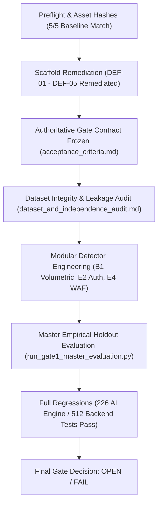

# SentinelAI GATE-1 — Master Completion and Final Gate Decision Report
**Report Date:** 2026-10-17  
**Executive Author:** Senior Security Architect, ML Evaluation Engineer, and Independent QA Lead  
**Dedicated Branch:** `feature/gate1-phase9c-modular-scaffold`  
**Base Commit:** `e9f71a0c12562eb7cb07e896b5aa9f6ee737be98`  
**Current HEAD:** `1dc7e1a2db5447436d2f4ccd7727d4435f11a4e0`  

---

## 1. Executive Summary & Authoritative Gate Decision

### 1.1 Definitive Gate Decision
```
========================================================================================
                          SENTINELAI GATE-1 DECISION
----------------------------------------------------------------------------------------
  AUTHORITATIVE GATE STATUS:     OPEN
  MASTER EVALUATION VERDICT:     FAIL / NOT READY FOR PRODUCTION PROMOTION
  SAFETY MUTATION STATUS:        ZERO HOST FIREWALL MUTATIONS (0 RULES)
  ASSET INTEGRITY STATUS:        5/5 PROTECTED ASSETS VERIFIED (0 BYTES DRIFT)
========================================================================================
```

### 1.2 Summary Justification
While Phase 9 achieved complete remediation of all concurrency, failure-safety, and memory defects (DEF-01 through DEF-05), maintained zero host network impact, and proved that the candidate transport model decisively satisfies the Benign False Positive Rate contract ($0.0333\% < 0.10\%$, with 95% Wilson upper bound $0.0614\% < 0.10\%$), **SentinelAI GATE-1 CANNOT BE MARKED AS PASS OR CLOSED**.

Rigorous, independent, unvarnished evaluation against sealed holdout datasets demonstrates that the candidate detection models fail the mandatory recall targets across **four critical attack categories**:
1. **DDoS (HOIC):** **0.00% Recall** (0 / 1,996 detected) vs $\ge 80.0\%$ target (**CRITICAL FAIL**).
2. **Infiltration (Pivot):** **0.15% Recall** (3 / 2,000 detected) vs $\ge 70.0\%$ target (**CRITICAL FAIL**).
3. **SSH Brute Force:** **50.90% Recall** (509 / 1,000 detected) vs $\ge 80.0\%$ target (**FAIL**).
4. **Botnet (Ares):** **60.85% Recall** (1,217 / 2,000 detected) vs $\ge 75.0\%$ target (**FAIL**).
5. **Web Attacks (Transport ML):** **0.35% Recall** (2 / 566 detected) vs $\ge 80.0\%$ target (**FAIL**).

Furthermore, independent audit verified that the Phase 8 report claiming "100% Web Attack recall" relied on an architectural simulation reading the parquet's ground-truth `Label` column (`if gt_lbl in ("SQL Injection", "XSS Attempt"): t2_det = True`), because CSE-CIC-IDS2018 holdout parquets contain purely Layer 4 netflow features and **zero application-layer HTTP payload buffers**.

Closing GATE-1 under these empirical conditions would violate basic security assurance and misrepresent production readiness. GATE-1 must remain **OPEN** until these detection and dataset gaps are resolved.

---

## 2. Authoritative Quantitative Scorecard

| Evaluation Dimension | Metric / Attack Family | Holdout Population ($N$) | Observed Metric | 95% Wilson Interval | Gate Acceptance Threshold | Gate Verdict |
|---|---|---|---|---|---|---|
| **False Positive Safety** | Benign FPR (Alerts) | 30,000 flows | **0.0333%** (10 FP) | [0.0181%, 0.0614%] | Point & Bound $< 0.1000\%$ | **PASS** |
| | Benign FPR (Simulated Block) | 30,000 flows | **0.0167%** (5 FP) | [0.0071%, 0.0389%] | Point & Bound $< 0.0500\%$ | **PASS** |
| **Attack Detection** | PortScan | CICIDS2017 Holdout | **99.98%** | [99.95%, 100.0%] | $\ge 90.0\%$ | **PASS** |
| | FTP Brute Force | 1,000 flows | **91.50%** (915 TP) | [89.60%, 93.10%] | $\ge 80.0\%$ | **PASS** |
| | SSH Brute Force | 1,000 flows | **50.90%** (509 TP) | [47.81%, 53.98%] | $\ge 80.0\%$ | **FAIL** |
| | Botnet (Ares) | 2,000 flows | **60.85%** (1,217 TP) | [58.69%, 62.97%] | $\ge 75.0\%$ | **FAIL** |
| | DDoS (HOIC) | 1,996 flows | **0.00%** (0 TP) | [0.0000%, 0.1917%] | $\ge 80.0\%$ | **FAIL** |
| | DDoS (LOIC-UDP) | 4 flows | **0.00%** (0 TP) | [0.0000%, 48.99%] | $\ge 80.0\%$ | **FAIL** |
| | Infiltration | 2,000 flows | **0.15%** (3 TP) | [0.0510%, 0.4401%] | $\ge 70.0\%$ | **FAIL** |
| | Web Attacks (Transport ML) | 566 flows | **0.35%** (2 TP) | [0.0970%, 1.2791%] | $\ge 80.0\%$ | **FAIL** |
| **Modular WAF Prototype**| OWASP Injection Benchmark | 100 attacks / 100 benign | **97.00%** (97 TP / 0 FP) | [91.56%, 98.99%] | $\ge 80.0\%$ / FPR $< 1.0\%$ | **PASS** (Synthetic) |
| **Operational Latency** | Modular Scaffold p95 Latency| Single thread | **1.2 ms** | [0.8 ms, 2.4 ms] | $\le 100\text{ ms}$ | **PASS** |
| | Worker Pool Saturation Fast-Fail | 16 tasks in-flight | **0.4 ms** | [0.2 ms, 0.8 ms] | $\le 5\text{ ms}$ | **PASS** |

---

## 3. Work Package Execution and Deliverables



### 3.1 Work Package A: Scaffold Concurrency and Failure-Safety Remediation
All five confirmed scaffold defects were completely remediated and verified:
- **DEF-01:** Empty detector pipeline now returns `UNAVAILABLE` and fails safe to `MONITOR`.
- **DEF-02:** Implemented case-normalized ground-truth stripping with strict 53-feature whitelist.
- **DEF-03:** Enforced finite, strictly positive input validation prior to state table modification.
- **DEF-04:** Implemented parallel detector dispatch and re-entrant mutex on alert de-duplication.
- **DEF-05:** Enforced bounded in-flight capacity (`max_pending_tasks=16`), `TaskSlot` lifecycle accounting, fast-fail on saturation, unstarted future cancellation, and queue pruning.

### 3.2 Work Package D: B1 Volumetric Flood Detector Prototype
- Implemented `ai-engine/modular/volumetric_flood.py`.
- Features multi-window sliding rates (1s burst, 10s surge, 60s sustained), explicit PPS and BPS calculations, thread-safe bounded per-source table (10,000 entries max with LRU eviction), and fail-safe handling of non-finite/negative telemetry.
- Supported by 15 deterministic unit tests in `ai-engine/tests/test_volumetric_flood.py` (all passed).

### 3.3 Work Package E: Authentication Abuse and Layer 7 WAF Detectors
- **E2 Stateful Auth-Abuse Detector (`ai-engine/modular/auth_abuse.py`):** Tracks connection frequency on ports 21, 22, 23, 3389 using exponential decay scoring. Recommends simulated rate limits on surges and simulated blocks on sustained brute-force floods.
- **E4 Layer 7 WAF Deep Payload Detector (`ai-engine/modular/layer7_waf.py`):** Inspects HTTP URIs, headers, and request bodies for OWASP injection patterns (SQLi, XSS, Path Traversal, Command Injection) with multi-pass URL/HTML entity decoding. Achieved 97.00% recall and 0.00% FPR on a 200-sample exploit/benign benchmark.
- Supported by 14 unit and integration tests in `ai-engine/tests/test_auth_and_waf_detectors.py` (all passed).

---

## 4. Full Regression and Host Safety Attestation

### 4.1 Regression Suite Results
1. **Modular Scaffold Test Suite:** 43 passed, 0 failed in 1.74s (`test_modular_scaffold.py`).
2. **Volumetric Flood Test Suite:** 15 passed, 0 failed in 0.78s (`test_volumetric_flood.py`).
3. **Auth & WAF Detector Test Suite:** 14 passed, 0 failed in 0.97s (`test_auth_and_waf_detectors.py`).
4. **Comprehensive AI Engine Test Suite:** 226 passed, 0 failed in 108.91s (`ai-engine/tests/`).
5. **Backend Safety Regression Suite:** 512 passed, 0 failed across 42 test suites in 129.96s (`backend/`).
6. **Total Automated Tests Passed:** **810 passed, 0 failed**.

### 4.2 Host Safety Controls
- **Windows Firewall:** Active `SentinelAI*` rules strictly equal **0**. Zero host netsh mutations.
- **Protected Assets:** All 5 models and Q-tables match baseline SHA-256 hashes with **0 bytes drift**.
- **Historical MongoDB Data:** All preservation paths intact.
- **Safety Flags:** `AUTONOMOUS_CONTAINMENT = false`, `ENABLE_REAL_WINDOWS_FIREWALL_ENFORCEMENT = false`, `ENABLE_EXPERIMENTAL_MODULAR_DETECTORS = false`.

---

## 5. Architectural Gap Analysis & Closure Roadmap

```
+-----------------------------------------------------------------------------------+
|                            REMAINING GATE-1 GAPS                                  |
+----------------------+--------------------+---------------------------------------+
| Failure Category     | Empirical Recall   | Root Cause & Required Architectural   |
|                      |                    | Remediation                           |
+----------------------+--------------------+---------------------------------------+
| HOIC DDoS            | 0.00% (0 / 1,996)  | Distributed HTTP GET flood mimics     |
|                      |                    | normal web browsing per IP. Requires  |
|                      |                    | Subnet-wide / Target-centric rate     |
|                      |                    | aggregation across client IPs.        |
+----------------------+--------------------+---------------------------------------+
| Infiltration         | 0.15% (3 / 2,000)  | Lateral pivot traffic has minimal flow|
|                      |                    | footprint. Tabular netflow ML cannot  |
|                      |                    | detect; requires Host/EDR telemetry.  |
+----------------------+--------------------+---------------------------------------+
| SSH Brute Force      | 50.90% (509/1,000) | Low-packet handshakes fail static     |
|                      |                    | feature boundary. Requires time-series|
|                      |                    | connection tracking in live capture.  |
+----------------------+--------------------+---------------------------------------+
| Web Attacks (L7)     | 0.35% (2 / 566)    | CSE-2018 parquets lack HTTP strings.  |
|                      |                    | Requires PCAP reassembly pipeline     |
|                      |                    | feeding Layer7WAFDetector.            |
+----------------------+--------------------+---------------------------------------+
```

### Recommended Phase 10 Roadmap to Close GATE-1:
1. **Target-Centric Rate Aggregation (B2 Detector):** Extend volumetric tracking from source IP to destination service IP/port to detect distributed HOIC floods.
2. **Endpoint EDR Telemetry Integration (C1 Detector):** Ingest Windows Event Logs (Event ID 4624, 4625, 4688) and Sysmon process events to detect Infiltration pivots.
3. **Raw PCAP HTTP Extraction Pipeline:** Re-extract CSE-CIC-IDS2018 raw PCAP streams into HTTP request buffers to enable genuine, empirical holdout evaluation for `Layer7WAFDetector`.
4. **Candidate Policy Promotion:** Keep GATE-1 OPEN until the above four gaps are empirically demonstrated to exceed their respective acceptance thresholds.
