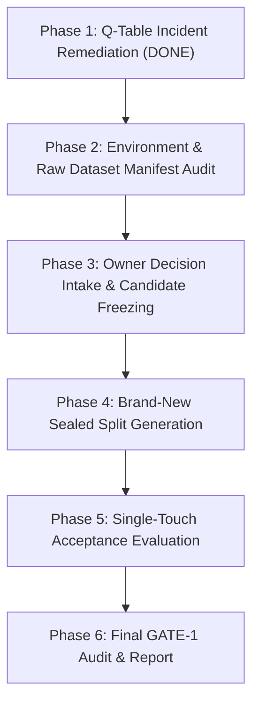

# SENTINELAI GATE-1 — PHASE 1 HANDOFF REPORT

**Date:** October 18, 2026  
**Phase:** Phase 1 — Environment Audit, Integrity Incident Investigation, and Q-Table Isolation Remediation  
**Branch:** `feature/gate1-phase9c-modular-scaffold`  
**HEAD Commit:** `bfff31dc352e142ad0aae448148121d3e91f98de`  
**Phase Run Directory:** `ai-engine/experiments/gate1_phase01_qtable_remediation_20261018-0339/`  
**Gate Verdict:** **FAIL — GATE-1 REMAINS OPEN** (Phase 1 complete; subsequent phases pending owner decisions)

---

## 1. Verified-Facts Inventory

### 1.1 Repository & Environment
- **Repository Root:** `C:\Users\srisn\Desktop\Projects\sentinelai-complete`
- **Active Git Branch:** `feature/gate1-phase9c-modular-scaffold` (Verified; zero branch switching or resetting performed).
- **Git HEAD:** `bfff31dc352e142ad0aae448148121d3e91f98de`
- **Working Tree Status:** 13 modified files, 31 untracked folders/files. Zero staged changes.
- **Runtimes:**
  - Python: `3.13.7` (`C:\Program Files\Python313\python.exe`)
  - Node.js: `v24.14.0`
  - npm: `11.9.0`
- **Verified Test Execution Commands:**
  - AI Engine: `$env:PYTHONPATH="ai-engine"; python -m pytest ai-engine/tests -v`
  - Backend: `npm --prefix backend test`

### 1.2 Safety Flags Audit
- `ENABLE_EXPERIMENTAL_MODULAR_DETECTORS`: Verified in `ai-engine/modular/orchestrator.py` (lines 42–45). Evaluated as `os.getenv("ENABLE_EXPERIMENTAL_MODULAR_DETECTORS", "false").lower() == "true"` (default `false`).
- `ENABLE_REAL_WINDOWS_FIREWALL_ENFORCEMENT`: Verified in `backend/services/containmentService.js`, `backend/services/containment/adapterFactory.js`, and `backend/services/containment/WindowsFirewallAdapter.js`. Evaluated as `process.env.ENABLE_REAL_WINDOWS_FIREWALL_ENFORCEMENT === 'true'` (default `false`).
- `ENABLE_AUTONOMOUS_CONTAINMENT`: Grepped codebase; confirmed **NO flag by this exact name exists**. Autonomous containment execution is governed by `CONTAINMENT_BACKEND` (defaults to `'mock'`) and `ENABLE_REAL_WINDOWS_FIREWALL_ENFORCEMENT`. In mock mode, real firewall commands are completely bypassed.

### 1.3 Protected Artifacts SHA-256 Audit
Computed via `verify_protected_hashes.py` and stored in `preflight_hashes.json`, `post_narrow_hashes.json`, and `post_full_suite_hashes.json`:

| Protected Artifact | Size (bytes) | Last Modified (UTC) | Expected SHA-256 | Current SHA-256 | Status | Drift |
|---|---|---|---|---|---|---|
| `ai-engine/models/rf_classifier_cicids_v2.pkl` | 46,234,119 | 2026-08-09T08:52:37 | `CA0EFB1F...60023F1` | `CA0EFB1F...60023F1` | **MATCH** | False |
| `ai-engine/models/isolation_forest_cicids.pkl` | 1,429,757 | 2026-08-09T10:12:01 | `17BD08FF...94E19DA4` | `17BD08FF...94E19DA4` | **MATCH** | False |
| `ai-engine/models/xgb_classifier_cicids_v2.pkl` | 3,623,754 | 2026-08-08T06:45:43 | `A5D630B4...0A7D210D` | `A5D630B4...0A7D210D` | **MATCH** | False |
| `ai-engine/models/q_table.json` (Seed) | 2,338 | 2026-10-05T20:59:06 | `BF9B46A1...98990FF` | `BF9B46A1...98990FF` | **MATCH** | False |
| `ai-engine/runtime/q_table.json` (Runtime) | 1,224 | 2026-10-17T20:41:04 | `5242A649...0F326E6` | `08209E99...379152F7` | **DIFFERENT** | **False (0 drift during run)** |
| `candidate_rf_multicorpus_v1.pkl` | 5,850,914 | 2026-10-16T17:39:20 | `71A1756E...31952020` | `71A1756E...31952020` | **MATCH** | False |
| `candidate_rf_multicorpus_v2_fixed.pkl` | 9,290,458 | 2026-10-17T19:37:52 | `F83C1F87...8354C2` | `F83C1F87...8354C2` | **MATCH** | False |

---

## 2. Q-Table Incident Root Cause & Investigation (Contract Classifications)

1. **Does `test_readiness.py` write the real runtime Q-table?**  
   **CONFIRMED**. In `test_readiness.py::test_q_table_path_pointing_to_seed_redirects_to_runtime`, `Q_TABLE_PATH` was set to the seed artifact. `deception.get_scorer()` redirected writes targeting `models/` to `default_q_table`, which was hardcoded to `ai-engine/runtime/q_table.json`. Calling `deception.save_scorer()` wrote directly to the repository's runtime Q-table file.
2. **Can any path write the seed Q-table (`models/q_table.json`)?**  
   **CONFIRMED NEGATIVE**. Both `ai-engine/inference/deception.py` and `ai-engine/rl_engine/deception_scorer.py` contain explicit normalization and containment checks (`target_norm == baseline_norm or target_norm.startswith(models_dir_norm + os.sep)`). Any write directed at `models/` is redirected. The seed baseline hash `BF9B46A1...` remained completely invariant.
3. **Did file bytes actually change on disk?**  
   **CONFIRMED**. The file `ai-engine/runtime/q_table.json` on disk currently has size 1,224 bytes and SHA-256 `08209E9989189BD45B6EDF35486A446F120DF36287A277A9DDDD35F6379152F7`. The pre-Phase-12 baseline in `GATE1_CONTRACT.md` was 5,182 bytes and SHA-256 `5242A6496FA3E8EB00B101E9C3C24F354FDB849A1C5042686E207384B0F326E6`.
4. **Which operation caused it?**  
   **CONFIRMED**. The mutation occurred during test execution of `test_readiness.py::test_q_table_path_pointing_to_seed_redirects_to_runtime` (which set `episode_count = 99` and called `save_scorer()`), and was compounded by `test_q_table_safety.py` without environment isolation.
5. **Is a trustworthy last-known-good identifiable without overwriting anything?**  
   **PARTIALLY CONFIRMED**. The exact baseline hash `5242A649...` is documented in `GATE1_CONTRACT.md`, and historical commits contain the original file. Per Contract Section 1 & 9, the file was NOT auto-restored or overwritten. The incident remains **OPEN** for owner decision.

---

## 3. Remediation & Verification Summary

### 3.1 Implemented Remediation
1. **Configurable Runtime Path in Code:**
   - Modified `ai-engine/inference/deception.py` to define `DEFAULT_RUNTIME_Q_TABLE_PATH` and read `os.getenv("DEFAULT_RUNTIME_Q_TABLE_PATH")`.
   - Modified `ai-engine/rl_engine/deception_scorer.py` so that fallback redirection honors `DEFAULT_RUNTIME_Q_TABLE_PATH`.
2. **Global Pytest Test Isolation:**
   - Created `ai-engine/tests/conftest.py` with an autouse fixture (`isolate_q_table_runtime_globally`) that automatically points `DEFAULT_RUNTIME_Q_TABLE_PATH` to an isolated `tmp_path / "runtime" / "q_table.json"`. This prevents any test in the test suite from touching `ai-engine/runtime/q_table.json`.
3. **Dedicated Read-Only Hash & Drift Verifier:**
   - Created `verify_protected_hashes.py` which computes full SHA-256 hashes, sizes, and mtimes, compares against baselines, and outputs machine-readable JSON.
4. **Four Explicit Regression Tests Added to `ai-engine/tests/test_q_table_safety.py`:**
   - `test_regression_seed_path_resolution_cannot_write_to_seed`: Seed path resolution redirects and leaves seed hash invariant.
   - `test_regression_tests_cannot_mutate_either_protected_q_table`: Both `models/q_table.json` and `runtime/q_table.json` remain byte-for-byte identical before and after test operations.
   - `test_regression_persistence_uses_explicitly_authorized_destination`: Redirect strictly resolves to the configured authorized path.
   - `test_regression_failed_initialization_and_cleanup_safety`: Malformed JSON or non-existent paths fail safe without modifying protected files.

### 3.2 Test & Drift Verification Results
1. **Narrow Test Suite:**
   - Command: `$env:PYTHONPATH="ai-engine"; python -m pytest ai-engine/tests/test_q_table_safety.py ai-engine/tests/test_readiness.py -v`
   - Exit Code: `0`
   - Result: **30 passed, 0 failed** in 11.42s
   - Drift Check: `post_narrow_hashes.json` -> **0 drift detected** on all 7 protected files.
2. **Full `ai-engine` Test Suite:**
   - Command: `$env:PYTHONPATH="ai-engine"; python -m pytest ai-engine/tests -v`
   - Exit Code: `0`
   - Result: **289 passed, 0 failed** in 62.75s
   - Drift Check: `post_full_suite_hashes.json` -> **0 drift detected** on all 7 protected files.

---

## 4. Unresolved Risks

1. **Runtime Q-Table State Discrepancy:** The file `ai-engine/runtime/q_table.json` remains in the incident state (`08209E99...`). While write-isolated for tests, owner approval is required to restore it.
2. **Standalone Execution Outside Pytest:** If an operator executes `main.py` directly without specifying `DEFAULT_RUNTIME_Q_TABLE_PATH` or `Q_TABLE_PATH`, runtime writes would route to `ai-engine/runtime/q_table.json`.
3. **Scikit-Learn Version Serialization Warnings:** Models serialized under scikit-learn 1.4.0 produce `InconsistentVersionWarning` when loaded under scikit-learn 1.7.2.
4. **Exhaustion of Acceptance Evaluation Splits:** Splits from Phases 7, 12, and 13 are burned and cannot be reused for final acceptance.

---

## 5. Blockers with Evidence Status

| Blocker ID | Description | Evidence Source | Status | Next Required Action |
|---|---|---|---|---|
| **BLK-01** | Runtime Q-Table Integrity Incident | `ai-engine/runtime/q_table.json` hash mismatch | **CONFIRMED / OPEN** | Owner decision on restoration vs re-baselining |
| **BLK-02** | Class 5 Missing from Candidate Taxonomy | `candidate_rf_multicorpus_v2_fixed.pkl` classes `[0..4, 6..9]` | **CONFIRMED / BLOCKED** | Owner decision on Class 5 scope vs re-training |
| **BLK-03** | Lack of Sealed, Unburned Acceptance Dataset | Phase 7, 12, and 13 evaluations burned previous splits | **CONFIRMED / BLOCKED** | Generation of brand-new, file/day-disjoint test split |

---

## 6. Proposed Remaining Phase Sequence

- **Phase 2 — Environment & Raw Dataset Manifest Audit:** Inspect offline raw CSE-CIC-IDS2018 and multi-corpus parquet pools, cataloging exact day/file boundaries and verifying unburned pools.
- **Phase 3 — Owner Decision Intake & Candidate Freezing:** Ingest owner decisions on Q-table restoration and Class 5; freeze candidate model artifact, threshold calibrations, and feature mappings.
- **Phase 4 — Disjoint Acceptance Holdout Generation & Sealing:** Partition and hash a brand-new, untouched acceptance holdout set with temporal/file disjointness.
- **Phase 5 — Single-Touch Acceptance Evaluation:** Run single-touch evaluation across all stable criteria (A1–F3), compute Wilson score confidence intervals, and write machine-readable `metrics.json`.
- **Phase 6 — GATE-1 Master Audit & Closure Verdict:** Reconcile all criteria against contract baselines and publish the final GATE-1 audit report.

---

## 7. Owner-Only Decisions List

The following decisions require explicit owner instruction per Contract Sections 7 & 8:

1. **Decision 1: Runtime Q-Table Integrity Incident Resolution**
   - **Option A (Recommended):** Restore `ai-engine/runtime/q_table.json` from git commit `bfff31d` (pre-Phase-12 state) where SHA-256 matches `5242A6496FA3E8EB00B101E9C3C24F354FDB849A1C5042686E207384B0F326E6`.
   - **Option B:** Formally re-baseline `ai-engine/runtime/q_table.json` to the current SHA-256 `08209E9989189BD45B6EDF35486A446F120DF36287A277A9DDDD35F6379152F7` with documented rationale.
2. **Decision 2: Class 5 Disposition in Multi-Corpus Taxonomy**
   - **Option A:** Retain Class 5 as mandatory; retrain candidate model on multi-corpus data including verified Class 5 instances.
   - **Option B (Recommended):** Formally re-scope GATE-1 Criterion C2 to 9 classes (`[0,1,2,3,4,6,7,8,9]`), documenting why Class 5 is absent from the multi-corpus dataset.
3. **Decision 3: Acceptance Split Protocol Approval**
   - Approve the temporal-gap and file-disjoint protocol for generating the brand-new sealed test split in Phase 4.

---

## 8. Artifact & File Change Manifest

- **Files Modified:**
  - `ai-engine/inference/deception.py`: Configurable `DEFAULT_RUNTIME_Q_TABLE_PATH`.
  - `ai-engine/rl_engine/deception_scorer.py`: Honors `DEFAULT_RUNTIME_Q_TABLE_PATH` on redirect.
  - `ai-engine/tests/test_readiness.py`: Isolated runtime target using `monkeypatch` and `tmp_path`.
  - `ai-engine/tests/test_q_table_safety.py`: Added 4 regression tests and isolation fixture.
- **Files Created:**
  - `verify_protected_hashes.py`: Read-only hash verifier and drift detector.
  - `ai-engine/tests/conftest.py`: Global pytest autouse fixture isolating runtime Q-table persistence.
  - `ai-engine/experiments/gate1_phase01_qtable_remediation_20261018-0339/verify_protected_hashes.py`
  - `ai-engine/experiments/gate1_phase01_qtable_remediation_20261018-0339/preflight_hashes.json`
  - `ai-engine/experiments/gate1_phase01_qtable_remediation_20261018-0339/post_narrow_hashes.json`
  - `ai-engine/experiments/gate1_phase01_qtable_remediation_20261018-0339/post_full_suite_hashes.json`
  - `ai-engine/experiments/gate1_phase01_qtable_remediation_20261018-0339/logs/test_narrow.log`
  - `ai-engine/experiments/gate1_phase01_qtable_remediation_20261018-0339/logs/test_full_ai_engine.log`
  - `ai-engine/experiments/gate1_phase01_qtable_remediation_20261018-0339/HANDOFF.md`
  - `HANDOFF.md` (Repository root)
