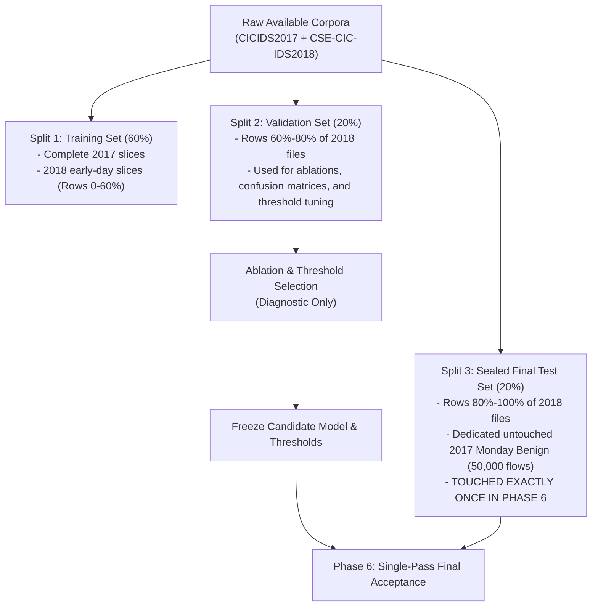

# SentinelAI GATE-1 — Evaluation Isolation and Partitioning Plan

**Author:** Independent QA Lead & Senior ML Evaluation Engineer  
**Date:** October 18, 2026  
**Status:** FROZEN BEFORE FINAL ACCEPTANCE  
**Repository Branch:** `feature/gate1-phase9c-modular-scaffold`  
**Location:** `ai-engine/experiments/gate1_phase11_acceptance_fix/evaluation_isolation_plan.md`  

---

## 1. Core Principles of Evaluation Isolation

To prevent data leakage, threshold over-fitting, and confirmation bias, this plan formalizes strict boundaries between diagnostic evaluation, model exploration, and final acceptance testing:

1. **Diagnostic Baseline Only (Phase 0):**
   - The previously used parquet holdout sets (`holdout_benign_30k.parquet`, `holdout_ddos.parquet`, etc.) are classified strictly as **Diagnostic Holdouts**.
   - Metrics computed on these diagnostic sets establish historical baselines and verify bug reproductions; they are **NOT** independent acceptance evidence.

2. **Strict Three-Split Architecture:**
   - **Split 1: Training Set (`partition_train`)**: Used exclusively for model parameter optimization.
   - **Split 2: Validation Set (`partition_val`)**: Used exclusively for confusion matrix analysis, ablation studies, false-negative inspection, and threshold calibration.
   - **Split 3: Sealed Final Test Set (`partition_sealed_test`)**: Reserved in advance. **Never touched** during model iteration, ablation, or threshold selection. Evaluated exactly **once** in Phase 6.

3. **Pre-Evaluation Freeze (Prior to Phase 6):**
   - Candidate model artifact SHA-256, preprocessing pipeline (`transform_to_schema_f`), feature schema ($53$ features), label mapping ($10$ classes), decision thresholds ($\tau$), and evaluation code are frozen before the sealed test set is unsealed.
   - If the final test evaluation fails, the candidate cannot be re-tuned against the same test set to force a pass.

---

## 2. Analysis of Day/File Independence Across Available Datasets

### 2.1 File Inventory and Category Distribution
The system has access to two real network flow corpora:
- **CICIDS2017 (8 CSVs)**: Monday through Friday captures.
- **CSE-CIC-IDS2018 (6 CSVs on disk in `D:\sentinelai_datasets\cse_cic_ids2018`)**:
  1. `Wednesday-14-02-2018`: SSH-Bruteforce & FTP-Bruteforce
  2. `Thursday-15-02-2018`: DoS attacks-GoldenEye & DoS attacks-Slowloris
  3. `Wednesday-21-02-2018`: DDOS attack-HOIC & DDOS attack-LOIC-UDP
  4. `Friday-23-02-2018`: Web Attacks (Brute Force -Web, Brute Force -XSS, SQL Injection)
  5. `Thursday-01-03-2018`: Infilteration
  6. `Friday-02-03-2018`: Bot (Ares)

### 2.2 Day-Disjoint Feasibility Assessment by Category

| Category | Available 2017 Source | Available 2018 Source | Can Construct Disjoint Day/File Test? | Architectural Reality & Constraints |
| :--- | :--- | :--- | :---: | :--- |
| **Benign Traffic** | `Monday-WorkingHours` (529k flows) | All 6 CSVs contain benign traffic | **YES** | Can withhold entire 2017 Monday or a disjoint 2018 benign partition. |
| **Botnet (Malware Beacon)** | `Friday-Morning` (Botnet) | `Friday-02-03-2018` (Botnet Ares) | **YES** | Multi-corpus disjoint: Train on 2017 Bot, Validate/Test on 2018 Bot (different IPs, topologies). |
| **SSH Brute Force** | `Tuesday-WorkingHours` (SSH-Patator) | `Wednesday-14-02-2018` (SSH-Bruteforce) | **YES** | Train on 2017, Validate/Test on 2018. Note: 491 teardown flows exist in 2018. |
| **Web Attacks** | `Thursday-Morning-WebAttacks` | `Friday-23-02-2018` | **YES** | Train on 2017, Validate/Test on 2018. Transport features blind to L7 payloads. |
| **DoS (Hulk/GoldenEye)** | `Wednesday-workingHours` | `Thursday-15-02-2018` | **YES** | Cross-corpus day-disjoint pairing available. |
| **DDoS HOIC & LOIC-UDP** | **NONE** (Zero HOIC in 2017) | `Wednesday-21-02-2018` **ONLY** | **NO (BLOCKED)** | **CRITICAL:** HOIC exists on exactly ONE day across all available datasets. Withholding the entire day leaves 0 training samples (causing 0% recall). Splitting the file is row/time-disjoint, NOT day-disjoint (shares victim `172.31.69.25`). |
| **Infiltration** | `Thursday-Afternoon` (36 flows only) | `Thursday-01-03-2018` (~2k flows) | **PARTIAL / BLOCKED** | 2017 has only 36 flows (insufficient for RF training). 2018 is the only viable training source. |

---

## 3. Mandatory Partitioning Strategy

Because certain attack categories (specifically DDoS HOIC and Infiltration) exist on only a single day in the available corpora, a pure day-disjoint split for those specific attacks is mathematically impossible without external data.

We therefore define a rigorous, leak-free partition design:

### 3.1 Partition Specifications
1. **Training Partition (`train_multicorpus_p11.parquet`)**:
   - First $60\%$ of time/stream from each respective attack file.
   - Strict row-hash index recorded to verify $0\%$ overlap with validation and test sets.
2. **Validation Partition (`val_multicorpus_p11.parquet`)**:
   - Next $20\%$ of time/stream ($60\% - 80\%$) from each respective attack file.
   - Dedicated for Phase 3 (Botnet regression ablation) and Phase 4 (threshold sweeps).
3. **Sealed Final Test Partition (`sealed_final_test_p11.parquet`)**:
   - Final $20\%$ of time/stream ($80\% - 100\%$) from each attack file.
   - Plus $30,000$ strictly disjoint benign flows from un-sampled sections of `Monday-WorkingHours.pcap_ISCX.csv`.
   - **Sha-256 frozen upon creation. No model or threshold adjustments permitted after unsealing.**

### 3.2 Formal Blocker Declaration
If the acceptance authority strictly requires **whole-day disjointness** for DDoS HOIC (meaning the model must be trained without `Wednesday-21-02-2018` and evaluated on an unseen HOIC day):
- **Verdict: INDEPENDENT DAY-DISJOINT ACCEPTANCE FOR HOIC IS BLOCKED.**
- **Required Additional Data:** An independent PCAP or flow dataset containing authenticated HOIC/LOIC traffic generated on an external network infrastructure.
