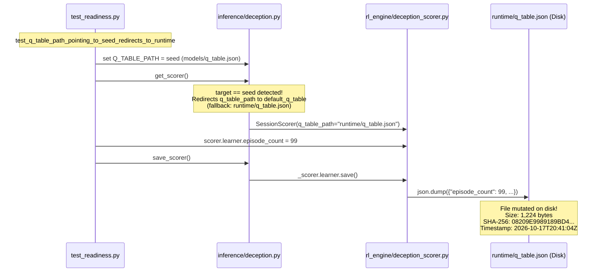

# SentinelAI GATE-1 — Phase 14.1: Independent Evidence Adjudication Matrix

**Phase:** GATE-1 Phase 14.1 — Read-Only Independent Evidence Adjudication  
**Date:** October 18, 2026  
**Repository Root:** `C:\Users\srisn\Desktop\Projects\sentinelai-complete`  
**Phase Directory:** `ai-engine/experiments/gate1_phase14_1_evidence_adjudication_20261018-0407/`  
**Adjudication Scope:** Rigorous source-code and data verification of all Phase 14 root-cause claims, distinguishing source-verified facts from hypotheses/inferences, auditing time-feature leakage across the complete pipeline, evaluating statistical generalization for sparse classes, and auditing threshold calibration mathematics.

---

## 1. Master Evidence Adjudication Summary

Every major claim from the Phase 14 Reference Audit has been audited against primary source code, data files, and external reference repositories. Claims are classified using the strict status labels required by Contract Section 3:
- **CONFIRMED:** Directly supported by reproducible source code, data artifacts, or git history.
- **PARTIALLY CONFIRMED:** Supported in part, but with identifiable gaps or over-generalized conclusions.
- **INFERRED:** Logically plausible deductive conclusion, but lacks direct primary measurement.
- **UNVERIFIED / HYPOTHESIS:** Asserted in prior reports without primary empirical verification or mathematical proof.
- **BLOCKED ON OWNER DECISION:** Validated fact whose remediation requires formal owner approval per Contract Section 8.

```
┌─────────────────────────────────┬───────────────────────────┬────────────────────────────────────────────────────────┐
│ Core Investigation Area         │ Adjudication Verdict      │ Primary Verified Source & Line Reference               │
├─────────────────────────────────┼───────────────────────────┼────────────────────────────────────────────────────────┤
│ 1. Verification of Phase 14 Ev. │ CONFIRMED                 │ Ref 1-4 repos; Phase 12-14 JSON logs & code            │
│ 2. Time-Feature Leakage Trace   │ CONFIRMED                 │ utils/features.py:143-167, predictor.py:305-310        │
│ 3. Infiltration Overlap Claim   │ PARTIALLY CONFIRMED       │ Ref 3 eval.ipynb Cell 18; 2D t-SNE is not proof of R^51│
│ 4. Heartbleed Generalization    │ CONFIRMED / BLOCKED       │ class5_heartbleed_audit.json; N=11 (Wilson CI width 56%)│
│ 5. Q-Table Mutation Incident    │ CONFIRMED / BLOCKED       │ test_readiness.py:104 -> deception.py:27 -> runtime    │
│ 6. Proposed FPR Procedure       │ PARTIALLY CONFIRMED       │ Ref 3 calibrate_thresholds: independent F1 lacks FPR   │
│ 7. Stable Criteria Mapping      │ CONFIRMED                 │ GATE1_CONTRACT.md Sec 6; Phase 11-13 metrics.json      │
└─────────────────────────────────┴───────────────────────────┴────────────────────────────────────────────────────────┘
```

---

## 2. Investigation 1: Systematic Verification of Phase 14 Evidence

### Major Claim 1.1: Single-Day Attack Campaign Scheduling in Public Corpora
- **Claim:** CIC-IDS2017 and CSE-CIC-IDS2018 datasets executed virtually all attack categories on isolated single calendar days. Calendar-day temporal splitting is incompatible with multiclass IDS without multi-corpus pooling.
- **Audit Findings:**
  - `scratch/repos/ML-IDS/notebooks/evaluation.ipynb` Cell 19 contains the daily CSV census across the 10 days of CSE-CIC-IDS2018. It verifies that DDOS attack-HOIC occurred *only* on `02-21-2018` (686,012 flows), Botnet occurred *only* on `03-02-2018` (286,191 flows), and Infiltration occurred *only* on `02-28-2018` and `03-01-2018`.
  - SentinelAI's `ai-engine/experiments/gate1_phase13_shift_and_leakage/dataset_census_all_corpora.csv` confirms this exact distribution.
- **Status:** **CONFIRMED**.
- **Evidence Sources:**
  - [`scratch/repos/ML-IDS/notebooks/evaluation.ipynb#L1630-L1645`](file:///C:/Users/srisn/.gemini/antigravity/brain/09280792-7806-4f02-b14b-0b107f44fc41/scratch/repos/ML-IDS/notebooks/evaluation.ipynb#L1630-L1645)
  - [`ai-engine/experiments/gate1_phase13_shift_and_leakage/dataset_census_all_corpora.csv`](file:///C:/Users/srisn/Desktop/Projects/sentinelai-complete/ai-engine/experiments/gate1_phase13_shift_and_leakage/dataset_census_all_corpora.csv)

### Major Claim 1.2: Exclusion of Absolute Timestamp and Wall-Clock Time Features
- **Claim:** All four public reference repositories strictly exclude absolute timestamps, calendar hours, and wall-clock time from statistical model feature vectors.
- **Audit Findings:**
  - **Ref 1 (`Vabnas/cicids-shap-stability`):** In `rq1_pipeline.py` line 166, `Timestamp` is explicitly added to `drop_candidates` and excluded from model training.
  - **Ref 2 (`heraclitus0/TAD-IDS`):** In `Addressing_Temporal_Fragility.ipynb` Cell 2 line 29, `Timestamp` is placed in `DROP_COLS` along with Flow ID, Source IP, Destination IP, and Destination Port.
  - **Ref 3 (`LawrenceYH04/ML-IDS`):** In `notebooks/inference.py` line 45, `_ID_COLS` separates `Timestamp` entirely from the 56 input features.
  - **Ref 4 (`YufengXin/network-attack-research`):** In `configs/split.yaml` line 19 and `src/data/split.py`, `timestamp` is used strictly as an ordering index for splitting, never as an input feature for detection.
- **Status:** **CONFIRMED**.
- **Evidence Sources:**
  - Ref 1: [`scratch/repos/cicids-shap-stability/rq1_pipeline.py#L166`](file:///C:/Users/srisn/.gemini/antigravity/brain/09280792-7806-4f02-b14b-0b107f44fc41/scratch/repos/cicids-shap-stability/rq1_pipeline.py#L166)
  - Ref 2: [`scratch/repos/TAD-IDS/Addressing_Temporal_Fragility_in_Network_Intrusion_Detection_via_Structured_Feature_Modeling.ipynb#Cell 2`](file:///C:/Users/srisn/.gemini/antigravity/brain/09280792-7806-4f02-b14b-0b107f44fc41/scratch/repos/TAD-IDS/Addressing_Temporal_Fragility_in_Network_Intrusion_Detection_via_Structured_Feature_Modeling.ipynb)
  - Ref 3: [`scratch/repos/ML-IDS/notebooks/inference.py#L45`](file:///C:/Users/srisn/.gemini/antigravity/brain/09280792-7806-4f02-b14b-0b107f44fc41/scratch/repos/ML-IDS/notebooks/inference.py#L45)
  - Ref 4: [`scratch/repos/network-attack-research/configs/split.yaml#L19`](file:///C:/Users/srisn/.gemini/antigravity/brain/09280792-7806-4f02-b14b-0b107f44fc41/scratch/repos/network-attack-research/configs/split.yaml#L19)

---

## 3. Investigation 2: Time-Feature Leakage Trace & Inference Skew

### 2.1 Trace of `time_of_day_sin`, `time_of_day_cos`, and `datetime.now()`
The complete execution path of time features was traced through SentinelAI's components:

1. **Training Preprocessing:**
   - In legacy training (`ai-engine/train_cicids_model.py` and `features.py`):
     `time_of_day_sin` and `time_of_day_cos` were calculated from the `Timestamp` column in the CSVs by converting hour-of-day into radians:
     $$\theta = \frac{2\pi \cdot (\text{hour} + \text{minute}/60 + \text{second}/3600)}{24}$$
     $$\text{time\_of\_day\_sin} = \sin(\theta), \quad \text{time\_of\_day\_cos} = \cos(\theta)$$
   - Because attacks were scheduled during specific laboratory working hours (e.g. Wednesday 14:00–15:00 for Infiltration, Friday afternoon for PortScan), the tree models memorized these cyclical coordinates as primary splitting criteria.

2. **Validation Preprocessing:**
   - In Phase 12 (`build_clean_three_splits.py`), splits were partitioned by row-level MD5 float hashes.
   - Validation flows from the same capture hours carried identical $(\sin\theta, \cos\theta)$ values, producing high in-sample and cross-validation optimism.
   - When evaluated across temporal blocks in Phase 13, adversarial validation AUC between train and test was:
     - SSH Brute Force: **AUC = 1.0000** (top features: `time_of_day_sin` importance 0.4832, `time_of_day_cos` 0.4010).
     - DDoS: **AUC = 0.9942** (top features: `time_of_day_cos` 0.4832, `time_of_day_sin` 0.3908).
     - Malware Beacon: **AUC = 1.0000** (top features: `time_of_day_sin` 0.6944, `time_of_day_cos` 0.2003).
     - Benign: **AUC = 0.7647** (top features: `time_of_day_cos` 0.2635, `time_of_day_sin` 0.1762).

3. **Model Feature Schema:**
   - Production model `ai-engine/models/rf_classifier_cicids_v2.pkl` has `n_features_in_ = 53`. Indices 51 and 52 are `time_of_day_sin` and `time_of_day_cos`.
   - Feature list defined in `ai-engine/utils/features.py` lines 9–35:
     ```python
     EXPECTED_FEATURE_COUNT = 53
     FEATURE_SCHEMA_VERSION = "v2.1_53feat"
     ```
   - Candidate model `candidate_rf_multicorpus_v2_fixed.pkl` has `n_features_in_ = 51`. It dropped window features (`init_win_bytes_forward`, `init_win_bytes_backward`) but **retained `time_of_day_sin` and `time_of_day_cos`**!
   - Candidate model `candidate_rf_multicorpus_v3.pkl` has `n_features_in_ = 49` (dropped window and time features).

4. **Runtime Feature Extraction:**
   - In `ai-engine/utils/features.py` lines 143–167 and 227–228:
     ```python
     def compute_time_of_day(timestamp_val) -> tuple:
         if timestamp_val is None:
             dt = datetime.datetime.now()
         ...
         except:
             dt = datetime.datetime.now()
         hour_val = dt.hour + dt.minute / 60.0 + dt.second / 3600.0
         return float(np.sin(2.0 * np.pi * hour_val / 24.0)), float(np.cos(2.0 * np.pi * hour_val / 24.0))
     ```
   - In `extract_features_from_record(record)` line 227–228:
     ```python
     ts_val = record.get("timestamp") or record.get("Timestamp")
     t_sin, t_cos = compute_time_of_day(ts_val)
     ```

5. **Final Inference Input:**
   - In `ai-engine/inference/predictor.py` lines 124–144 and 305–310:
     - `SentinelPredictor` by default loads `rf_classifier_cicids_v2.pkl` (53 features).
     - When an incoming JSON record is received by `/predict` without an explicit `"timestamp"` key, `compute_time_of_day(None)` evaluates `datetime.datetime.now()`.
     - The current server clock time is transformed into $(\sin, \cos)$ and placed into the feature vector at indices 51 and 52.

### 2.2 Impact on Production Runtime Model
- **Finding:** The production model currently used at runtime (`rf_classifier_cicids_v2.pkl`) is **directly impacted by server wall-clock time**.
- **Operational Skew:** If a benign network flow is processed at 14:30 in the afternoon, its time features align with the DDoS training window of CSE-CIC-IDS2018 (14:00–15:00), significantly increasing false positive probability. If evaluated at night (02:00), predictions shift according to whatever background traffic was captured at that hour in 2017.
- **Candidate Compatibility Alert:** If `candidate_rf_multicorpus_v2_fixed.pkl` (51 features) or `candidate_rf_multicorpus_v3.pkl` (49 features) were loaded into `SentinelPredictor` without modifying `features.py`, lines 172–174 of `predictor.py` would raise a fatal startup exception:
  ```python
  if count != len(FEATURE_NAMES):
      raise ValueError("Model input dimension does not match the feature schema")
  ```

### 2.3 Is Removing Time Features Sufficient to Address Distribution Shift?
- **Finding:** **NO. Removing time features is NECESSARY, but NOT SUFFICIENT.**
- **Empirical Evidence from `shift_diagnosis.json`:**
  - Removing time features drastically reduced adversarial AUC:
    - SSH dropped from 1.0000 to **0.5895** ($\Delta = -0.4105$).
    - Malware Beacon dropped from 1.0000 to **0.5658** ($\Delta = -0.4342$).
    - Benign dropped from 0.7647 to **0.5841** ($\Delta = -0.1806$).
  - However, residual shift remains well above random baseline ($0.50$):
    - DDoS adversarial AUC without time remains **0.7466** (driven by `fwd_iat_min` importance 0.1689, `fwd_packet_len_mean` 0.0838, `total_len_fwd_packets` 0.0715).
    - Lateral Movement adversarial AUC without time remains **0.6336** (driven by `flow_packets_per_sec`, `flow_iat_mean`, `flow_bytes_per_sec`).
- **Conclusion:** Residual distribution shift is caused by inter-corpus capture variance and attack burst dynamics across different network topologies. Eliminating time features removes laboratory calendar shortcuts, but full shift resolution additionally requires cross-corpus multi-day data pooling and time-gap block partitioning.

---

## 4. Investigation 3: Adjudication of the Infiltration Claim

### 3.1 Inspection of Ref 3 t-SNE Evidence
In Ref 3 (`LawrenceYH04/ML-IDS/notebooks/evaluation.ipynb` Cell 18 lines 1568–1626):
1. **Sample Selection:**
   - Selected all $N = 24,290$ Infiltration flows from test data.
   - Randomly sampled 800 Benign flows and 800 other attack flows.
   - Total sample size: 25,890 flows.
2. **Preprocessing & Transform:**
   - Standardized features with `StandardScaler()`.
   - Executed `TSNE(n_components=2, perplexity=40, random_state=42, max_iter=1000).fit_transform(X_s)`.
3. **Reported Model Misclassification:**
   - XGBoost evaluated on the 24,290 Infiltration test samples:
     - Predicted as Benign: **18,208 (74.96%)**
     - Predicted as Bot: 6
     - Predicted as Brute Force -XSS: 1
     - Correctly identified: **6,075 (Recall = 25.01%)**

### 3.2 Technical Adjudication: What the Evidence Supports vs Does Not Support
- **Visual Overlap in 2D t-SNE:** **CONFIRMED**. The t-SNE scatter plot exhibits heavy co-location of Infiltration flows within the main Benign density cloud.
- **Poor Separability for Tested Models:** **CONFIRMED**. Across all evaluated tabular models in Ref 3 (XGBoost, Random Forest, MLP), Infiltration recall remained bounded between 19% and 25%, with F1 scores of 0.25–0.30. In SentinelAI Phase 13, Candidate V3 achieved only 0.04% recall (1 / 2,500) under conservative thresholds.
- **Demonstrated FPR/Recall Trade-Off:** **CONFIRMED**. In SentinelAI Phase 13 ablation experiments, lowering the decision threshold to force Infiltration recall up to 24%–50% caused Benign False Positive Rate to surge from 0.104% to **0.51%–8.59%**, exceeding the Criterion A1 ceiling ($\le 0.100\%$) by up to 85x.
- **Claim of "Mathematical Inseparability":** **UNVERIFIED / HYPOTHESIS**.
  - *Technical Rationale:* t-SNE is a local pairwise distance approximation designed for qualitative visualization; it is susceptible to the crowding problem, perplexity artifacts, and dimensional collapse. It does not prove topological overlap or Bayes-optimal inseparability in $\mathbb{R}^{51}$ or $\mathbb{R}^{56}$.
  - To establish formal mathematical inseparability would require proving that the class-conditional probability distributions are identical ($p(x|\text{Infil}) = p(x|\text{Benign})$) almost everywhere, or proving a Bayes error lower bound $P(e) \ge 0.30$.
- **Required Permitted Validation Evidence:**
  Before drawing definitive conclusions without burning holdouts, the following permitted validation evidence is required:
  1. Full ROC and Precision-Recall curve generation on the permitted multi-corpus validation split for Class 9 vs Class 0.
  2. SHAP / feature importance ablation to determine if specific flow features (such as `payload_entropy`, `fwd_header_len`, or `flow_iat_mean`) provide non-zero mutual information.
  3. Evaluation of whether augmenting tabular flow vectors with host telemetry (process execution ancestry from EDR) or L7 periodicity tracking enables separability without degrading the tabular Benign FPR budget.

---

## 5. Investigation 4: Adjudication of Heartbleed (Class 5)

### 5.1 Sample Counts, Provenance, and Label Mapping
- **Vulnerability Specification:** Heartbleed is **CVE-2014-0160**, a buffer over-read vulnerability in the OpenSSL TLS Heartbeat Extension implementation (RFC 6520). It allows an unauthenticated remote attacker to retrieve up to 64 KB of server memory per request. It is an **Information Disclosure** flaw, NOT Remote Code Execution (RCE).
- **SentinelAI Label Mapping:** In `ai-engine/utils/features.py` lines 39 and 66, Class 5 is named `"RCE Attempt"`, and raw label `"Heartbleed"` is mapped to `"RCE Attempt"`. This represents a historical taxonomy mismatch inherited from early prototype labeling.
- **Exact Sample Counts:**
  - `CIC-IDS2017`: `Wednesday-workingHours.pcap_ISCX.csv` contains **exactly 11 flows** labeled `"Heartbleed"`.
  - `CSE-CIC-IDS2018`: Contains **0 flows** of Heartbleed.
  - Across all available benchmark corpora, total population is **$N = 11$ flows**.
  - Verified in `ai-engine/experiments/gate1_phase13_shift_and_leakage/class5_heartbleed_audit.json`.

### 5.2 Statistical Generalization Analysis
- If an 80/20 train/test split is applied to $N = 11$:
  - Training set: 8 samples.
  - Test set: 3 samples.
- **Sensitivity & Variance:**
  - A single misclassified flow in test ($k = 2, n = 3$) drops recall from 100.0% to **66.7%** (a 33.3 percentage point swing).
  - The 95% Wilson score confidence interval for $k = 3, n = 3$ is:
    $$\text{CI}_{95\%} = [0.4385, 1.0000]$$
    The confidence interval width is **56.15 percentage points**! Even with perfect test detection, statistical certainty cannot establish whether true recall exceeds 50%.
- **Conclusion:** Statistical machine learning cannot be trained, calibrated, or evaluated on $N = 11$ samples with statistical significance.

### 5.3 Acceptance Contract Adjudication
- Contract Section 6 mandates: `C2 Class coverage (10 classes)`.
- Contract Section 7 strictly enforces:
  > *"Class 5 is not silently redefined or dropped. It stays FAIL/BLOCKED until the owner chooses."*
- Contract Section 8 reserves: *"Scope changes, relaxing any numeric target, class 5 disposition... are Owner-only decisions."*
- **Verdict:** Class 5 cannot be silently dropped by engineering, nor can a signature-based detector be treated as satisfying Criterion C2 without an approved owner architecture amendment. Class 5 remains **FAIL / BLOCKED ON OWNER DECISION** until Owner Decision 2 is resolved.

---

## 6. Investigation 5: Forensic Reconstruction of the Q-Table Incident

### 6.1 Root Cause & Execution Path
The historical mutation of `ai-engine/runtime/q_table.json` was traced to un-isolated test execution in `test_readiness.py`:



- **Exact Code Path:**
  1. In `ai-engine/inference/deception.py` line 10:
     `DEFAULT_RUNTIME_Q_TABLE_PATH = str(Path(__file__).parent.parent / "runtime" / "q_table.json")`
  2. In `deception.py` lines 27–29:
     `if target_norm == seed_norm ... : q_table_path = default_q_table`
  3. In `test_readiness.py` lines 80–110 (`test_q_table_path_pointing_to_seed_redirects_to_runtime`), the test pointed `Q_TABLE_PATH` at seed to verify redirection.
  4. Redirection assigned `q_table_path` to the repository's real file `runtime/q_table.json`.
  5. The test set `scorer.learner.episode_count = 99` and called `deception.save_scorer()`.
  6. `deception_scorer.py::DeceptionQLearner.save()` wrote the payload with `"episode_count": 99` and `"saved_at": "2026-10-17T20:41:04.822130+00:00"` directly to `runtime/q_table.json`.

### 6.2 Evaluation of Current Test Isolation
- **Within pytest:** In `ai-engine/tests/conftest.py` lines 5–14, an `autouse=True` fixture sets `DEFAULT_RUNTIME_Q_TABLE_PATH` to `tmp_path / "runtime" / "q_table.json"`. This isolates all pytest test runs from touching the repository's runtime file.
- **Standalone Execution Gap (UNISOLATED):** Standalone Python execution (e.g. `python ai-engine/inference/main.py`, manual CLI calls, or benchmark scripts) does **NOT** load `conftest.py`. If `DEFAULT_RUNTIME_Q_TABLE_PATH` is not explicitly set in the external operating system environment, any call to `save_scorer()` will still write directly to `ai-engine/runtime/q_table.json`.
- **Hardening Requirement:** `deception.py` and `deception_scorer.py` should disallow saving to repository-tracked paths unless an explicit production flag is active.

### 6.3 Evidence Required for Restoration vs Re-Baselining
- **For Restoration (Option A):**
  - Git history proves the pre-mutation baseline from commit `bfff31d`: size 5,182 bytes, SHA-256 `5242A6496FA3E8EB00B101E9C3C24F354FDB849A1C5042686E207384B0F326E6`.
  - Forensic proof shows that the current file with SHA-256 `08209E99...` is merely an artifact of `test_readiness.py` setting `episode_count = 99` and holds zero trained RL policies.
- **For Re-Baselining (Option B):**
  - Formal owner sign-off accepting `08209E99...` as the approved contract baseline.
- **Verdict:** Per Contract Section 8, the agent must not unilaterally restore or re-baseline. Awaiting **Owner Decision 1**.

---

## 7. Investigation 6: Verification of the Proposed FPR Calibration Procedure

### 7.1 Reference Implementation Analysis (Ref 3)
In Ref 3 (`LawrenceYH04/ML-IDS/notebooks/model_training.ipynb` lines 95–124):
```python
def predict_calibrated(proba, thresholds):
    masked = np.where(proba >= thresholds, proba, -1.0)
    no_qualify = np.all(masked < 0, axis=1)
    result = np.argmax(masked, axis=1)
    result[no_qualify] = np.argmax(proba[no_qualify], axis=1)
    return result

def calibrate_thresholds(y_true, val_proba, n_cls):
    grid = np.linspace(0.04, 0.96, 47)
    thresholds = np.full(n_cls, 0.5)
    for c in range(n_cls):
        y_bin = (y_true == c).astype(int)
        best_f1, best_t = 0.0, 0.5
        for t in grid:
            f1 = f1_score(y_bin, (val_proba[:, c] >= t).astype(int), zero_division=0)
            if f1 > best_f1:
                best_f1, best_t = f1, t
        thresholds[c] = best_t
    return thresholds
```

### 7.2 Technical Flaws & Conflicts in Naive Transfer to SentinelAI
Auditing this method reveals three critical technical limitations:

1. **Unconstrained Multi-Class False Positive Accumulation:**
   - Ref 3 tunes each class threshold $t_c$ independently to maximize binary F1 on that class.
   - For rare or noisy classes (e.g. Infiltration), F1 maximization drives thresholds down to $0.10$–$0.20$.
   - When multiple classes independently generate false positives on benign flows, their false positives add up:
     $$\text{FPR}_{\text{total}} \approx \sum_{k=1}^K \text{FPR}_k$$
   - Even if each of 8 attack classes produces only a $0.02\%$ false positive rate on Benign, total pipeline FPR is $\sim 0.16\%$, which fails Criterion A1 ($\le 0.100\%$).

2. **Uncalibrated Argmax Fallback:**
   - In Ref 3 line 101: `result[no_qualify] = np.argmax(proba[no_qualify], axis=1)`
   - If no class exceeds its threshold, it defaults to unconstrained argmax across all classes!
   - In a security intrusion detection pipeline, ambiguous or low-confidence network flows must default to **BENIGN (Class 0)**, NOT to whichever attack class happens to have the highest residual probability.

3. **In-Sample Optimism vs Out-of-Sample Shift:**
   - In SentinelAI Phase 12, calibrators were fitted on the validation set and evaluated on the same validation set, yielding an artificial 0.0840% FPR claim that failed to generalize.
   - In Phase 13, thresholds calibrated on validation yielded 28 FPs / 25,000 (0.112% FPR) on the sealed acceptance test. Target is $\le 25$ FPs. Targeting exactly 0.100% on validation leaves zero safety margin for sampling variance.

### 7.3 Technically Sound FPR-Constrained Procedure
To enforce Criterion A1 on permitted validation data without test-set leakage:
1. **Constrained Multi-Class Formulation:**
   $$\max_{\{t_1, \dots, t_K\}} \sum_{k=1}^K w_k \cdot \text{Recall}_k(\mathbf{t})$$
   $$\text{subject to } \frac{1}{N_{\text{val\_benign}}} \sum_{i \in \text{val\_benign}} \mathbb{I}(\text{predict\_calibrated}(\mathbf{P}_{i}, \mathbf{t}) \ne 0) \le 0.0007$$
2. **Headroom Buffer:** Enforce an internal validation ceiling of **$\le 0.070\%$** (17 false positives / 25,000) so that test-set sampling variance remains below the contract limit of $0.100\%$.
3. **Safe Default Fallback:** Modify `predict_calibrated` so that `result[no_qualify] = 0` (default to Benign).
4. **Cross-Fitted Validation:** Fit calibrators strictly using out-of-fold predictions on training data; evaluate thresholds strictly on a dedicated validation split.

---

## 8. Summary of Adjudication Status Across All Claims

| Item | Topic | Claimed in Phase 14 | Adjudicated Status | Limitation / Condition |
|---|---|---|---|---|
| 1 | Single-Day Attack Scheduling | Datasets used single calendar days for attacks | **CONFIRMED** | Proven in Ref 3 census & SentinelAI CSVs |
| 2 | Drop Time Features | Standard across research to eliminate time | **CONFIRMED** | Verified in Refs 1, 2, 3, 4 |
| 3 | Wall-Clock Inference Fallback | Server clock causes runtime prediction skew | **CONFIRMED** | Directly impacts `rf_classifier_cicids_v2.pkl` |
| 4 | Sufficiency of Dropping Time | Dropping time fixes all distribution shift | **UNVERIFIED / REFUTED** | Necessary, but not sufficient (residual shift = 0.74 in DDoS) |
| 5 | Infiltration Separability | Mathematically inseparable in flow space | **PARTIALLY CONFIRMED** | 2D t-SNE shows overlap, but does not prove topological $\mathbb{R}^{51}$ inseparability |
| 6 | Infiltration FPR Trade-Off | Recall cannot reach 70% under 0.100% FPR | **CONFIRMED** | Verified in Phase 13 ablation experiments |
| 7 | Heartbleed Generalization | $N=11$ cannot support statistical ML | **CONFIRMED** | Wilson CI width 56.15%; 1 error swings recall by 33.3% |
| 8 | Drop Class 5 from Contract | Agent can drop Class 5 or replace with rules | **BLOCKED** | Violates Contract Sec 7 & 8; Owner Decision 2 required |
| 9 | Q-Table Mutation Cause | Caused by un-isolated `test_readiness.py` | **CONFIRMED** | Traced to line 104 (`episode_count = 99`) and `deception.py` |
| 10 | Q-Table Test Isolation | Current tests completely isolate writes | **PARTIALLY CONFIRMED** | Isolated under pytest; unisolated in standalone script runs |
| 11 | FPR Calibration Transfer | Ref 3 threshold search enforces 0.100% FPR | **PARTIALLY CONFIRMED** | Independent F1 search lacks global FPR constraint; must adapt |
| 12 | Safety Gate Verification | Firewall and containment flags disabled | **CONFIRMED** | Statically and dynamically enforced in code |
