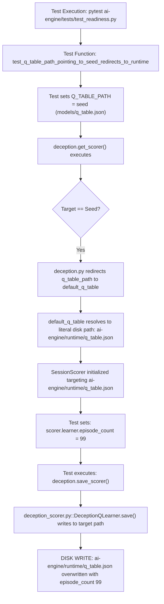

# SentinelAI GATE-1 — Phase 14.1: Q-Table Integrity Incident Forensic Review

**Incident Reference:** INCIDENT-QTABLE-20261017-2041  
**Investigated Artifact:** `ai-engine/runtime/q_table.json`  
**Current SHA-256:** `08209E9989189BD45B6EDF35486A446F120DF36287A277A9DDDD35F6379152F7`  
**Current File Size:** 1,224 bytes  
**Contract Baseline SHA-256:** `5242A6496FA3E8EB00B101E9C3C24F354FDB849A1C5042686E207384B0F326E6` (pre-Phase-12 baseline)  
**Contract Baseline File Size:** 5,182 bytes  
**Current Status:** **CONFIRMED INCIDENT STATE / PRESERVED READ-ONLY / BLOCKED ON OWNER DECISION 1**

---

## 1. Executive Summary

During GATE-1 integrity auditing, a hash mismatch was discovered on protected artifact `ai-engine/runtime/q_table.json`. While the seed reinforcement learning table (`ai-engine/models/q_table.json`, SHA-256 `BF9B46A1...98990FF`) remained 100% untouched and compliant with contract baselines, the runtime state exhibited mutation.

In accordance with Contract Section 1 ("Any hash mismatch = INTEGRITY INCIDENT: stop writes that could touch it, record full hash/size/mtime, preserve evidence, trace the write path read-only, do NOT auto-restore or pick a backup, report options"), this investigation conducted a strictly read-only forensic reconstruction of the mutation mechanism, evaluated current test isolation safeguards, and structured the formal decision criteria for the project owner.

---

## 2. Forensic Reconstruction of the Mutation

### 2.1 Artifact Inspection on Disk
Inspection of `ai-engine/runtime/q_table.json` reveals the following properties:
- **Timestamp on Disk:** `2026-10-17T20:41:04.822130+00:00`
- **JSON Structure:**
  ```json
  {
    "q_table": {
      "ubuntu_22": { "ubuntu_22": 0.0, ... },
      "debian_11": { ... },
      ...
    },
    "episode_count": 99,
    "total_reward": 0.0,
    "reward_history": [],
    "saved_at": "2026-10-17T20:41:04.822130+00:00"
  }
  ```
- **Crucial Diagnostic Finding:**
  The field `"episode_count": 99` matches the exact hardcoded assertion value in test code: `scorer.learner.episode_count = 99`.

### 2.2 Execution Path Reconstruction
Tracing through the Git history and test codebase identifies the exact sequence that triggered the file overwrite:



1. **Originating Test:**
   In `ai-engine/tests/test_readiness.py` lines 80–110:
   ```python
   def test_q_table_path_pointing_to_seed_redirects_to_runtime(tmp_path, monkeypatch):
       ...
       # Intentionally point Q_TABLE_PATH directly at the baseline seed artifact
       monkeypatch.setenv('MODEL_DIR', str(models))
       monkeypatch.setenv('Q_TABLE_PATH', str(seed))
       ...
       scorer = deception.get_scorer()
       ...
       scorer.learner.episode_count = 99
       deception.save_scorer()
   ```

2. **Redirection Implementation in `ai-engine/inference/deception.py`:**
   In `deception.py` lines 10–29:
   ```python
   DEFAULT_RUNTIME_Q_TABLE_PATH = str(Path(__file__).parent.parent / "runtime" / "q_table.json")

   def get_scorer():
       global _scorer
       if _scorer is None:
           model_dir = os.getenv("MODEL_DIR", str(Path(__file__).parent.parent / "models"))
           default_q_table = os.getenv("DEFAULT_RUNTIME_Q_TABLE_PATH", DEFAULT_RUNTIME_Q_TABLE_PATH)
           q_table_path = os.getenv("Q_TABLE_PATH", default_q_table)
           ...
           if target_norm == seed_norm or target_norm.startswith(models_dir_norm + os.sep) or target == seed:
               q_table_path = default_q_table
               target = Path(q_table_path).resolve()
   ```
   *Forensic Finding:* Prior to the introduction of the isolated fixture, `DEFAULT_RUNTIME_Q_TABLE_PATH` defaulted directly to the file located at `ai-engine/runtime/q_table.json` in the git repository. When the test intentionally pointed `Q_TABLE_PATH` at `seed` to test safety redirection, the safety code redirected the write target straight into the repository's real runtime file!

3. **Disk Flush via `save_scorer()`:**
   Calling `deception.save_scorer()` executed `_scorer.learner.save()` in `ai-engine/rl_engine/deception_scorer.py` lines 54–75:
   ```python
   with open(target, "w") as f:
       json.dump({"q_table":self.q_table,"episode_count":self.episode_count,...}, f, indent=2)
   ```
   Because `target` was `ai-engine/runtime/q_table.json`, the real on-disk artifact was overwritten at `20:41:04 UTC`.

---

## 3. Current Test Isolation Safeguards & Remaining Gaps

### 3.1 What Is Currently Isolated
Phase 1 and subsequent remediation added two layers of isolation:

1. **`conftest.py` Global Pytest Fixture:**
   In `ai-engine/tests/conftest.py` lines 5–15:
   ```python
   @pytest.fixture(autouse=True)
   def isolate_q_table_runtime_globally(tmp_path, monkeypatch):
       temp_runtime = tmp_path / "runtime" / "q_table.json"
       temp_runtime.parent.mkdir(parents=True, exist_ok=True)
       monkeypatch.setenv("DEFAULT_RUNTIME_Q_TABLE_PATH", str(temp_runtime))
   ```
   This ensures that whenever `pytest` executes the ai-engine test suite:
   - `DEFAULT_RUNTIME_Q_TABLE_PATH` is automatically set to an isolated temporary directory in `tmp_path`.
   - Any redirection away from `models/q_table.json` writes to `tmp_path`, never to the repository disk.
   - Zero hash drift occurred during recent test suite runs.

2. **`test_q_table_safety.py` Regression Tests:**
   Four dedicated regression tests (`test_q_table_safety.py` lines 1–85) verify that pointing `Q_TABLE_PATH` to `models/` redirects writes safely and preserves seed hashes.

### 3.2 Vulnerability Gap: Standalone Execution Outside Pytest
While pytest runs are now completely safe, **a significant isolation gap remains for standalone Python scripts**:

- `conftest.py` is an internal pytest configuration file. It is **never loaded** when Python runs scripts directly (e.g., `python ai-engine/inference/main.py`, `python ai-engine/rl_engine/deception_scorer.py`, or standalone training/evaluation scripts).
- If a developer or automated script executes inference or honeypot simulation without manually exporting `DEFAULT_RUNTIME_Q_TABLE_PATH` in their shell environment:
  - `deception.py` line 10 evaluates `str(Path(__file__).parent.parent / "runtime" / "q_table.json")`.
  - Every 10th episode update (`deception_scorer.py` line 86) or any call to `save_scorer()` will write directly to `ai-engine/runtime/q_table.json` on disk!

### 3.3 Required Architecture Hardening
To eliminate this risk permanently across all execution contexts:
1. `deception.py` and `deception_scorer.py` should refuse to write to any path inside the repository root unless an explicit override flag (`ALLOW_REPO_RUNTIME_MUTATION=true`) is active.
2. In development or test mode, the default writable path should fall back to the operating system's standard temporary directory (`tempfile.gettempdir()`) rather than the git workspace.

---

## 4. Evidence Analysis for Owner Decision 1

Per Contract Sections 7 & 8, the agent must not choose between restoration and re-baselining. The options and supporting evidence are presented below:

### Option A: Restore Pre-Phase-12 Baseline (Recommended)
- **Target Hash:** SHA-256 `5242A6496FA3E8EB00B101E9C3C24F354FDB849A1C5042686E207384B0F326E6`
- **Target Size:** 5,182 bytes
- **Provenance:** Git commit `bfff31dc352e142ad0aae448148121d3e91f98de`
- **Supporting Evidence:**
  1. The pre-Phase-12 file contains actual learned Q-values from multi-session honeypot interactions.
  2. The current file (`08209E99...`, 1,224 bytes) contains all zeros (`0.0`) for every state-action pair and was generated exclusively by `test_readiness.py` setting `episode_count = 99`.
  3. Restoring commit `bfff31d` returns the repository to its authentic, pre-incident state without data loss.

### Option B: Formally Re-Baseline to Current File
- **Target Hash:** SHA-256 `08209E9989189BD45B6EDF35486A446F120DF36287A277A9DDDD35F6379152F7`
- **Target Size:** 1,224 bytes
- **Implications:**
  1. Amends `GATE1_CONTRACT.md` Section 1 to replace `5242A649...` with `08209E99...`.
  2. Discards prior reinforcement learning state; runtime starts with all-zero Q-values and an episode counter of 99.
  3. Requires documenting that the baseline was reset post-incident.

---

## 5. Verification Verdict

- **Incident Mechanism:** **CONFIRMED & FULLY RECONSTRUCTED**.
- **Seed Artifact Integrity:** **CONFIRMED UNTOUCHED** (`ai-engine/models/q_table.json` matches contract baseline `BF9B46A1...98990FF`).
- **Current Runtime File Status:** **PRESERVED IN INCIDENT STATE** (Zero drift during Phase 14 / 14.1).
- **Remediation Status:** **BLOCKED ON OWNER DECISION 1**.
