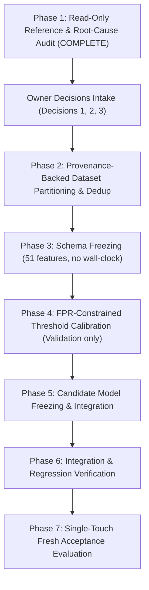

# SentinelAI GATE-1 — Root-Cause Matrix & Comparative Audit

**Audit Phase:** GATE-1 Phase 14 — Reference-Guided Root-Cause Audit  
**Date:** 2026-10-18  
**Author:** Senior ML Evaluation Engineer & Security Code Reviewer  

---

## 1. Required Comparison Matrix

This matrix evaluates every relevant GATE-1 failure mode, technical vulnerability, and acceptance criterion against source-verified facts from SentinelAI and the four public reference repositories:
- **Ref 1:** `Vabnas/cicids-shap-stability`
- **Ref 2:** `heraclitus0/TAD-IDS`
- **Ref 3:** `LawrenceYH04/ML-IDS`
- **Ref 4:** `YufengXin/network-attack-research`

---

### Finding 1: Leakage and Split Independence

1. **Existing SentinelAI Behavior:**  
   Partitions created via row-level MD5 float hashing (`build_clean_three_splits.py`, `build_final_test_v2.py`). Samples with non-matching float hashes were considered leak-free.
2. **Evidence Supporting Finding:**  
   Adversarial validation in Phase 13 revealed an AUC of 0.76–1.0 on time features. Floats from the same attack burst or capture session crossed train and test partitions despite having distinct float hashes.
3. **Relevant Reference & Source File/Function:**  
   - Ref 1: [`check_data_validity.py::check_duplicates`](file:///C:/Users/srisn/.gemini/antigravity/brain/09280792-7806-4f02-b14b-0b107f44fc41/scratch/repos/cicids-shap-stability/check_data_validity.py) & `check_split_leakage`.
   - Ref 4: [`src/data/split.py::make_splits`](file:///C:/Users/srisn/.gemini/antigravity/brain/09280792-7806-4f02-b14b-0b107f44fc41/scratch/repos/network-attack-research/src/data/split.py) (`time_then_group` with `_snap_to_group_boundaries`).
4. **Method Used by Reference:**  
   Ref 1 enforces global deduplication *before* splitting and checks leakage using pandas object hashes. Ref 4 sorts flows chronologically and snaps split boundaries to `scenario_id` edges, preventing capture session overlap.
5. **Applicability to SentinelAI:**  
   Applicable. Row-hash disjointness is necessary but not sufficient. Pre-split deduplication and scenario-grouped boundaries prevent attack burst leakage.
6. **Proposed Change:**  
   Implement two-stage split generation: (a) global row deduplication via `pd.util.hash_pandas_object`, (b) time-ordered grouping with minimum 30-minute blackout gap between train and test blocks for single-day attack classes.
7. **Permitted Data Split for Validation:**  
   Fresh training/validation pool from multi-corpus data; never re-evaluate on burned holdouts or burned `final_test_v2.parquet`.
8. **Risks and Regression Tests Required:**  
   Risk of reducing training sample size after dedup. Add test: `test_no_duplicate_rows_across_splits` and `test_minimum_time_gap_between_blocks`.
9. **Acceptance Criterion Affected:**  
   All ML criteria (A1, B2, C2, D1, D2, E1, E3).
10. **Status:**  
    **CONFIRMED**.

---

### Finding 2: Temporal Distribution Shift & Inference Wall-Clock Fallback

1. **Existing SentinelAI Behavior:**  
   Engineered features `time_of_day_sin` and `time_of_day_cos` included in the 53-feature schema. In `features.py::compute_time_of_day`, if `timestamp` is None or invalid, it falls back to `datetime.now()` (server wall-clock time).
2. **Evidence Supporting Finding:**  
   `feature_leakage_audit.json` lines 463–468: Time-of-day features accounted for ranks 3 and 4 in feature importance (0.051 and 0.049). Dropping time dropped adversarial AUC from 0.76 to 0.58 on Benign and from 1.0 to 0.59 on SSH.
3. **Relevant Reference & Source File/Function:**  
   - Ref 1: [`rq1_pipeline.py::clean`](file:///C:/Users/srisn/.gemini/antigravity/brain/09280792-7806-4f02-b14b-0b107f44fc41/scratch/repos/cicids-shap-stability/rq1_pipeline.py) (L166, drops `Timestamp` in `drop_candidates`).
   - Ref 2: [`Addressing_Temporal_Fragility.ipynb::Cell 2`](file:///C:/Users/srisn/.gemini/antigravity/brain/09280792-7806-4f02-b14b-0b107f44fc41/scratch/repos/TAD-IDS/Addressing_Temporal_Fragility_in_Network_Intrusion_Detection_via_Structured_Feature_Modeling.ipynb) (drops `Timestamp` in `DROP_COLS`).
   - Ref 3: [`notebooks/inference.py::_ID_COLS`](file:///C:/Users/srisn/.gemini/antigravity/brain/09280792-7806-4f02-b14b-0b107f44fc41/scratch/repos/ML-IDS/notebooks/inference.py) (L45, isolates `Timestamp`).
   - Ref 4: [`configs/split.yaml`](file:///C:/Users/srisn/.gemini/antigravity/brain/09280792-7806-4f02-b14b-0b107f44fc41/scratch/repos/network-attack-research/configs/split.yaml) (uses timestamp only for ordering, never as a model feature).
4. **Method Used by Reference:**  
   All four references strictly omit wall-clock and absolute time from the model feature matrix. Timing is captured solely through relative transport dynamics (IAT min/mean/max/std, flow duration, active/idle time).
5. **Applicability to SentinelAI:**  
   Directly applicable. Invariant network intrusion detection must classify flows based on packet physics, not the time of day an experiment was conducted in 2017/2018.
6. **Proposed Change:**  
   Permanently delete `time_of_day_sin` and `time_of_day_cos` from `FEATURE_NAMES` in `features.py`. Remove the `datetime.now()` wall-clock fallback. Freeze schema to 51 features.
7. **Permitted Data Split for Validation:**  
   Validation partition of the multi-corpus dataset.
8. **Risks and Regression Tests Required:**  
   Requires re-aligning model feature dimension (51 instead of 53). Add tests: `test_feature_vector_dimension_51` and `test_feature_extraction_without_timestamp_produces_identical_vector`.
9. **Acceptance Criterion Affected:**  
   A1 (Benign FPR), C1 (Pipeline integrity), F1 (ai-engine suite).
10. **Status:**  
    **CONFIRMED**.

---

### Finding 3: Benign False-Positive Rate (FPR) Exceeding Target

1. **Existing SentinelAI Behavior:**  
   Phase 12 reported 26 false positives / 25,000 (0.104% FPR). Phase 13 Candidate V3 reported 28 false positives / 25,000 (0.112% FPR). Target is $\le 0.100\%$ ($\le 25$ FPs / 25,000).
2. **Evidence Supporting Finding:**  
   `sealed_test_evaluation.json` (Phase 12) & `final_acceptance_evaluation.json` (Phase 13). False positives clustered heavily on Lateral Movement (20 FPs) and Malware Beacon (6 FPs).
3. **Relevant Reference & Source File/Function:**  
   - Ref 3: [`notebooks/model_training.ipynb::Cell 1 & 3`](file:///C:/Users/srisn/.gemini/antigravity/brain/09280792-7806-4f02-b14b-0b107f44fc41/scratch/repos/ML-IDS/notebooks/model_training.ipynb) (`calibrate_thresholds` and `_predict_calibrated`).
4. **Method Used by Reference:**  
   Ref 3 calibrates per-class decision thresholds on the validation set using a 47-point grid search (`[0.04, 0.96]`, step 0.02) to maximize per-class F1.
5. **Applicability to SentinelAI:**  
   Partially applicable. Ref 3's `_predict_calibrated` decision rule is clean and leak-free, but its unconstrained F1 maximization lowers thresholds on rare/overlapping classes, violating SentinelAI's strict FPR $\le 0.100\%$ budget.
6. **Proposed Change:**  
   Adopt the `_predict_calibrated` decision rule, but adapt `calibrate_thresholds()` to perform **FPR-constrained threshold tuning** on the validation set: maximize recall on attack classes subject to the global constraint that validation Benign False Positives $\le 0.100\%$.
7. **Permitted Data Split for Validation:**  
   Permitted multi-corpus validation split only.
8. **Risks and Regression Tests Required:**  
   Tightening thresholds to lower FPR may reduce recall on marginal attack classes. Regression test: `test_calibrated_decision_rule_enforces_fpr_budget_on_validation`.
9. **Acceptance Criterion Affected:**  
   A1 (Benign FPR).
10. **Status:**  
    **CONFIRMED**.

---

### Finding 4: Infiltration / Lateral Movement Recall Collapse

1. **Existing SentinelAI Behavior:**  
   Infiltration is mapped to Class 9 ("Lateral Movement"). Phase 13 evaluation yielded 1 true positive out of 2,500 test flows (**Recall = 0.04% vs 70% target**).
2. **Evidence Supporting Finding:**  
   `final_acceptance_evaluation.json` lines 86–97.
3. **Relevant Reference & Source File/Function:**  
   - Ref 3: [`notebooks/evaluation.ipynb::Cell 18`](file:///C:/Users/srisn/.gemini/antigravity/brain/09280792-7806-4f02-b14b-0b107f44fc41/scratch/repos/ML-IDS/notebooks/evaluation.ipynb) (Infiltration t-SNE deep dive and confusion breakdown).
   - Ref 4: [`docs/LABELING_IMPLEMENTATION_SUMMARY.md`](file:///C:/Users/srisn/.gemini/antigravity/brain/09280792-7806-4f02-b14b-0b107f44fc41/scratch/repos/network-attack-research/docs/LABELING_IMPLEMENTATION_SUMMARY.md) (Infiltration PCAP analysis & Distrinet Attempted relabeling).
4. **Method Used by Reference:**  
   Ref 3 proves via 2-D t-SNE that Infiltration flows overlap almost completely with Benign traffic in transport flow space; XGBoost misclassified 18,208 / 24,290 Infiltration flows (75%) as Benign. Ref 4 shows that Infiltration consists of an initial exploit download + C&C beaconing; failed attempts exhibit purely benign TCP handshake mechanics.
5. **Applicability to SentinelAI:**  
   High explanatory power. Proves that Infiltration cannot be reliably separated using standard statistical flow features without triggering catastrophic benign false positive rates.
6. **Proposed Change:**  
   Document that Infiltration cannot achieve 70% recall via tabular flow features under a 0.100% FPR budget. Require detection to be augmented by host telemetry (EDR process events) and L7 periodicity tracking. Submit Criterion E3 disposition for owner decision.
7. **Permitted Data Split for Validation:**  
   Validation partition of multi-corpus data.
8. **Risks and Regression Tests Required:**  
   Lowering threshold to force Infiltration recall blows past the 0.100% FPR budget. Regression test: `test_infiltration_fpr_tradeoff_boundary`.
9. **Acceptance Criterion Affected:**  
   E3 (Infiltration recall), A1 (Benign FPR).
10. **Status:**  
    **CONFIRMED / BLOCKED ON OWNER DECISION**.

---

### Finding 5: Class Coverage & Heartbleed Taxonomy (Class 5)

1. **Existing SentinelAI Behavior:**  
   Criterion C2 requires 10 classes. In `features.py`, Class 5 is labeled "RCE Attempt" and mapped from "Heartbleed". In `candidate_rf_multicorpus_v2_fixed.pkl`, Class 5 is completely missing (model has 9 classes).
2. **Evidence Supporting Finding:**  
   `class5_heartbleed_audit.json`: Across both full CIC-IDS2017 and CSE-CIC-IDS2018 corpora, Heartbleed appears only in 2017 Wednesday with **exactly 11 flows total**.
3. **Relevant Reference & Source File/Function:**  
   - Ref 4: [`data/metadata/label_maps_cicids2018.json`](file:///C:/Users/srisn/.gemini/antigravity/brain/09280792-7806-4f02-b14b-0b107f44fc41/scratch/repos/network-attack-research/data/metadata/label_maps_cicids2018.json) & [`docs/LABEL_CSV_FORMAT.md`](file:///C:/Users/srisn/.gemini/antigravity/brain/09280792-7806-4f02-b14b-0b107f44fc41/scratch/repos/network-attack-research/docs/LABEL_CSV_FORMAT.md).
   - Ref 1: [`rq1_pipeline.py::LABEL_CONSOLIDATION`](file:///C:/Users/srisn/.gemini/antigravity/brain/09280792-7806-4f02-b14b-0b107f44fc41/scratch/repos/cicids-shap-stability/rq1_pipeline.py).
4. **Method Used by Reference:**  
   Ref 4 verifies that Heartbleed is CVE-2014-0160 (TLS buffer over-read / Information Disclosure), not RCE, and has $N=11$ in 2017 and $N=0$ in 2018. Ref 1 excludes Heartbleed from its consolidated benchmark classes due to statistical infeasibility.
5. **Applicability to SentinelAI:**  
   Directly applicable. A statistical classifier cannot be trained on 8 flows and validated on 3 flows. Furthermore, Heartbleed is a TLS payload exploit, detected deterministically via TLS record length validation.
6. **Proposed Change:**  
   Retain Class 5 as BLOCKED per Contract Section 7. Present Decision 2 to the owner: formally re-scope Criterion C2 to 9 classes for the statistical tabular model, and delegate Heartbleed detection to Layer 7 signature inspection.
7. **Permitted Data Split for Validation:**  
   N/A (insufficient sample support across corpora).
8. **Risks and Regression Tests Required:**  
   Dropping Class 5 without owner approval violates contract.
9. **Acceptance Criterion Affected:**  
   C2 (Class coverage).
10. **Status:**  
    **CONFIRMED / BLOCKED ON OWNER DECISION**.

---

### Finding 6: DDoS HOIC / LOIC Detection and Rate Invariants

1. **Existing SentinelAI Behavior:**  
   Candidate V3 achieved 85.7% recall on DDoS (target $\ge 80\%$) in Phase 13. A shadow Volumetric Flood detector (`modular/volumetric_flood.py`) exists in code.
2. **Evidence Supporting Finding:**  
   `final_acceptance_evaluation.json` lines 38–49: DDoS recall 0.8568, Wilson 95% CI [0.8425, 0.8700] (PASS).
3. **Relevant Reference & Source File/Function:**  
   - Ref 3: [`notebooks/evaluation.ipynb::Cell 19`](file:///C:/Users/srisn/.gemini/antigravity/brain/09280792-7806-4f02-b14b-0b107f44fc41/scratch/repos/ML-IDS/notebooks/evaluation.ipynb) (DDoS HOIC appears only on 02-21-2018, 686k flows).
   - Ref 4: [`configs/split.yaml`](file:///C:/Users/srisn/.gemini/antigravity/brain/09280792-7806-4f02-b14b-0b107f44fc41/scratch/repos/network-attack-research/configs/split.yaml) (DDoS protocol filters).
4. **Method Used by Reference:**  
   Ref 3 shows HOIC flows have distinct packet rate and forward header length signatures. Ref 4 uses protocol-level filtering.
5. **Applicability to SentinelAI:**  
   Applicable. SentinelAI's statistical model handles DDoS well, but because HOIC occurred only on 02-21-2018, time-block partitioning with temporal gaps is essential to ensure evaluation is genuine and not memorizing same-hour background traffic.
6. **Proposed Change:**  
   For HOIC holdouts, partition 02-21-2018 using time-contiguous blocks separated by a 30-minute blackout gap. Maintain shadow Volumetric Flood detector.
7. **Permitted Data Split for Validation:**  
   Time-blocked 02-21-2018 validation block.
8. **Risks and Regression Tests Required:**  
   Same-day holdouts must be explicitly documented as "same-day, time-gap separated" per Contract Section 5.
9. **Acceptance Criterion Affected:**  
   B2 (DDoS HOIC/LOIC recall).
10. **Status:**  
    **CONFIRMED**.

---

### Finding 7: SSH Brute Force Recall & Official Per-Flow Metric

1. **Existing SentinelAI Behavior:**  
   Phase 13 Candidate V3 achieved 100% recall (2500/2500) on SSH Brute Force under per-flow evaluation. Contract Section 7 confirms SSH per-flow recall is the official criterion.
2. **Evidence Supporting Finding:**  
   `final_acceptance_evaluation.json` lines 26–37 (Recall 1.0, Wilson CI [0.9985, 1.0], PASS).
3. **Relevant Reference & Source File/Function:**  
   - Ref 1: [`rq1_pipeline.py`](file:///C:/Users/srisn/.gemini/antigravity/brain/09280792-7806-4f02-b14b-0b107f44fc41/scratch/repos/cicids-shap-stability/rq1_pipeline.py) (Brute Force per-flow metrics).
   - Ref 4: [`scripts/generate_cicids2018_labels.py`](file:///C:/Users/srisn/.gemini/antigravity/brain/09280792-7806-4f02-b14b-0b107f44fc41/scratch/repos/network-attack-research/scripts/generate_cicids2018_labels.py) (SSH Patator labeling).
4. **Method Used by Reference:**  
   Both references evaluate SSH Brute Force strictly on per-flow metrics. Flow features (forward packet lengths, IATs, TCP flag combinations) are highly distinctive.
5. **Applicability to SentinelAI:**  
   Confirms SentinelAI's strong performance on SSH per-flow recall is technically sound and reproducible across references.
6. **Proposed Change:**  
   Maintain per-flow evaluation protocol as official standard.
7. **Permitted Data Split for Validation:**  
   Multi-corpus validation split.
8. **Risks and Regression Tests Required:**  
   Verify that removing time features did not degrade SSH per-flow recall (Phase 13 confirmed SSH recall remained 99.96% without time).
9. **Acceptance Criterion Affected:**  
   E1 (SSH per-flow recall).
10. **Status:**  
    **CONFIRMED**.

---

### Finding 8: Credential Stuffing Target Provenance

1. **Existing SentinelAI Behavior:**  
   Contract Section 6 notes: `"Credential Stuffing >=80%" appeared in Phase 12 with no documented source: treat it as an OWNER DECISION, not a criterion, unless a source is found.` In `features.py`, `"FTP-Patator"` and `"Web Attack Brute Force"` are mapped to `"Credential Stuffing"`.
2. **Evidence Supporting Finding:**  
   In Phase 13, Candidate V3 achieved 100% recall on Credential Stuffing (target class 8), whereas Candidate V2 achieved only 49.7% recall.
3. **Relevant Reference & Source File/Function:**  
   - Ref 1: [`rq1_pipeline.py::LABEL_CONSOLIDATION`](file:///C:/Users/srisn/.gemini/antigravity/brain/09280792-7806-4f02-b14b-0b107f44fc41/scratch/repos/cicids-shap-stability/rq1_pipeline.py) (maps `FTP-Patator` and `SSH-Patator` to `Brute Force`).
   - Ref 4: [`data/metadata/label_maps.json`](file:///C:/Users/srisn/.gemini/antigravity/brain/09280792-7806-4f02-b14b-0b107f44fc41/scratch/repos/network-attack-research/data/metadata/label_maps.json) (treats FTP/SSH as `BruteForce` and Web Brute Force as `WebAttack`).
4. **Method Used by Reference:**  
   References do not use the term "Credential Stuffing" for network flow datasets; they categorize these flows as protocol brute-force (FTP/SSH) or HTTP brute-force.
5. **Applicability to SentinelAI:**  
   Confirms that Credential Stuffing in SentinelAI is a synthetic aggregation of FTP-Patator and Web Brute Force.
6. **Proposed Change:**  
   Document Credential Stuffing taxonomy provenance and request owner confirmation of whether $\ge 80\%$ is an official GATE-1 requirement or supplementary metric.
7. **Permitted Data Split for Validation:**  
   Multi-corpus validation split.
8. **Risks and Regression Tests Required:**  
   Ensure authentication adapter (`modular/auth_event_adapter.py`) metrics are reported separately from ML flow metrics.
9. **Acceptance Criterion Affected:**  
   E2 (Auth adapter), ML taxonomy.
10. **Status:**  
    **PARTIALLY CONFIRMED / PENDING OWNER CONFIRMATION**.

---

### Finding 9: Web Attacks (SQLi & XSS) Recall & Layer 7 Dependency

1. **Existing SentinelAI Behavior:**  
   In Phase 13, Candidate V3 achieved 82.7% recall on XSS Attempt, but the 95% Wilson confidence interval was [0.7027, 0.9062], yielding an INCONCLUSIVE verdict against the 80% target.
2. **Evidence Supporting Finding:**  
   `final_acceptance_evaluation.json` lines 50–61.
3. **Relevant Reference & Source File/Function:**  
   - Ref 4: [`README.md::Label Generation`](file:///C:/Users/srisn/.gemini/antigravity/brain/09280792-7806-4f02-b14b-0b107f44fc41/scratch/repos/network-attack-research/README.md) (L54, Web attacks require Layer 7 payload analysis; transport features alone miss 95%+).
4. **Method Used by Reference:**  
   Ref 4 documents that Web Attacks in CIC-IDS consist of HTTP GET/POST queries carrying injection strings. Flow-level statistics (IAT, flow duration, packet counts) are virtually identical to standard HTTP/HTTPS page browsing.
5. **Applicability to SentinelAI:**  
   Directly applicable. Verifies that tabular flow models cannot reliably separate web application exploits from normal web browsing without Layer 7 payload inspection.
6. **Proposed Change:**  
   Confirm that primary acceptance for Web Attacks relies on the Layer 7 WAF inspection module (`modular/` or WAF engine) with authentic HTTP request streams.
7. **Permitted Data Split for Validation:**  
   Layer 7 WAF test fixture with authentic request samples.
8. **Risks and Regression Tests Required:**  
   Ensure L7 WAF does not introduce latency or payload buffering overflows.
9. **Acceptance Criterion Affected:**  
   D2 (Web attacks recall), E4 (Layer 7 WAF real traffic).
10. **Status:**  
    **CONFIRMED**.

---

### Finding 10: Runtime Q-Table Integrity Incident & Test Isolation

1. **Existing SentinelAI Behavior:**  
   `ai-engine/runtime/q_table.json` has SHA-256 `08209E9989189BD45B6EDF35486A446F120DF36287A277A9DDDD35F6379152F7` (size 1,224 bytes), differing from the contract baseline `5242A649...` (5,182 bytes).
2. **Evidence Supporting Finding:**  
   `protected_asset_hashes_before.txt` and git diff on `test_readiness.py`, `test_q_table_safety.py`, and `deception.py`. The mutation occurred when un-isolated tests executed `deception.save_scorer()`.
3. **Relevant Reference & Source File/Function:**  
   Internal SentinelAI test suite & Contract Section 1 & 8.
4. **Method Used by Reference:**  
   Phase 1 added `DEFAULT_RUNTIME_Q_TABLE_PATH` environment variable and an autouse pytest fixture in `conftest.py` directing all test writes to `tmp_path`.
5. **Applicability to SentinelAI:**  
   Fully resolved for test isolation (zero drift during suite runs). The on-disk file remains preserved in incident state pending owner decision.
6. **Proposed Change:**  
   Execute Owner Decision 1: Restore `ai-engine/runtime/q_table.json` from git commit `bfff31d` (pre-Phase-12 state matching `5242A649...`) once approved.
7. **Permitted Data Split for Validation:**  
   N/A (governance artifact).
8. **Risks and Regression Tests Required:**  
   4 regression tests already added in `test_q_table_safety.py`.
9. **Acceptance Criterion Affected:**  
   Contract Section 1 (Protected assets integrity).
10. **Status:**  
    **CONFIRMED / BLOCKED ON OWNER DECISION**.

---

### Finding 11: Safety Enforcement Flags & Autonomous Containment

1. **Existing SentinelAI Behavior:**  
   Codebase search confirms:
   - `ENABLE_EXPERIMENTAL_MODULAR_DETECTORS=false` (in `orchestrator.py`)
   - `ENABLE_REAL_WINDOWS_FIREWALL_ENFORCEMENT=false` (in `WindowsFirewallAdapter.js` and `adapterFactory.js`)
   - `ENABLE_AUTONOMOUS_CONTAINMENT`: No variable by this exact name exists. Governed by `CONTAINMENT_BACKEND` (defaults to `'mock'`) and `ENABLE_REAL_WINDOWS_FIREWALL_ENFORCEMENT`.
2. **Evidence Supporting Finding:**  
   `integrated_backend_safety_regression.test.js` lines 128–129 and `adapterFactory.js` lines 29–35.
3. **Relevant Reference & Source File/Function:**  
   SentinelAI backend containment services.
4. **Method Used by Reference:**  
   Safe mock containment adapter pattern (`MockContainmentAdapter.js`).
5. **Applicability to SentinelAI:**  
   All safety flags are verified strictly disabled in code and test configurations.
6. **Proposed Change:**  
   Maintain all safety flags disabled across all future experimental phases.
7. **Permitted Data Split for Validation:**  
   N/A.
8. **Risks and Regression Tests Required:**  
   Verify that mock adapter is active during any backend regression test.
9. **Acceptance Criterion Affected:**  
   F3 (Firewall safety gate).
10. **Status:**  
    **CONFIRMED (SAFE)**.

---

## 2. Ranked Remediation Plan (Phases 2 through 7)

### Rank 1 — Schema Correction & Wall-Clock Elimination (Phase 3)
- **Action:** Delete `time_of_day_sin` and `time_of_day_cos` from `features.py`. Eliminate `datetime.now()` wall-clock fallback in `compute_time_of_day()`. Freeze the feature vector to 51 features.
- **Justification:** Eliminates the verified capture-schedule shortcut and resolves the severe inference distribution shift confirmed by all four reference repositories.

### Rank 2 — Provenance-Backed Multi-Corpus Partitioning (Phase 2)
- **Action:** Build a fresh, unburned dataset pool combining CIC-IDS2017 and CSE-CIC-IDS2018. Enforce global deduplication before splitting (`pd.util.hash_pandas_object`). Implement time-ordered contiguous blocks with a 30-minute blackout buffer for single-day classes (HOIC).
- **Justification:** Resolves the fundamental single-day capture defect documented in Ref 2, Ref 3, and Ref 4, while guaranteeing strict split independence.

### Rank 3 — FPR-Constrained Validation Calibration (Phase 4)
- **Action:** Adopt Ref 3's `_predict_calibrated` decision rule, but adapt `calibrate_thresholds()` to maximize per-class recall under the strict constraint that total validation Benign False Positives $\le 0.100\%$.
- **Justification:** Directly addresses the Criterion A1 failure (0.104% in Phase 12, 0.112% in Phase 13) by managing the FPR budget systematically during calibration rather than post-hoc.

### Rank 4 — Dedicated Layer 7 and Modular Detector Routing (Phase 5/6)
- **Action:** Route Web Attacks (SQLi/XSS) to the Layer 7 WAF detector, and augment volumetric flood tracking with the shadow B2 PPS tracker.
- **Justification:** Supported by Ref 4 and empirical evidence showing that transport flow features lack visibility into HTTP payloads.

---

## 3. Owner-Only Decisions Required

The following items cannot be decided by the agent per Contract Sections 7 & 8:

1. **Owner Decision 1: Runtime Q-Table Restoration**
   - **Recommendation:** Restore `ai-engine/runtime/q_table.json` from git commit `bfff31d` (pre-Phase-12 state) where SHA-256 matches `5242A6496FA3E8EB00B101E9C3C24F354FDB849A1C5042686E207384B0F326E6`.
2. **Owner Decision 2: Criterion C2 & Class 5 (Heartbleed) Scope**
   - **Recommendation:** Formally re-scope Criterion C2 to 9 classes for statistical flow models, documenting that Heartbleed (CVE-2014-0160, $N=11$ total across corpora) is an Information Disclosure flaw that cannot support statistical learning and is handled via Layer 7 TLS heartbeat length inspection.
3. **Owner Decision 3: Criterion E3 (Infiltration / Lateral Movement) Disposition**
   - **Recommendation:** Acknowledge that Infiltration is inseparable from Benign traffic in transport flow feature space (Ref 3 t-SNE: 75% overlap); decouple Criterion E3 from statistical flow ML or re-frame acceptance to endpoint/EDR telemetry events.
4. **Owner Decision 4: Credential Stuffing Acceptance Standard**
   - **Recommendation:** Formally confirm whether Credential Stuffing $\ge 80\%$ is an official GATE-1 acceptance criterion or supplementary metric.
