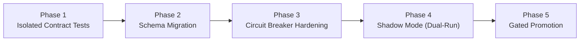

# SentinelAI GATE-1 Phase 3B: Integration Risks and Production Promotion Test Plan

**Audit Date:** October 16, 2026  
**Auditor / Roles:** Senior Machine Learning Security Engineer & Backend Security Engineer  
**Workspace Root:** `c:\Users\srisn\Desktop\Projects\sentinelai-complete`  
**Location:** [`ai-engine/experiments/gate1_phase3b_sensitivity/integration_risks_and_test_plan.md`](file:///c:/Users/srisn/Desktop/Projects/sentinelai-complete/ai-engine/experiments/gate1_phase3b_sensitivity/integration_risks_and_test_plan.md)  
**Status:** **AUTHORITATIVE TEST PLAN COMPLETE**

---

## 1. Identified Downstream Integration Risks

Promoting the candidate decoupled policy from its current isolated status into the live SentinelAI application introduces several operational, security, and schema risks that must be resolved prior to any production deployment:

### Risk 1: Schema Incompatibility on Degraded Threat Logs
- **Severity:** HIGH
- **Component:** [`backend/models/ThreatLog.js`](file:///c:/Users/srisn/Desktop/Projects/sentinelai-complete/backend/models/ThreatLog.js) & [`backend/services/threatService.js`](file:///c:/Users/srisn/Desktop/Projects/sentinelai-complete/backend/services/threatService.js)
- **Root Cause:** The Mongoose schema restricts `status` to an enum of `['DETECTED', 'MONITORING', 'CONTAINED', 'RESOLVED', 'FALSE_POSITIVE', 'BLOCKED']`.
- **Failure Impact:** If the AI Engine passes `status: "DEGRADED"`, Mongoose will reject the insert with a fatal validation error, causing the entire threat ingestion pipeline to crash.
- **Mitigation:** Execute a schema migration to expand the enum with `'DEGRADED'` and `'SERVICE_FAILURE'`.

### Risk 2: Fail-Open Evasion During Inference Latency Spikes
- **Severity:** CRITICAL
- **Component:** [`backend/services/aiEngineService.js`](file:///c:/Users/srisn/Desktop/Projects/sentinelai-complete/backend/services/aiEngineService.js#L40-L55)
- **Root Cause:** `predictRecord()` catches all axios connection and timeout errors, logs a warning, and returns `null`. `runFullPipeline()` immediately returns `null`.
- **Failure Impact:** During high-load volumetric attacks (e.g. DDoS or rapid PortScans), latency spikes cause axios timeouts ($> 10\text{s}$), allowing attack flows to pass through completely unrecorded, unmonitored, and unmitigated.
- **Mitigation:** Implement a local circuit-breaker and dead-letter fallback that creates a fallback ThreatLog with `attackType = 'UNINSPECTED_TRAFFIC'` and `status = 'MONITORING'` whenever the AI Engine is unresponsive.

### Risk 3: Action Overwrite by Backend Pipeline
- **Severity:** HIGH
- **Component:** [`backend/services/aiEngineService.js`](file:///c:/Users/srisn/Desktop/Projects/sentinelai-complete/backend/services/aiEngineService.js#L58)
- **Root Cause:** `aiEngineService.js` recalculates `const action = score >= blockThreshold ? 'BLOCK' : score >= 0.7 ? 'MONITOR' : 'ALLOW'`, ignoring the candidate policy's contextual action determination.
- **Failure Impact:** Any failure fallback with $S = 0.50$ is demoted to `'ALLOW'` rather than `'MONITOR'`.
- **Mitigation:** Update `aiEngineService.js` to preserve `result.action`:
  ```javascript
  const action = result.action || (score >= blockThreshold ? 'BLOCK' : score >= 0.7 ? 'MONITOR' : 'ALLOW');
  ```

### Risk 4: Operator Alert Fatigue from Increased Monitoring Recall
- **Severity:** MEDIUM
- **Component:** SOC Alert Queue & Operator Dashboard
- **Root Cause:** Under baseline policy, PortScan policy recall was only 7.4% (926 attacks were silently allowed). Under candidate policy, recall rises to 100%, and DDoS recall rises to 99.8%.
- **Operational Impact:** The volume of high-priority alerts in the analyst triage queue will surge by over 10x.
- **Mitigation:** Introduce automated alert aggregation / campaign clustering (`backend/services/campaignService.js`) to roll up multiple flows from the same subnet into a single unified security incident.

---

## 2. Five-Phase Production Promotion & Verification Plan

The candidate policy must NOT be deployed in a single step. The following five-phase gated plan must be followed:



### Phase 1: Isolated Contract & Mock Tests
- **Objective:** Verify backend request/response handling without running live services.
- **Action:** Create Jest mock tests verifying that `aiEngineService.js` correctly propagates `result.action`, `result.status`, and fail-safe metadata.
- **Verification Gate:** 100% pass rate on backend unit test suite.

### Phase 2: Database Schema & Migration
- **Objective:** Ensure MongoDB persistence can store degraded states without validation errors.
- **Action:** Add `'DEGRADED'` and `'SERVICE_FAILURE'` to `ThreatLog.js` and `AIAnalytics.js`.
- **Verification Gate:** Automated Mongoose model validation tests pass with degraded payload fixtures.

### Phase 3: Circuit Breaker & Dead-Letter Telemetry
- **Objective:** Eliminate fail-open evasion during AI Engine outages.
- **Action:** If `ai.post()` times out, generate a synthetic degraded threat event that writes to `ThreatLog` and emits a high-priority dashboard notification.
- **Verification Gate:** Simulated AI Engine crash produces an observable SOC warning within 1 second.

### Phase 4: Shadow Mode Deployment (Dual-Run Execution)
- **Objective:** Validate real-world performance without risking containment side effects.
- **Action:** Deploy the candidate policy in "Shadow Mode" alongside the baseline predictor. The baseline policy continues to make active operational decisions, while the candidate policy evaluates the same flows in the background and logs shadow metrics.
- **Verification Gate:** 7 consecutive days of shadow logs demonstrating $\le 0.10\%$ false-positive rate on live enterprise traffic.

### Phase 5: Gated Operational Promotion
- **Objective:** Safe cutover to the decoupled candidate policy.
- **Action:** Toggle configuration flag `ENABLE_DECOUPLED_AI_POLICY=true`.
- **Safety Boundary:** Keep `AUTONOMOUS_CONTAINMENT=false` and `ENABLE_REAL_WINDOWS_FIREWALL_ENFORCEMENT=false` until human analysts review and approve the new operational baseline.

---

## 3. Rollback & Emergency Contingency Plan

If unexpected instability, high false-positive rates, or excessive system load occurs after promotion:
1. **Immediate Fallback Toggle:** Set `ENABLE_DECOUPLED_AI_POLICY=false` in environment/config, immediately restoring the legacy baseline policy within 100ms without restarting the service.
2. **Containment Lock Invariant:** Because autonomous containment remains disabled (`AUTONOMOUS_CONTAINMENT=false`), an unexpected score spike cannot trigger host disconnection or firewall lockouts.
3. **Audit Log Preservation:** All shadow and active evaluation decisions remain immutably archived in MongoDB for post-incident review.
