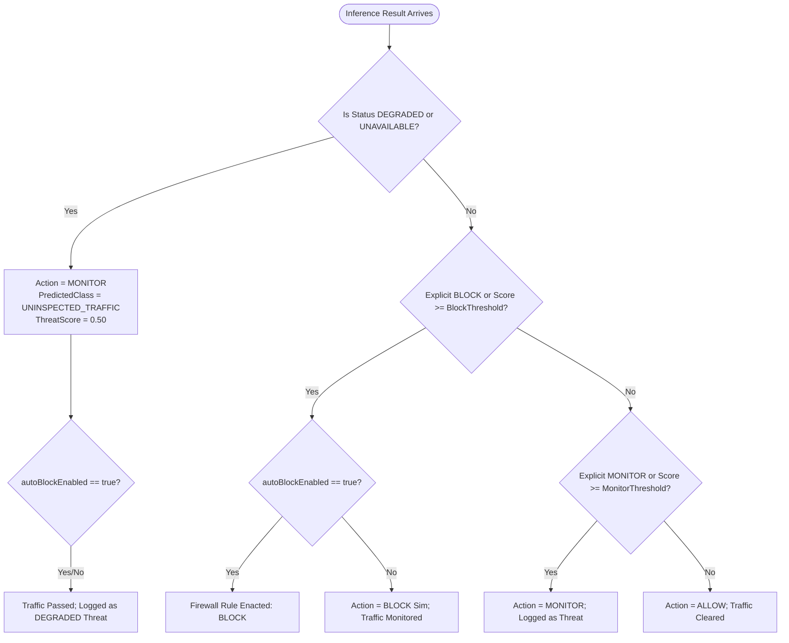

# SentinelAI GATE-1 Phase 3D: Final Backend Failure-State Contract

## 1. Specification Overview

This document specifies the authoritative, production-grade failure-state contract implemented in SentinelAI under `feature/gate1-phase3d-backend-safety`. 

The contract defines deterministic, failure-safe behaviors across the backend inference, persistence, and notification pipelines when AI components, network transports, or database engines degrade or fail.

---

## 2. Failure Classifications

| Failure Class | Trigger Condition | Detection Mechanism | System Reaction | Emitted Status | Pipeline Action |
| :--- | :--- | :--- | :--- | :--- | :--- |
| **ECONNREFUSED** | AI Engine Python service is offline or listening port (5000) is unreachable. | `error.code === 'ECONNREFUSED'` in `predictRecord` | Fallback response generated; warn log recorded. | `UNAVAILABLE` | `MONITOR` |
| **TIMEOUT** | AI Engine takes longer than `AI_TIMEOUT` (default 5000ms) to return inference. | `error.code === 'ETIMEDOUT'` or `error.message.includes('timeout')` | Fallback response generated; prevent socket leak. | `UNAVAILABLE` | `MONITOR` |
| **HTTP_5XX** | AI Engine encounters unhandled Python exception, OOM, or internal error. | `error.response && error.response.status >= 500` | Fallback response generated with HTTP status. | `UNAVAILABLE` | `MONITOR` |
| **MALFORMED_PAYLOAD** | Response is null, missing fields, or contains invalid non-numeric scores. | Validation check in `predictRecord` and `runFullPipeline` | Sanitize and clamp values; fall back to safe degraded schema. | `DEGRADED` / `UNAVAILABLE` | `MONITOR` |
| **PERSISTENCE_FAILURE** | MongoDB is offline, disconnected, or write operation times out. | `catch` block in `runFullPipeline` Mongoose `.save()` | Emergency synchronous audit write to disk with `fsync`. | N/A (Logged to disk) | Retain in-memory action |
| **NOTIFICATION_FAILURE** | WebSocket / Alert dispatcher throws error on emit. | `catch` block in `aiService.js` | Logged as warning; transaction continues unblocked. | N/A | Retain in-memory action |

---

## 3. Concrete Payload Schemas

### 3.1 Inference Fallback Payload (`buildFallbackResponse`)

When `predictRecord` encounters an inference error or transport failure, it returns this exact structure:

```json
{
  "predictedClass": "UNINSPECTED_TRAFFIC",
  "threatScore": 0.50,
  "action": "MONITOR",
  "confidence": 0.0,
  "attackType": "UNINSPECTED_TRAFFIC",
  "status": "UNAVAILABLE",
  "error": "ECONNREFUSED: connect ECONNREFUSED 127.0.0.1:5000",
  "reason": "AI Engine inference service unavailable (ECONNREFUSED). Safe degraded fallback invoked."
}
```

### 3.2 Full Pipeline Response Payload (`runFullPipeline`)

When `runFullPipeline(record)` processes a record under failure, the returned object matches:

```json
{
  "sourceIp": "192.168.1.50",
  "targetIp": "10.0.0.1",
  "prediction": {
    "predictedClass": "UNINSPECTED_TRAFFIC",
    "threatScore": 0.50,
    "action": "MONITOR",
    "confidence": 0.0,
    "attackType": "UNINSPECTED_TRAFFIC",
    "status": "UNAVAILABLE",
    "error": "TIMEOUT: timeout of 5000ms exceeded",
    "reason": "AI Engine inference service unavailable (TIMEOUT). Safe degraded fallback invoked."
  },
  "action": "MONITOR",
  "blockThreshold": 0.90,
  "monitorThreshold": 0.35,
  "timestamp": "2026-10-16T14:06:48.000Z"
}
```

---

## 4. Action Precedence and Containment Rules

Under no circumstances may an uninspected or degraded packet be automatically dropped or blocked, nor may it be silently allowed without inspection:



### Formal Precedence Rules:
1. **Rule 1 (Degraded Safety)**: If `status === 'UNAVAILABLE'` or `status === 'DEGRADED'` or `predictedClass === 'UNINSPECTED_TRAFFIC'`, the action MUST be `MONITOR`. It can NEVER be `ALLOW` and NEVER be `BLOCK`.
2. **Rule 2 (No Auto-Block on Degraded)**: Autonomous containment cannot enact firewall rules against traffic whose classification is degraded or uninspected.
3. **Rule 3 (Preserve Explicit MONITOR)**: If the ML engine explicitly assigns `action: 'MONITOR'`, downstream logic MUST NOT demote it to `ALLOW` based on a score comparison against `blockThreshold`.
4. **Rule 4 (Strict Block Gating)**: Only flows with explicit `action: 'BLOCK'` OR verified supervised score $\ge blockThreshold$ ($0.90$) may be blocked, and only if `autoBlockEnabled === true`.

---

## 5. Persistence and Audit Guarantees

### 5.1 Primary Path (MongoDB Available)
- A `ThreatLog` document is saved with:
  - `attackType`: `'UNINSPECTED_TRAFFIC'`
  - `status`: `'DEGRADED'`
  - `confidenceScore`: `0.50`
  - `details.errorReason`: Specific failure message (e.g. `'ECONNREFUSED'`)
- If score $\ge 0.50$, an `Alert` document is emitted with:
  - `type`: `'SYSTEM_HEALTH'` or `'THREAT_DETECTED'`
  - `severity`: `'MEDIUM'`
  - `sourceRef.refModel`: `'ThreatLog'` or `'AIPrediction'`

### 5.2 Fallback Path (MongoDB Unavailable / Storage Failure)
- The exception triggers `emergencyAudit.writeEmergencyAudit()`.
- The event is appended to `logs/emergency_threat_audit.log` using synchronous file I/O (`fs.openSync`, `fs.writeSync`, `fs.fsyncSync`, `fs.closeSync`).
- This guarantees zero data loss on database crashes or disk delays, ensuring forensic continuity for security auditors.
- Sensitive fields (passwords, tokens, secrets) are automatically sanitized and redacted.

---

## 6. Security Contract Invariants

1. **Deterministic Containment**: In the absence of an operational AI engine, the system fails open with monitoring (`MONITOR`), avoiding enterprise denial-of-service against internal traffic while preventing stealth infiltration.
2. **Zero False Certainty**: No synthetic prediction or random score is fabricated. The threat score is fixed to neutral $0.50$ with $0.0$ confidence.
3. **Forensic Traceability**: Every failed inference is auditable via MongoDB `DEGRADED` records or the emergency audit log.
