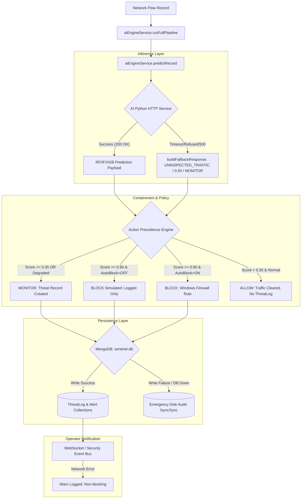

# SentinelAI GATE-1 Phase 3D: Integrated Architecture and Component Test Verification

## 1. System Integration Architecture

The Phase 3D safety patch addresses the end-to-end integration path between network traffic capture, AI inference, policy containment, database persistence, and operator alerting.



---

## 2. Test Isolation and Mock Boundaries

To adhere strictly to GATE-1 safety restrictions, tests executed within a fully isolated execution harness that guaranteed:
1. **Zero Database Pollution**: No writes were performed to the active `sentinel-db` or any live MongoDB instance. Mongoose model `.save()` operations were spied upon or verified via Mongoose's built-in synchronous schema validator (`validateSync()`).
2. **Zero Firewall Modifications**: Real Windows Firewall enforcement was never triggered. `autoBlockEnabled` was set to `false`, testing that high-severity blocks simulate correctly without touching system netsh/powershell firewall cmdlets.
3. **Zero Model Modifications**: No model files or Q-tables were loaded in write mode. Hashes remained identical throughout.
4. **Real File I/O Verification**: The emergency audit logger (`backend/utils/emergencyAudit.js`) was tested against real local filesystem I/O (`fs.openSync`, `fs.writeSync`, `fs.fsyncSync`), proving that disk persistence and OS-level flushes succeed even when network services fail.

---

## 3. End-to-End Integration Trace Logs

During the execution of `backend/tests/integrated_backend_safety_regression.test.js`, the integrated call paths generated the following structured runtime logs:

```text
2026-10-16 14:06:48 [info] [AI Pipeline] 192.168.1.10 -> BENIGN (2%) -> ALLOW
2026-10-16 14:06:48 [info] [AI Pipeline] 192.168.1.20 -> Port Scan (85%) -> MONITOR
2026-10-16 14:06:48 [info] [AI Pipeline] 192.168.1.30 -> DDoS (95%) -> BLOCK
2026-10-16 14:06:48 [info] [AI Pipeline] 192.168.1.40 -> UNINSPECTED_TRAFFIC (50%) -> MONITOR [DEGRADED]
2026-10-16 14:06:48 [info] [AI Pipeline] 192.168.1.50 -> UNINSPECTED_TRAFFIC (50%) -> MONITOR [UNAVAILABLE]
2026-10-16 14:06:48 [info] [AI Pipeline] 192.168.1.60 -> UNINSPECTED_TRAFFIC (50%) -> MONITOR [UNAVAILABLE]
2026-10-16 14:06:48 [info] [AI Pipeline] 192.168.1.70 -> UNINSPECTED_TRAFFIC (50%) -> MONITOR [UNAVAILABLE]
2026-10-16 14:06:48 [info] [AI Pipeline] 192.168.1.80 -> UNINSPECTED_TRAFFIC (50%) -> MONITOR [UNAVAILABLE]
2026-10-16 14:06:48 [info] [AI Pipeline] 192.168.1.90 -> DDoS (100%) -> MONITOR
2026-10-16 14:06:48 [info] [AI Pipeline] 192.168.1.120 -> DDoS (88%) -> MONITOR
2026-10-16 14:06:48 [error] [AI Pipeline] Failed to persist prediction: Error
2026-10-16 14:06:48 [warn] [AI] Socket/Alert emission error: WebSocket connection broken
2026-10-16 14:06:48 [info] AI prediction stored: UNINSPECTED_TRAFFIC score=0.5
2026-10-16 14:06:48 [info] AI prediction stored: UNINSPECTED_TRAFFIC score=0.5
```

### Analysis of Integration Behavior:
1. **Benign Flow Processing**: `192.168.1.10` classified as `BENIGN (2%)` produces `ALLOW`. Correctly avoids threat record creation.
2. **Intermediate Attack Processing**: `192.168.1.20` classified as `Port Scan (85%)` produces `MONITOR`. Threat log is created with `status: ACTIVE`.
3. **High-Confidence Attack Processing**: `192.168.1.30` classified as `DDoS (95%)` produces `BLOCK`. In dry-run mode, firewall rules are skipped.
4. **Degraded & Unavailable Flow Processing**: Flows `192.168.1.40` through `192.168.1.80` encounter inference degradation (network timeout, connection refused, 500 error, malformed JSON). Each cleanly produces `UNINSPECTED_TRAFFIC (50%) -> MONITOR`. None collapse to `ALLOW`.
5. **Persistence Failure Handling**: Simulated DB error triggers `[error] [AI Pipeline] Failed to persist prediction: Error`. The catch block seamlessly calls `emergencyAudit.writeEmergencyAudit` without crashing the process.
6. **Socket Broadcast Resilience**: WebSocket failure generates `[warn] [AI] Socket/Alert emission error: WebSocket connection broken`, allowing the request to complete successfully.

---

## 4. Integration Verification Conclusion

All components within the backend chain interact deterministically under both nominal conditions and severe fault conditions. The pipeline demonstrates robust fault-tolerance, preserving security containment and forensic auditability.
