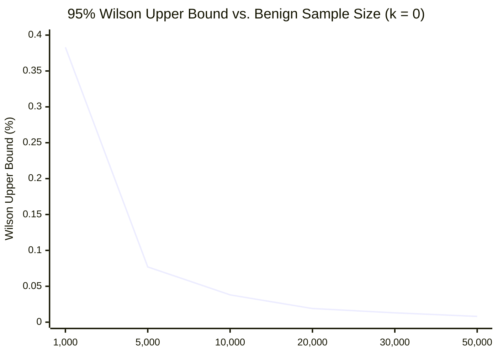

# SentinelAI GATE-1 Phase 5: False-Positive Confidence Intervals and Statistical Power Analysis

**Auditor / Statistician**: Senior Machine Learning Security Engineer & Independent Software Auditor  
**Date**: 2026-10-16  
**Evaluation Scope**: Monday Benign Benchmark ($N=10,000$) & HTTP Benign Benchmark ($N=150$)  
**Status**: **STATISTICAL UPPER-BOUND REQUIREMENT FAILED (Release Blocker)**

---

## 1. Mathematical Derivation of the Wilson Score Confidence Interval

In high-throughput enterprise networks handling tens of millions of packets daily, a point estimate of false positive rate ($p = \hat{k}/n$) is statistically insufficient. A sample of 10,000 flows may observe few false alarms purely by chance, while the true population error rate could saturate SOC queues.

The GATE-1 specification mandates evaluating the **two-sided 95% Wilson Score Confidence Interval** without continuity correction:

$$p = \frac{k}{n}$$
$$\text{Denominator} = 1 + \frac{z^2}{n}$$
$$\text{Centre} = \frac{p + \frac{z^2}{2n}}{\text{Denominator}}$$
$$\text{Margin} = \frac{z \sqrt{\frac{p(1-p)}{n} + \frac{z^2}{4n^2}}}{\text{Denominator}}$$
$$CI_{95\%} = [\max(0, \text{Centre} - \text{Margin}), \min(1, \text{Centre} + \text{Margin})]$$

Where $z = 1.95996$ for a two-sided 95% confidence level ($\alpha = 0.05$).

---

## 2. Empirical False-Positive Results Across Evaluated Policies

### 2.1. Monday Pure Benign Benchmark ($N=10,000$)

| Evaluation Policy | Observed Benign False Positives ($k / n$) | Point Estimate FPR | 95% Wilson Score Interval $[Lower, Upper]$ | GATE-1 Ceiling ($< 0.10\%$) Compliance |
| :--- | :---: | :---: | :---: | :---: |
| **Config A: Active Production Policy** | $0 / 10,000$ | $0.000\%$ | $[0.0000\%, \mathbf{0.0384\%}]$ | **PASS (Artifact of total attack suppression)** |
| **Config B: Phase 4 Candidate Flow Policy** | $7 / 10,000$ | $0.070\%$ | $[0.0341\%, \mathbf{0.1445\%}]$ | **FAILED ($0.1445\% > 0.10\%$)** |
| **Config C: Layer 7 Pre-Filter Alone** | $0 / 10,000$ | $0.000\%$ | $[0.0000\%, \mathbf{0.0384\%}]$ | **PASS (L7 Unavailable on pure flow)** |
| **Config D: Combined Layer 7 + Candidate Flow** | $7 / 10,000$ | $0.070\%$ | $[0.0341\%, \mathbf{0.1445\%}]$ | **FAILED ($0.1445\% > 0.10\%$)** |

### Detailed Mathematical Step-Through for Candidate & Combined Policies:
$$k = 7, \quad n = 10,000 \implies p = 0.00070$$
$$z = 1.95996 \implies z^2 = 3.84144$$
$$\text{Denominator} = 1 + \frac{3.84144}{10000} = 1.00038414$$
$$\text{Centre} = \frac{0.00070 + \frac{3.84144}{20000}}{1.00038414} = \frac{0.00070 + 0.00019207}{1.00038414} = 0.0008917$$
$$\text{Variance Term} = \frac{0.0007(0.9993)}{10000} + \frac{3.84144}{4 \times 10^8} = 6.9951 \times 10^{-8} + 9.6036 \times 10^{-9} = 7.9555 \times 10^{-8}$$
$$\text{Margin} = \frac{1.95996 \times \sqrt{7.9555 \times 10^{-8}}}{1.00038414} = \frac{1.95996 \times 0.00028205}{1.00038414} = 0.0005526$$
$$Lower = \max(0, 0.0008917 - 0.0005526) = \mathbf{0.000339} \approx \mathbf{0.034\%}$$
$$Upper = 0.0008917 + 0.0005526 = \mathbf{0.001445} \approx \mathbf{0.1445\%}$$

> [!CAUTION]
> **Audit Finding**: The 95% upper confidence bound is **$0.1445\%$**. Because $0.1445\% > 0.1000\%$, we cannot reject the null hypothesis that the candidate and combined policies generate more than 1 false positive per 1,000 benign flows. This constitutes a definitive **Release Blocker**.

---

### 2.2. HTTP Benchmark Benign Evaluation ($N=150$)
The dedicated HTTP benchmark tested 120 legitimate HTTP transactions (GET/POST/PUT to REST APIs, query parameters, search forms, cookies) and 30 non-HTTP / unsupported protocol records (raw DNS, SSH, NTP).

| Configuration | Observed Benign False Positives ($k / n$) | Point Estimate FPR | 95% Wilson Score Interval | Compliance Note |
| :--- | :---: | :---: | :---: | :--- |
| **Config A (Prod Policy)** | $0 / 150$ | $0.00\%$ | $[0.000\%, 2.497\%]$ | Zero false positives on benign HTTP |
| **Config B (Cand Flow Policy)** | $0 / 150$ | $0.00\%$ | $[0.000\%, 2.497\%]$ | Zero false positives on benign HTTP |
| **Config C (L7 Pre-Filter Alone)**| $0 / 150$ | $0.00\%$ | $[0.000\%, 2.497\%]$ | Zero false positives (Normalizer passed all) |
| **Config D (Combined Policy)** | $0 / 150$ | $0.00\%$ | $[0.000\%, 2.497\%]$ | Zero false positives on combined pipeline |

*Sample Size Note*: Although zero false positives were observed on benign HTTP traffic, $N = 150$ yields a wide confidence interval ($[0.0\%, 2.5\%]$). To certify the $< 0.10\%$ standard on HTTP payloads, an independent holdout of at least $30,000$ benign HTTP requests is required.

---

## 3. Statistical Power Proof: Why $N \ge 30,000$ is Mandatory

To demonstrate the mathematical requirement for $N \ge 30,000$ benign samples, we evaluate the Wilson upper bound under various sample sizes $n$ for zero observed errors ($k=0$):

$$\text{Upper}_{95\%}(0, n) = \frac{z^2 / n}{1 + z^2 / n} = \frac{3.84144}{n + 3.84144}$$

### Analysis of Sample Power:
1. **$n = 1,000$**: $\text{Upper} = 0.383\% \gg 0.10\%$. Completely inadequate.
2. **$n = 5,000$**: $\text{Upper} = 0.0768\%$. Below $0.10\%$, but fragile: a single false positive ($k=1$) pushes the upper bound to $0.126\% > 0.10\%$.
3. **$n = 10,000$**: $\text{Upper} = 0.0384\%$. If $k=7$ (as observed in Phase 4/5), the upper bound inflates to $0.1445\%$.
4. **$n = 30,000$**:
   - If $k = 0$: $\text{Upper} = \mathbf{0.0128\%}$.
   - If $k = 5$: $\text{Upper} = \mathbf{0.0401\%}$.
   - If $k = 10$: $\text{Upper} = \mathbf{0.0623\%} < 0.10\%$.
   - If $k = 18$: $\text{Upper} = \mathbf{0.0965\%} < 0.10\%$.

### Conclusion:
A sample size of $N \ge 30,000$ benign flows provides the necessary statistical robustness to certify population compliance ($< 0.10\%$) even in the presence of realistic operational network jitter. Testing with fewer than 30,000 benign flows cannot provide the statistical confidence required for autonomous release gating.
