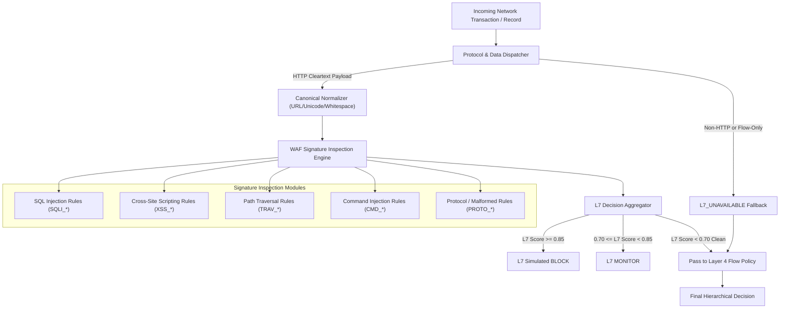

# SentinelAI GATE-1 Phase 5: Layer 7 Prototype Design Specification

**Author / Architect**: Senior Machine Learning Security Engineer & Independent Software Auditor  
**Date**: 2026-10-16  
**Implementation Target**: Isolated Non-Production Proof-of-Concept (`layer7_prototype.py`)  
**Scope**: HTTP-Aware Signature & WAF Pre-Filter complementing Layer 4 Flow Classifier  

---

## 1. Prototype Objectives and Design Philosophy

The Layer 7 prototype addresses the critical detection gap identified in Phase 4: the inability of 53 Layer 4 transport flow statistics to detect web application attacks (SQLi, XSS, Path Traversal, Command Injection, Web Brute Force).

### Design Philosophy:
1. **Defense-in-Depth (Layered Architecture)**: The Layer 7 engine acts as a **fast pre-filter** at the application ingress. High-confidence web attacks are intercepted immediately before or alongside Layer 4 flow evaluation.
2. **Graceful Protocol Degradation**: Non-HTTP traffic (DNS, SSH, NTP) or encrypted traffic without TLS termination cannot be parsed by Layer 7. The prototype must explicitly return `status: 'L7_UNAVAILABLE'` and seamlessly delegate decision-making to the Layer 4 flow policy without throwing errors or failing open.
3. **Strict Evasion Normalization**: To prevent trivial bypasses, all input strings (URIs, query parameters, headers, bodies) undergo recursive canonical decoding before signature matching.
4. **Privacy-Preserving Telemetry**: No cleartext passwords, session tokens, or sensitive personal data are logged. Rule matches log only rule identifiers, attack categories, and sanitized token excerpts.

---

## 2. Component Architecture



---

## 3. Detailed Component Specifications

### 3.1. Canonical Normalizer
Attackers frequently chain multiple encodings to evade regex filters. The normalizer executes:
1. **Recursive URL Decoding**: Loops up to 3 times to unwrap nested percent-encoding (e.g., `%2527` $\to$ `%27` $\to$ `'`).
2. **Unicode Canonical Normalization**: Applies standard Unicode normalization (`NFKD`) to decompose full-width and Cyrillic/homoglyph bypasses.
3. **Null-Byte and Comment Stripping**: Removes embedded null bytes (`\x00`, `%00`) and collapses inline comments (`/**/`) into single spaces.
4. **Whitespace and Case Normalization**: Collapses repeated whitespace and tabs into single spaces and lowercases search buffers.

### 3.2. Signature and Rule Matcher Engine

| Rule ID | Attack Category | Pattern / Logic Description | Weight / Base Score |
| :--- | :--- | :--- | :---: |
| `SQLI_001` | SQL Injection | Tautology patterns: `' OR '1'='1'`, `' OR 1=1 --`, `admin'--` | 0.95 |
| `SQLI_002` | SQL Injection | UNION SELECT expressions: `UNION\s+(ALL\s+)?SELECT` | 0.95 |
| `SQLI_003` | SQL Injection | SQL execution functions: `sleep\(`, `benchmark\(`, `waitfor delay` | 0.92 |
| `SQLI_004` | SQL Injection | Stacked query injection: `;\s*(DROP\|DELETE\|UPDATE\|INSERT)` | 0.95 |
| `SQLI_005` | SQL Injection | Boolean logic injection: `'\s+(AND\|OR)\s+['"\d\w]+\s*=\s*['"\d\w]+` | 0.88 |
| `XSS_001` | XSS Attempt | Inline script tags: `<\s*script[^>]*>` | 0.95 |
| `XSS_002` | XSS Attempt | Event handler attributes: `\bon(load\|error\|click\|mouseover)\s*=` | 0.92 |
| `XSS_003` | XSS Attempt | Pseudo-protocol injection: `javascript:\s*` or `vbscript:\s*` | 0.90 |
| `XSS_004` | XSS Attempt | HTML element injection: `<\s*(iframe\|svg\|object\|embed\|applet)[^>]*>` | 0.88 |
| `TRAV_001` | Path Traversal | Directory backtracking: `(\.\./\|\.\.\\\|%2e%2e%2f)` repeated $\ge 2$ times | 0.95 |
| `TRAV_002` | Path Traversal | System file targeting: `(/etc/passwd\|/etc/shadow\|c:\\windows\\win.ini)` | 0.95 |
| `CMD_001` | Command Injection | Pipe / semicolon chaining with shell binaries: `(;\s*\|\s*\|)\s*(whoami\|cat\|id\|uname\|sh\|bash)` | 0.95 |
| `CMD_002` | Command Injection | Command substitution syntax: `\$\([^)]+\)` or `` `[^`]+` `` | 0.90 |
| `CMD_003` | Command Injection | Outbound download injection: `(curl\|wget\|powershell)\s+http` | 0.92 |
| `PROTO_001`| Malformed Protocol | Invalid HTTP method (not GET, POST, PUT, DELETE, HEAD, OPTIONS, PATCH) | 0.75 |
| `PROTO_002`| Malformed Protocol | Control characters in HTTP header names or URI | 0.80 |

### 3.3. Layer 7 Scoring and Output Schema
For any evaluated request, the Layer 7 module produces:
```json
{
  "l7_evaluated": true,
  "l7_status": "BLOCK",
  "l7_score": 0.95,
  "matched_rules": ["SQLI_002"],
  "primary_threat": "SQL Injection",
  "matched_excerpt": "union select username, password from users",
  "latency_ms": 0.42
}
```

---

## 4. Multi-Configuration Comparison Architecture

To rigorously evaluate the impact of Layer 7 pre-filtering, the prototype benchmarks **four distinct configurations** on identical records:

1. **Configuration A: Existing Production Policy**
   - Pure Layer 4 flow classifier with coupled Random Forest and Isolation Forest (`score = 0.7*rf_s + 0.3*if_sig`).
   - Known defect: Isolation Forest suppresses inliers, causing PortScan and DDoS recall collapse.
2. **Configuration B: Phase 4 Candidate Flow Policy**
   - Decoupled Random Forest and Isolation Forest. High-confidence RF attacks ($p \ge 0.85$) are preserved without IF suppression.
   - Known defect: L4 features lack L7 payload visibility, resulting in $60.90\%$ Web Attack recall.
3. **Configuration C: Layer 7 Pre-Filter Alone**
   - Operates strictly on application-layer payloads using signature and canonical normalization rules.
   - For pure flow records without HTTP payloads, emits `L7_UNAVAILABLE` $\to$ default `ALLOW`.
4. **Configuration D: Combined Layer 7 Pre-Filter + Flow Candidate Policy**
   - **Hierarchical Combination**:
     * If L7 detects attack with score $\ge 0.85 \implies$ Action: `BLOCK` (Simulated).
     * Else if L7 detects attack with score $\ge 0.70 \implies$ Action: `MONITOR`.
     * Else (L7 clean or `L7_UNAVAILABLE`) $\implies$ Execute Phase 4 Candidate Flow Policy (handles PortScan, DDoS, DoS Hulk, Botnet, SSH-Patator at Layer 4).

---

## 5. Security Limitations and Disclaimers

> [!CAUTION]
> **Prototype Disclaimers**:
> 1. A regex-based signature WAF is a defense-in-depth pre-filter, **not a complete web application security solution**. Sophisticated polymorphic payloads, SQL dialect-specific obfuscations, or AST-level vulnerabilities can bypass static regexes.
> 2. The prototype runs exclusively in non-production simulation. Real-world deployment requires integration into an API gateway with TLS termination.
> 3. Zero real containment is performed; all blocking decisions are strictly simulated.
