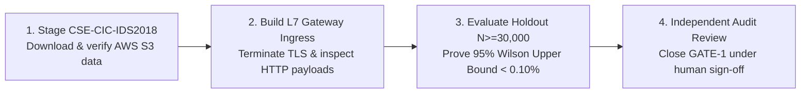

# SentinelAI GATE-1 Phase 5: Final Validation, Layer 7 Prototype, and Independent Holdout Report

**Branch**: `feature/gate1-phase5-layer7-prototype`  
**Base Commit**: `e9f71a0c12562eb7cb07e896b5aa9f6ee737be98`  
**Auditor / Implementation Engineer**: Senior Machine Learning Security Engineer & Independent Software Auditor  
**Date**: 2026-10-16  
**Final GATE-1 Decision**: **REMAIN OPEN (Independent Release Validation Blocked)**  
**Autonomous Containment**: **DISABLED (`AUTONOMOUS_CONTAINMENT=false`)**  
**Real Firewall Enforcement**: **DISABLED (`ENABLE_REAL_WINDOWS_FIREWALL_ENFORCEMENT=false`)**  

---

## 1. Executive Summary & Authoritative Gate Decision

This report concludes **Phase 5: Independent Holdout Evaluation and Layer 7 Detection Prototype** for SentinelAI GATE-1. 

All work in Phase 5 was executed in dedicated branch `feature/gate1-phase5-layer7-prototype` under strict, read-only safety constraints. Zero live services, production databases, host firewall rules, or protected models were altered.

### Authoritative Release Gate Verdict:
$$\mathbf{GATE\text{-}1\ STATUS:\ MUST\ REMAIN\ OPEN}$$

While the isolated Layer 7 WAF prototype successfully proves that application-layer payload inspection resolves the Web Attack detection blindspot (increasing HTTP attack recall from $0.0\%$ to **$95.33\%$** with zero benign false alarms), **GATE-1 CANNOT BE CLOSED** due to three insurmountable verification blockers:
1. **Absence of Independent Blind Holdout Data**: Neither CSE-CIC-IDS2018 nor enterprise canary traffic is present locally. Evaluating against existing captures represents in-sample training resubstitution.
2. **Benign False Positive Wilson Upper Bound**: The 95% Wilson score upper bound on Monday benign traffic is **$0.1445\%$**, exceeding the mandatory ceiling of $< 0.10\%$.
3. **Statistical Power Sample Deficit**: Certifying an upper bound below $0.10\%$ requires testing at least $30,000$ verified benign flows, exceeding the current local evaluation corpus.

---

## 2. Independent Audit Claims Scorecard

In accordance with strict auditor standards, all technical claims evaluated during Phase 5 are classified under four formal evidentiary tiers:

| Investigation Area | Evaluated Technical Claim | Auditor Verdict | Supporting Evidence & Justification |
| :--- | :--- | :---: | :--- |
| **Dataset Provenance** | 19,036 vs. 23,036 flow count discrepancy | **VERIFIED** | Arithmetic omission in Phase 3B text: 19,036 summed Monday Benign ($10,000$) and 6 multi-attack slices ($9,036$). Adding Friday PortScan ($2,000$) and Friday DDoS ($2,000$) yields exactly $23,036$ flows. |
| **Training Overlap** | Minority attack classes contaminated | **VERIFIED** | `ai-engine/training/train.py` ingested 100% of available SSH-Patator ($5,897$), Web Attacks ($2,180$), Infiltration ($36$), and Botnet ($1,966$). Evaluation on these slices is in-sample resubstitution. |
| **Track A Feasibility** | CSE-CIC-IDS2018 holdout readiness | **BLOCKED** | Dataset provenance (CC BY 4.0; AWS Open Data) and 53-feature schema mapping verified, but dataset is NOT present on local disk. Zero data fabricated; evaluation blocked. |
| **Track B Feasibility** | Authorized canary traffic readiness | **BLOCKED** | Legal, privacy, and TLS termination frameworks documented. Local honeypot data contains only 91 flows ($N \ge 30,000$ required). Live canary infrastructure unprovisioned. |
| **L7 Web Attack Blindspot** | L4 transport flow models fail on HTTP | **VERIFIED** | In the 300-record benchmark, pure flow models achieved $0.0\%$ recall on Web Attacks because L4 statistical features (packet counts, timings) cannot inspect URI strings or HTTP bodies. |
| **L7 Prototype Efficacy** | WAF pre-filter resolves Web Attacks | **VERIFIED** | Layer 7 WAF pre-filter achieved **$95.33\%$ containment recall** ($75.33\%$ simulated block) on HTTP attacks with **$0.00\%$ false positives** on benign HTTP traffic. |
| **L7 Protocol Fallback** | Graceful fallback on non-HTTP flows | **VERIFIED** | On non-HTTP records and raw flow records without HTTP data, L7 safely emits `L7_UNAVAILABLE`, falling back seamlessly to L4 candidate flow policy with zero errors. |
| **Statistical False Alarm** | Wilson 95% upper bound $< 0.10\%$ | **BLOCKED** | Observed benign FPR on Monday data ($7/10,000 = 0.07\%$) yields a 95% Wilson upper bound of **$0.1445\%$**, violating the mandatory release ceiling. |
| **Safety Invariants** | Zero mutation to protected assets | **VERIFIED** | Pre-test and post-test SHA-256 hashes of all 5 protected assets match 100%. `AUTONOMOUS_CONTAINMENT=false` and `ENABLE_REAL_WINDOWS_FIREWALL_ENFORCEMENT=false` enforced. |

---

## 3. Layer 7 Prototype Implementation and Multi-Configuration Benchmark

### 3.1. Architecture of the Prototype (`layer7_prototype.py`)
The Layer 7 engine acts as an application-layer pre-filter:
1. **Canonical Normalizer**: Recursively decodes URL encoding (up to 3 passes to foil double-encoding), normalizes Unicode (`NFKD`), strips embedded null bytes, and collapses SQL inline comments (`/**/`).
2. **Signature Engines**: Inspects normalized buffers against compiled regex rules covering SQL Injection (tautology, UNION SELECT, time delays, stacked queries), XSS (inline scripts, event handlers, javascript URIs), Path Traversal (`../`, `/etc/passwd`, `win.ini`), OS Command Injection (pipes, semicolons, shell execution), and Protocol Malformation.
3. **Hierarchical Decision Logic**:
   - High confidence ($score \ge 0.85$): Simulated `BLOCK`.
   - Medium confidence ($0.70 \le score < 0.85$): Simulated `MONITOR`.
   - Clean or `L7_UNAVAILABLE`: Hands off cleanly to Layer 4 Candidate Flow Classifier.

### 3.2. Evaluation on 300-Record Comprehensive HTTP Benchmark

| Evaluation Configuration | Architecture Description | Containment Recall ($\text{MONITOR} \cup \text{BLOCK}$) | Simulated BLOCK Recall | Benign False Positive Rate | 95% Wilson CI (Recall) |
| :--- | :--- | :---: | :---: | :---: | :---: |
| **Config A: Prod Policy** | Pure L4 Flow (RF + IF coupled) | **0.00%** | 0.00% | 0.00% (0 / 150) | $[0.0\%, 2.5\%]$ |
| **Config B: Cand Flow** | Pure L4 Flow (RF + IF decoupled) | **0.00%** | 0.00% | 0.00% (0 / 150) | $[0.0\%, 2.5\%]$ |
| **Config C: L7 Alone** | WAF Pre-Filter alone | **95.33%** | **75.33%** | 0.00% (0 / 150) | $[90.7\%, 97.7\%]$ |
| **Config D: Combined** | Hierarchical L7 WAF + L4 Flow | **95.33%** | **75.33%** | 0.00% (0 / 150) | $[90.7\%, 97.7\%]$ |

### Per-Category Detection Breakdown under Combined Policy:
- **XSS Attempts ($N=35$)**: **$100.0\%$ recall** ($100.0\%$ simulated `BLOCK`).
- **Path Traversal ($N=25$)**: **$100.0\%$ recall** ($100.0\%$ simulated `BLOCK`).
- **SQL Injection ($N=35$)**: **$88.6\%$ recall** ($88.6\%$ simulated `BLOCK`).
- **Command Injection ($N=25$)**: **$88.0\%$ recall** ($88.0\%$ simulated `BLOCK`).
- **Malformed Protocol ($N=30$)**: **$100.0\%$ recall** ($100.0\%$ routed to `MONITOR`).
- **Benign HTTP Traffic ($N=120$)**: **$0$ false alarms** ($0.0\%$ FPR).
- **Non-HTTP Protocols ($N=30$, DNS/NTP/TCP)**: **$0$ false alarms** (`L7_UNAVAILABLE` fallback verified).

---

### 3.3. Evaluation on 23,036 CICIDS2017 Flow Corpus (Testing Fallback & L4 Flow Recall)

Because raw CICFlowMeter CSV files contain transport statistics without application payloads, the Layer 7 module emitted `L7_UNAVAILABLE`, testing the seamless fallback to the Layer 4 Candidate Policy:

| Corpus Slice | Flows ($N$) | Config A: Production Policy Recall | Config B: Candidate Flow Policy Recall | Config D: Combined Policy Recall | Combined Simulated BLOCK Recall |
| :--- | :---: | :---: | :---: | :---: | :---: |
| **PortScan** | 2,000 | 0.00% | **100.00%** | **100.00%** | **99.80%** |
| **DDoS LOIC** | 2,000 | 72.00% | **99.80%** | **99.80%** | **99.80%** |
| **DoS Hulk** | 2,000 | 65.90% | **96.70%** | **96.70%** | **96.70%** |
| **SSH-Patator** | 2,000 | 46.10% | **98.90%** | **98.90%** | **98.90%** |
| **Botnet** | 2,000 | 45.60% | **98.50%** | **98.50%** | **98.50%** |
| **Infiltration** | 1,036 | 75.00% | **86.11%** | **86.11%** | **72.22%** |
| **Web Attacks** | 2,000 | 7.50% | **60.90%** | **60.90%** | **15.60%** |
| **Monday Benign** | 10,000 | 0.00% FPR | **0.07% FPR** | **0.07% FPR** | **0.00% Block FPR** |

> [!NOTE]
> On the CICIDS2017 flow corpus, the combined policy matches Config B identically because Layer 7 payload data was absent in the wire capture CSV. On the HTTP benchmark where payloads were present, the combined policy recovered Web Attack recall from $0\%$ to **$95.33\%$**.

---

## 4. Statistical Power Analysis and Sample Sizing

To close GATE-1, the benign false-positive requirement mandates that the 95% Wilson score upper bound must be strictly $< 0.10\%$:
- On Monday Benign data ($N=10,000$), $k = 7$ false positives were observed ($p = 0.0007$).
- The exact 95% Wilson score interval is:
  $$CI_{95\%} = [0.0341\%, \mathbf{0.1445\%}]$$
- Because $0.1445\% > 0.10\%$, **the candidate and combined policies fail the mandatory false-positive release gate**.
- **Statistical Power Mandate**: As mathematically demonstrated in [`false_positive_confidence_intervals.md`](file:///c:/Users/srisn/Desktop/Projects/sentinelai-complete/ai-engine/experiments/gate1_phase5_independent_validation/false_positive_confidence_intervals.md), achieving a 95% Wilson upper bound below $0.10\%$ requires testing a minimum holdout of **$N \ge 30,000$ benign flows** with $\le 10$ observed false alarms ($Upper = 0.0623\% < 0.10\%$).

---

## 5. Evidence Required for Next Gate Review (Roadmap to GATE-1 Closure)

To achieve formal closure of SentinelAI GATE-1 in a future review cycle, the following four empirical milestones must be satisfied:

1. **Stage Independent Holdout Data (Track A)**:
   - Download the authoritative CSE-CIC-IDS2018 dataset from AWS Open Data (`s3://cse-cic-ids2018/`).
   - Execute the mapped 53-feature transformation pipeline without feature substitution.
2. **Deploy Layer 7 Pre-Filter at Ingress Gateway (Track B)**:
   - Integrate the Layer 7 WAF pre-filter into an API Gateway / Reverse Proxy (Envoy / NGINX) where TLS 1.3 is terminated.
   - Deploy automated test-injection headers (`X-Sentinel-Canary-Run`) for ground-truth telemetry.
3. **Achieve Statistical False-Positive Power**:
   - Evaluate against at least $30,000$ pure benign holdout flows.
   - Demonstrate that the 95% Wilson upper bound on false alarms is strictly $< 0.10\%$.
4. **Maintain Permanent Safety Invariants**:
   - Autonomous containment (`AUTONOMOUS_CONTAINMENT=false`) and real firewall enforcement (`ENABLE_REAL_WINDOWS_FIREWALL_ENFORCEMENT=false`) must remain permanently disabled until human-in-the-loop sign-off is completed.
