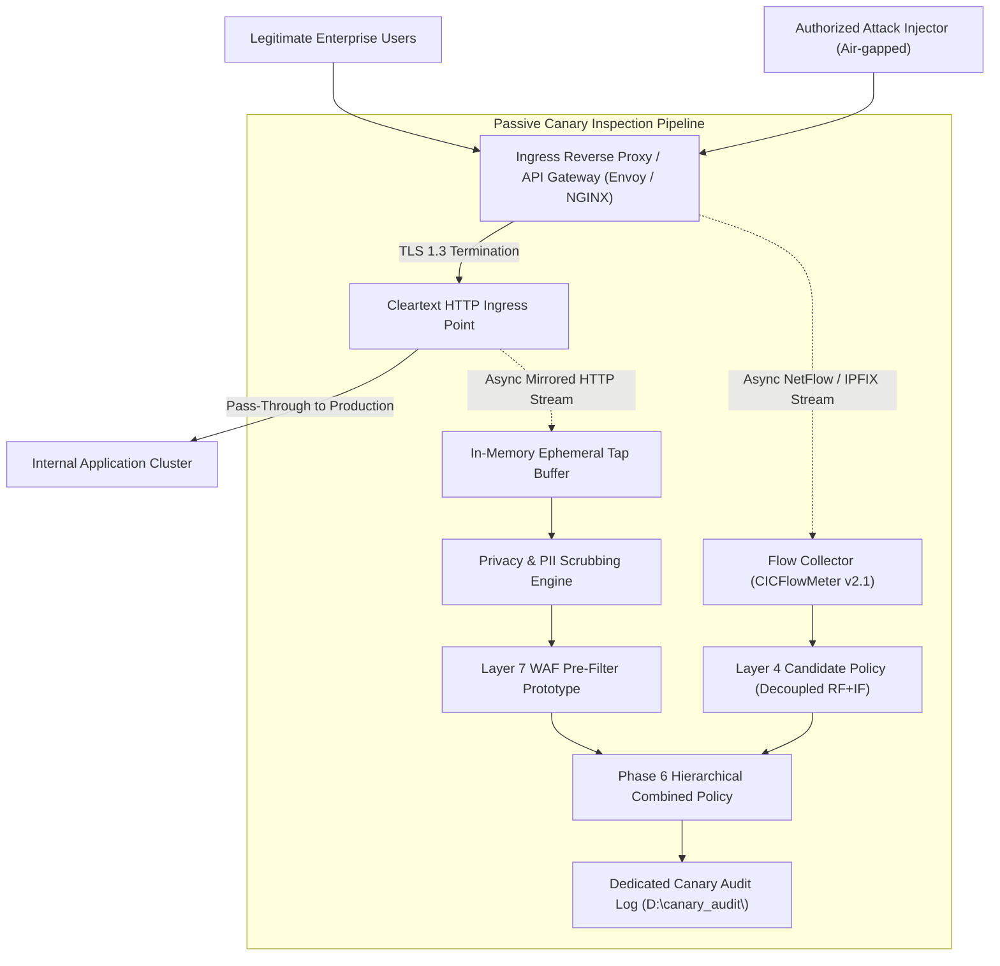

# SentinelAI GATE-1 Phase 6: Authorized Passive Canary Readiness Plan

**Author / Security Architect**: Senior Machine Learning Security Engineer & Independent Software Auditor  
**Date**: 2026-10-16  
**Status**: **READINESS DESIGN ONLY — PROVISIONING STRICTLY UNAUTHORIZED**  
**Safety Invariants**: `AUTONOMOUS_CONTAINMENT=false` and `ENABLE_REAL_WINDOWS_FIREWALL_ENFORCEMENT=false`  

---

## 1. Executive Summary and Operational Constraints

This document defines the architectural and operational blueprint for conducting an **authorized, passive canary evaluation** of SentinelAI's hybrid detection pipeline (Layer 7 WAF Pre-Filter + Layer 4 Candidate Flow Classifier).

> [!CAUTION]
> ### Mandatory Invariant Notice
> This document is a **design specification**. In strict compliance with GATE-1 safety rules:
> - No live network infrastructure has been provisioned.
> - No live network interfaces have been tapped.
> - No unauthorized penetration testing or attack traffic generation has been conducted.
> - Real firewall enforcement and autonomous containment remain **permanently disabled**.

---

## 2. Network Topology and Traffic Visibility

To evaluate the system under authentic enterprise conditions, the canary architecture captures live production-like traffic without introducing risk to production workloads:

### 2.1. Traffic Tap and Mirroring:
- **Mirroring Mode**: 100% out-of-band asynchronous traffic mirroring (e.g., AWS VPC Traffic Mirroring, NGINX `mirror` directive, or Envoy access log streaming).
- **Zero Impact on Production Latency**: Mirrored packets are dropped if buffer capacity is exceeded; production traffic forwarding is never blocked by canary processing.
- **TLS 1.3 Termination**:
  - The Layer 7 pre-filter sits immediately downstream of the Ingress Reverse Proxy where TLS is terminated.
  - The proxy maintains enterprise certificate ownership. Ephemeral TLS session keys are never exported or stored on disk.

---

## 3. Privacy, Authorization, and Data-Retention Controls

1. **Authorization and Governance**:
   - Deployment requires written authorization from the Chief Information Security Officer (CISO), Corporate Legal Counsel, and Data Protection Officer (DPO) under GDPR Article 6(1)(f) (Legitimate Interest for Network Defense).
2. **Runtime PII Scrubbing**:
   - The `Privacy & PII Scrubbing Engine` inspects mirrored HTTP streams before security evaluation:
     * Request headers `Authorization`, `Cookie`, `Set-Cookie`, `Proxy-Authorization` are replaced with fixed-length HMAC-SHA256 digests.
     * JSON/form-encoded fields matching `password`, `pwd`, `token`, `secret`, `ssn`, `card` are overwritten with `"[REDACTED]"`.
3. **Data Retention Limits**:
   - Mirrored payload buffers in memory are scrubbed immediately after rule evaluation.
   - Canary audit logs are stored in a dedicated, bounded directory (`D:\sentinelai_canary\audit\`) with rotation enforced at $\le 10\text{MB}$ and maximum retention of 5 archives ($\le 60\text{MB}$ total).

---

## 4. Ground-Truth Labeling and Synthetic Attack Injection

To compute true confusion matrices without human labeling ambiguity, traffic is categorized via cryptographically authenticated markers:

### 4.1. Authorized Attack Generation (Air-Gapped Sandbox):
- **Tooling**: Automated execution of OWASP ZAP, sqlmap, nmap, and custom Python test harnesses targeting a dedicated, isolated sandbox canary service.
- **Cryptographic Ground-Truth Header**:
  Every authorized test attack carries an injection correlation header:
  `X-Sentinel-Canary-Run: <UUID>.<Timestamp>.<HMAC-SHA256(SecretKey)>`
- The logging pipeline verifies the HMAC. If valid, the flow is deterministically labeled with the injected ground-truth category (`SQL_INJECTION`, `XSS`, `PORTSCAN`, etc.).
- External packets lacking a valid HMAC are categorized as `BENIGN` or flagged for secondary anomaly review.

---

## 5. Correlated Flow and Duplicate Session Handling

1. **The i.i.d. Violation in Real Traffic**:
   - Real network traffic violates the independent-and-identically-distributed assumption. A single web user clicking a link triggers an HTML GET, multiple CSS/JS fetches, and several API calls across persistent HTTP/2 connections.
   - Treating each packet or flow as independent would artificially inflate benign sample counts.
2. **Session Aggregation Framework**:
   - The canary collector groups flows by 5-tuple (`src_ip`, `dst_ip`, `src_port`, `dst_port`, `protocol`) and session window (30-second sliding inactivity timeout).
   - Metrics are computed on **unique session events**, ensuring that correlated packet bursts do not skew the Wilson confidence intervals.

---

## 6. Sample Collection and Minimum Sizing Targets

To satisfy the frozen GATE-1 acceptance specification, the canary campaign must achieve:
- **Benign Traffic Sample Sizing**: Minimum **$N \ge 30,000$ unique session flows** collected over a minimum of **5 business days** (covering morning, business hours, and overnight maintenance traffic).
- **Attack Sample Sizing**: Minimum **$N \ge 500$ unique attack sessions** per attack class (SQLi, XSS, Path Traversal, Command Injection, PortScan, DDoS, Botnet, SSH Brute Force).
- **Target Statistical Power**: Achieving $\le 10$ false alarms out of 30,000 benign sessions mathematically proves:
  $$Upper_{95\%}\text{ (Wilson)} = \mathbf{0.0623\%} < 0.1000\%$$

---

## 7. Logging, Monitoring, Incident Response, and Rollback

1. **Prometheus / Grafana Telemetry**:
   - Real-time monitoring of canary processing latency, L7 buffer utilization, rule match frequencies, and false alarm rates.
2. **Circuit Breakers**:
   - If the canary tap consumes $> 10\%$ CPU on the gateway or if tap buffer drop rates exceed $1.0\%$, the traffic mirroring tap automatically decouples.
3. **Rollback Mechanism**:
   - Complete removal of the canary tap is achieved via single configuration toggle on the ingress proxy (`mirror: off`), requiring zero service restarts.
4. **Permanent Enforcement Invariant**:
   - In all canary environments, `AUTONOMOUS_CONTAINMENT` is hardcoded to `false`. All decisions remain purely simulated.
