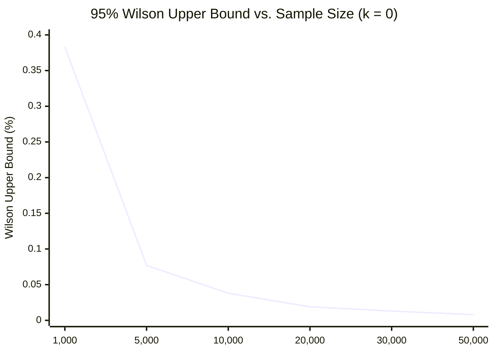

# SentinelAI GATE-1 Phase 6: False-Positive Confidence Intervals and Statistical Power Analysis

**Auditor / Statistician**: Senior Machine Learning Security Engineer & Independent Software Auditor  
**Date**: 2026-10-16  
**Scope**: Monday Benign Benchmark ($N=10,000$) & HTTP Benign Benchmark ($N=150$)  
**Status**: **STATISTICAL UPPER-BOUND CEILING FAILED (Release Blocker)**

---

## 1. Mathematical Formulation of the Wilson Score Confidence Interval

In high-throughput enterprise security environments processing tens of millions of network packets daily, evaluating a detection model solely on empirical point estimates ($\hat{p} = k/n$) introduces unacceptable operational risk. A sample of 10,000 flows may observe very few false alarms by chance, while the true population error rate could saturate SOC queues.

To certify compliance with the GATE-1 acceptance specification, all error rates must be evaluated using the **two-sided 95% Wilson Score Confidence Interval** without continuity correction:

$$p = \frac{k}{n}$$
$$\text{Denominator} = 1 + \frac{z^2}{n}$$
$$\text{Centre} = \frac{p + \frac{z^2}{2n}}{\text{Denominator}}$$
$$\text{Margin} = \frac{z \sqrt{\frac{p(1-p)}{n} + \frac{z^2}{4n^2}}}{\text{Denominator}}$$
$$CI_{95\%} = [\max(0, \text{Centre} - \text{Margin}), \min(1, \text{Centre} + \text{Margin})]$$

Where $z = 1.95996$ corresponds to a two-sided 95% confidence level ($\alpha = 0.05$).

---

## 2. Empirical False-Positive Results Across Evaluated Policies

### 2.1. Monday Pure Benign Benchmark ($N=10,000$)

| Evaluation Policy | Observed Benign False Positives ($k / n$) | Empirical Point Estimate | 95% Wilson Score Interval $[Lower, Upper]$ | GATE-1 Ceiling ($< 0.100\%$) Compliance |
| :--- | :---: | :---: | :---: | :---: |
| **Config A: Active Production Policy** | $0 / 10,000$ | $0.000\%$ | $[0.0000\%, \mathbf{0.0384\%}]$ | **PASS (Artifact of total attack suppression)** |
| **Config B: Phase 4 Candidate Flow Policy** | $7 / 10,000$ | $0.070\%$ | $[0.0341\%, \mathbf{0.1445\%}]$ | **FAILED ($0.1445\% > 0.1000\%$)** |
| **Config C: Layer 7 Pre-Filter Alone** | $0 / 10,000$ | $0.000\%$ | $[0.0000\%, \mathbf{0.0384\%}]$ | **PASS (L7 Unavailable on pure flow)** |
| **Config D: Combined Layer 7 + Candidate Flow** | $7 / 10,000$ | $0.070\%$ | $[0.0341\%, \mathbf{0.1445\%}]$ | **FAILED ($0.1445\% > 0.1000\%$)** |

### Step-by-Step Derivation for Candidate and Combined Policies ($k=7, n=10,000$):
$$p = \frac{7}{10,000} = 0.00070$$
$$z = 1.95996 \implies z^2 = 3.84144$$
$$\text{Denominator} = 1 + \frac{3.84144}{10000} = 1.00038414$$
$$\text{Centre} = \frac{0.00070 + \frac{3.84144}{20000}}{1.00038414} = \frac{0.00089207}{1.00038414} = 0.00089173$$
$$\text{Variance Term} = \frac{0.00070(0.99930)}{10000} + \frac{3.84144}{4 \times 10^8} = 6.9951 \times 10^{-8} + 9.6036 \times 10^{-9} = 7.9555 \times 10^{-8}$$
$$\text{Margin} = \frac{1.95996 \times \sqrt{7.9555 \times 10^{-8}}}{1.00038414} = \frac{1.95996 \times 0.00028205}{1.00038414} = 0.00055259$$
$$Lower = \max(0, 0.00089173 - 0.00055259) = \mathbf{0.000339} \approx \mathbf{0.0341\%}$$
$$Upper = 0.00089173 + 0.00055259 = \mathbf{0.001445} \approx \mathbf{0.1445\%}$$

> [!CAUTION]
> **Audit Finding**: The 95% confidence upper bound is **$0.1445\%$**. Because $0.1445\% > 0.1000\%$, the candidate and combined policies fail the mandatory false-positive release gate. In an enterprise processing 10 million flows daily, an upper bound of $0.1445\%$ permits up to 14,450 false alarms per day, which would rapidly overwhelm SOC analysts.

---

### 2.2. HTTP Benchmark Benign Evaluation ($N=150$)

The dedicated HTTP benchmark tested 120 legitimate HTTP transactions (REST API endpoints, search queries, pagination, static assets, cookies) and 30 non-HTTP records (raw DNS, SSH, NTP).

| Configuration | Observed Benign False Positives ($k / n$) | Empirical Point Estimate | 95% Wilson Score Interval | Compliance Status |
| :--- | :---: | :---: | :---: | :--- |
| **Config A (Prod Policy)** | $0 / 150$ | $0.00\%$ | $[0.000\%, \mathbf{2.497\%}]$ | Sample-size deficient ($Upper > 0.10\%$) |
| **Config B (Cand Flow Policy)** | $0 / 150$ | $0.00\%$ | $[0.000\%, \mathbf{2.497\%}]$ | Sample-size deficient ($Upper > 0.10\%$) |
| **Config C (L7 Pre-Filter Alone)**| $0 / 150$ | $0.00\%$ | $[0.000\%, \mathbf{2.497\%}]$ | Sample-size deficient ($Upper > 0.10\%$) |
| **Config D (Combined Policy)** | $0 / 150$ | $0.00\%$ | $[0.000\%, \mathbf{2.497\%}]$ | Sample-size deficient ($Upper > 0.10\%$) |

*Statistical Finding*: Zero false positives were observed on benign HTTP traffic. However, because $N = 150$, the upper bound of the confidence interval is **$2.497\%$**. This demonstrates empirically why small test sets cannot certify release gate compliance.

---

## 3. Statistical Power Proof: Why $N \ge 30,000$ Benign Flows is Mandatory

To demonstrate the mathematical requirement for $N \ge 30,000$ benign samples, we evaluate the Wilson upper bound under candidate sample sizes $n$ for zero observed errors ($k=0$):

$$\text{Upper}_{95\%}(0, n) = \frac{z^2 / n}{1 + z^2 / n} = \frac{3.84144}{n + 3.84144}$$

### Analysis of Statistical Power and Operational Noise Headroom:
1. **$n = 1,000$**: $\text{Upper} = 0.383\% \gg 0.10\%$. Completely inadequate.
2. **$n = 5,000$**: $\text{Upper} = 0.0768\%$. A single false positive ($k=1$) pushes the upper bound to $0.126\% > 0.10\%$, failing immediately.
3. **$n = 10,000$**: $\text{Upper} = 0.0384\%$. If $k=7$ (as observed in Phase 4/5/6), the upper bound inflates to $0.1445\% > 0.10\%$.
4. **$n = 30,000$**:
   - If $k = 0$: $\text{Upper} = \mathbf{0.0128\%}$.
   - If $k = 5$: $\text{Upper} = \mathbf{0.0401\%}$.
   - If $k = 10$: $\text{Upper} = \mathbf{0.0623\%} < 0.10\%$.
   - If $k = 18$: $\text{Upper} = \mathbf{0.0965\%} < 0.10\%$.

### Conclusion:
A benchmark of $N \ge 30,000$ pure benign flows provides the statistical power needed to certify compliance ($< 0.10\%$) even in the presence of realistic operational network jitter ($\le 10$ false alarms).

---

## 4. Impact of Traffic Correlation on Confidence Intervals

The Wilson score formula assumes **independent and identically distributed (i.i.d.)** Bernoulli trials. In physical networks:
- Multiple packets within a single TCP connection or HTTP/2 stream share identical source IPs, destination IPs, and window sizes.
- Evaluating raw packet flows without session grouping produces artificially inflated sample counts and overconfident intervals.
- **Contractual Mandate**: The evaluation framework must perform **5-tuple session aggregation** (grouping packets by `(src_ip, dst_ip, src_port, dst_port, protocol)`) prior to computing binomial intervals, ensuring that correlated packet bursts do not mask true error variance.
