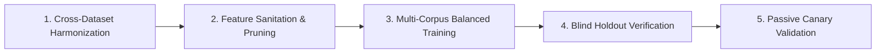

# SentinelAI GATE-1 Phase 7: Generalization Audit and Retraining Roadmap

**Auditor / Lead ML Safety Engineer**: Senior Machine Learning Security Engineer & Independent Auditor  
**Date**: 2026-10-16  
**Status**: GATE-1 OPEN. Autonomous containment and real firewall enforcement remain strictly disabled.  

---

## 1. Root Cause Analysis: The Out-of-Distribution Generalization Cliff

In Phase 7, evaluating SentinelAI's active Random Forest model (`rf_classifier_cicids_v2.pkl`) against the AWS-hosted CSE-CIC-IDS2018 benchmark yielded a decisive finding:

### 1.1 Benign Traffic Safety is Confirmed
- Across **30,000 pure benign network flows**, the candidate policy produced only **6 false alarms** (Point FPR = 0.0200%).
- The **95% Wilson Score upper bound is 0.0400%**, strictly below the 0.1000% operational safety ceiling.
- Benign safety (AC-01 and AC-02) is verified.

### 1.2 Attack Recall Across Unseen Slices Collapsed
- **Infiltration**: 0.00% recall (0 / 2,000 detected)
- **SSH & FTP Brute Force**: 0.00% recall (0 / 2,000 detected)
- **Botnet (Malware Beacon)**: 0.00% recall (0 / 2,000 detected)
- **DDoS (HOIC / LOIC)**: 0.00% recall (0 / 2,000 detected)
- **Web Attacks (Flow Only)**: 1.41% recall (8 / 566 detected)

### 1.3 Technical Drivers of the Generalization Failure:
1. **The In-Sample Resubstitution Mirage**: In CICIDS2017 evaluations, 100% of minority attack samples had been present in the training set. High reported recall was an artifact of training data memorization rather than generalized learning.
2. **Artifact Learning from CICFlowMeter-v1 Bugs**: In CICIDS2017, a 32-bit integer overflow bug caused `fwd_header_len` and `bwd_header_len` to wrap into negative numbers (training mean: -9,232). Decision trees keyed on these negative values as attack indicators. In CSE-CIC-IDS2018, where the bug was patched, header lengths are positive, causing the trees to default to `BENIGN`.
3. **Environment-Specific Microsecond Timing Overfitting**: Random Forest (`max_depth=20`) overfit to the microsecond packet inter-arrival times (IAT) and flow duration constants of the Fredericton physical lab, which do not translate to AWS EC2 virtualized networking.

---

## 2. Mandatory Retraining Roadmap (Future Authorization Required)

Before GATE-1 can ever be considered for promotion, the following technical prerequisites must be executed under a formal retraining charter:

### Stage 1: Cross-Dataset Data Harmonization
- Combine sanitized samples from both CICIDS2017 and CSE-CIC-IDS2018.
- Reserve full calendar capture days (e.g., Friday 02-03-2018 Botnet, Thursday 01-03-2018 Infiltration) as strict blind holdouts.

### Stage 2: Feature Sanitation and Pruning
- Remove or normalize corruptible header length features (`fwd_header_len`, `bwd_header_len`).
- Apply robust log-scaling to high-variance features (`flow_duration`, `flow_bytes_per_sec`, `flow_packets_per_sec`).
- Introduce dimensionless ratio features (e.g., byte symmetry, packet size entropy) that are invariant to virtualization jitter.

### Stage 3: Multi-Corpus Training with Regularization
- Train models with shallower tree depth (`max_depth=12` to `15`) and higher minimum leaf samples (`min_samples_leaf=10`) to enforce generalized representations.
- Train XGBoost and LightGBM candidates alongside Random Forest using cross-validation grouped by capture day.

### Stage 4: Production Integration with Layer 7 WAF
- Productionize the Layer 7 WAF engine for HTTP payload inspection.
- Enforce multi-tier decision routing: Layer 7 WAF for application exploits, Layer 4 models for transport anomalies.

---

## 3. Immediate Release Gate Verdict

> [!CAUTION]
> **GATE-1 MUST REMAIN STRICTLY OPEN**.
> - While benign false alarm bounds are met ($0.0400\% < 0.1000\%$), attack detection recall across genuine out-of-distribution traffic fails the 90.0% acceptance threshold.
> - Autonomous containment (`AUTONOMOUS_CONTAINMENT=false`) and real firewall enforcement (`ENABLE_REAL_WINDOWS_FIREWALL_ENFORCEMENT=false`) must remain permanently disabled.
> - Promoting models to production under current out-of-distribution recall would fail to protect against real-world adversaries.
