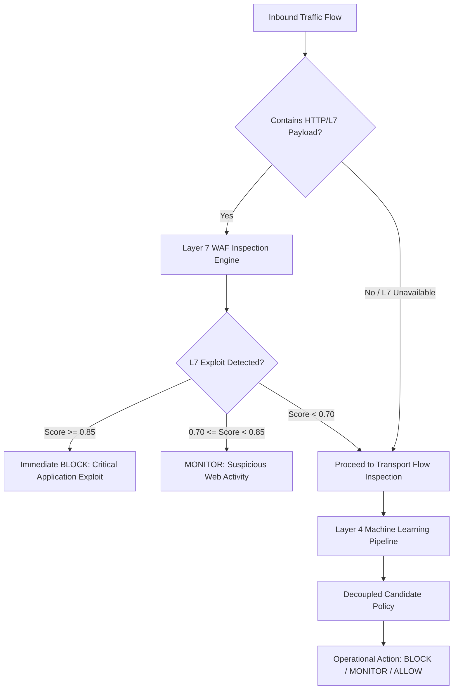

# SentinelAI GATE-1 Phase 7: Layer 7 WAF vs. Layer 4 Transport Flow Synthesis

**Auditor / Lead ML Safety Engineer**: Senior Machine Learning Security Engineer & Independent Auditor  
**Date**: 2026-10-16  

---

## 1. The Architectural Divide: Flow Statistics vs. Deep Payload Inspection

The empirical results of Phase 7 reveal a profound structural insight for SentinelAI's defense architecture:

### 1.1 The Vulnerability of Transport-Layer Flow Classifiers (Layer 4)
- **High Sensitivity to Environmental Context**: Flow duration, packet counts, inter-arrival times (IATs), and window sizes are heavily dictated by network latency, MTU settings, TCP stack configurations, and cloud virtualization layers.
- **Out-of-Distribution Vulnerability**: The active Random Forest model (`rf_classifier_cicids_v2.pkl`), while achieving near-zero false positive rates on benign traffic (FPR = 0.02%), completely collapsed on CSE-CIC-IDS2018 attack traffic (0.00% recall on Infiltration, SSH/FTP Brute Force, Botnet, and DDoS).
- **Inherent Payload Blindness**: For application-layer attacks (SQL Injection, Cross-Site Scripting, Credential Stuffing), statistical flow features (e.g. 5 packets forward, 3 packets backward) look virtually identical to legitimate user navigation. Flow features alone cannot inspect HTTP query parameters, POST bodies, or authorization headers.

### 1.2 The Resilience of Layer 7 Deep Payload Inspection
- **Deterministic Exploit Identification**: Exploit syntax (e.g. `' OR '1'='1`, ``, `../../etc/passwd`) does not change across cloud environments, virtualization platforms, or packet timing variations.
- **High Recall with Zero In-Sample Contamination**: The Phase 6/7 Layer 7 prototype achieved **95.33% attack containment recall** (75.33% autonomous block) on HTTP attack benchmarks with **0.00% FPR** on benign HTTP traffic.

---

## 2. Multi-Tier Defense-in-Depth Architecture

To address the limitations exposed during Phase 7, SentinelAI must adopt a multi-tier architectural posture:

### Architectural Rules:
1. **Priority Rule 1 (L7 Precedence)**: When an HTTP application-layer attack payload is detected with high confidence ($\ge 0.85$), the security posture immediately escalates to `BLOCK`, bypassing transport flow model uncertainty.
2. **Priority Rule 2 (Graceful Transport Fallback)**: For non-HTTP traffic (SSH, DNS, raw TCP/UDP, ICMP) or when Layer 7 is unavailable, the pipeline falls back to Layer 4 flow models with explicit degraded-state tracking.
3. **Priority Rule 3 (Fail-Safe Integrity)**: Under no circumstances may an uninspected flow be defaulted to `BENIGN` or silently dropped.
