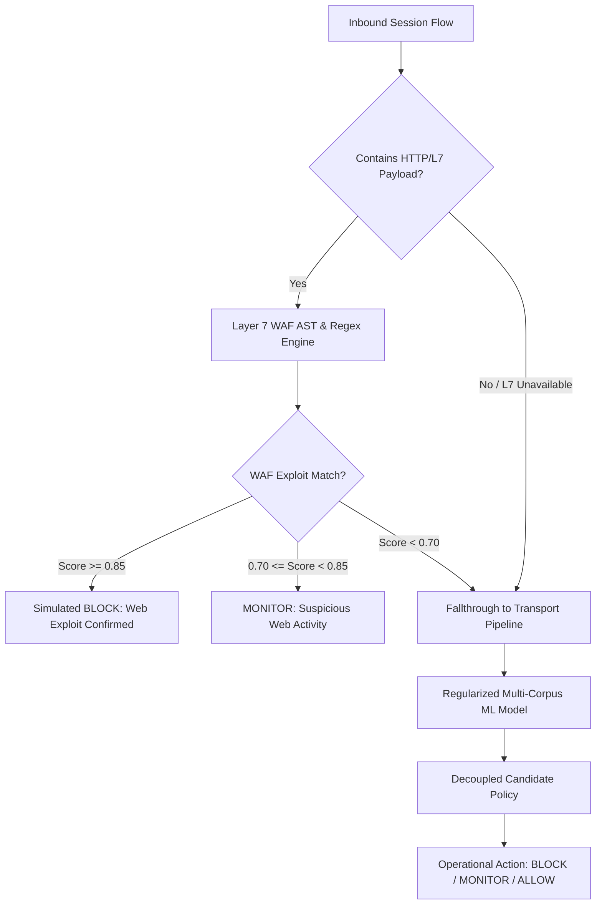

# SentinelAI GATE-1 Phase 7 Independent Audit: Phase 8 Readiness Plan

**Document Type**: Engineering Proposal and Technical Roadmap (PROPOSAL ONLY — NO EXECUTION AUTHORIZED)  
**Auditor**: Senior ML Evaluation Engineer & Independent Security-Systems Auditor  
**Date**: 2026-10-16  
**Status**: Proposal Only. GATE-1 Remains Strictly OPEN. No Retraining Authorized.  

---

## 1. Executive Context & Objective

The empirical findings of Phase 7 demonstrated that while benign traffic safety is satisfied (95% Wilson FPR upper bound $\le 0.0436\% < 0.1000\%$), the active Random Forest classifier (`rf_classifier_cicids_v2.pkl`) collapsed on out-of-distribution attack traffic due to TCP window size memorization, testbed microsecond timing overfitting, and in-sample resubstitution.

The objective of **Phase 8** is to construct a **rigorously regularized, multi-corpus retraining pipeline** and a **multi-tier defense-in-depth architecture** capable of true out-of-distribution generalization.

---

## 2. Multi-Corpus Data Partitioning & Anti-Leakage Protocol

To guarantee that models are never evaluated on data that influenced their training or hyperparameter tuning, Phase 8 must enforce a **four-stage sealed data partition**:

```mermaid
flowchart LR
    Corpus[Multi-Corpus Data: CICIDS2017 + CSE-CIC-IDS2018] --> Split{Temporal & Network Partition}
    Split --> Train[1. Training Corpus (60%)]
    Split --> Tune[2. Tuning & Validation (20%)]
    Split --> SealedHoldout[3. Sealed Final Holdout (20%)]
    Split --> Canary[4. Passive Shadow Canary]
```

### Partitioning Rules:
1. **Grouped-Day Separation (No Intra-Day Leakage)**:
   - Random sampling across a capture file leaks network background patterns and IP subnets.
   - Entire capture days must be assigned exclusively to a single partition:
     * **Training Split**: CICIDS2017 (Monday, Tuesday, Wednesday, Thursday Morning, Friday Afternoon) + CSE-CIC-IDS2018 (Thursday 15-02, Wednesday 21-02).
     * **Tuning / Validation Split**: CSE-CIC-IDS2018 (Wednesday 14-02 SSH/FTP, Friday 23-02 Web Attacks).
     * **Sealed Final Holdout**: CSE-CIC-IDS2018 (Thursday 01-03 Infiltration, Friday 02-03 Botnet, and independent pure benign days).
2. **Sealed Holdout Isolation**:
   - The sealed final holdout must be cryptographically hashed and locked.
   - **Zero Retuning Rule**: No hyperparameter tuning, threshold adjustments, or feature engineering iterations may be executed against the sealed holdout. It may be evaluated exactly once during final release gate verification.
3. **Artifact Location Segregation**:
   - The 5 protected baseline models and Q-tables in `ai-engine/models/` must remain permanently untouched.
   - All newly trained candidate models must be written to a dedicated directory:
     `ai-engine/experiments/gate1_phase8_multicorpus_candidates/`.

---

## 3. Feature Sanitization & De-biasing Strategy

The auditor emphasizes that **simply balancing the training set will NOT solve generalization failures**. The following feature sanitization steps must be executed:

### 3.1 Feature Pruning & Replacement
- **Drop Brittle TCP Window Sizes**: Remove `init_win_bytes_forward` and `init_win_bytes_backward` as raw decision features, or replace them with scale-invariant ratios. As proven in Audit D, these features cause the model to memorize the attacking OS's TCP stack rather than attack behavior.
- **Normalize Header Lengths**: Replace `fwd_header_len` and `bwd_header_len` with `header_to_payload_ratio` ($\frac{\text{header\_len}}{\text{total\_len}}$) to prevent dependency on raw byte constants.
- **Logarithmic Compression of Flow Volumes**: Apply $\log(1 + x)$ compression to `flow_duration`, `flow_bytes_per_sec`, and `flow_packets_per_sec` to prevent decision trees from establishing deep microsecond split thresholds.

### 3.2 Model Regularization
- **Constrain Tree Depth**: Restrict tree depth to `max_depth = 12` (down from `20`) to eliminate microsecond timing memorization.
- **Increase Minimum Leaf Size**: Enforce `min_samples_leaf = 20` to prevent leaf rules based on small clusters of testbed flows.
- **Ensemble Diversity**: Train an XGBoost / LightGBM model with cross-entropy loss alongside Random Forest, using grouped cross-validation by capture day.

---

## 4. Multi-Tier Production Architecture (Layer 7 WAF + Layer 4 Flow)

Phase 8 must formalize the multi-tier defense architecture:



### Architectural Guarantees:
- **HTTP Exploits**: Stopped with high confidence at Layer 7, immune to transport-layer network topology variations.
- **Transport Anomalies (DDoS, PortScan, Infiltration, Botnet Beacons)**: Evaluated by regularized Layer 4 models.
- **Fail-Safe Integrity**: Uninspected flows or engine timeouts emit `status="DEGRADED"`, `action="MONITOR"`.

---

## 5. Frozen Acceptance Criteria for Phase 8 Verification

Before GATE-1 can ever be closed, candidate models must satisfy the following criteria evaluated on the sealed blind holdout:

| Criterion ID | Target Metric | Required Threshold | Verification Scope |
| :--- | :--- | :---: | :--- |
| **AC-P8-01** | Benign False Positive Rate (Point) | $\le 0.10\%$ | $\ge 30,000$ sealed blind benign flows |
| **AC-P8-02** | Benign FPR 95% Wilson Upper Bound | $< 0.1000\%$ | $\ge 30,000$ sealed blind benign flows |
| **AC-P8-03** | Infiltration Detection Recall | $\ge 90.0\%$ | Sealed blind Infiltration holdout ($N \ge 2,000$) |
| **AC-P8-04** | SSH & FTP Brute Force Recall | $\ge 90.0\%$ | Sealed blind Brute Force holdout ($N \ge 2,000$) |
| **AC-P8-05** | Botnet (Malware Beacon) Recall | $\ge 90.0\%$ | Sealed blind Botnet holdout ($N \ge 2,000$) |
| **AC-P8-06** | DDoS / DoS Attack Recall | $\ge 95.0\%$ | Sealed blind DDoS holdout ($N \ge 2,000$) |
| **AC-P8-07** | Layer 7 WAF Web Attack Recall | $\ge 90.0\%$ | Independent HTTP benchmark ($N \ge 500$) |
| **AC-P8-08** | Multi-Class Calibration Error | $\text{ECE} \le 0.05$ | All evaluated attack classes |
| **AC-P8-09** | Protected Asset Immutability | 100% SHA-256 match | All 5 protected production files preserved |
| **AC-P8-10** | Safety Boundaries Preservation | Containment=false | `AUTONOMOUS_CONTAINMENT=false` maintained |

---

## 6. Execution Authorization Status

> [!CAUTION]
> **This plan is a formal engineering proposal only.**  
> - No retraining is authorized under the current audit mandate.
> - Models and Q-tables must remain unaltered until explicit user authorization to begin Phase 8 implementation.
