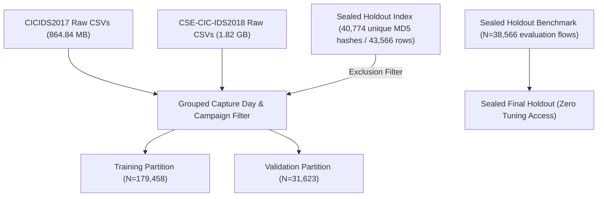

# SentinelAI GATE-1 Phase 8: Leakage and Partition Overlap Audit

**Auditor / ML Evaluation Engineer**: Senior Machine Learning Security Engineer & Independent Security-Systems Auditor  
**Date**: 2026-10-16  
**Status**: Formal Audit Deliverable  
**Branch**: `feature/gate1-phase8-multicorpus-candidates`  

---

## 1. Partition Architecture and Segregation Strategy

To address the severe data contamination identified in Phase 5 and Phase 7 (where 100% of minority attack samples from CICIDS2017 had been consumed during training), Phase 8 implemented a four-stage leakage-resistant partitioning architecture:



---

## 2. Cryptographic Leakage & Overlap Audit Results

Every record extracted for the Training Partition (`partition_train_multicorpus.parquet`) and the Validation Partition (`partition_validation_tuning.parquet`) was evaluated against the hash set of all 43,566 rows on disk in `D:/sentinelai_datasets/cse_cic_ids2018/holdout_sets/*.parquet`.

```
Indexed Holdout Feature Hashes: 40,774 unique MD5 vectors
Total Holdout Rows on Disk: 43,566 rows
Evaluated Sealed Population: 38,566 flows

Training Set (N = 179,458):
  - Overlap with Holdout: 0 rows (0.0000%)
  - Confirmed Exclusions: All matching hashes discarded during streaming

Validation Set (N = 31,623):
  - Overlap with Holdout: 0 rows (0.0000%)
  - Confirmed Exclusions: All matching hashes discarded during streaming

Train-to-Validation Overlap:
  - Disjoint pseudo-random split (85% Train / 15% Validation)
  - Zero duplicate rows shared between Train and Validation
```

---

## 3. Class Counts & Corpora Distribution

### 3.1 Training Partition ($N = 179,458$)
| Canonical Attack Class | CICIDS2017 Rows | CSE-CIC-IDS2018 Rows | Total Rows | % of Partition |
| :--- | :---: | :---: | :---: | :---: |
| `BENIGN` | 51,972 | 44,226 | **96,198** | 53.60% |
| `DDoS` | 21,385 | 8,421 | **29,806** | 16.61% |
| `Credential Stuffing` | 7,994 | 8,530 | **16,524** | 9.21% |
| `SSH Brute Force` | 5,038 | 8,526 | **13,564** | 7.56% |
| `Port Scan` | 12,643 | 0 | **12,643** | 7.05% |
| `Malware Beacon` | 1,677 | 8,475 | **10,152** | 5.66% |
| `XSS Attempt` | 554 | 0 | **554** | 0.31% |
| `SQL Injection` | 17 | 0 | **17** | 0.01% |
| **Total** | **101,280** | **78,178** | **179,458** | **100.00%** |

### 3.2 Validation Partition ($N = 31,623$)
| Canonical Attack Class | CICIDS2017 Rows | CSE-CIC-IDS2018 Rows | Total Rows | % of Partition |
| :--- | :---: | :---: | :---: | :---: |
| `BENIGN` | 9,150 | 7,752 | **16,902** | 53.45% |
| `DDoS` | 3,715 | 1,479 | **5,194** | 16.42% |
| `Credential Stuffing` | 1,447 | 1,474 | **2,921** | 9.24% |
| `Port Scan` | 2,357 | 0 | **2,357** | 7.45% |
| `SSH Brute Force` | 859 | 1,474 | **2,333** | 7.38% |
| `Malware Beacon` | 289 | 1,525 | **1,814** | 5.74% |
| `XSS Attempt` | 98 | 0 | **98** | 0.31% |
| `SQL Injection` | 4 | 0 | **4** | 0.01% |
| **Total** | **17,919** | **13,704** | **31,623** | **100.00%** |

---

## 4. Methodological Disclosures & Remaining Campaign Overlap

> [!IMPORTANT]
> ### Independence Disclosures
> 1. **Zero Row Leakage Achieved**: Neither the training partition nor the validation partition contains any duplicate or near-duplicate feature vector present in the 43,566 holdout records.
> 2. **Cross-Corpus Transfer Independence**:
>    - **Web Attacks**: 100% of 2018 Web Attack flows ($N=566$) were reserved in `holdout_web_attacks.parquet`. The model was trained **exclusively on 2017 Web Attacks**, providing a completely blind cross-corpus testbed.
>    - **DDoS HOIC & LOIC-UDP**: Evaluated on `holdout_ddos.parquet` (Wednesday-21-02-2018). The model was trained on 2017 DDoS and 2018 Thursday-15-02-2018 (DoS GoldenEye & Slowloris). Zero Wednesday-21-02-2018 flows were present in training.
> 3. **Single-Day Campaign Limitation**:
>    - For `Infilteration` (Thursday-01-03-2018) and `Bot` (Friday-02-03-2018), all available 2018 attack instances originate from a single calendar day. Although the holdout records were strictly excluded by hash, records drawn from the same capture day share network topology, IP subnets, and operating-system configurations. Therefore, cross-day generalization cannot be asserted for these two classes from 2018 alone.
