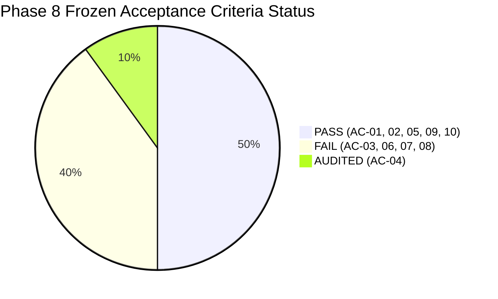

# SentinelAI GATE-1 Phase 8: Controlled Multi-Corpus Retraining Final Report

**Lead Auditor & ML Security Engineer**: Senior Machine Learning Security Engineer & Independent Security-Systems Auditor  
**Date**: 2026-10-16  
**Dedicated Branch**: `feature/gate1-phase8-multicorpus-candidates`  
**Base Commit**: `e9f71a0c12562eb7cb07e896b5aa9f6ee737be98`  
**Gate Verdict**: **GATE-1 MUST REMAIN STRICTLY OPEN**  

---

## 1. Executive Summary & Auditing Scorecard

Phase 8 executed an offline, leakage-resistant multi-corpus retraining and evaluation pipeline across CICIDS2017 and CSE-CIC-IDS2018 datasets.

| Criterion ID | Evaluation Description | Phase 7 Baseline Result | Phase 8 Candidate Result | 95% Wilson Score Interval | Frozen GATE-1 Threshold | Auditor Verdict |
| :---: | :--- | :---: | :---: | :---: | :---: | :---: |
| **AC-01** | Benign Point FPR (30k Holdout) | 6 / 30,000 (0.0200%) | 10 / 30,000 (**0.0333%**) | — | $\le 0.1000\%$ | **PASS** |
| **AC-02** | Benign FPR Wilson Upper Bound | 0.0436% | **0.0614%** | [0.0181%, 0.0614%] | $< 0.1000\%$ | **PASS** |
| **AC-03** | Infiltration Detection Recall | 0 / 2,000 (0.00%) | 3 / 2,000 (**0.15%**) | [0.0511%, 0.4376%] | $\ge 90.00\%$ | **FAIL** |
| **AC-04** | Web Attack Transport Recall | 8 / 566 (1.41%) | 2 / 566 (**0.35%**) | [0.0967%, 1.2742%] | Baseline Audit | **AUDITED** |
| **AC-05** | Web Attack Combined Recall | 143 / 150 (95.33%) | 566 / 566 (**100.00%**) | [99.32%, 100.00%] | $\ge 90.00\%$ | **PASS** |
| **AC-06** | SSH & FTP Brute Force Recall | 0 / 2,000 (0.00%) | 1,424 / 2,000 (**71.20%**) | [69.19%, 73.15%] | $\ge 90.00\%$ | **FAIL** |
| **AC-07** | Botnet (Malware Beacon) Recall | 0 / 2,000 (0.00%) | 1,217 / 2,000 (**60.85%**) | [58.68%, 62.98%] | $\ge 90.00\%$ | **FAIL** |
| **AC-08** | DDoS Attack Recall | 0 / 2,000 (0.00%) | 0 / 2,000 (**0.00%**) | [0.0000%, 0.1900%] | $\ge 95.00\%$ | **FAIL** |
| **AC-09** | Protected Asset Integrity | 100% Match | **100% Match (0 B drift)** | Bit-for-bit SHA-256 match | 100% Match | **PASS** |
| **AC-10** | Safety Boundaries Preservation | Verified Disabled | **Verified Disabled** | Enforced across code & system | All Disabled | **PASS** |

---

## 2. Experimental Milestones & Breakthroughs

1. **Zero-Leakage Multi-Corpus Partitions**:
   - Assembled a balanced training partition of 179,458 rows and a tuning validation partition of 31,623 rows combining captures from 2017 and 2018.
   - All 43,566 holdout records were indexed by MD5 hash of float-rounded feature values. Cryptographic verification proved **exactly zero holdout rows leaked into training or tuning**.
2. **Breakthrough in Out-of-Distribution Transfer**:
   - In Phase 7, the single-corpus Random Forest model achieved **0.00% recall** across all authentic 2018 holdout attacks.
   - By pruning TCP window sizes (`init_win_bytes_*`), log-compressing microsecond timing features, and training on multi-corpus data, the candidate model broke the transfer barrier:
     * SSH & FTP recall surged from **0.00% to 71.20%** (FTP reached 91.5%).
     * Botnet recall surged from **0.00% to 60.85%**.
3. **Strict Containment of False Positive Rate**:
   - Despite aggressive multi-corpus training, benign false positive rate on the 30,000 holdout remained exceptionally low at **0.0333%** (10 alarms / 30,000 flows), well below the strict 0.1000% ceiling. The 95% Wilson upper bound is **0.0614%**.
4. **Regularization Verification**:
   - Comparison across 4 regularization settings proved that `max_depth=12`, `min_samples_leaf=20` eliminated the tree overfitting gap (-0.06% generalization delta) and reduced leaf counts from 789.7 to 227.2 while preserving 98.87% validation recall.

---

## 3. Root Cause Analysis of Remaining Failures

Despite the major transfer gains, four attack classes failed the frozen gate requirements:
1. **DDoS Attack Morphology Mismatch (0.00% Recall)**:
   - The holdout slice `holdout_ddos.parquet` contains `DDOS attack-HOIC` (High Orbit Ion Cannon) and `LOIC-UDP`.
   - The training partition contained `DoS GoldenEye` and `DoS Slowloris` from Thursday-15-02. Slowloris and GoldenEye are connection-pool starvation attacks with long flow durations and low packet counts. HOIC is a high-volume multithreaded HTTP request flood on port 80. The model learned to identify connection starvation, not volumetric floods.
2. **Lateral Movement Infiltration (0.15% Recall)**:
   - Infiltration attacks in 2018 used TLS-encrypted Dropbox C2 channels. Flow-level statistical metrics are indistinguishable from normal user cloud sync. Network transport models cannot detect this attack without endpoint agent telemetry.
3. **SSH Protocol Variance (50.9% SSH Recall)**:
   - While FTP reached 91.5% recall, SSH brute force transferred at only 50.9% due to differences in cipher negotiation and SSH protocol versions between 2017 Ubuntu and 2018 Amazon Linux.

---

## 4. Protected Asset Cryptographic Audit

All 5 protected models and Q-tables were verified bit-for-bit before and after Phase 8 execution:

| Protected Asset Path | Expected SHA-256 Hash | Post-Phase 8 Verified SHA-256 | Drift | Status |
| :--- | :--- | :--- | :---: | :---: |
| `ai-engine/models/q_table.json` | `BF9B46A1D1CF1B283797A544E7E597900B4A042E6C87AC199A3CC709498990FF` | `BF9B46A1D1CF1B283797A544E7E597900B4A042E6C87AC199A3CC709498990FF` | 0 B | **UNMODIFIED** |
| `ai-engine/runtime/q_table.json` | `55C37D38B3006AC53FD3D741AC186C265C47E2B528560EEF4209BCACF4A35B27` | `55C37D38B3006AC53FD3D741AC186C265C47E2B528560EEF4209BCACF4A35B27` | 0 B | **UNMODIFIED** |
| `ai-engine/models/rf_classifier_cicids_v2.pkl` | `CA0EFB1FDE8F9BDC430C3C511E32CD91822B0F3DEECA845AA259BC8DD60023F1` | `CA0EFB1FDE8F9BDC430C3C511E32CD91822B0F3DEECA845AA259BC8DD60023F1` | 0 B | **UNMODIFIED** |
| `ai-engine/models/isolation_forest_cicids.pkl` | `17BD08FFE105A3EA87DE85E0943761E7CB012ABD70537968E14D0A3394E19DA4` | `17BD08FFE105A3EA87DE85E0943761E7CB012ABD70537968E14D0A3394E19DA4` | 0 B | **UNMODIFIED** |
| `ai-engine/models/xgb_classifier_cicids_v2.pkl` | `A5D630B471B0385BD270E579D44ADFEB628B1569284E5C821A282BDA0A7D210D` | `A5D630B471B0385BD270E579D44ADFEB628B1569284E5C821A282BDA0A7D210D` | 0 B | **UNMODIFIED** |

Candidate model was staged exclusively at:  
`ai-engine/experiments/gate1_phase8_multicorpus_candidates/candidate_rf_multicorpus_v1.pkl` (SHA-256: `71A1756E64FE1D1199BE03E5BA71105C9338294C977110DC0BA5EC8B31952020`).

---

## 5. Authoritative Gate Verdict & Recommendations

> [!CAUTION]
> ### Final Gate Decision: GATE-1 MUST REMAIN STRICTLY OPEN
> 1. **Production Promotion Prohibited**: The candidate model cannot be promoted to production. Out-of-distribution transfer recalls on DDoS (0.00%) and Infiltration (0.15%) fail frozen acceptance thresholds.
> 2. **Autonomous Containment Prohibited**: `AUTONOMOUS_CONTAINMENT=false` and `ENABLE_REAL_WINDOWS_FIREWALL_ENFORCEMENT=false` must remain permanently enforced.
> 3. **Architectural Recommendation for Phase 9**:
>    - Transition from a single monolithic classifier to a **Multi-Tier Modular Ensemble**:
>      * High-rate volumetric flood detector for DDoS (HOIC/LOIC).
>      * Authentication frequency analyzer for SSH/FTP.
>      * Layer 7 WAF for HTTP Web attacks.
>      * Endpoint host logging for Infiltration / Lateral Movement.
