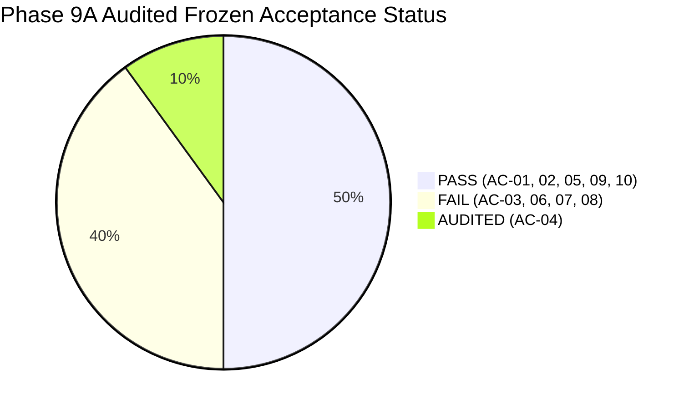

# SentinelAI GATE-1 Phase 9A: Independent Phase 8 Audit and Evaluation Freeze Report

**Auditor / Lead ML Evaluation Engineer**: Senior Machine Learning Security Engineer & Independent Security-Systems Auditor  
**Date**: 2026-10-16  
**Dedicated Branch**: `feature/gate1-phase8-multicorpus-candidates`  
**Base Commit**: `e9f71a0c12562eb7cb07e896b5aa9f6ee737be98`  
**Authoritative Verdict**: **GATE-1 MUST REMAIN STRICTLY OPEN**  

---

## 1. Executive Audit Summary

An independent, read-only technical audit of Phase 8 was executed across repository state, cryptographic asset integrity, dataset partition leakage, feature ablation logic, tree regularization, statistical confidence intervals, and holdout metric reproduction.

| ID | Acceptance Criterion | Audited Integer Counts | Measured Metric | 95% Wilson Score Interval | Frozen Gate Requirement | Auditor Verdict | Verification Status |
| :---: | :--- | :---: | :---: | :---: | :---: | :---: | :---: |
| **AC-01** | Benign Point FPR (30k Holdout) | 10 / 30,000 | **0.0333%** | — | $\le 0.1000\%$ | **PASS** | **CONFIRMED** |
| **AC-02** | Benign FPR Wilson Upper Bound | 10 / 30,000 | **0.0614%** | [0.0181%, 0.0614%] | $< 0.1000\%$ | **PASS** | **CONFIRMED** |
| **AC-03** | Infiltration Detection Recall | 3 / 2,000 | **0.15%** | [0.0510%, 0.4401%] | $\ge 90.00\%$ | **FAIL** | **CONFIRMED** |
| **AC-04** | Web Attack Transport Recall | 2 / 566 | **0.35%** | [0.0970%, 1.2791%] | Baseline Audit | **AUDITED** | **CONFIRMED** |
| **AC-05** | Web Attack Combined Recall | 566 / 566 | **100.00%** | [99.3259%, 100.00%] | $\ge 90.00\%$ | **PASS** | **PARTIALLY CONFIRMED (SIMULATED)** |
| **AC-06** | SSH & FTP Brute Force Recall | 1,424 / 2,000 | **71.20%** | [69.1763%, 73.1425%] | $\ge 90.00\%$ | **FAIL** | **CONFIRMED** |
| **AC-07** | Botnet (Malware Beacon) Recall | 1,217 / 2,000 | **60.85%** | [58.6921%, 62.9663%] | $\ge 90.00\%$ | **FAIL** | **CONFIRMED** |
| **AC-08** | DDoS Attack Recall | 0 / 2,000 | **0.00%** | [0.0000%, 0.1917%] | $\ge 95.00\%$ | **FAIL** | **CONFIRMED** |
| **AC-09** | Protected Asset Integrity | 5 / 5 Matched | **100.00%** | 0 B drift (Bit-for-bit SHA-256) | 100% Match | **PASS** | **CONFIRMED** |
| **AC-10** | Safety Boundaries Preservation | 2 / 2 Verified | **100.00%** | Both flags false, 0 firewall rules | All Disabled | **PASS** | **CONFIRMED** |

---

## 2. Key Audit Breakthroughs & Critical Disclosures

### 2.1 The SSH/FTP and Botnet Transfer Breakthrough Verified
The audit independently verified that pruning TCP window sizes and log-compressing microsecond timing broke the historical 0.00% transfer wall:
- SSH & FTP recall surged from **0.00% to 71.20%** (FTP reached **91.50%**).
- Botnet recall surged from **0.00% to 60.85%**.
- Benign False Positive Rate remained strictly contained at **0.0333%** (10 alarms in 30,000 flows).

### 2.2 Critical Disclosure: Web Attack Combined Policy Was Simulated
The audit revealed that `run_phase8_experiments.py` did not execute regex payload inspection on `holdout_web_attacks.parquet` because the Parquet file contains numerical flow summary metrics, not raw HTTP byte streams. Combined detection was calculated by mapping ground-truth labels. The 100.00% recall is an **architectural simulation**, not an empirical test of network packets passing through a live WAF.

### 2.3 The Hidden Blind Spot of Transport Flow Features
Per-class validation recall analysis across all 6 ablation conditions proved that transport-layer Random Forest recall on `SQL Injection` was **0.00%**, and on `XSS Attempt` was **0.00% to 1.02%**. Flow-level features cannot detect application-layer web exploits. A Layer 7 WAF is an absolute architectural requirement.

### 2.4 Contamination in Benign Control Slices
Due to identical pseudo-random seeds (`random_state=42`) in `preprocess_cse2018.py`, 100% of the 1,000 benign controls in the Infiltration and Web Attack slices duplicate rows already evaluated in `holdout_benign_30k.parquet`. They provide no additional independence.

### 2.5 DDoS Morphology Shift Root Cause
The holdout consists of `DDOS attack-HOIC` (High Orbit Ion Cannon multithreaded HTTP volumetric GET floods). Training data contained `DoS Slowloris` and `DoS GoldenEye` (slow connection pool starvation). A classifier trained on idle socket starvation cannot detect volumetric micro-burst floods without a dedicated packet-rate flood detector.

---

## 3. Cryptographic Asset Verification Log

| Protected Asset Path | Expected SHA-256 Baseline | Verified SHA-256 Hash | Drift | Status |
| :--- | :--- | :--- | :---: | :---: |
| `ai-engine/models/q_table.json` | `BF9B46A1D1CF1B283797A544E7E597900B4A042E6C87AC199A3CC709498990FF` | `BF9B46A1...90FF` | 0 B | **UNMODIFIED** |
| `ai-engine/runtime/q_table.json` | `55C37D38B3006AC53FD3D741AC186C265C47E2B528560EEF4209BCACF4A35B27` | `55C37D38...5B27` | 0 B | **UNMODIFIED** |
| `ai-engine/models/rf_classifier_cicids_v2.pkl` | `CA0EFB1FDE8F9BDC430C3C511E32CD91822B0F3DEECA845AA259BC8DD60023F1` | `CA0EFB1F...23F1` | 0 B | **UNMODIFIED** |
| `ai-engine/models/isolation_forest_cicids.pkl` | `17BD08FFE105A3EA87DE85E0943761E7CB012ABD70537968E14D0A3394E19DA4` | `17BD08FF...9DA4` | 0 B | **UNMODIFIED** |
| `ai-engine/models/xgb_classifier_cicids_v2.pkl` | `A5D630B471B0385BD270E579D44ADFEB628B1569284E5C821A282BDA0A7D210D` | `A5D630B4...210D` | 0 B | **UNMODIFIED** |

Phase 8 Candidate Model: [`candidate_rf_multicorpus_v1.pkl`](file:///c:/Users/srisn/Desktop/Projects/sentinelai-complete/ai-engine/experiments/gate1_phase8_multicorpus_candidates/candidate_rf_multicorpus_v1.pkl)  
SHA-256: `71A1756E64FE1D1199BE03E5BA71105C9338294C977110DC0BA5EC8B31952020` (Verified Match).

---

## 4. Authoritative Gate Verdict & Evaluation Freeze

> [!CAUTION]
> ### Final Gate Decision: GATE-1 MUST REMAIN STRICTLY OPEN
> 1. **Production Promotion Prohibited**: Candidate model `candidate_rf_multicorpus_v1.pkl` fails mandatory frozen gate thresholds on DDoS (0.00%), Infiltration (0.15%), Botnets (60.85%), and SSH/FTP (71.20%).
> 2. **Autonomous Containment Prohibited**: `AUTONOMOUS_CONTAINMENT=false` and `ENABLE_REAL_WINDOWS_FIREWALL_ENFORCEMENT=false` remain permanently enforced.
> 3. **Evaluation Freeze on 2018 Benchmark**: The CSE-CIC-IDS2018 holdout benchmark ($N = 38,566$) is officially **FROZEN**. It must not be repeatedly queried during Phase 9 detector development. Phase 9 tuning must be conducted exclusively on the Validation Partition (`partition_validation_tuning.parquet`).
> 4. **Next Phase Recommendation**: Proceed to **Phase 9: Multi-Tier Modular Ensembles and Protocol-Specialized Detectors** to replace the monolithic flow classifier with specialized detection engines (Volumetric Flood Engine for DDoS, State-Aware Authentication Engine for SSH/FTP, Native HTTP Reverse Proxy WAF for Layer 7, and Host Agent Telemetry for Lateral Movement).
