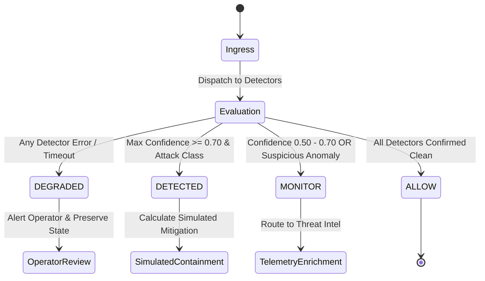

# SentinelAI GATE-1 Phase 9B: Common Detector Contract and Failure-Safe Policy

**Author / Senior Reviewer**: Senior Security Architect, Machine Learning Engineer & Independent Security-Systems Reviewer  
**Date**: 2026-10-16  
**Execution Context**: Read-Only Architecture Design & Safety Review (Non-Production)  
**Dedicated Branch**: `feature/gate1-phase8-multicorpus-candidates`  
**Base Commit**: `e9f71a0c12562eb7cb07e896b5aa9f6ee737be98`  

---

## 1. Unified Modular Detector Interface

All specialized detection engines (Volumetric Flood, Authentication Abuse, Reverse-Proxy WAF, Host Telemetry) must adhere to a strict, typed JSON contract:

```json
{
  "$schema": "https://json-schema.org/draft/2020-12/schema",
  "title": "SentinelModularDetectorEvent",
  "type": "object",
  "required": [
    "detector_id",
    "detector_version",
    "observation_timestamp",
    "correlation_id",
    "decision",
    "confidence_score",
    "severity",
    "telemetry_coverage"
  ],
  "properties": {
    "detector_id": {
      "type": "string",
      "enum": ["DET_VOLUMETRIC_FLOOD", "DET_AUTH_ABUSE", "DET_L7_WAF", "DET_HOST_TELEMETRY"]
    },
    "detector_version": { "type": "string", "pattern": "^\\d+\\.\\d+\\.\\d+$" },
    "observation_timestamp": { "type": "string", "format": "date-time" },
    "correlation_id": { "type": "string", "format": "uuid" },
    "decision": {
      "type": "string",
      "enum": ["ALLOW", "MONITOR", "DETECTED", "DEGRADED", "UNAVAILABLE"]
    },
    "confidence_score": {
      "type": "number",
      "minimum": 0.0,
      "maximum": 1.0
    },
    "severity": {
      "type": "string",
      "enum": ["CRITICAL", "HIGH", "MEDIUM", "LOW", "INFO"]
    },
    "evidence": {
      "type": "object",
      "properties": {
        "reason_code": { "type": "string" },
        "matched_rules": { "type": "array", "items": { "type": "string" } },
        "indicators": { "type": "object" },
        "raw_features_subset": { "type": "object" }
      },
      "required": ["reason_code"]
    },
    "telemetry_coverage": {
      "type": "object",
      "properties": {
        "status": { "type": "string", "enum": ["FULL", "PARTIAL", "NONE"] },
        "missing_fields": { "type": "array", "items": { "type": "string" } },
        "sampling_ratio": { "type": "number", "minimum": 0.0, "maximum": 1.0 }
      },
      "required": ["status"]
    },
    "latency_ms": { "type": "number", "minimum": 0.0 },
    "error": {
      "type": "object",
      "properties": {
        "code": { "type": "string" },
        "message": { "type": "string" }
      }
    }
  }
}
```

---

## 2. Decision State Machine & Consensus Rules

The modular orchestrator aggregates outputs from multiple detectors for each event:



### 2.1 Multi-Detector Conflict Resolution Rules
1. **Maximum Severity Precedence**: If any specialized detector triggers `DETECTED` with confidence $\ge 0.70$, the consolidated event is elevated to `DETECTED`.
2. **Layer Specialization Precedence**:
   - For HTTP application exploits, Tier 2 (L7 WAF) overrides Tier 1 (Transport Flow), because transport flow models have a proven 0.35% blind spot.
   - For volumetric floods (PPS saturation), Tier 1 (Volumetric) overrides Layer 7 request parsing.
3. **No Silent Allow**: If a detector fails to inspect an event due to timeout or missing fields, the aggregate state **cannot** be marked as a verified `ALLOW`. The event status must report `DEGRADED`.

---

## 3. Mandatory Fail-Safe Policies

### 3.1 Strict Finite-Number and Out-of-Range Enforcement
- All `confidence_score` and `threat_score` values must satisfy:
  $$\text{score} \in \mathbb{R}, \quad 0.0 \le \text{score} \le 1.0, \quad \neg \text{isnan}(\text{score}), \quad \neg \text{isinf}(\text{score})$$
- If a detector emits `NaN`, `+Infinity`, `-Infinity`, `null`, or an out-of-range number:
  * The orchestrator rejects the output immediately.
  * Emits error code `INVALID_NUMERICAL_SCORE`.
  * The detector state is forced to `DEGRADED`.
  * The invalid score is **never** coerced to `0.0` or treated as benign.

### 3.2 Detector Timeout and Process Failure Policy
- **Hard Timeout**: 1,500 ms execution deadline per detector.
- If a detector exceeds the timeout:
  * Sub-process / thread is aborted cleanly.
  * Event state is marked `DEGRADED` with reason `DETECTOR_TIMEOUT`.
  * Event is forwarded to operator audit logs; fail-closed monitoring is triggered.

### 3.3 Partial Inspection & Unsupported Protocols
- When network traffic uses non-standard or unsupported encapsulations (e.g. non-standard tunneling):
  * Emits `telemetry_coverage: { status: "PARTIAL", missing_fields: [...] }`.
  * Reason code `UNSUPPORTED_PROTOCOL_ENCAPSULATION`.
  * The system records the observation without assuming clean traffic.

### 3.4 Stale Rules & Model Version Invariant
- Every detector event logs `detector_version`.
- If a detector is running with an expired signature database or out-of-date model artifact:
  * Orchestrator flags `STALE_DETECTOR_VERSION`.
  * Prevents autonomous containment recommendations until updated.

### 3.5 Audit Sink Failure Behavior
- If MongoDB or the structured audit log buffer is unreachable:
  * The orchestrator caches audit records in an in-memory ring buffer (up to 10,000 events).
  * System alerts operators via stderr and fallback health endpoints.
  * Real enforcement remains permanently locked.

---

## 4. Separation of Detection and Mitigation

In accordance with mandatory safety boundaries:
1. **Detection is Read-Only**: Specialized detectors output threat classifications, confidence metrics, and evidence indicators.
2. **Mitigation is Exclusively Simulated**:
   - `simulated_block_decision: true` reflects an architectural calculation.
   - No firewall rules, IP route nulls, or network connection terminations are executed.
   - `AUTONOMOUS_CONTAINMENT=false` and `ENABLE_REAL_WINDOWS_FIREWALL_ENFORCEMENT=false` remain hardcoded invariants.
