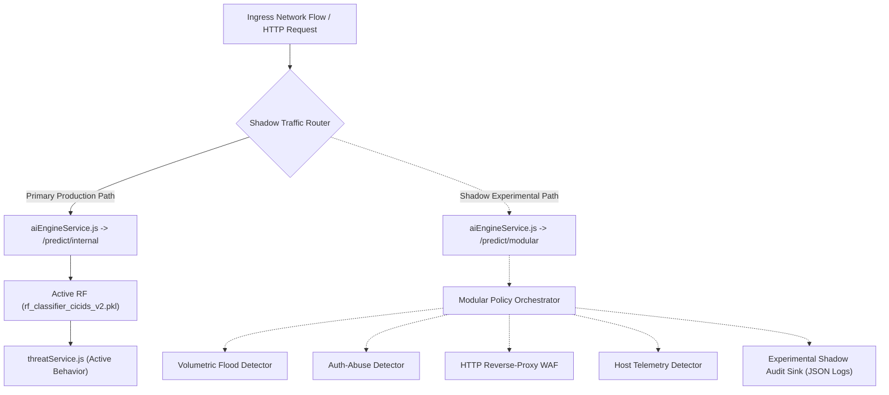

# SentinelAI GATE-1 Phase 9B: Integration, Observability & Rollback Plan

**Author / Senior Reviewer**: Senior Security Architect, Machine Learning Engineer & Independent Security-Systems Reviewer  
**Date**: 2026-10-16  
**Execution Context**: Read-Only Architecture Design & Safety Review (Non-Production)  
**Dedicated Branch**: `feature/gate1-phase8-multicorpus-candidates`  
**Base Commit**: `e9f71a0c12562eb7cb07e896b5aa9f6ee737be98`  

---

## 1. Integration Architecture with Existing Services

The current SentinelAI production architecture couples inference tightly through a single monolithic endpoint:

```
[Ingress Network Flow] 
       │
       ▼
backend/services/aiEngineService.js  ──(HTTP POST /predict/internal)──►  ai-engine/inference/predictor.py
       │                                                                                │
       ▼                                                                                ▼
backend/services/threatService.js    ◄──(aiScore, severity, confidence, predictedClass)──┘
       │
       ▼
MongoDB ThreatLog & Socket.IO threat:new
```

### 1.1 Proposed Modular Integration Architecture
To integrate four specialized detectors without destabilizing active production paths, Phase 9B designs a **Shadow Modular Orchestrator**:



### 1.2 Interface Incompatibilities Identified in Inspected Code
A source audit of [`backend/services/aiEngineService.js`](file:///c:/Users/srisn/Desktop/Projects/sentinelai-complete/backend/services/aiEngineService.js) and [`ai-engine/inference/predictor.py`](file:///c:/Users/srisn/Desktop/Projects/sentinelai-complete/ai-engine/inference/predictor.py) revealed two structural incompatibilities:
1. **Single Flow Vector Constraint**:
   `predictRecord(record)` currently accepts only a flat dictionary of 53 numerical flow features. It cannot ingest raw HTTP request bodies, URIs, authentication event streams, or host process IDs.
   *Resolution*: A dedicated experimental endpoint `/predict/modular` must be specified, accepting a polymorphic payload:
   ```json
   {
     "flow_telemetry": { ... },
     "http_request": { "method": "POST", "uri": "/login", "headers": {...}, "body": "..." },
     "auth_event": { "protocol": "SSH", "user": "admin", "status": "FAILED" },
     "host_telemetry": { "process_name": "powershell.exe", "parent_pid": 1024 }
   }
   ```
2. **Coupled Anomaly Scoring**:
   `predictor.py` forces a coupled score `0.7 * rf_s + 0.3 * if_sig`. This suppresses PortScan detection when the Isolation Forest scores traffic as normal.
   *Resolution*: Specialized detectors report independent confidence scores and reason codes directly to the orchestrator.

---

## 3. Dynamic Feature Flags & Instant Rollback Mechanism

All modular detector components are isolated behind strict dynamic feature flags:

```javascript
// Environment / System Setting Flags:
ENABLE_EXPERIMENTAL_MODULAR_DETECTORS = false  // Default: Disabled
MODULAR_DETECTOR_SHADOW_MODE = true            // Runs in background without altering active ThreatLog
MODULAR_DETECTOR_TIMEOUT_MS = 1500             // Strict per-detector timeout
```

### Fast Rollback Procedure
If any modular detector exhibits high latency, unhandled exceptions, or false alarms during future testing:
1. Set `ENABLE_EXPERIMENTAL_MODULAR_DETECTORS=false` via configuration or environment variable.
2. System immediately bypasses modular dispatch and executes 100% legacy production code paths without server restart.
3. Protected assets remain untouched, guaranteeing zero operational risk.

---

## 4. Structured Audit Logging & Traceability

Every detection decision produces an immutable, structured audit entry linking alerts to their underlying physical evidence:

```json
{
  "event_id": "evt_883a1b02-73a4-4f01",
  "correlation_id": "corr_c9102844-3011",
  "timestamp": "2026-10-16T23:55:00.000Z",
  "source_ip": "192.168.1.105",
  "target_ip": "10.0.0.5",
  "target_port": 80,
  "consensus_decision": "DETECTED",
  "max_severity": "CRITICAL",
  "active_detectors": {
    "DET_L7_WAF": {
      "version": "1.0.0",
      "decision": "DETECTED",
      "confidence": 0.98,
      "severity": "CRITICAL",
      "matched_rules": ["OWASP_CRS_942100_SQLI"],
      "evidence": { "matched_string": "' OR 1=1 --", "parameter": "username" }
    },
    "DET_VOLUMETRIC_FLOOD": {
      "version": "1.0.0",
      "decision": "ALLOW",
      "confidence": 0.05,
      "evidence": { "pps": 12.4, "baseline_pps": 10.0 }
    }
  },
  "containment_action": {
    "simulated_block": true,
    "real_enforcement_executed": false,
    "safety_reason": "ENABLE_REAL_WINDOWS_FIREWALL_ENFORCEMENT is false"
  }
}
```

---

## 5. Duplicate-Alert Suppression & Alert Storm Mitigation

During volumetric floods (HOIC) or high-speed brute force (Patator), an attacker generates thousands of connections per minute. Unfiltered alerting would overwhelm MongoDB and operator consoles.

### De-duplication Policy
- **Sliding De-duplication Window**: 60 seconds per `(SourceIP, DestinationPort, AttackType)` tuple.
- **Aggregation Logic**:
  * First detection creates a `ThreatLog` record and emits an operator alert.
  * Subsequent detections within the 60-second window increment an `eventCount` counter and update `lastSeenTimestamp` without generating new database records or push notifications.
  * Exceeding 1,000 events/minute elevates severity to `CRITICAL` with an aggregated summary report.

---

## 6. Surfacing DEGRADED State in UI & Avoiding Misleading Block Status

1. **Explicit DEGRADED Visibility**:
   - When a detector times out or receives malformed data, `status: 'DEGRADED'` is recorded in `ThreatLog`.
   - The frontend console renders a distinct amber `[DEGRADED]` badge with a tooltip detailing the affected detector (e.g. `L7 WAF Unavailable - Fallback to Transport`).
2. **Clear UI Distinction for Simulated Containment**:
   - The UI must **never** state "IP Blocked" when real firewall enforcement is disabled.
   - The frontend displays:
     * Label: `[SIMULATED BLOCK]` or `[MITIGATION RECOMMENDED]`.
     * Detail: `"Action simulated by safety gate. Real Windows Firewall enforcement is disabled."`.
   - Prevents operators from falsely assuming active network protection has occurred.
