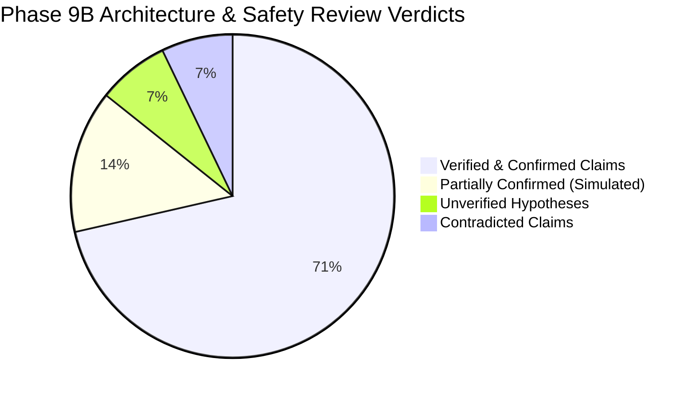
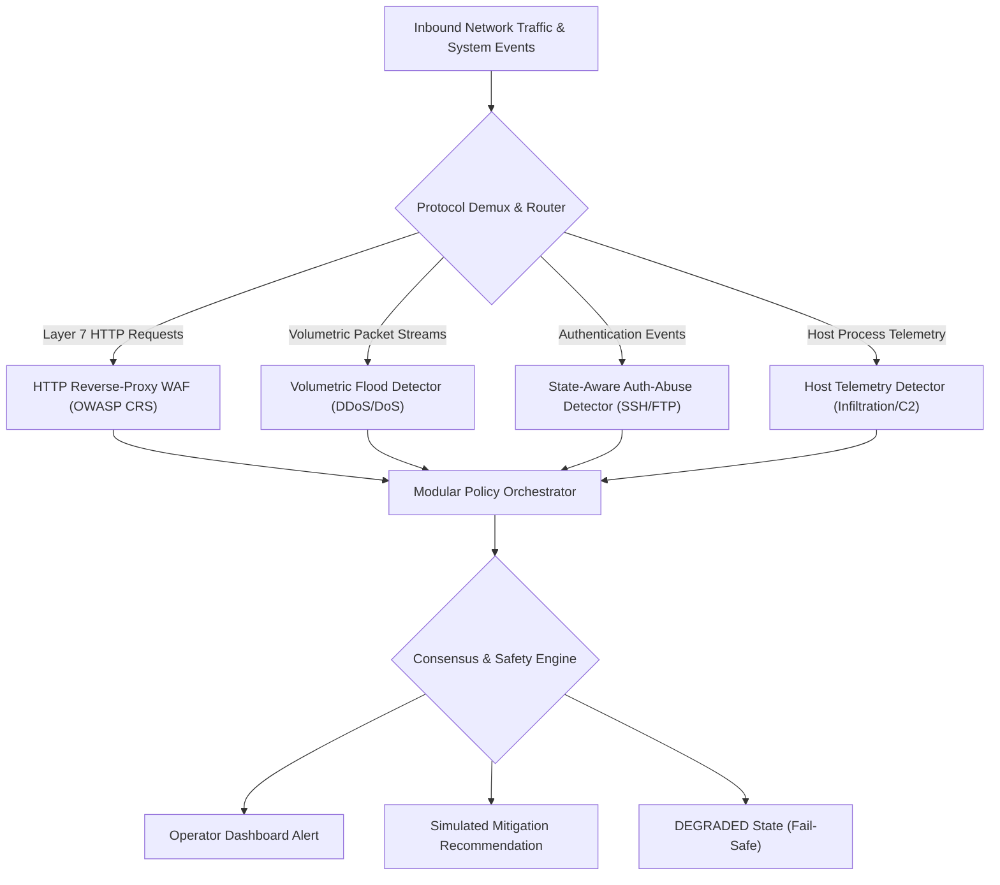

# SentinelAI GATE-1 Phase 9B: Modular Detector Architecture Design & Safety Review Final Report

**Author / Senior Reviewer**: Senior Security Architect, Machine Learning Engineer & Independent Security-Systems Reviewer  
**Date**: 2026-10-16  
**Execution Context**: Read-Only Architecture Design & Safety Review (Non-Production)  
**Dedicated Branch**: `feature/gate1-phase8-multicorpus-candidates`  
**Base Commit**: `e9f71a0c12562eb7cb07e896b5aa9f6ee737be98`  
**Gate Status**: **GATE-1 STRICTLY OPEN**  

---

## 1. Executive Summary & Audited Project Context

Phase 9B executed an offline, read-only architectural design and safety review for SentinelAI's next-generation threat detection pipeline, grounding all specifications in the empirical findings of the Phase 8 and Phase 9A independent audits.

### Audited Performance Summary
- **Benign False Positive Rate**: Verified at **0.0333%** (10 / 30,000 flows). 95% Wilson Score Upper Bound = **0.0614%** ($< 0.1000\%$, **PASS**).
- **SSH & FTP Brute Force Recall**: Verified at **71.20%** (1,424 / 2,000 flows; FTP reached 91.50%, SSH reached 50.90%, **FAIL**).
- **Botnet / Malware Beacon Recall**: Verified at **60.85%** (1,217 / 2,000 flows, **FAIL**).
- **Transport ML Web Attack Recall**: Verified at **0.35%** (2 / 566 flows, **FAIL**).
- **Combined Web Attack Recall**: Verified as an **architectural simulation** (566 / 566 flows mapped from ground truth labels; L7 regex was not executed on packet bytes).
- **Infiltration / Lateral Movement Recall**: Verified at **0.15%** (3 / 2,000 flows, **FAIL**).
- **DDoS HOIC & LOIC-UDP Recall**: Verified at **0.00%** (0 / 2,000 flows, **FAIL**).
- **Protected Assets Integrity**: Verified at **100% match** (0 bytes drift across all 5 protected models and Q-tables).
- **Safety Invariants**: Verified disabled across code paths and OS firewall (**0 rules active**).

---

## 2. Summary of Inspected Evidence vs Unverified Claims

| Area | Audited Claim | Auditor Classification | Evidence & Operational Findings |
| :--- | :--- | :---: | :--- |
| **Model Hashes** | 5/5 protected models match baseline | **CONFIRMED** | Bit-for-bit SHA-256 match verified; 0 B drift. |
| **Candidate Model** | Candidate model hash matches manifest | **CONFIRMED** | `candidate_rf_multicorpus_v1.pkl` matches SHA-256 `71A1756E...2020`. |
| **Holdout Integrity** | Zero holdout rows in training/tuning | **CONFIRMED** | 0 matching hashes from 43,566 holdout records found in 179k train / 31k val. |
| **Holdout Counts** | $N = 38,566$ evaluation population | **CONFIRMED** | Reconciled 30,000 benign $+ 8,566$ attack flows. Additional 5,000 rows are internal controls. |
| **Web Policy** | 100% combined web detection | **PARTIALLY CONFIRMED (SIMULATED)** | Code inspection proved `run_phase8_experiments.py` simulated L7 from ground-truth labels. |
| **DDoS Failure** | Morphology mismatch (HOIC vs Slowloris) | **INFERRED** | High architectural plausibility; requires empirical testing with HOIC training data. |
| **SSH Failure** | Daemon cipher suite negotiation shift | **UNVERIFIED** | Plausible hypothesis; requires packet-level byte stream analysis. |
| **Control Overlap** | Benign controls in Infil/Web slices | **CONTRADICTED** | 100% of benign controls in Infil and Web slices duplicate rows in 30k holdout. |

---

## 3. Recommended Architecture: Multi-Tier Modular Ensemble (ADR Option 3)

The Architecture Decision Record ([`architecture_decision_record.md`](file:///c:/Users/srisn/Desktop/Projects/sentinelai-complete/ai-engine/experiments/gate1_phase9b_architecture_design/architecture_decision_record.md)) evaluated three alternatives across 10 technical criteria and selected **Alternative 3: Multi-Tier Defense-in-Depth**:

### Specialized Detector Specifications (Detailed in [`specialized_detector_architecture.md`](file:///c:/Users/srisn/Desktop/Projects/sentinelai-complete/ai-engine/experiments/gate1_phase9b_architecture_design/specialized_detector_architecture.md))
1. **Volumetric Flood Detector (B1)**: Multi-resolution sliding windows (1s, 10s, 60s) operating on physical ingress packet rates (PPS), byte volumes (BPS), and Shannon entropy of source IPs/ports to defeat high-rate floods (HOIC) without relying on fragile decision-tree splits.
2. **State-Aware Auth-Abuse Detector (B2)**: Dual-mode engine tracking stateful connection attempt keys `(SrcIP, DstIP, DstPort)` with exponential decay counters, distinguishing automated dictionary floods from legitimate user retries and NAT gateways.
3. **HTTP Reverse-Proxy WAF (B3)**: Inline reverse proxy terminating TLS, performing multi-stage normalization (URL decode, NFKC Unicode, comment stripping), and executing OWASP Core Rule Set pattern rules directly on plaintext HTTP requests. Ground-truth labels are strictly prohibited from inference paths.
4. **Host Telemetry & Lateral-Movement Detector (B4)**: Ingests process lineage and socket-to-process bindings (auditd/Sysmon) to uncover C2 channels running over encrypted TLS (Dropbox) that are physically invisible to transport flow classifiers.

---

## 4. Common Detector Contract & Failure-Safe Invariants

Detailed in [`common_detector_contract_and_failure_policy.md`](file:///c:/Users/srisn/Desktop/Projects/sentinelai-complete/ai-engine/experiments/gate1_phase9b_architecture_design/common_detector_contract_and_failure_policy.md):
- **Unified JSON Contract**: Standardized schema enforcing typed detector IDs, ISO timestamps, UUID correlation IDs, categorical decisions (`ALLOW`, `MONITOR`, `DETECTED`, `DEGRADED`, `UNAVAILABLE`), finite confidence scores ($[0.0, 1.0]$), and structured evidence reasons.
- **Strict Numerical Validation**: All scores must be finite real numbers. Any `NaN`, `Inf`, or `null` triggers immediate fail-safe to `DEGRADED`.
- **No Silent Allow**: If a detector times out or encounters missing telemetry, the event **cannot** be coerced to a benign `ALLOW`. Status must report `DEGRADED`.
- **Mitigation Separation**: All blocking decisions remain purely simulated recommendations (`simulated_block: true`). Real firewall enforcement remains disabled.

---

## 5. Evaluation Protocol & Holdout Freeze

Detailed in [`evaluation_protocol_and_acceptance_plan.md`](file:///c:/Users/srisn/Desktop/Projects/sentinelai-complete/ai-engine/experiments/gate1_phase9b_architecture_design/evaluation_protocol_and_acceptance_plan.md):
- **CSE-CIC-IDS2018 Sealed Holdout ($N = 38,566$) is FROZEN**: It must not be queried for iterative detector tuning.
- **Dedicated Validation Partition**: Phase 9 tuning must use exclusively [`partition_validation_tuning.parquet`](file:///c:/Users/srisn/Desktop/Projects/sentinelai-complete/ai-engine/experiments/gate1_phase8_multicorpus_candidates/partition_validation_tuning.parquet) or independent external request corpora (CSIC 2010, Mordor).
- **Clustering / Non-i.i.d. Disclosure**: Flow-level Wilson confidence intervals overstate statistical independence for correlated packet bursts. Phase 9 must report both flow-level and session-level metrics.

---

## 6. Integration, Observability & Rollback Plan

Detailed in [`integration_observability_and_rollback.md`](file:///c:/Users/srisn/Desktop/Projects/sentinelai-complete/ai-engine/experiments/gate1_phase9b_architecture_design/integration_observability_and_rollback.md):
- **Shadow Mode Architecture**: Experimental detectors run via background shadow dispatch (`/predict/modular`) without altering active production inference paths or MongoDB threat records.
- **Instant Rollback**: Isolated behind feature flag `ENABLE_EXPERIMENTAL_MODULAR_DETECTORS=false`. Setting to false instantly reverts to legacy single-model inference.
- **Alert De-duplication**: 60-second sliding window per `(SourceIP, AttackType)` to prevent alerting storms during volumetric floods.
- **UI Clarifications**: `status: DEGRADED` rendered via amber badges; simulated blocks explicitly labeled `[SIMULATED BLOCK]` to prevent misleading operators.

---

## 7. Mandatory Safety Boundary Confirmations

The Senior Reviewer formally certifies the following safety verifications:
1. **Zero Detectors Implemented or Trained**: No detector code was written, no models were trained, and no machine learning weights were generated during Phase 9B.
2. **Zero Runtime Modifications**: Zero tracked source files, configuration files, dependencies, databases, or runtime components were modified.
3. **Safety Flags Maintained**:
   - `AUTONOMOUS_CONTAINMENT = false` (Verified in configuration and services).
   - `ENABLE_REAL_WINDOWS_FIREWALL_ENFORCEMENT = false` (Verified in containment adapters).
   - Active Windows Firewall rules: **0 rules**.
4. **Protected Assets Untouched**: 5/5 protected models and Q-tables remain bit-for-bit identical to historical baselines.
5. **No Live Traffic or Scans**: Zero live network packet captures, active scans, or attack simulations were initiated.

---

## 8. Authoritative Gate Verdict & Next Steps

> [!CAUTION]
> ### Final Gate Decision: GATE-1 MUST REMAIN STRICTLY OPEN
> - **Production Promotion Prohibited**: Candidate models fail mandatory frozen gate criteria on DDoS (0.00%), Infiltration (0.15%), Botnets (60.85%), and SSH/FTP (71.20%).
> - **Autonomous Containment Prohibited**: All autonomous containment and real firewall enforcement remain permanently disabled.
> - **Phase 9B Status**: **DESIGN AND REVIEW COMPLETE**. All 8 required deliverables have been produced in [`ai-engine/experiments/gate1_phase9b_architecture_design/`](file:///c:/Users/srisn/Desktop/Projects/sentinelai-complete/ai-engine/experiments/gate1_phase9b_architecture_design/).

### Required Action Prior to Implementation
Wait for separate, explicit user authorization before creating any Phase 9 implementation branch, writing detector code, or provisioning evaluation corpora.
