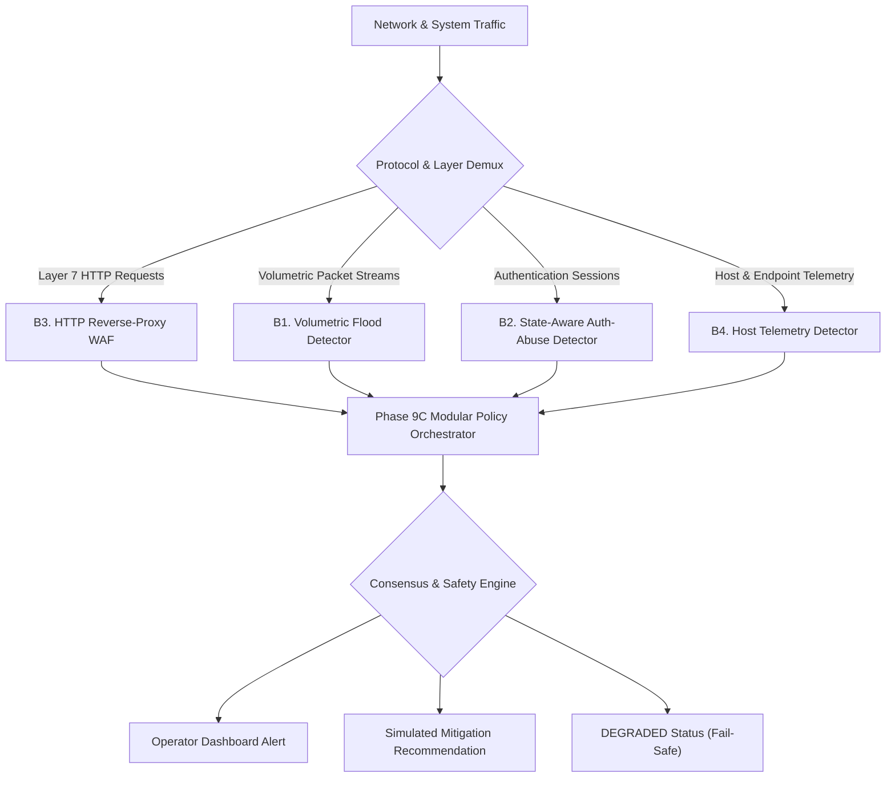

# SentinelAI GATE-1 Phase 9B: Specialized Detector Architecture Design

**Author / Senior Reviewer**: Senior Security Architect, Machine Learning Engineer & Independent Security-Systems Reviewer  
**Date**: 2026-10-16  
**Execution Context**: Read-Only Architecture Design & Safety Review (Non-Production)  
**Dedicated Branch**: `feature/gate1-phase8-multicorpus-candidates`  
**Base Commit**: `e9f71a0c12562eb7cb07e896b5aa9f6ee737be98`  

---

## 1. Architectural Motivation: Decoupling the Monolithic Classifier

The Phase 8 and Phase 9A audits proved that a single monolithic Random Forest classifier has reached its fundamental theoretical limit:
- Transport flow features achieved **71.20% on SSH/FTP** and **60.85% on Botnets**, but collapsed to **0.00% on DDoS (HOIC)**, **0.15% on Infiltration**, and **0.35% on Web Attacks**.
- Single-request web exploits (SQLi, XSS) do not alter transport flow summaries.
- Encrypted C2 communications (Dropbox TLS) are invisible to packet statistical features.
- High-rate HTTP floods (HOIC) have completely different traffic morphology from slow socket exhaustion (Slowloris).

To overcome these structural barriers, SentinelAI designs four specialized, decoupled experimental detectors:

---

## 2. B1. Volumetric Flood Detector (DDoS / DoS)

### 2.1 Purpose & Target Threat
Detects high-volume distributed denial-of-service and connection exhaustion attacks:
- High Orbit Ion Cannon (HOIC) multithreaded HTTP GET floods.
- Low Orbit Ion Cannon (LOIC) UDP/TCP floods.
- SYN flood, ACK flood, and UDP amplification attacks.
- Explicit non-goal: Does not inspect HTTP payloads or application business logic.

### 2.2 Telemetry & Feature Vector
- **Ingress Volumetrics**: Packets per second (PPS), Bytes per second (BPS), Bits per packet (BPP).
- **Cardinality Metrics**: Unique Source IP count per window, Unique Source Port count.
- **Protocol Symmetry**: SYN-to-ACK ratio, SYN-to-FIN ratio, Request-to-Response byte ratio.
- **Dispersion Entropy**: Normalized Shannon entropy of source IPs ($H_{\text{src}}$) and source ports ($H_{\text{sport}}$).

### 2.3 Windowing & Aggregation Strategy
Multi-resolution sliding time windows:
1. **Micro-Burst Window (1.0s)**: Detects sudden saturating packet spikes (e.g. LOIC-UDP).
2. **Surge Window (10.0s)**: Detects ramp-up multithreaded floods (e.g. HOIC).
3. **Macro Baseline Window (60.0s)**: Tracks rolling Exponential Moving Average (EMA) of legitimate traffic volume.

### 2.4 Distinguishing Legitimate Spikes from Attack Floods
Legitimate traffic surges (e.g. marketing campaigns, breaking news) exhibit:
- High source IP entropy ($H_{\text{src}} \to 1.0$) with geographically diverse subnets.
- Normal session durations and varied HTTP request endpoints.
- High TCP handshake completion rate ($> 95\%$).

Automated attack floods (HOIC/LOIC) exhibit:
- Extreme source IP concentration (or spoofed unroutable IP distributions).
- Low source port entropy or fixed client window sizes.
- Handshake abandonment (incomplete SYN handshakes) or uniform GET request rates.

### 2.5 Handling Unseen Tools & Morphologies
The detector does not search for tool-specific string signatures (e.g. "HOIC booster"). It keys on **physical conservation laws of network queues**: a target destination port receiving $10\times$ its baseline packet volume with an asymmetric handshake completion ratio triggers detection regardless of the attacking software.

### 2.6 Telemetry Degradation & Missing Data
If packet sampling drops below 80% coverage due to interface saturation:
- Emits status `DEGRADED`.
- Bypasses autonomous block simulations; issues operator alerts with flow rate estimates.

### 2.7 Decision Levels
- **Detection**: Ingress PPS exceeds adaptive baseline threshold by $3.5\times$ with entropy collapse.
- **Alerting**: Emits critical alert detailing target IP, target port, estimated bandwidth, and protocol.
- **Simulated Mitigation**: Recommends SYN cookies or upstream rate-limiting (never permanent host drop).

---

## 3. B2. State-Aware Authentication-Abuse Detector (SSH / FTP)

### 3.1 Purpose & Target Threat
Detects automated authentication brute-forcing, dictionary attacks, and credential stuffing on administrative protocols (SSH on port 22, FTP on port 21).

### 3.2 Required Telemetry & Signals
- **Network Flow Signals**: Connection attempt rate, session duration, total bytes exchanged per session (brute-force failures consistently exchange $\approx 2.5 - 4.5$ KB during key exchange and auth rejection), TCP RST frequency.
- **Host Authentication Logs (Where Authorized)**: `sshd` auth failure logs (`Failed password for invalid user ...`), PAM authentication failure events.
- **Dual-Mode Operation**:
  * *Flow-Only Mode*: Evaluates statistical session clustering when server logs are absent.
  * *Log-Enriched Mode*: Combines flow rate with actual authentication rejection events for 100% precision.

### 3.3 Grouping & Tracking Strategy
Maintains a stateful sliding-window key table:
$$\text{State Key} = (\text{SourceIP}, \text{DestinationIP}, \text{DestinationPort})$$
- Tracks failed attempt counters with exponential time-decay ($t_{1/2} = 120\text{s}$).
- Tracks distinct usernames attempted within a 5-minute sliding window.

### 3.4 Handling NAT, Legitimate Retries, and Shared Proxies
- **Legitimate User Retries**: A single user mistyping a password generates $\le 3$ failures followed by a successful login or disconnection. Threshold set to $\ge 10$ failures/window.
- **Corporate NAT Gateways**: If a source IP is identified as a shared proxy, the detector tracks distinct source ports and requires distributed failure patterns across multiple accounts before elevating to an alert.

### 3.5 Acceptance Criteria
- Separate SSH Recall $\ge 90.00\%$ on independent captures.
- Separate FTP Recall $\ge 90.00\%$ on independent captures.
- *Caveat*: The hypothesis that SSH misses in Phase 8 were caused by cipher negotiation differences remains unproven and must be treated as an empirical research question.

---

## 4. B3. HTTP Reverse-Proxy WAF (Layer 7 Detection)

### 4.1 Architecture & Traffic Placement
- Sits inline as a reverse-proxy inspection engine (e.g. Envoy / Node.js middleware) terminating TLS in front of protected web endpoints.
- Authorized plaintext inspection of HTTP method, URI, query string, request headers, and request body.

### 4.2 Size Limits & Parsing Scope
- Request Line Maximum: $\le 8$ KB.
- Total Headers Maximum: $\le 32$ KB.
- Request Body Inspection Limit: $\le 1$ MB (content beyond 1 MB streamed with header inspection).
- Supported Content Types:
  * `application/x-www-form-urlencoded`
  * `application/json`
  * `multipart/form-data`
  * `text/plain`

### 4.3 Evasion Defense & Normalization Pipeline
All payloads pass through multi-stage canonicalization prior to pattern matching:
1. **URL Decoding**: Recursive decode with double-encoding detection (`%252e%252e` $\to$ `%2e%2e` $\to$ `..`).
2. **Unicode Normalization**: NFKC normalization to eliminate full-width characters and homoglyphs.
3. **Null-Byte & Comment Stripping**: Removes SQL comment interpolations (`/* ... */`) and null bytes (`%00`).

### 4.4 Rule Versioning & Failure Behavior
- Decoupled OWASP Core Rule Set (CRS) v3.3+ pattern rules with semantic versioning (`crs_v1.0.0`).
- **Malformed Request Handling**: Syntactically invalid HTTP requests or unparseable JSON/multipart bodies yield HTTP 400 Bad Request with reason code `PARSER_ERROR`, logged as a `MONITOR` alert.
- **Ground-Truth Prohibition**: The design explicitly forbids using ground-truth dataset labels during inference or policy decisions. All decisions must evaluate actual request bytes.

### 4.5 Reporting Standards
Separately measures and reports:
- Application Detection Recall (SQLi, XSS, RCE).
- Simulated Block Recall.
- Benign False Positive Rate on valid web applications.
- Unsupported Request / Parser Error Rate.

---

## 5. B4. Host Telemetry & Lateral-Movement Detector

### 5.1 Purpose & Target Threat
Detects post-exploitation lateral movement, reverse shells, and command-and-control (C2) communication where network traffic is encrypted via TLS (e.g. Infiltration over Dropbox APIs).

### 5.2 Candidate Authorized Telemetry Sources
- **Process Lineage**: Process execution tree (`ParentProcessId`, `ProcessId`, `CommandLine`, `User`).
- **Socket-to-Process Correlation**: Binding network connections (`SrcIP`, `SrcPort`, `DstIP`, `DstPort`) to originating process binaries.
- **Privilege Events**: Token impersonation, UAC elevation, internal service creation.

### 5.3 Data Minimization & Privacy Controls
- Strict regex masking of command lines to strip passwords, API keys, and PII.
- Process binaries represented exclusively by SHA-256 hashes.
- Zero file content ingestion; metadata and event logs only.

### 5.4 Encrypted Traffic Observability
When an attacker establishes C2 over TLS to `dropbox.com`:
- Transport network flow classifier sees benign HTTPS traffic to a legitimate cloud host.
- Host telemetry exposes that the TLS connection was initiated by `powershell.exe -enc ...` spawned by `acrobat.exe`.
- This exposes the attack that transport models are physically incapable of detecting.

### 5.5 Distinguishing Suspicious Signals from Proof of Compromise
- Single anomaly (e.g. admin running PowerShell) generates `INFO` / `MONITOR` score.
- Correlation of anomalous parentage + outbound socket + local recon (`whoami`, `net group`) elevates score to `DETECTED`.

### 5.6 Safe Offline Evaluation Protocol
- Evaluated exclusively against recorded public auditd/Sysmon attack logs (e.g. DARPA Transparent Computing, Mordor project datasets).
- Zero live agents installed during Phase 9B.
