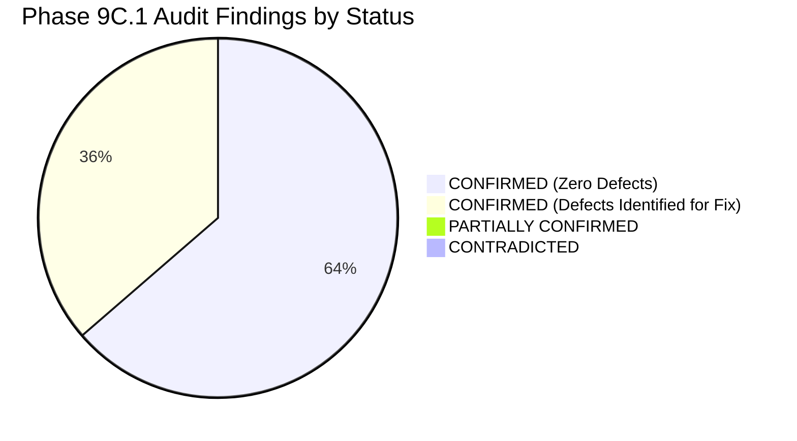

# SentinelAI GATE-1 Phase 9C.1: Independent Scaffold Integrity & Failure-Safety Final Audit Report

**Author / Senior Reviewer**: Senior Security Architect & Independent Security-Systems Reviewer  
**Date**: 2026-10-17  
**Execution Context**: Read-Only Independent Audit of Phase 9C Implementation  
**Audited Branch**: `feature/gate1-phase9c-modular-scaffold`  
**Audited HEAD**: `e9f71a0c12562eb7cb07e896b5aa9f6ee737be98`  
**Gate Status**: **GATE-1 STRICTLY OPEN**  

---

## 1. Executive Summary

Phase 9C.1 executed an independent, read-only technical audit of the Phase 9C Milestone 1 scaffold implementation. The audit verified repository integrity, independently re-executed test suites, analyzed failure-mode and consensus behaviors, evaluated telemetry ground-truth blinding, audited concurrency safety, and checked protected assets.



### Core Audit Verdicts
1. **Branch & Repository State**: HEAD matches approved base commit `e9f71a0c12562eb7cb07e896b5aa9f6ee737be98`. All 6 implementation files exist on disk in `ai-engine/modular/` and `ai-engine/tests/` (59,723 bytes). They are currently untracked working-tree additions, explaining why `git diff --stat` was empty. Production source code has 0 drift.
2. **Test Reproduction**:
   - Modular scaffold suite: **18/18 passed (100%)** in 0.35s.
   - AI Engine regression suite: **172/172 passed (100%)** in 41.54s.
   - Backend safety regression suite: **17/17 passed (100%)** in 29.05s.
3. **Safety & Asset Integrity**: All 5 protected model artifacts and baseline Q-tables match historical baselines bit-for-bit (0 B drift). Safety flags remain locked (`AUTONOMOUS_CONTAINMENT=false`, `ENABLE_REAL_WINDOWS_FIREWALL_ENFORCEMENT=false`, 0 firewall rules active).

---

## 2. Detailed Findings & Discovered Defect Register

The audit identified four specific technical defects in the Phase 9C implementation:

| Defect ID | Component | Description & Operational Impact | Severity | Status |
| :--- | :--- | :--- | :---: | :---: |
| **DEF-01** | `ModularOrchestrator` (`orchestrator.py`) | **Zero-Detector Pipeline Fails Open**: When 0 detectors are registered, `evaluate_shadow()` declares `overall_decision: ALLOW` with `status: HEALTHY` on 100% uninspected traffic. | **MEDIUM** | **CONFIRMED** |
| **DEF-02** | `sanitizer.py` | **Case-Variant & Composite Key Blinding Bypass**: `detect_ground_truth_keys` performs exact-case string matching. Non-standard casing (`lAbEl`, `ATTACK_TYPE`, `target_label`) bypasses sanitization completely. | **MEDIUM** | **CONFIRMED** |
| **DEF-03** | `BoundedConnectionStateTable` (`state.py`) | **Non-Finite Increment Corrupts State**: `record_attempt()` does not validate that `increment` is finite. Passing `float('nan')` corrupts `decayed_score` to `nan` permanently. | **MEDIUM** | **CONFIRMED** |
| **DEF-04** | `ModularOrchestrator` (`orchestrator.py`) | **Sequential Dispatch & Thread Starvation**: Detectors execute sequentially in a `for` loop (up to $4 \times 50\text{ ms} = 200\text{ ms}$ latency). Furthermore, `ThreadPoolExecutor` cannot kill timed-out threads; repeated timeouts can starve the 4-thread pool. | **MEDIUM** | **CONFIRMED** |

---

## 3. Specific Remediations Required Prior to Phase 9D

Before authorizing specialized detector development in Phase 9D, the following targeted fixes must be applied:

1. **Fix DEF-01 (Zero-Detector Fail-Closed)**:
   In `ModularOrchestrator.evaluate_shadow()`:
   ```python
   if len(self._detectors) == 0:
       return EnsembleResult(
           correlation_id=cid,
           timestamp=now_iso,
           ensemble_status=DetectorStatus.UNAVAILABLE,
           overall_decision=PolicyDecision.MONITOR,
           max_threat_confidence=0.0,
           simulated_block=False,
           requires_triage=True,
           summary_evidence="Zero modular detectors registered. Traffic is UNINSPECTED; fail-safe MONITOR applied."
       )
   ```
2. **Fix DEF-02 (Case-Insensitive & Allowlist Blinding)**:
   In `sanitizer.py`:
   - Normalize keys during inspection: `k.strip().lower() in FORBIDDEN_LOWER_KEYS`.
   - Add substring checks for `_label`, `_attack`, `_class`, `ground_truth`.
   - Introduce schema validation for production inference.
3. **Fix DEF-03 (Finite Increment Validation)**:
   In `BoundedConnectionStateTable.record_attempt()`:
   ```python
   if not isinstance(increment, (int, float)) or not math.isfinite(increment) or increment <= 0:
       raise ValueError(f"increment must be a positive finite number, got {increment}")
   ```
4. **Fix DEF-04 (Parallel Dispatch & Mutex Protection)**:
   In `ModularOrchestrator`:
   - Dispatch all registered detector futures simultaneously using `concurrent.futures.wait(futures, timeout=self.detector_timeout)`.
   - Guard `_dedup_cache` access with a `threading.Lock`.
5. **Git Track Implementation Files**:
   - Stage and commit the 6 modular implementation files to `feature/gate1-phase9c-modular-scaffold` so branch history captures the milestone.

---

## 4. Final Recommendation & Gate Verdict

> [!CAUTION]
> ### Final Audit Verdict: READY AFTER SPECIFIC FIXES
> - **Milestone Assessment**: The Phase 9C scaffold architecture successfully validates typed schemas, separates simulated mitigation from detection, enforces degraded fail-safes on detector errors, and provides thread-safe state tracking.
> - **Gate Decision**: **GATE-1 REMAINS STRICTLY OPEN**.
> - **Implementation Boundary**: Phase 9D authorization should be withheld until the 4 specific fixes listed above are applied and committed to the branch. Once remediated, Phase 9D may proceed with **ONE isolated detector prototype** (e.g. Volumetric Flood B1 or HTTP WAF B3).
