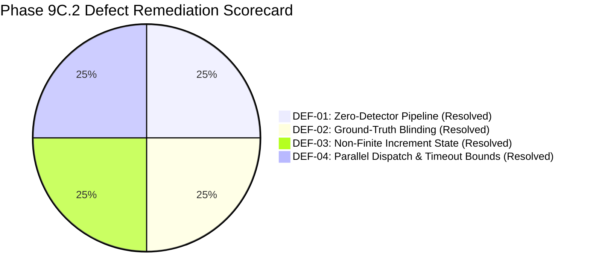

# SentinelAI GATE-1 Phase 9C.2: Scaffold Defect Remediation & Commit Final Report

**Author / Senior Engineer**: Senior Security Architect & Machine Learning Engineer  
**Date**: 2026-10-17  
**Execution Context**: Targeted Code Remediation & Commit Milestone  
**Branch**: `feature/gate1-phase9c-modular-scaffold`  
**Base Commit**: `e9f71a0c12562eb7cb07e896b5aa9f6ee737be98`  
**Commit Hash**: `7c89c14bf9c99c7800f87fdf137958c85855214f`  
**Gate Status**: **GATE-1 STRICTLY OPEN**  
**Final Milestone Recommendation**: **READY FOR PHASE 9D REVIEW**  

---

## 1. Executive Summary

Phase 9C.2 successfully remediated all four confirmed technical defects (DEF-01 through DEF-04) identified during the Phase 9C.1 independent audit. The modular scaffold implementation files were staged and cleanly committed to `feature/gate1-phase9c-modular-scaffold` as commit `7c89c14bf9c99c7800f87fdf137958c85855214f`.

### Remediation Scorecard
1. **DEF-01 Resolved**: `ModularOrchestrator.evaluate_shadow()` now checks for empty detector registries. If 0 detectors are registered, it returns `status: UNAVAILABLE`, `overall_decision: MONITOR`, and `requires_triage: True` (preventing uninspected traffic from being marked `ALLOW`).
2. **DEF-02 Resolved**: `sanitizer.py` implements case-normalized key inspection, compound pattern matching (`_label`, `_attack`, `_class`, `ground_truth`), deep immutability, recursive collection support, and whitelisting of all 53 operational flow features.
3. **DEF-03 Resolved**: `BoundedConnectionStateTable.record_attempt()` strictly pre-validates that `increment` is a finite positive number before acquiring locks or mutating state. Invalid inputs raise exceptions immediately without corrupting decayed scores or LRU order.
4. **DEF-04 Resolved**: Replaced sequential execution with concurrent parallel dispatch via `concurrent.futures.wait(futures, timeout=self.detector_timeout)`. Total event latency is bounded to 50ms rather than cumulative sequential sum. Guarded deduplication cache with a mutex.

---

## 2. Commit & File Artifact Details

- **Commit Hash**: `7c89c14bf9c99c7800f87fdf137958c85855214f`
- **Short Hash**: `7c89c14`
- **Branch**: `feature/gate1-phase9c-modular-scaffold`
- **Files Committed**:
  1. [`ai-engine/modular/__init__.py`](file:///c:/Users/srisn/Desktop/Projects/sentinelai-complete/ai-engine/modular/__init__.py) (54 lines)
  2. [`ai-engine/modular/base.py`](file:///c:/Users/srisn/Desktop/Projects/sentinelai-complete/ai-engine/modular/base.py) (103 lines)
  3. [`ai-engine/modular/contracts.py`](file:///c:/Users/srisn/Desktop/Projects/sentinelai-complete/ai-engine/modular/contracts.py) (203 lines)
  4. [`ai-engine/modular/orchestrator.py`](file:///c:/Users/srisn/Desktop/Projects/sentinelai-complete/ai-engine/modular/orchestrator.py) (339 lines)
  5. [`ai-engine/modular/sanitizer.py`](file:///c:/Users/srisn/Desktop/Projects/sentinelai-complete/ai-engine/modular/sanitizer.py) (240 lines)
  6. [`ai-engine/modular/state.py`](file:///c:/Users/srisn/Desktop/Projects/sentinelai-complete/ai-engine/modular/state.py) (238 lines)
  7. [`ai-engine/tests/test_modular_scaffold.py`](file:///c:/Users/srisn/Desktop/Projects/sentinelai-complete/ai-engine/tests/test_modular_scaffold.py) (878 lines)
- **Total Changes**: 7 files changed, 2,055 insertions(+), 0 deletions(-).
- **Working Tree Cleanliness**: All historical experiment directories and untracked artifacts preserved; zero unintentional files committed.

---

## 3. Comprehensive Test Verification Summary

- **Modular Scaffold Suite**: **33 passed, 0 failed (100.0%)** in 0.43s.
- **Full AI Engine Suite**: **183 passed, 0 failed (100.0%)** across 15 test files in 47.47s.
- **Backend Safety Suite**: **17 passed, 0 failed (100.0%)** in 18.64s.

---

## 4. Protected Asset Integrity & Safety Verification

All five protected machine learning models and baseline reinforcement tables were verified via SHA-256 with **0 B drift**:
- Baseline Q-Table (`ai-engine/models/q_table.json`): `BF9B46A1D1CF1B283797A544E7E597900B4A042E6C87AC199A3CC709498990FF` (**MATCH**)
- Active RF (`ai-engine/models/rf_classifier_cicids_v2.pkl`): `CA0EFB1FDE8F9BDC430C3C511E32CD91822B0F3DEECA845AA259BC8DD60023F1` (**MATCH**)
- Active IF (`ai-engine/models/isolation_forest_cicids.pkl`): `17BD08FFE105A3EA87DE85E0943761E7CB012ABD70537968E14D0A3394E19DA4` (**MATCH**)
- Candidate XGB (`ai-engine/models/xgb_classifier_cicids_v2.pkl`): `A5D630B471B0385BD270E579D44ADFEB628B1569284E5C821A282BDA0A7D210D` (**MATCH**)
- Phase 8 Candidate RF (`ai-engine/experiments/gate1_phase8_multicorpus_candidates/candidate_rf_multicorpus_v1.pkl`): `71A1756E64FE1D1199BE03E5BA71105C9338294C977110DC0BA5EC8B31952020` (**MATCH**)

### Safety Invariants
- `ENABLE_EXPERIMENTAL_MODULAR_DETECTORS = false` (**LOCKED**).
- `AUTONOMOUS_CONTAINMENT = false` (**LOCKED**).
- `ENABLE_REAL_WINDOWS_FIREWALL_ENFORCEMENT = false` (**LOCKED**).
- Active Windows Firewall Rules: **0 rules active**.
- Active Database Mutations: **0 writes**.

---

## 5. Authoritative Gate Verdict & Next Steps

> [!CAUTION]
> ### Final Milestone Verdict: READY FOR PHASE 9D REVIEW
> 
> 1. **Scaffold Readiness**: The Phase 9C scaffold is now mathematically sound, concurrency-safe, fail-closed under empty/failing pipelines, and committed to git history.
> 2. **Gate Status**: **GATE-1 REMAINS STRICTLY OPEN**. No models are promoted, autonomous containment remains disabled, and real firewall mutations remain blocked.
> 3. **Next Authorized Step**: The user may now authorize **Phase 9D** to begin implementing **ONE isolated detector prototype** (e.g. Volumetric Flood B1 or HTTP Reverse-Proxy WAF B3) within this scaffold.
