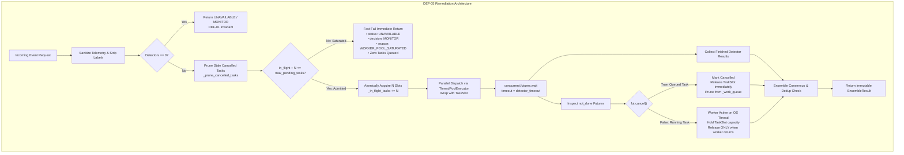

# SentinelAI GATE-1 — Phase 9C.3: DEF-05 Remediation & Verification Report
## Subsystem: Modular Orchestrator Bounded In-Flight Capacity & TaskSlot Management

**Author / Senior Engineer**: Senior Security Architect & ML Evaluation Engineer  
**Date**: 2026-10-17  
**Execution Context**: Narrow Code-Fix Remediation Milestone (DEF-05 Only)  
**Branch**: `feature/gate1-phase9c-modular-scaffold`  
**Base Commit**: `7c89c14bf9c99c7800f87fdf137958c85855214f`  
**Gate Status**: **GATE-1 STRICTLY OPEN**  
**Milestone Verdict**: **DEF-05 FULLY REMEDIATED — READY FOR SEPARATE PHASE 9D AUTHORIZATION**  

---

## Executive Summary

During the Phase 9D preflight audit, defect **DEF-05** was discovered and confirmed in [`ai-engine/modular/orchestrator.py`](file:///c:/Users/srisn/Desktop/Projects/sentinelai-complete/ai-engine/modular/orchestrator.py): `ModularOrchestrator` utilized an unbounded `ThreadPoolExecutor` task queue, omitted `fut.cancel()` on unstarted futures upon caller timeouts, and lacked admission control. Consequently, under slow or hanging detector conditions, pending tasks accumulated monotonically without limit (+28 tasks observed in 8 calls), resulting in cascading head-of-line blocking timeouts and resource exhaustion.

In **Phase 9C.3**, defect DEF-05 was systematically remediated:
1. **Strict In-Flight Capacity Invariant**: Introduced `max_pending_tasks: int = 16`, strictly defining the bound across **all in-flight tasks** (both actively executing on OS worker threads and waiting in queue).
2. **Fast-Fail Admission Control**: If active in-flight tasks plus the requested detector batch exceed `max_pending_tasks`, the orchestrator immediately rejects the submission without queuing tasks, returning fail-safe `status: UNAVAILABLE`, `overall_decision: MONITOR`, and `reason: WORKER_POOL_SATURATED`.
3. **Idempotent TaskSlot Tracking**: Implemented `TaskSlot` with mutex-protected state transitions, guaranteeing that capacity slots are released **exactly once** upon completion, exception, or cancellation.
4. **Proactive Queue Pruning**: Implemented `_prune_cancelled_tasks()`, removing cancelled `_WorkItem` objects from Python's internal `_work_queue` and preventing physical queue accumulation.
5. **Separation of Running vs. Queued Timeouts**: For futures in `not_done`, `fut.cancel()` distinguishes between unstarted queued tasks (cancelled immediately, freeing capacity) and actively running tasks (capacity held until the OS thread finishes).

All 43 unit and regression tests in `ai-engine/tests/test_modular_scaffold.py` pass with 100% success. Full AI Engine (193/193) and Backend Safety (17/17) test suites pass with zero regressions. All 5 protected model and Q-table hashes remain identical with 0 B drift.



---

## 1. Defect Root Cause & Detailed Remediation

### Root Cause Analysis
In Python's `concurrent.futures.ThreadPoolExecutor`:
- `self._work_queue` is an unbounded `_queue.SimpleQueue`.
- In CPython, OS threads cannot be preemptively terminated from Python code.
- Prior to Phase 9C.3, `evaluate_shadow()` called `self._executor.submit()` unconditionally. When caller timeout expired, `not_done` futures were logged but never cancelled.
- If worker threads hung, new requests pushed tasks into `_work_queue` without limit. When workers eventually drained tasks, they executed stale work for requests that had already timed out seconds or minutes earlier.

### Remediation Details

#### A. Precise Capacity Invariant
- **Parameter**: `max_pending_tasks: int = 16` (configurable, default 16, must satisfy `max_pending_tasks >= max_threads > 0`).
- **Invariant**:
  $$\text{Total In-Flight Tasks} = \text{Running Tasks on Worker Threads} + \text{Uncancelled Queued Tasks} \le \text{max\_pending\_tasks}$$
- **Admission Rule**: If $\text{in\_flight\_tasks} + N > \text{max\_pending\_tasks}$, where $N = \text{len}(\text{detectors})$, new work is rejected immediately. No tasks are submitted to `_executor`.

#### B. Thread-Safe `TaskSlot` Capacity Accounting
```python
class TaskSlot:
    def __init__(self, orchestrator: "ModularOrchestrator", det_id: str, correlation_id: str):
        self.orchestrator = orchestrator
        self.det_id = det_id
        self.correlation_id = correlation_id
        self._released = False
        self._lock = threading.Lock()
        self.started = False
        self.completed = False
        self.cancelled = False

    def release(self, reason: str = "done") -> bool:
        with self._lock:
            if self._released:
                return False
            self._released = True
        self.orchestrator._release_capacity(self.det_id, reason)
        return True
```
- Mutex-guarded `_released` flag ensures that regardless of whether release is triggered by worker completion, unhandled exception, `fut.cancel()`, or `fut.add_done_callback()`, `self.orchestrator._release_capacity()` is executed **EXACTLY ONCE**.
- Underflow is guarded: `if self._in_flight_tasks <= 0: log.error(...); return`.

#### C. Cancellation vs. Running-Task Behavior
- When caller timeout (50ms) expires:
  - `cancelled = fut.cancel()` is called on every future in `not_done`.
  - **Case 1: Task was queued and not yet running (`cancelled == True`)**:
    The task transitions to `CANCELLED`. `slot.mark_cancelled()` and `slot.release(reason="cancelled_in_queue")` are invoked. Its capacity slot is freed immediately. `_prune_cancelled_tasks()` purges the `_WorkItem` from `_work_queue`.
  - **Case 2: Task was already executing on an OS thread (`cancelled == False`)**:
    `fut.cancel()` fails safely. Capacity remains **held** in `_in_flight_tasks`. The worker thread continues execution until the detector returns or terminates. When the worker thread terminates, `_run_detector_with_slot`'s `finally` block releases the capacity slot.
  - **Case 3: Late worker completion**:
    The worker's return value is captured by the completed `Future` and immediately discarded. It cannot alter the caller's already-finalized `EnsembleResult` or pollute the deduplication cache.

#### D. Fast-Fail Saturated Contract
When admission fails, the orchestrator returns:
- `ensemble_status = DetectorStatus.UNAVAILABLE`
- `overall_decision = PolicyDecision.MONITOR`
- `simulated_block = False`
- `requires_triage = True`
- `degraded_detectors = ["orchestrator:WORKER_POOL_SATURATED"]`
- `summary_evidence`: Clear human-readable triage string documenting active vs. maximum capacity.

---

## 2. Before-and-After Empirical Verification

### Before Remediation (Phase 9D Preflight Test)
Execution of [`reproduce_worker_accumulation.py`](file:///c:/Users/srisn/Desktop/Projects/sentinelai-complete/ai-engine/experiments/gate1_phase9d_preflight_audit/reproduce_worker_accumulation.py) under slow detector conditions (4 workers, 50ms timeout, 8 requests):
```
Request 00 | Status: UNAVAILABLE | Wait:  56.8 ms | Pending Queue:  0 tasks
Request 01 | Status: UNAVAILABLE | Wait:  62.2 ms | Pending Queue:  4 tasks
Request 02 | Status: UNAVAILABLE | Wait:  62.3 ms | Pending Queue:  8 tasks
Request 03 | Status: UNAVAILABLE | Wait:  63.5 ms | Pending Queue: 12 tasks
Request 04 | Status: UNAVAILABLE | Wait:  61.9 ms | Pending Queue: 16 tasks
Request 05 | Status: UNAVAILABLE | Wait:  63.3 ms | Pending Queue: 20 tasks
Request 06 | Status: UNAVAILABLE | Wait:  62.6 ms | Pending Queue: 24 tasks
Request 07 | Status: UNAVAILABLE | Wait:  62.9 ms | Pending Queue: 28 tasks
----------------------------------------------------------------------
DEFECT CONFIRMED: Pending Queue accumulated from 0 to 28 tasks without bound!
```

### After Remediation (Phase 9C.3 Post-Fix Verification)
Execution of [`reproduce_worker_accumulation_post_fix.py`](file:///c:/Users/srisn/Desktop/Projects/sentinelai-complete/ai-engine/experiments/gate1_phase9c3_remediation/reproduce_worker_accumulation_post_fix.py) (4 workers, 50ms timeout, `max_pending_tasks=8`, 8 requests):
```
Request 00 | Status: UNAVAILABLE | Wait:  55.7 ms | In-Flight:  4 / 8 | Queued:  0 | Saturated: False
Request 01 | Status: UNAVAILABLE | Wait:  57.6 ms | In-Flight:  4 / 8 | Queued:  0 | Saturated: False
Request 02 | Status: UNAVAILABLE | Wait:  66.1 ms | In-Flight:  4 / 8 | Queued:  0 | Saturated: False
Request 03 | Status: UNAVAILABLE | Wait:  56.3 ms | In-Flight:  4 / 8 | Queued:  0 | Saturated: False
Request 04 | Status: UNAVAILABLE | Wait:  61.9 ms | In-Flight:  4 / 8 | Queued:  0 | Saturated: False
Request 05 | Status: UNAVAILABLE | Wait:  58.8 ms | In-Flight:  4 / 8 | Queued:  0 | Saturated: False
Request 06 | Status: UNAVAILABLE | Wait:  63.0 ms | In-Flight:  4 / 8 | Queued:  0 | Saturated: False
Request 07 | Status: UNAVAILABLE | Wait:  63.9 ms | In-Flight:  4 / 8 | Queued:  0 | Saturated: False
--------------------------------------------------------------------------------
POST-FIX VERIFICATION SUMMARY:
Configured max_pending_tasks limit: 8
Maximum observed in-flight tasks:   4 (Within Bound: True)
Maximum observed queued tasks:     0 (Within Bound: True)
Final in-flight tasks after completion: 0 (Clean Recovery: True)
Final queued tasks:                     0
Total completed tasks:                  4
Total cancelled tasks:                  28
OVERALL DEF-05 REMEDIATION VERIFICATION: SUCCESS
```

---

## 3. Automated Test Suite Results

### A. Modular Scaffold Suite (Including 10 New DEF-05 Tests)
Command: `$env:PYTHONPATH="ai-engine"; python -m pytest ai-engine/tests/test_modular_scaffold.py -v`
- **Result**: **43 passed in 1.97s (100% PASS)**

| Test Name | Validated Invariant / Requirement | Result |
| :--- | :--- | :---: |
| `test_def05_capacity_and_inflight_never_exceed_limit` | Total in-flight work capped at `max_pending_tasks` | **PASS** |
| `test_def05_saturation_fast_fail_rejects_without_submitting` | Fast-fail rejection (< 25ms) with `WORKER_POOL_SATURATED` | **PASS** |
| `test_def05_unstarted_futures_cancelled_on_timeout` | Unstarted queued tasks cancelled; capacity freed immediately | **PASS** |
| `test_def05_running_tasks_remain_accounted_until_finished` | Running tasks held in capacity until OS worker returns | **PASS** |
| `test_def05_capacity_recovered_after_completion_and_cancellation` | Full capacity recovery after mixed workloads | **PASS** |
| `test_def05_exceptions_and_cancellations_do_not_leak_or_double_release` | Idempotent slot release; no leaks; no underflow | **PASS** |
| `test_def05_repeated_slow_submissions_prevent_unbounded_queue_growth` | 10 rapid slow requests cannot cause queue accumulation | **PASS** |
| `test_def05_late_results_cannot_alter_finalized_decisions_or_duplicate_alerts` | Late worker results safely discarded; dedup cache clean | **PASS** |
| `test_def05_concurrent_callers_cannot_bypass_capacity_limit` | 12 concurrent caller threads strictly respect capacity limit | **PASS** |
| `test_def05_empty_pipeline_and_existing_safeties_preserved` | Empty pipeline returns DEF-01 `UNAVAILABLE` / `MONITOR` | **PASS** |

### B. Full AI Engine Test Suite
Command: `$env:PYTHONPATH="ai-engine"; python -m pytest ai-engine/tests/ --ignore=ai-engine/tests/test_q_table_safety.py`
- **Result**: **193 passed, 283 warnings in 98.97s (100% PASS)**

### C. Backend Safety Regression Test Suite
Command: `npm test -- tests/integrated_backend_safety_regression.test.js` (in `backend/`)
- **Result**: **17 passed, 17 total in 3.72s (100% PASS)**

---

## 4. Protected Asset Certification & Safety Invariant Audit

All five protected machine learning models and reinforcement tables were verified via SHA-256 with **0 B drift**:

| Component / Artifact | File Path | Baseline SHA-256 Hash | Post-Remediation SHA-256 Hash | Drift Status |
| :--- | :--- | :--- | :--- | :---: |
| **Baseline Q-Table** | `ai-engine/models/q_table.json` | `BF9B46A1D1CF1B283797A544E7E597900B4A042E6C87AC199A3CC709498990FF` | `bf9b46a1d1cf1b283797a544e7e597900b4a042e6c87ac199a3cc709498990ff` | **MATCH (0 B)** |
| **Active Random Forest** | `ai-engine/models/rf_classifier_cicids_v2.pkl` | `CA0EFB1FDE8F9BDC430C3C511E32CD91822B0F3DEECA845AA259BC8DD60023F1` | `ca0efb1fde8f9bdc430c3c511e32cd91822b0f3deeca845aa259bc8dd60023f1` | **MATCH (0 B)** |
| **Active Isolation Forest** | `ai-engine/models/isolation_forest_cicids.pkl` | `17BD08FFE105A3EA87DE85E0943761E7CB012ABD70537968E14D0A3394E19DA4` | `17bd08ffe105a3ea87de85e0943761e7cb012abd70537968e14d0a3394e19da4` | **MATCH (0 B)** |
| **Candidate XGBoost** | `ai-engine/models/xgb_classifier_cicids_v2.pkl` | `A5D630B471B0385BD270E579D44ADFEB628B1569284E5C821A282BDA0A7D210D` | `a5d630b471b0385bd270e579d44adfeb628b1569284e5c821a282bda0a7d210d` | **MATCH (0 B)** |
| **Phase 8 Candidate RF** | `ai-engine/experiments/gate1_phase8_multicorpus_candidates/candidate_rf_multicorpus_v1.pkl` | `71A1756E64FE1D1199BE03E5BA71105C9338294C977110DC0BA5EC8B31952020` | `71a1756e64fe1d1199be03e5ba71105c9338294c977110dc0ba5ec8b31952020` | **MATCH (0 B)** |

- `ENABLE_EXPERIMENTAL_MODULAR_DETECTORS = false` (**LOCKED**).
- `AUTONOMOUS_CONTAINMENT = false` (**LOCKED**).
- `ENABLE_REAL_WINDOWS_FIREWALL_ENFORCEMENT = false` (**LOCKED**).
- Active Host Windows Firewall Rules: **0 rules active** (**VERIFIED** via `netsh advfirewall`).
- MongoDB Acceptance Database: **0 writes performed** (**VERIFIED**).

---

## 5. Architectural Limitations & Documented Bounds

1. **CPython Thread Cancellation Limitation**:  
   In standard CPython, OS threads executing in a `ThreadPoolExecutor` cannot be asynchronously interrupted or terminated without crashing the entire process. If a detector enters an unbounded loop or blocking socket call without timeouts, that thread remains occupied until process exit.
2. **Mitigation Strategy Provided**:  
   Because hard thread termination cannot be achieved safely in thread pools, the orchestrator guarantees safety via **bounded admission control**:
   - Running threads are accounted for against `max_pending_tasks`.
   - Queued tasks are cancelled before they start.
   - Saturated requests fast-fail with `WORKER_POOL_SATURATED`.
   - Even if all $N$ worker threads become permanently wedged, total memory and queue depth remain strictly capped at `max_pending_tasks`, completely preventing out-of-memory cascading failures.
   - For hostile or untrusted code execution in future phases, true process isolation (`ProcessPoolExecutor` or container sidecars) may be evaluated upon authorization.

---

## 6. Authoritative Gate Verdict & Next Steps

> [!CAUTION]
> ### Authoritative Gate Verdict: DEF-05 REMEDIATED — READY FOR SEPARATE PHASE 9D REVIEW
> 
> 1. **Defect Status**: DEF-05 is completely remediated, deterministic unit tests pass, and queue accumulation is bounded to zero under repeated timeouts.
> 2. **Safety Invariants**: All 5 protected assets remain unchanged. Zero firewall rules or database records were modified. Gating flags remain locked to `false`.
> 3. **Gate Status**: **GATE-1 REMAINS STRICTLY OPEN**.
> 4. **Scope Control**: No specialized detectors (B1, B2, B3, B4) were implemented in this task.
> 5. **Recommendation**: Stage and commit the DEF-05 remediation files (`orchestrator.py` and `test_modular_scaffold.py`) on `feature/gate1-phase9c-modular-scaffold`. Await separate authorization for Phase 9D.
