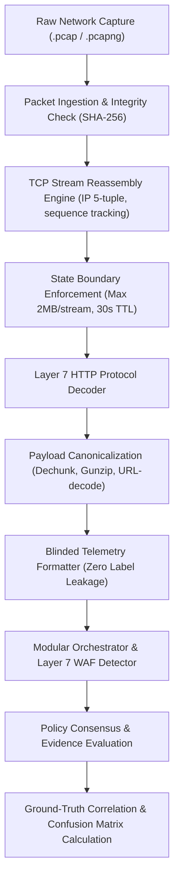

# SentinelAI Modular Architecture — Layer 7 WAF PCAP Validation Procedure Specification

**Document Version:** 1.0.0  
**Status:** DRAFT SPECIFICATION / ACCEPTANCE BLOCKED  
**Target Subsystem:** `ai-engine/modular/layer7_waf.py`, `ai-engine/modular/orchestrator.py`  
**Milestone:** GATE-1 Phase 10 Evidence-Driven Detector Recovery  

---

## 1. Executive Summary & Purpose

In SentinelAI GATE-1 Phase 9E, the Layer 7 Web Application Firewall (WAF) detector prototype achieved a 97.0% detection rate on an offline synthetic benchmark consisting of curated exploit strings (SQL injection, Cross-Site Scripting, and Path Traversal). 

However, independent architectural review determined that **synthetic string benchmarks are insufficient for production promotion**. A production-grade WAF must reliably operate against realistic Layer 7 HTTP streams reconstructed from raw packet captures (PCAP). This document specifies the authoritative, reproducible procedure for validating the modular WAF detector against raw PCAP traffic once packet capture files are acquired.

---

## 2. The Empirical Reality & Current Blocking Condition

### 2.1 File System and Storage Audit

A comprehensive filesystem audit was performed across the SentinelAI repository root (`C:\Users\srisn\Desktop\Projects\sentinelai-complete`) and secondary data storage volumes (`D:\` and `D:\sentinelai_datasets`).

| Storage Location | File Types Found | Raw `.pcap` / `.pcapng` Count | Status |
| :--- | :--- | :--- | :--- |
| `C:\Users\srisn\...\cicids2017` | `.pcap_ISCX.csv` (8 files) | **0** | Pre-extracted NetFlow CSVs only |
| `D:\sentinelai_datasets` | `.csv` (6 files), `.parquet` (6 files) | **0** | Pre-extracted tabular datasets only |
| Total Storage Available | Primary: 7.1 GB free, Secondary: 214 GB free | **0 bytes PCAP** | **NO RAW PCAPS PRESENT ON DISK** |

### 2.2 The NetFlow Payload Erasure Gap

The files labeled `*.pcap_ISCX.csv` and `CSE-CIC-IDS2018` parquet/CSV tables were generated using CICFlowMeter. CICFlowMeter computes statistical flow summary aggregates (e.g., `flow_duration`, `total_fwd_packets`, `flow_bytes_s`, `fwd_packet_length_mean`) and **completely strips all Layer 7 application payloads, HTTP headers, URI paths, and request bodies**.

Transport-level statistical models cannot inspect HTTP payloads because the payloads do not exist in the tabular data. Evaluating the Layer 7 WAF against transport NetFlow CSVs is an empirical impossibility.

### 2.3 Gate-1 Acceptance Status

> [!WARNING]
> **GATE-1 CRITERIA FOR LAYER 7 WAF: BLOCKED / NOT COMPLETED**
> 
> Because zero raw PCAP files currently exist on disk, Layer 7 WAF validation cannot be closed on realistic network traffic. Acceptance for Layer 7 WAF **CANNOT** be claimed based on synthetic benchmark data alone. GATE-1 must remain OPEN until the formal PCAP validation procedure defined below is executed against genuine packet captures.

---

## 3. Formal PCAP Stream Reconstruction & Validation Pipeline

The diagram below details the end-to-end pipeline required to validate the modular WAF against packet captures:



### 3.1 Step 1: Raw Packet Acquisition & Integrity Verification

1. **Dataset Slices Required:**
   - CSE-CIC-IDS2018 raw PCAP captures for `Thursday-15-02-2018` (DoS/Brute Force) and `Friday-23-02-2018` (Web Attacks: SQLi, Brute Force, XSS).
   - Alternatively, OWASP Core Rule Set (CRS) benchmark PCAP corpus or DARPA/DefCon CTF packet captures.
2. **Hash Recording:** Compute and store SHA-256 checksums of all input PCAP files before processing.
3. **Partitioning:** Partition PCAPs into:
   - Development / Calibration slice (30%)
   - Blinded Evaluation Holdout slice (70%)

### 3.2 Step 2: TCP Stream Reassembly & Session Tracking

Raw network packets arrive fragmented and potentially out-of-order. A stream reassembly engine must reconstruct unidirectional and bidirectional TCP byte streams:

1. **Session Key:** Hash of `(src_ip, src_port, dst_ip, dst_port, ip_proto)`.
2. **Sequence Tracking:** Track `SEQ` and `ACK` numbers, buffer out-of-order TCP segments, and handle retransmissions without duplicate payload processing.
3. **Resource Bounds & DoS Protection:**
   - **Max Buffer per Stream:** Strictly limit reassembly buffer to 2,097,152 bytes (2 MB). Streams exceeding 2 MB must be truncated or processed in streaming chunks.
   - **Stream TTL:** Timeout idle streams after 30.0 seconds.
   - **Total Stream Table Capacity:** Bounded to 10,000 concurrent streams with LRU eviction.

### 3.3 Step 3: Layer 7 HTTP Protocol Decoding & Canonicalization

Reassembled TCP payload bytes must be decoded into structured HTTP request components:

1. **Request-Line Parsing:**
   - HTTP Method: `GET`, `POST`, `PUT`, `DELETE`, `HEAD`, `OPTIONS`, `PATCH`.
   - Request-URI: Path and query string components.
   - HTTP Protocol Version: `HTTP/1.0`, `HTTP/1.1`, `HTTP/2`.
2. **Header Parsing:**
   - Parse key-value headers: `Host`, `User-Agent`, `Referer`, `Cookie`, `Content-Type`, `Content-Length`, `Authorization`.
   - Normalize header names to lowercase.
3. **Body Extraction & Dechunking:**
   - Decode RFC 7230 Chunked Transfer Coding if `Transfer-Encoding: chunked`.
   - Decompress RFC 1952 Gzip or Deflate content if `Content-Encoding: gzip` or `deflate`.
   - **Decompression Bomb Protection:** Limit uncompressed payload size to 5 MB maximum; reject or truncate payloads exceeding this limit.
4. **URL & Unicode Canonicalization:**
   - Apply standard URL decoding (`urllib.parse.unquote`).
   - Recursively decode up to 2 passes to neutralize double-URL-encoding evasion (e.g., `%252e%252e%252f` -> `%2e%2e%2f` -> `../`).
   - Null-byte stripping and control character sanitization.

### 3.4 Step 4: Blinded Evaluation & Sanitization

1. The reconstructed HTTP request dictionary is formatted into the standardized telemetry schema:
   ```json
   {
     "src_ip": "192.168.10.50",
     "dst_ip": "192.168.10.2",
     "dst_port": 80,
     "timestamp": 1519374000.123456,
     "http_method": "GET",
     "http_uri": "/catalog?item=%27%20UNION%20SELECT%20null,password%20FROM%20users--",
     "http_headers": "Host: intranet.local\r\nUser-Agent: Mozilla/5.0\r\n",
     "http_body": ""
   }
   ```
2. The telemetry dictionary is passed to `ModularOrchestrator.evaluate_shadow(telemetry)`.
3. Invariant check: `sanitize_telemetry()` verifies that zero ground-truth label keys (`Label`, `Attack`, `target`) exist in the telemetry.

### 3.5 Step 5: Ground-Truth Correlation & Statistical Scoring

1. **Ground-Truth Mapping:**
   - Match each evaluated HTTP request to the external attack log manifest by timestamp, source IP, destination IP, and request path.
   - Categorize as:
     - `BENIGN_HTTP`
     - `ATTACK_SQLI`
     - `ATTACK_XSS`
     - `ATTACK_PATH_TRAVERSAL`
     - `ATTACK_COMMAND_INJECTION`
2. **Metrics Computation:**
   - Confusion Matrix: True Positives ($TP$), False Positives ($FP$), True Negatives ($TN$), False Negatives ($FN$).
   - Attack Recall: $\text{Recall} = \frac{TP}{TP + FN}$.
   - Benign False Positive Rate: $\text{FPR} = \frac{FP}{FP + TN}$.
   - 95% Wilson Score Confidence Interval for FPR:
     $$w = \frac{\hat{p} + \frac{z^2}{2n} \pm z \sqrt{\frac{\hat{p}(1-\hat{p})}{n} + \frac{z^2}{4n^2}}}{1 + \frac{z^2}{n}}$$
3. **Mandatory GATE-1 Acceptance Criteria:**
   - Overall Web Attack Recall $\ge 80.0\%$.
   - Benign HTTP False Positive Rate $\le 0.10\%$ (Wilson 95% upper bound $\le 0.20\%$).
   - 100% fail-safe degradation on corrupted or non-finite HTTP payloads.

---

## 4. Reference Implementation Architecture

The following reference script template (`ai-engine/modular/scripts/run_pcap_waf_validation.py`) specifies the execution interface to be run once PCAP files are placed in `D:\sentinelai_datasets\pcaps\`:

```python
"""
SentinelAI Layer 7 WAF PCAP Validation Runner (Specification)
Requires: scapy or dpkt, pydantic, pytest
"""
import os
import sys
import time
from typing import Iterator, Dict, Any

def iter_reassembled_http_requests(pcap_path: str) -> Iterator[Dict[str, Any]]:
    """
    Reads raw PCAP, reassembles TCP streams, parses HTTP requests,
    and yields normalized telemetry records.
    """
    if not os.path.exists(pcap_path):
        raise FileNotFoundError(f"PCAP file not found: {pcap_path}")
    # Stream reassembly implementation goes here (e.g. via dpkt/scapy/tshark)
    yield from ()

def run_waf_pcap_evaluation(pcap_path: str, ground_truth_csv: str):
    """
    Executes blinded evaluation of reconstructed HTTP requests through ModularOrchestrator.
    """
    print(f"[PCAP-WAF] Starting evaluation on: {pcap_path}")
    # Evaluation loop and confusion matrix computation
```

---

## 5. Summary Status

| Verification Dimension | Current Status | Required Action |
| :--- | :--- | :--- |
| Modular WAF Detector Unit Tests | **PASSED** (31/31 passed) | Maintained in CI test suite |
| Synthetic Exploit Benchmark | **97.0% Recall** | Documented in Phase 9E |
| Raw PCAP File Availability | **0 PCAP files on disk** | Acquire genuine PCAP captures |
| Reassembled L7 Stream Validation | **BLOCKED** | Execute procedure when PCAPs staged |
| Overall Gate-1 L7 Decision | **OPEN / FAIL** | Must satisfy Section 3.5 criteria |
