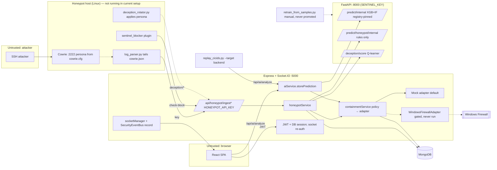

# SentinelAI — Evidence-Driven Audit Report

**Audited:** branch `db-fixes` at `a5856b7` (2026-10-22). **Auditor:** Claude (Claude Code).
**Scope:** Stages 1–7 of the audit brief. Stages 1–2 began at `f2e6bc8`. **16 commits landed during the audit**
(`e5318ac`…`a5856b7`, ~21k lines changed), so every earlier finding was re-verified against `a5856b7`.
**Evidence labels:** CONFIRMED / LIKELY / POSSIBLE / UNKNOWN, with source `static` (read code), `ran` (executed this
session), `prior-report` (project docs/earlier evidence, not re-run), `docs`.
**Companion files:** `FINDINGS.md` (detailed write-ups), `STAGE2_FLOWS.md` (flow traces at `f2e6bc8`), `FIXES.md`
(fix batch 1 applied by the auditor on user request), `LEDGER.md`.

---

## 1. Executive summary

**What SentinelAI is today.** SentinelAI is a well-engineered, security-conscious **SOC prototype**, made of four
services:
- a React dashboard;
- an Express/Socket.IO API with strong session auth and RBAC;
- a FastAPI engine serving a **registry-pinned XGBoost classifier** (`xgb_cicids_v1`) + Isolation Forest trained on
  CICIDS2017;
- a Cowrie integration (parser, blocker plugin, persona rotator).

It is a decision-support and logging platform with **simulated** (mock-adapter) containment. It is not an autonomous
or self-evolving defence system.

**What genuinely works (static + ran):**
- Authentication: HS256 pinned, 15-min access tokens, DB-backed sessions with revocation and inactivity timeout.
- Socket.IO handshake and per-packet re-authorisation.
- RBAC on every router; NoSQL-injection defences; credential redaction.
- The honeypot ingest → MongoDB → live dashboard path (code-complete, idempotent event handling).
- A fail-closed, SHA-256-pinned model registry with a golden-set check.
- A rigorous re-evaluation suite (chronological and leave-one-day-out).
- About 1,300 automated tests, which passed when run on 2026-10-21 (on an earlier commit; see §5).

**Top 5 problems**

| # | Problem | Why it matters |
|---|---|---|
| 1 | **SEC-001 (P0):** the live honeypot ingest key is in Git history that is now **pushed** (`origin/db-fixes`), and it is still in use in `backend/.env` and `deployment/.env.demo`. | Anyone with the repo can forge honeypot sessions, raise CRITICAL alerts and drive auto-block decisions. |
| 2 | **CLAIM-001 (P1):** the papers, README and UI describe a different system from `HEAD`. | Examples: "RF 98.43% is deployed" (XGBoost is); "XGBoost not deployed / trained on synthetic data"; 4 files / 6 classes / 46 features (8 files, 10 classes, 53 features); an SGD online learner (no code uses it); MITRE tagging "on every detection" (honeypot only); live network flows through ML (none); a Landing-page "REAL MODE … listening for live packet events" terminal that is hard-coded text. |
| 3 | **ML-004 (P1):** detection does not generalise. | Leave-one-day-out attack detection is 0.03–7.7% for the RF recipe (prior-report, `docs/C1_EVALUATION_PLAN_AND_RESULTS.md`; not measured for the deployed XGBoost). Rare classes have 2–7 test rows. Any "zero-day" or "novel attack" claim is unsupported. |
| 4 | **F1-001 / CORE-004 (P1):** nothing about "live honeypot telemetry" or "adaptive deception" has been observed end to end in the current setup. | Cowrie needs Linux, and no Linux/WSL environment is set up. One historical lab session exists. The persona rotator has never run against Cowrie. |
| 5 | **Issue 2 (P1 claim):** containment is simulated. | Auto-block now goes through the containment lifecycle, but with the **mock** adapter by default. The real Windows Firewall adapter has never executed; manual block buttons still only write a deny-list row. |

**Revalidation of the eight prior issues** (details in §4)

| # | Prior claim | Verdict (at `a5856b7`) | Key evidence |
|---|---|---|---|
| 1 | No supervised retraining loop, only Q-table updates | **PARTLY TRUE** | A human-gated offline loop exists (`ai-engine/training/retrain_from_samples.py`, promotion gates, `/model/reload`), but it has **never promoted a model**: `models/registry_history.jsonl` has only `backfill`/`register_model.py` entries. The only runtime learning is the Q-table. |
| 2 | Firewall adapter never live; mock default; autoBlock off | **STILL TRUE** | `adapterFactory.js` default `mock`; `autoBlockEnabled` default false; VM harness never run (prior-report). Auto-block now calls `requestContainment` (`containmentService.js:895`), so it reaches the adapter. |
| 3 | UI label claims success for alert/mock | **PARTLY TRUE** | Containment toasts and alerts are now honest (fix batch 1). Landing "REAL MODE" terminal and Features ("SOAR playbook", "session termination", "sub-100ms") remain. |
| 4 | Metrics produced before the time-of-day leakage fix | **NO LONGER TRUE — as stated** | Time-of-day features are zero in every training row (`features.py:496-498`) and have **0.0 importance** in RF v2, RF v3 and XGB v1 (ran). The real inflation is the random row split (98.43% vs 97.57% chronological, macro-F1 0.84 → 0.74; LODO collapses). |
| 5 | Root RF file differs; which one loads? | **RESOLVED** | Root copy archived (`models/README.md`); runtime loads only what `ai-engine/models/registry.json` pins (sha256), currently `xgb_classifier_xgb_cicids_v1.pkl`. |
| 6 | Live Cowrie telemetry may not reach the UI | **PARTLY TRUE / CAN'T VERIFY** | Chain is code-complete; it cannot run here; one historical lab session (prior-report). Settle with one recorded WSL/VM run. |
| 7 | Business-event distribution incomplete | **MOSTLY FIXED** | Duplicate delivery removed; every emitted event is recorded on the SecurityEventBus (`socketManager.js:110-120`). `ip_unblocked` and `critical_alert` still have no UI listener. |
| 8 | Enrollment weak/unenforced | **NO LONGER TRUE (users) / N/A (agents)** | Public `/register` → 403; admin-only `/provision` with forced first-login change; no agent concept in the code. |

---

## 2. Architecture

Component and flow diagram at `a5856b7` (relationships found in code; dashed = exists but not exercised live):



Trust boundaries:
- **Browser ↔ Express:** Bearer JWT + CSRF cookies, Origin allow-list.
- **Honeypot host ↔ Express:** one static key; carries attacker-controlled strings.
- **Express ↔ FastAPI:** one static key, plus an optional admin key for reload.
- **Express ↔ OS firewall:** `child_process.exec` netsh, two env gates.

**Flow table (at `a5856b7`)**

| Flow | Status | Where it breaks / is mocked / is untested |
|---|---|---|
| F1 Honeypot telemetry | Code-complete, **not observed live** | Cowrie can't run on this host. Prior-report: one lab session. Idempotent event IDs, sweep of stale sessions, credential redaction present. |
| F2 Detection | Works **on demand / replay** | No live flow capture. Input arrives via analyst `/api/ai/analyze` or `replay_cicids.py --target backend`. Real XGB+IF inference; missing features reported as `defaultedFeatures`. |
| F3 Deception | Learns; **application untested** | Credit assignment fixed; Q-table persists (`%LOCALAPPDATA%\SentinelAI\runtime`). `deception_rotator.py` applies personas but has never run against Cowrie. Honeypot verdicts are rule-based (`classificationMethod: honeypot_rules`). |
| F4 Containment | **Simulated** | Auto-block → BlockedIP + `requestContainment` → mock adapter. Manual Block / block-ip → DB only. Real adapter needs `CONTAINMENT_BACKEND=windows-firewall` + `ENABLE_REAL_WINDOWS_FIREWALL_ENFORCEMENT=true`; never executed. |
| F5 Auth / enrollment | **Works** (static + tests) | Admin-only provisioning. Service auth is two static keys. |
| F6 Event distribution | **Works** | One copy per role; deliveries recorded on the bus. Two events have no listener. |

---

## 3. Claims vs reality matrix

Sources:
- **P:** `paper_text.txt` (= `IMPLIMENTATION.pdf`) §/line.
- **R:** `README.md` line.
- **UI:** component.

Status values: REAL / PARTIAL / MOCK/DEMO / PAPER-ONLY / BROKEN / UNKNOWN. The survey paper is not in the repo and was
not assessed.

| # | Claim | Source | Implementation (file:line) | Status | Gap → cheapest honest fix |
|---|---|---|---|---|---|
| 1 | RF 98.43% acc / 0.9862 wF1 is the deployed model | P abstract, Tab II, Tab IV, X Ph4, XIII; R:139-143 | `ai-engine/models/registry.json` pins **XGBoost `xgb_cicids_v1`** | **BROKEN (stale)** | Reword: report the deployed model's numbers, or re-pin RF and say so. |
| 2 | XGBoost trained only on synthetic data (83.67%) / "not deployed" | P Tab IV, VII-A; R:146 | `xgb_classifier_xgb_cicids_v1_meta.json`: real CICIDS2017, 8 files, acc 0.9897, macro-F1 0.8738, random split; **deployed** | **BROKEN (stale)** | Update the table: XGB is real-data and deployed. |
| 3 | 4 CICIDS files, 6 real classes, 46 features | P VIII-A, VIII-B | `datasets/cicids2017` has 8 files; XGB meta has 10 trained classes; `FEATURE_NAMES` = 53 | **BROKEN (stale)** | Reword to 8 files / 10 classes / 53 features (2 always zero). |
| 4 | Headline accuracy represents detection quality | P IX-A; R:139-153 | Random split (`evaluation.independent_holdout: false`); chronological 97.57% / macro-F1 0.74; LODO 0.03–7.7% detection (prior-report) | **PARTIAL** | README already labels splits; the paper must too. Lead with chronological + LODO. |
| 5 | Zero-day / unseen-attack detection (IF tier) | P abstract, I, VI-A Tier 3; UI `Features.jsx:4` | IF runs (`predictor.py`), but LODO shows ~0% detection of unseen days | **PAPER-ONLY (unsupported)** | Remove "zero-day" or state it as untested/negative. |
| 6 | Live network events flow through ML to the dashboard | P XI-H; UI `Landing.jsx:209-218` ("REAL MODE… live packet") | No packet capture; replay only (`replay_cicids.py`) | **MOCK/DEMO** | Say "recorded CICIDS flows replayed through the live pipeline". Delete the fake terminal or label it "illustrative". |
| 7 | Honeypot sessions classified by RF/IF + SHAP | R:72-75 (sequence diagram) | `predictor.py:529-575` rules only (`classificationMethod: honeypot_rules`) | **BROKEN (stale)** | Fix the diagram: "rule-based session classifier". |
| 8 | Q-learning recommends profiles | P VI-B, VII-B, IX-C | `rl_engine/deception_scorer.py`; credit assignment fixed | **REAL** | — |
| 9 | Q-learning **dynamically reconfigures Cowrie** / "morphs fingerprint" | R:30,44; UI `Features.jsx:5` | `honeypot/deception_rotator.py` exists; never run against a live Cowrie | **PARTIAL (untested)** | "Rotator implemented; not yet validated live." P is already honest ("not automatically applied") but now outdated. |
| 10 | Persistent Q-table across restarts | P VII-B, XIII | `deception_scorer.py:47-66` stable per-user path; compose volume | **REAL** (since `e5318ac`) | — |
| 11 | Algorithm 2 detects fingerprinting attempts | P Alg. 2 l.2-3 | No fingerprinting detector in `deception_scorer.py` | **PAPER-ONLY** | Remove the fingerprint gate from Alg. 2 or mark it future. |
| 12 | Adaptive honeypot improves engagement ≥40% | P IV-B, IX-C | Not run (P says so) | **PAPER-ONLY** (honestly stated) | Keep as future work. |
| 13 | Automated containment / firewall isolation | R:48; UI `Features.jsx:6`, `About.jsx:28`, `Landing.jsx:133` | Mock adapter default; real adapter never executed | **MOCK/DEMO** | "Policy-governed containment workflow; enforcement simulated by default; Windows Firewall adapter gated and not field-tested." P Tab II is honest ("not executed"). |
| 14 | SOAR playbooks, session termination | UI `Features.jsx:6` | None in code | **PAPER-ONLY** | Delete. |
| 15 | Sub-second / sub-100 ms latency | R:46; UI `Features.jsx:4,7` | Not measured (P IX-A says latency not instrumented) | **UNKNOWN** | Delete or measure. |
| 16 | SGD online learner with `partial_fit` feedback (self-evolution) | P Tab II, VI-E, X Ph4 | Not used by any code path (`features.py:598` comment) | **PAPER-ONLY** | Replace with "human-gated offline retraining (`retrain_from_samples.py`), implemented, not yet exercised". |
| 17 | "Self-evolving" / continuous adaptation | P abstract, I, V-A; UI `Landing.jsx:134` | Q-table updates only; retraining manual, never promoted | **PAPER-ONLY** | Say "designed toward self-evolution; currently human-in-the-loop". |
| 18 | MITRE ATT&CK tagging on every detection | P Tab II, X Ph7, XIII | `honeypotService.js:175` only (honeypot sessions) | **PARTIAL** | "…on honeypot sessions". |
| 19 | AbuseIPDB enrichment | P Tab II | `threatIntelService.js` (async, key-optional) | **REAL** (static) | — |
| 20 | SHAP explanations | P XI-F, XIII; R:29,43 | `predictor.py:329-340` TreeExplainer | **REAL** (static; not executed this session) | — |
| 21 | Campaign clustering (HASSH / command similarity) | P XI-E | `campaignService.js:44-64` | **REAL** | — |
| 22 | JWT + RBAC + rate limits on all routes | P V-B, X Ph2, XI-B | `middleware/auth.js`, every router, `server.js:90-120` | **REAL** | — |
| 23 | Socket.IO doesn't validate tokens; no revocation; stateless refresh | P XI-B | `websocket/auth.js`, `authSessionService.js` (sessions, revocation) | **STALE (understates)** | Update the paper; this is now a strength. |
| 24 | "No automated test suite or CI" / "four Jest files" | P X Ph8, XI-G | 74 backend + 43 pytest + 7 frontend unit + 14 E2E files; `ci.yml`, `e2e.yml` | **STALE (understates)** | Update the paper. |
| 25 | Deployed via Docker Compose (four services containerised) | P V-C, X Ph9, XI | `docker-compose.yml` (mongo, ai-engine, backend, frontend, prometheus, grafana — **no Cowrie service**); Docker removed from this host (prior-report) | **UNKNOWN** | Run it once and record, or say "compose file provided; honeypot runs on a separate Linux host". |
| 26 | Cowrie profile is Ubuntu-oriented | P XI-D | `cowrie.cfg:3,11` CentOS 7 | **BROKEN (stale)** | Fix wording. |
| 27 | Live SOC dashboard data, not mock | P X Ph1, XI-C | Pages fetch the backend; `mockData.js` deleted; DB contains seeded `demo-*` sessions (prior-report) | **PARTIAL** | Say the demo DB is seeded and label demo records. |
| 28 | Five-engine architecture (Fig. 1) | P V-A, Fig. 1 | Four services; DQN, BERT, CNN/LSTM, EWC absent | **PAPER-ONLY** (honestly labelled "proposed") | Keep the explicit "proposed" caption. |
| 29 | Honeypot nodes (HTTP/FTP/SMTP) | UI (earlier) | Removed in fix batch 1 | **FIXED** | — |
| 30 | MTTD / FPR evaluated | UI `About.jsx:27` | FPR measured offline (C1 doc); MTTD not measured | **PARTIAL** | Remove MTTD. |

**Exact wording changes needed (paper):**
- **Abstract / §XIII:** replace "a Random Forest classifier … achieves 98.43% accuracy and 0.9862 weighted F1" with
  > "the deployed XGBoost classifier, trained on de-duplicated CICIDS2017 flows (8 capture files, 10 classes), reaches 98.97% accuracy (macro-F1 0.87) on a random split; on a chronological split the RF baseline reaches 97.6% (macro-F1 0.74), and attacks from capture days excluded from training are almost entirely missed."
- **Tab IV:** add the XGB real-data row and a "split" column; drop or mark the synthetic rows as historical.
- **§VIII:** 8 files / 10 classes / 53 features (two time-of-day features are constant zero in CICIDS2017).
- **Tab II "Self-Evolution":** remove SGD/`partial_fit`; describe `retrain_from_samples.py` (human-gated, not yet exercised).
- **Tab II "Threat Intel":** MITRE tagging applies to honeypot sessions.
- **§XI-B:** replace with the current auth design (DB sessions, revocation, socket re-auth).
- **§XI-D:** CentOS persona; rotator implemented but not validated live.
- **§XI-G / Ph8:** describe the actual test suites and CI, but report pass/fail only from a recorded run.
- **§XI-H:** "recorded CICIDS2017 flows are replayed through the live pipeline"; drop "live network events".
- **Alg. 2:** remove the fingerprinting gate or mark it future.

**README:** lines 30, 44 (Cowrie reconfiguration), 46 (sub-second), 48 (automated firewall), 72-75 (sequence diagram), 139-146 (deployed model).

**UI:** `Landing.jsx` 133-134 and 206-218, `Features.jsx` 4-7, `About.jsx` 18-28.

For every non-REAL row, **rewording is cheaper and more honest than code**, except row 25 (one recorded compose run)
and row 9 (one recorded rotator run), which are cheap to evidence.

---

## 4. Findings register (current state at `a5856b7`, sorted by priority)

States updated after fix batch 2 (see `FIXES.md`); rows not mentioned there are unchanged.

| ID | Pri | Label | Title | Location | Fix | State |
|---|---|---|---|---|---|---|
| SEC-001 | **P0** | CONFIRMED (ran) | Live honeypot key in pushed Git history, still in use | commit `315700c` `scratch/run_browser_script.mjs`; on `origin/db-fixes`; `backend/.env`, `deployment/.env.demo` | Rotate now; treat as public | **PARTLY FIXED** (batch 2: key rotated in both env files, removed from `scratch/run_all_verify.ps1`; honeypot host, history purge and account passwords still open) |
| CLAIM-001 | P1 | CONFIRMED (static) | Paper/README/UI describe a different system from HEAD (rows 1-7, 13-18, 25-27 of §3) | see §3 | Reword (list in §3) | **PARTLY FIXED** (batch 2: README + Landing/Features/About; paper not edited) |
| ML-004 | P1 | CONFIRMED (static) + prior-report | No generalisation to unseen attack days; tiny rare classes | XGB meta `class_counts` (SQLi 17/4, RCE 9/2, Lateral 29/7, Data Exfil 0); `docs/C1_*` LODO | Report LODO + per-class; drop zero-day claims | **OPEN** |
| F1-001 | P1 | CONFIRMED (static) + prior-report | Live Cowrie path never observed in current setup | `honeypot/`, no Cowrie in compose | One recorded WSL/VM run, or reword | **OPEN** |
| CORE-004 | P1→P2 | CONFIRMED (static) | Deception application untested live (learning itself fixed) | `honeypot/deception_rotator.py` | One recorded rotator run | **PARTLY FIXED** |
| SEC-004 | P2 | LIKELY (static) | Once real firewall enforcement is enabled, a key holder can forge honeypot sessions that auto-block arbitrary non-loopback IPs | `predictor.py:541-543` (rules + 0.02/command), `containmentService.js:895`, empty `CONTAINMENT_PROTECTED_TARGETS` default | Set the protected list; require manual approval for RFC1918; rotate key (SEC-001) | **OPEN** |
| OPS-002 | P2 | CONFIRMED (static) | Compose runs backend with `NODE_ENV=development`, published on all interfaces | `docker-compose.yml` backend env + `ports`; `securityTopology.js:45`, `authCookies.js:24`, `server.js:226` | Use `production` + TLS proxy, or bind 127.0.0.1 | **OPEN** |
| CORE-001b | P2 | CONFIRMED (static) | Manual Block / block-ip don't go through the adapter (labelled honestly) | `containmentService.js` `blockThreat`, `blockIPManual` | Route through `requestContainment` | **FIXED** (batch 2: `enforceManualBlock` / `releaseManualBlock`) |
| ML-005 | P2 | CONFIRMED (static) | Deployed model trained from a dirty tree, random split only | XGB meta `provenance.git_dirty: true`, `evaluation.independent_holdout: false` | Retrain from a clean commit on the chronological recipe; record split | **OPEN** |
| TEST-003 | P2 | CONFIRMED (static) | No CI test exercises Express↔FastAPI↔Mongo together; firewall only tested for refusal; Cowrie only offline contracts | `backend/tests` (36 files mock models, 14 mock AI), `ai-engine/tests` | Add one compose-based integration job | **OPEN** |
| TEST-004 | P2 | CONFIRMED | Test pass status at HEAD not re-established by auditor | last auditor run 2026-10-21 on an earlier commit | Re-run (needs approval) | **FIXED** (2026-11-01: Jest 1128, pytest 594, frontend 49 + build, all green; `FIXES.md`) |
| RET-001 | P2 | CONFIRMED (static) | Retraining loop implemented but never exercised | `registry_history.jsonl` | Run one gated retrain → promote → reload, record it | **OPEN** |
| OPS-003 | P3 | CONFIRMED (static) | MongoDB in compose without auth (internal network only) | `docker-compose.yml` mongo | Enable auth (least-privilege config already exists in docs) | **OPEN** |
| OPS-004 | P3 | LIKELY (static) | Collector `sessionMap` grows for sessions that never close via the collector | `honeypot/collectors/session_collector.js:8,29` | Delete on sweep/timeout or drop the map | **OPEN** |
| EVT-001 | P3 | CONFIRMED (static) | `ip_unblocked`, `critical_alert` emitted with no UI listener | `socketManager.js` vs `frontend/src` | Listen or stop emitting | **OPEN** |
| SEC-005 | P3 | CONFIRMED (static) | CSP disabled in helmet | `server.js:69` | Enable CSP for the SPA host | **OPEN** |
| DEP-001 | P3 | CONFIRMED (static) | Early-2024 Python pins (fastapi 0.109.2, requests 2.31.0, scikit-learn 1.4.0); pytest in runtime requirements; npm/pip audit not run | `ai-engine/requirements.txt` | Run `pip-audit`/`npm audit` (network, ask) and bump | **OPEN** |
| HYG-001 | P3 | CONFIRMED (static) | ~30 superseded model files beside the registered ones | `ai-engine/models/` | Move non-registered files to an archive dir | **OPEN** |
| CORE-001 | P1 | CONFIRMED | UI claimed blocks / no protected targets | — | Fix batch 1 + `e5318ac` | **FIXED** |
| CORE-002 | P1 | CONFIRMED | Honeypot "ML" was synthetic-flow RF | — | Now rule-based and labelled | **FIXED** |
| CORE-003 | P1 | CONFIRMED | No traffic into the persisted path | — | `replay_cicids.py --target backend` | **FIXED (as replay)** — claim wording still under CLAIM-001 |
| SEC-002 | P1 | CONFIRMED | Fabricated predictions via honeypot key/JWT | — | Fix batch 1 | **FIXED** |
| OPS-001 | P1 | CONFIRMED | `npm run seed/clean` wiped DB unprompted | — | Fix batch 1 | **FIXED** |
| TEST-001/002 | P1/P2 | — | E2E reused live backend; E2E CI couldn't boot | — | Fix batch 1 | **FIXED** |
| ML-001 | P1 | CONFIRMED (ran) | Time-of-day leakage | — | Never leaked (zero importance) | **WITHDRAWN** |
| ML-002, ML-003, CORE-005, CORE-006, CORE-007, SEC-003, DOC-001, DOC-002, CFG-001, CI-001 | P2–P3 | — | see FINDINGS.md | — | — | **FIXED** |

### Detailed write-ups (P0/P1 open)

```
ID: SEC-001 | Priority: P0 | Label: CONFIRMED (ran: git branch -r --contains; value comparison printed match flags only)
Where: commit 315700c, scratch/run_browser_script.mjs:12-15 (deleted in a7fa029, still in history); contained in origin/db-fixes;
       same value as HONEYPOT_API_KEY in backend/.env and deployment/.env.demo
What: The key the honeypot uses to post telemetry is published in a pushed branch and has not been rotated.
Why it matters: Anyone who can read the GitHub repo can POST /api/honeypot/ingest*: create sessions and CRITICAL alerts,
      inject commands that the dashboard shows as attacker activity, and — with autoBlock on — get arbitrary IPs added to
      the deny-list (and, once real enforcement is enabled, to the host firewall; see SEC-004). If the repo is public,
      assume it is already scraped.
Fix: Generate a new key (openssl rand -hex 32), update backend/.env, deployment/.env.demo and the honeypot host; restart.
     Optionally purge history (git filter-repo + force-push), but rotation is the actual fix. Also rotate the three
     verify-account passwords from the same file.
Proof of fix: Old key → 401 on /api/honeypot/ingest; `git grep -F <new key> $(git rev-list --all)` returns nothing.
```

```
ID: CLAIM-001 | Priority: P1 | Label: CONFIRMED (static)
Where: §3 rows 1-7, 11, 13-18, 25-27 (paper_text.txt, README.md, Landing/Features/About.jsx)
What: The submitted text describes the August model (RF v2), an older data scope, an SGD learner nobody calls, MITRE
      tagging on all detections, live network input, and Docker deployment. The code now serves XGBoost on 8 files /
      10 classes, has no SGD path, tags only honeypot sessions, takes replayed flows, and has an unexercised compose file.
      The UI shows a hard-coded "REAL MODE … listening for live packet events" terminal and promises SOAR playbooks.
Why it matters: Each mismatch is a one-question viva failure ("which model is running?", "show the SGD update",
      "where do live packets come from?"). The paper is otherwise unusually candid, so these stale lines are the weak point.
Fix: Apply the wording list in §3 (≈1–2 hours). Do not change the code to match the old paper.
Proof of fix: Every number/claim in the paper traces to a file:line or a recorded run in an appendix table.
```

```
ID: ML-004 | Priority: P1 | Label: CONFIRMED (static: meta class_counts) + prior-report (LODO numbers, not re-run)
Where: ai-engine/models/xgb_classifier_xgb_cicids_v1_meta.json class_counts; docs/C1_EVALUATION_PLAN_AND_RESULTS.md §3
What: With a day held out, attack detection is 0.03% (Tue), 0.31% (Wed), 0.14% (Thu), 7.69% (Fri). These LODO
      figures were measured with the Random Forest recipe in docs/C1; no LODO result exists for the deployed XGBoost
      (UNKNOWN; run evaluation/day_holdout_eval.py with the XGB recipe to settle it). The deployed XGB has SQL Injection
      at 4 test rows, RCE 2, Lateral Movement 7, Data Exfiltration none. Accuracy is dominated by BENIGN and DDoS.
Why it matters: The paper motivates SentinelAI with zero-day/APT detection. The evidence says the classifier recognises
      the attack tools it was trained on and little else, and the Isolation Forest does not rescue unseen days.
Fix: Present this as a finding (it is a strong, honest result). Report per-class P/R with support counts; merge or drop
     classes with < 30 test rows; remove "zero-day" claims.
Proof of fix: Paper table with chronological + LODO rows and per-class support.
```

```
ID: F1-001 | Priority: P1 | Label: CONFIRMED (static) + prior-report
Where: honeypot/ (parser, plugin, rotator); docker-compose.yml has no Cowrie service; docs/DATABASE_HEALTH_REPORT.md:319
What: The honeypot chain has been exercised live once (a lab session via the old Docker bridge). There is no Linux host
      in the current setup; the rotator and the blocker plugin have never run against a live Cowrie.
Why it matters: "Live honeypot telemetry" and "adaptive deception" are headline claims.
Fix: One recorded run on WSL2/VM: ssh into Cowrie, show session → DB row → dashboard → closure → Q update → rotator
     switch. Screenshots + DB export in an appendix. Otherwise reword to "validated with one lab session and replays".
Proof of fix: Recorded run with matching sessionId in cowrie.json, MongoDB and the UI.
```

---

## 5. Test reality

Prior claims (project docs) are separated from what the auditor ran.

**Auditor runs (2026-10-21, commit after fix batch 1, before `e5318ac`…`a5856b7`):**
- Backend Jest: 948 passed, 13 skipped, 0 failed.
- AI pytest: 335 passed.
- Frontend `node --test`: 36 passed; `vite build` succeeded.

**Not re-run at `a5856b7`** (test counts grew to 74 / 43 / 7 / 14 files).

| Requirement | Test(s) | Proves it? | Why |
|---|---|---|---|
| F1 ingest → DB → socket | `honeypotIngestContract`, `cowrieIngest`, `honeypotCollectorContract`, `test_cowrie_parser*` | **Partly** | Contracts and service logic with mocked/in-memory stores; no real Cowrie or real backend↔parser run. |
| F2 detection | `test_predictor`, `test_api`, `test_high/medium_priority_ml`, `aiDependencyContract` | **Partly** | Real models load in pytest; backend tests mock `aiEngineService`. No test sends a flow Express → FastAPI → Mongo. |
| F3 deception | `test_deception_credit_assignment`, `test_q_table_safety`, `test_readiness` | **Partly** | Learner maths and persistence proven; rotator ↔ Cowrie not. |
| F4 containment | `containmentPolicy`, `containmentLifecycle`, `containmentProtectedTargets`, `windowsFirewallSafety` | **Partly** | Policy, state machine, compensation proven with mocks. Firewall tests prove only that it **refuses**. VM harness never run. |
| F5 auth / session | `auth*`, `sessionInactivity`, `revocationDelivery`, `roleMatrix`, `websocket`, E2E `auth`, `rbac`, `api-authz` | **Yes (mostly)** | Negative tests for no token / wrong role / revoked session exist (21 files assert 401/403). Real-Mongo auth suites are skipped unless `AUTH_TEST_MONGO_URI` is set. |
| F6 events | `socketRoomDelivery`, `websocket`, `securityEventBus`, E2E `realtime` | **Partly** | Room targeting proven with a mock `io`; E2E uses a test-only emit hook. |
| Secrets/env validation | `secretsValidation` | **Yes** | — |
| NoSQL injection / query safety | `querySecurity` | **Yes** (unit) | — |
| Destructive-script guard | `destructiveGuard` | **Yes** | — |
| Model registry integrity | `test_high_priority_ml` (registry/golden) | **Yes** (static read) | — |

**Tests that could pass while the feature is broken:**
- everything that mocks `aiEngineService` (14 files);
- `windowsFirewallSafety` (gate only);
- E2E `realtime.spec.js` (injects events via `/api/test/emit-socket` rather than producing them).

No acceptance test uses the shared real database: guards exist in `start-test-backend.cjs`, `e2e/dbGuard.js` and the
`AUTH_TEST_MONGO_URI` name check. No coverage percentages are claimed.

---

## 6. Roadmap (ordered fix batches)

| Batch | What changes | Files | Could regress | Done when |
|---|---|---|---|---|
| **B1 Secrets (today)** | Rotate `HONEYPOT_API_KEY` and verify-account passwords; decide whether to purge history | `backend/.env`, `deployment/.env.demo`, honeypot host env | Honeypot/parser stop posting until updated | Old key → 401 |
| **B2 Claims (before submission)** | Apply the §3 wording list to paper, README and UI text | `IMPLIMENTATION` source, `README.md`, `Landing.jsx`, `Features.jsx`, `About.jsx` | E2E text assertions on Landing (check `landing.spec.js`) | Every claim maps to file:line or a recorded run |
| **B3 Evidence runs** | (a) one recorded WSL/VM Cowrie session → DB → UI → rotator; (b) one `docker compose up`; (c) one gated `retrain_from_samples.py` promote → reload; (d) re-run all suites at HEAD | none (records only) | — | Appendix with logs, screenshots, registry_history entry |
| **B4 Deployment safety** | Compose backend `NODE_ENV=production` behind TLS or bind 127.0.0.1; Mongo auth; set `CONTAINMENT_PROTECTED_TARGETS`; manual approval for private-range auto-blocks | `docker-compose.yml`, `.env.example`, `containmentPolicyService.js` | Login over plain HTTP stops working in compose (intended) | Compose run with HTTPS proxy; policy test for RFC1918 approval |
| **B5 ML honesty** | Retrain from a clean commit on the chronological recipe; per-class report with support; merge classes with < 30 test rows | `training/`, `models/registry.json` | Served model changes; golden set must be regenerated | Meta shows `git_dirty: false`, `split: chronological` |
| **B6 Integration test** | One CI job: compose up mongo + ai-engine + backend; replay 50 flows; assert ThreatLog + socket event; no mocks | `.github/workflows/`, `scripts/` | CI time | Job green on a PR |
| **B7 Minor** | Manual block via adapter; listeners for `ip_unblocked`/`critical_alert`; CSP; dep bumps after audit; prune old models | various | Containment tests | Tests green |

---

## 7. Readiness verdicts

| Area | Verdict | Evidence (one line) |
|---|---|---|
| Functionality | **READY WITH CONDITIONS** | Core flows work on replayed data; containment simulated; honeypot live path unobserved. |
| Security | **NOT READY** | P0 leaked live key in a pushed branch, unrotated. Otherwise strong (auth, RBAC, sanitisation, registry pinning). |
| ML validity | **READY WITH CONDITIONS** | Honest re-evaluation exists; deployed model is random-split, trained from a dirty tree, and fails unseen days. Usable only if reported that way. |
| Tests | **READY WITH CONDITIONS** | Large suite, green on 2026-10-21; not re-run at HEAD; no unmocked cross-service test. |
| Integrations | **NOT READY** | Cowrie, real firewall, Docker Compose and the retrain loop never exercised end to end in the current setup. |
| Docs | **NOT READY** | Paper/README/UI are stale against HEAD (CLAIM-001). |

**Are the papers' claims currently defensible in a viva? — No, not as written.** The implementation paper is
unusually candid about future work (DQN, BERT, CNN, EWC, enforcement), and that candour will help. But its concrete
present-tense claims are now stale against the code:
- the deployed model and its numbers;
- the data scope;
- the SGD learner;
- MITRE coverage;
- live network input;
- Docker deployment;
- the Cowrie persona.

Its one strong result (98.43%) rests on a random split that the project's own evaluation shows collapses on unseen
days. All of this is fixable with wording plus three recorded runs (Cowrie, compose, retrain), not with new
features.

---

## 8. Next 10 actions

1. **Rotate the leaked honeypot key (SEC-001), today.**
   - Generate: run `node -e "console.log(require('crypto').randomBytes(32).toString('hex'))"`.
   - Put the value in `HONEYPOT_API_KEY` in `backend/.env` and `deployment/.env.demo`, and on the honeypot host (parser, rotator, blocker plugin env).
   - Restart the backend.
   - **Check:** the old key → 401; a parser POST with the new key → 200.
   - Optionally run `git filter-repo --path scratch/run_browser_script.mjs --path scratch/regenerate_audit_and_fixtures.mjs --invert-paths` and force-push `db-fixes`. This rewrites shared history, so coordinate first.
2. **Fix the deployed-model claim (CLAIM-001 rows 1–4).**
   - Paper abstract, Tab II, Tab IV, §VIII, Ph4, §XIII, and `README.md:139-146`: state that the served model is `xgb_cicids_v1` (`ai-engine/models/registry.json`).
   - Quote its random-split metrics from `xgb_classifier_xgb_cicids_v1_meta.json` (acc 0.9897, macro-F1 0.8738).
   - Add the chronological and LODO rows from `docs/C1_EVALUATION_PLAN_AND_RESULTS.md` §3.
   - Correct to 8 files / 10 classes / 53 features.
   - If you prefer the RF story, re-pin RF v3 with `register_model.py` instead, and then quote its numbers.
   - **Check:** grep the paper for "98.43" and every occurrence carries a split label.
3. **Remove the fake/unsupported UI and README claims (CLAIM-001 rows 5–7, 13–16).**
   - `frontend/src/pages/Landing.jsx`: delete the hard-coded terminal block (lines ~198–218) or caption it "Illustrative", and change lines 133–134 to "threat detection, adaptive honeypot intelligence and policy-governed response".
   - `Features.jsx:4-7`: drop "zero-day", "sub-second/sub-100ms", "SOAR playbook", "session termination"; say "XGBoost + Isolation Forest".
   - `About.jsx:28`: "policy-governed containment workflow (simulated enforcement)"; remove MTTD.
   - README lines 30, 44, 46, 48 and the sequence diagram lines 72–75 (honeypot sessions use rules, not RF/IF/SHAP).
   - **Check:** run `npx playwright test landing.spec.js` (adjust any text assertions); grep the UI for "zero-day|SOAR|sub-100".
4. **Record one live Cowrie run** on WSL2 (F1-001, CORE-004): session → `/honeypot` page → closure → Q-table update → `deception_rotator.py --once` switch. Save the evidence under `docs/evidence/`.
5. **Re-run all suites at HEAD** (TEST-004) and paste the summaries into the paper's testing section, replacing §XI-G.
6. **Exercise the retraining loop once** (RET-001): export samples, run `retrain_from_samples.py`, `--promote`, then `/api/ai/engine/reload`. Cite the `registry_history.jsonl` entry. Only then call it "human-in-the-loop retraining"; never "self-evolving".
7. **Harden compose** (OPS-002/003, SEC-004): `NODE_ENV=production` behind a TLS proxy (or bind `127.0.0.1:5000`), Mongo auth, and `CONTAINMENT_PROTECTED_TARGETS` set to your LAN.
8. **Rewrite §XI-B, §XI-D, Tab II "Self-Evolution", and Algorithm 2** per the §3 wording list.
9. **Per-class results with support counts** (ML-004). Merge or drop SQLi/RCE/Lateral/Exfil from headline macro-F1, or report them as "insufficient data".
10. **Add one unmocked integration CI job** (TEST-003): compose mongo + ai-engine + backend, replay 50 CICIDS rows via `/api/ai/analyze`, assert stored predictions and a socket event.
