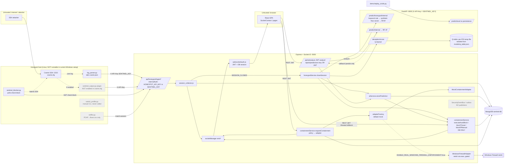

# Stage 2 — Critical flows, end to end

All citations were read this session (static), unless marked prior-report.

## Component / flow diagram (only relationships found in code)

Trust boundaries: **browser ↔ Express** (JWT Bearer + CSRF cookies; Socket.IO JWT handshake), **Cowrie/parser ↔ Express** (shared static API key; attacker-controlled content crosses here), **Express ↔ FastAPI** (shared static SENTINEL_KEY), **Express ↔ OS firewall** (child_process `exec` of netsh; mock unless two env gates are set).

## Flow table

| Flow | Status | Where it breaks / is mocked / is untested |
|---|---|---|
| **F1 Honeypot telemetry** | **WIRED, NOT LIVE** | Chain exists: `log_parser.py:45-160` → `routes/honeypotIngest.js:107-139` → `honeypot/collectors/session_collector.js:20-91` → Mongo → `socketManager.emitHoneypotEvent` (`socketManager.js:275`) → `useRealTimeFeed.js:37-53`, `HoneypotAnalytics.jsx:51`. Breaks at the source: Cowrie is Linux-only, Docker was removed, `cowrie.cfg` has no `[output_sentinel]` section (plugin path disabled), parser defaults to `/opt/cowrie/...`. Prior-report (`docs/DATABASE_HEALTH_REPORT.md:319`, `DATABASE_GUIDE.md:322`): **one** lab Cowrie session ever reached the DB (via Docker bridge 172.18.0.1) + 7 synthetic `demo-*` sessions. Session-open creates a fixed-score ThreatLog (`aiScore: 0.75`, "SSH Brute Force") before any ML (`session_collector.js:28`). |
| **F2 Detection** | **MANUAL/OFFLINE ONLY** | No live traffic source. Callers of inference: analyst `POST /api/ai/analyze` with a hand-supplied feature record (`routes/aiEngine.js:123`) → `/predict/internal` (`main.py:180`); `replay_cicids.py:299` uses `/predict/eval` which by design skips persistence/alerts (`main.py:195-207`); `sniffer.py` only labels PCAP flows into a CSV and never calls `/predict` (`sniffer.py:103-160`). The RF/IF inference itself is real (`predictor.py:298-367`); score = 0.7·RF + 0.3·IF signal; thresholds 0.92/0.70. Pydantic `Record` silently fills missing features with defaults (`main.py:77-101`). Honeypot sessions are "classified" by a keyword rule that then fabricates a flow vector from hard-coded class means (`features.py:318-400`), plus +0.02 per command (`predictor.py:390`). |
| **F3 Deception scoring** | **RUNS, DOES NOT AFFECT BEHAVIOUR** | `honeypotService.finishClosure` → `/deception/score` → `SessionScorer.process_session` (`deception_scorer.py:205-209`). (a) State is `payload.deceptionProfile = session.recommendedProfile || 'ubuntu_22'` (`honeypotService.js:128`) – unset at first closure → state is always `ubuntu_22`. (b) `update(prev, next_p, reward, next_p)` credits a reward earned under the old profile to the newly chosen one. (c) Output `nextProfile` is stored on the session (`honeypotService.js:291`) and **never applied**: `switch_profile.py` is a manual CLI nobody calls; Cowrie persona is fixed CentOS in `cowrie.cfg`. (d) Persistence goes to a per-PID temp file unless `SENTINEL_ALLOW_REPO_RUNTIME_WRITE=1` (`deception_scorer.py:46-65`, `deception.py:17-96`) → learning resets each restart. |
| **F4 Containment** | **MOCK / DB-ONLY** | Two separate paths. **Legacy path** (auto-block, `/threats/:id/block`, `/threats/block-ip`): `containmentService.executeAutoBlock` (`:783-852`), `blockThreat` (`:501-599`), `blockIPManual` (`:605-700`) write `BlockedIP`, set ThreatLog `status:'BLOCKED'`, `autonomousAction.taken:true`, emit `ip_blocked`, create "IP Address Blocked (Auto)" alert — **no adapter call, no policy check, no expiry**. Only enforcement: Cowrie blocker plugin rejecting SSH to the honeypot (`sentinel_blocker.py:36-80`). **Policy path** (`POST /api/containment/actions` from Settings/ThreatLogs modal): policy → `adapterFactory` (default `mock`, `adapterFactory.js:23`) → `MockContainmentAdapter.applyRule` → `ContainmentAction` `ACTIVE`, ThreatLogs `BLOCKED` (`containmentService.js:44-320`). Real `WindowsFirewallAdapter` needs `CONTAINMENT_BACKEND=windows-firewall` + `ENABLE_REAL_WINDOWS_FIREWALL_ENFORCEMENT=true` and not test/dry-run; never executed live (prior-report: `docs/final-closure/known-limitations-and-release-gates.md:21`). `autoBlockEnabled` defaults false (`honeypotService.js:177-178`, `aiService.js:69-70`). |
| **F5 Auth & enrollment** | **WORKS (static)** | HTTP: `protect` → `authSessionService.authorize` (HS256 pinned, DB session + revocation + inactivity, `authSessionService.js:87-160`); `mustChangePassword` gate. Socket.IO: handshake requires JWT + live DB session, re-checked on every packet and every 15 s, revocation disconnects rooms (`websocket/auth.js:4-60`, `authSessionService.js:57-60`). Public `/register` returns 403 (`authController.js:20`); admin-only `/provision` sets `mustChangePassword:true` (`userController.js:32`). There is **no agent concept** in the codebase. Service-to-service auth is two static shared keys, and either key is accepted on ingest and on `/api/ai/predictions`. |
| **F6 Event distribution** | **WORKS, WITH GAPS** | Direct emits from services via `socketManager` (fire-and-forget). Emitted with no frontend listener: `ip_unblocked`, `malware_download`, `critical_alert`. Every socket joins room `all` (`socketManager.js:28`), so admins/analysts receive honeypot events, live-feed events and `ai_prediction` **twice** (raw + redacted copy) (`socketManager.js:268-300`). `SecurityEventBus`/outbox (`utils/securityEventBus.js`, `/api/system/outbox`) has **no publisher** anywhere in production code. Containment-action lifecycle events are never pushed to clients. |

### F4 stage-by-stage (what the UI shows)

| Stage | What code does | What UI shows |
|---|---|---|
| Alert | ThreatLog + Alert created (`aiService.js:84-138`) | Alert bell / feed |
| Recommendation | `action: BLOCK/MONITOR/ALLOW` from score (`predictor.py:347`) | AI Analytics row "BLOCK" |
| Attempted action (auto) | Only if `autoBlockEnabled` true; ThreatLog created already `BLOCKED` (`aiService.js:73,84`) | Status badge `BLOCKED`, toast "🚫 IP Blocked" (`useRealTimeAlerts.js:59`) |
| Mock action | Legacy path: no adapter at all. Policy path: `MockContainmentAdapter` returns success → `ACTIVE` | Dashboard: "IP x blocked successfully" (`Dashboard.jsx:237`); ThreatLogs: "Containment rule active for x" (`ThreatLogs.jsx:117`); Settings: "containment policy applied" (`Settings.jsx:94`). Only the pre-confirm modal says "SIMULATION / MOCK ADAPTER" (`ContainmentConfirmModal.jsx:29,56`). |
| Confirmed real action | Only `WindowsFirewallAdapter` with both gates; never run | — |

## Revalidation of prior issues 2, 3, 5, 6, 7, 8

| # | Verdict | Evidence |
|---|---|---|
| 2 Firewall adapter never live; mock default; autoBlock off | **STILL TRUE — and worse** | `adapterFactory.js:23` default `mock`; backend `.env` sets no `CONTAINMENT_BACKEND`; `autoBlockEnabled` default false (`honeypotService.js:178`, `aiService.js:70`); prior-report says VM harness never executed. Additionally, the *auto*-block path never calls any adapter (`containmentService.js:783-852`). |
| 3 UI claims success for alert/mock | **STILL TRUE** | `Dashboard.jsx:237`, `ThreatLogs.jsx:117`, `Settings.jsx:94`, `useRealTimeAlerts.js:59`; ThreatLog `status:'BLOCKED'` + `autonomousAction.taken:true` written for DB-only blocks. Pre-confirm modal is honest. |
| 5 Root vs ai-engine RF file | **STILL TRUE — resolved which is loaded** | Started from `ai-engine/` (README), `MODEL_DIR=./models` → `ai-engine/models/rf_classifier_cicids_v2.pkl` (2026-08-09, metrics = README). Root `models/` copy (2026-08-14) referenced by no code. |
| 6 Live Cowrie telemetry E2E | **PARTLY TRUE** | Code chain complete; source cannot run in current setup; plugin not enabled in `cowrie.cfg`; prior-report: 1 historical lab session. Needs a Linux/WSL Cowrie run to settle. |
| 7 Business-event distribution incomplete | **STILL TRUE (different shape)** | Core events reach UI; outbox/event bus has zero publishers; 3 emitted events have no listener; duplicate delivery to privileged users. |
| 8 Enrollment weak/unenforced | **NO LONGER TRUE (users) / N/A (agents)** | `/register` → 403; admin-only `/provision`; forced first-login change. No agent enrollment exists in code. Residual: two static service keys, either accepted everywhere internal (see SEC-002). |
