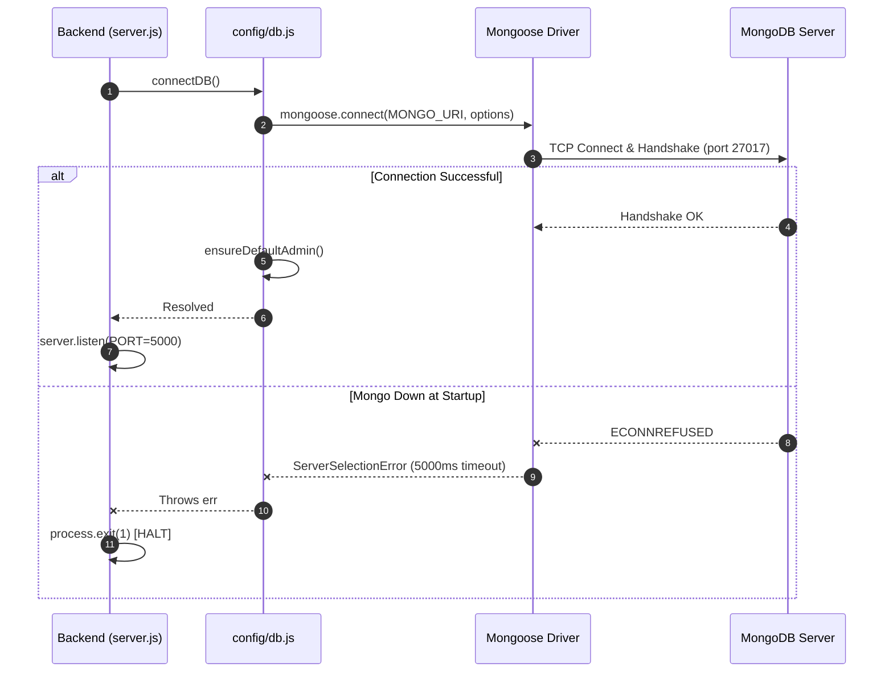
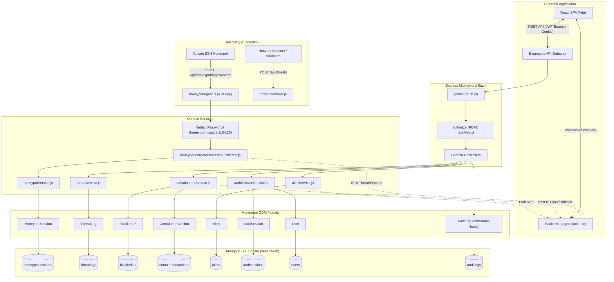
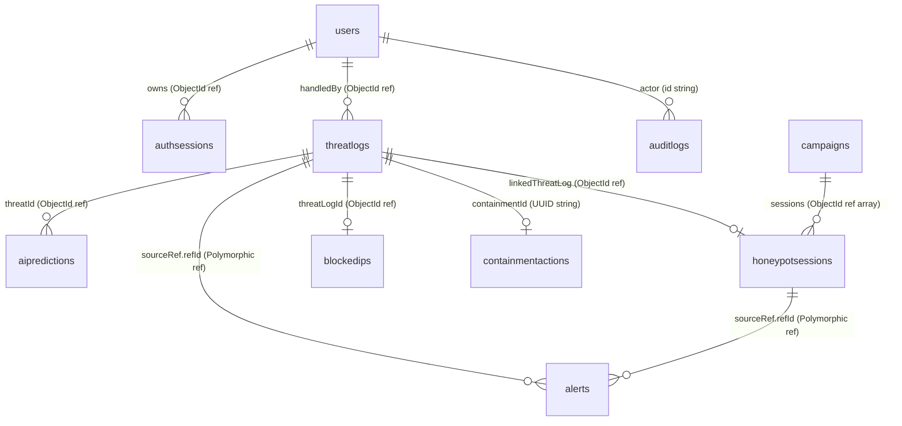

# SentinelAI Database Architecture & Engineering Guide

> **Audience**: Engineering students, SOC analysts, and developers with foundational JavaScript knowledge who are new to MongoDB, Mongoose ODM, and production NoSQL architectures.  
> **System Verified**: Live SentinelAI Engine running MongoDB `v7.0.45` and Mongoose `8.24.2` on Node.js.  
> **Source Grounding**: 100% verified against live codebase files and read-only queries executed against the live database `sentinel-db`.

---

## Table of Contents
1. [Glossary of Core Database Concepts](#1-glossary-of-core-database-concepts)
2. [The Big Picture: Architecture & Connection Lifecycle](#2-the-big-picture-architecture--connection-lifecycle)
   - [Why Document-Oriented NoSQL for SentinelAI](#21-why-document-oriented-nosql-for-sentinelai)
   - [Connection Mechanics & Resilience](#22-connection-mechanics--resilience)
   - [Versions & Mongoose 8.x Hook Compatibility](#23-versions--mongoose-8x-hook-compatibility)
   - [Architectural Flow Diagram](#24-architectural-flow-diagram)
3. [Collections and Schemas Deep-Dive](#3-collections-and-schemas-deep-dive)
   - [users](#31-users)
   - [authsessions](#32-authsessions)
   - [threatlogs](#33-threatlogs)
   - [honeypotsessions](#34-honeypotsessions)
   - [campaigns](#35-campaigns)
   - [alerts](#36-alerts)
   - [aipredictions](#37-aipredictions)
   - [trainingsamples](#38-trainingsamples)
   - [blockedips](#39-blockedips)
   - [containmentactions](#310-containmentactions)
   - [systemsettings](#311-systemsettings)
   - [auditlogs](#312-auditlogs)
   - [Outbox & Queue Collection Analysis](#313-outbox--queue-collection-analysis)
4. [Relationships & Integrity](#4-relationships--integrity)
   - [Entity-Relationship Diagram](#41-entity-relationship-diagram)
   - [Reference Link Types & Orphan Risk](#42-reference-link-types--orphan-risk)
   - [Populate & Aggregation Usage](#43-populate--aggregation-usage)
5. [End-to-End Data Flows](#5-end-to-end-data-flows)
   - [Flow A: Cowrie Event Ingest & Telemetry](#51-flow-a-cowrie-event-ingest--telemetry)
   - [Flow B: Threat Creation, AI Classification & Auto-Block](#52-flow-b-threat-creation-ai-classification--auto-block)
   - [Flow C: Analyst Manual Block IP Action & Rollback](#53-flow-c-analyst-manual-block-ip-action--rollback)
   - [Flow D: Session Auth & Token Lifecycle](#54-flow-d-session-auth--token-lifecycle)
   - [Flow E: SOC Dashboard Metric Aggregation](#55-flow-e-soc-dashboard-metric-aggregation)
   - [Flow F: Audit Log Pipeline, Dedupe & Immutability](#56-flow-f-audit-log-pipeline-dedupe--immutability)
6. [Deployment & Infrastructure Profiles](#6-deployment--infrastructure-profiles)
7. [Top 15 Viva Questions with Answers](#7-top-15-viva-questions-with-answers)
8. [Known System Limitations](#8-known-system-limitations)

---

## 1. Glossary of Core Database Concepts

| Term | Definition in Plain English | Concrete Example in SentinelAI |
| :--- | :--- | :--- |
| **Document** | A JSON-like record stored in BSON (Binary JSON) format. Contains key-value pairs, arrays, and nested objects. | A single threat incident record stored in `threatlogs` with fields like `sourceIP`, `attackType`, and `severity`. |
| **Collection** | A grouped set of documents, analogous to a table in relational SQL databases, but schema-flexible. | The `honeypotsessions` collection storing all attacker interaction sessions from Cowrie decoys. |
| **Schema** | A blueprint defined in application code (via Mongoose) declaring document fields, types, validators, defaults, and hooks. | `UserSchema` defined in [`backend/models/User.js`](../backend/models/User.js) enforcing email uniqueness, role enums, and version fields. |
| **ObjectId** | A 12-byte unique BSON identifier generated by MongoDB containing timestamp, machine ID, process ID, and counter. | `_id: ObjectId("6a9fc315dd3280a95f99f529")` uniquely identifying the Admin user. |
| **Index** | A specialized B-Tree data structure that speeds up document lookups at the expense of extra storage and slower writes. | `ThreatLogSchema.index({ createdAt: -1 })` in [`backend/models/ThreatLog.js:111`](../backend/models/ThreatLog.js#L111) enabling fast chronological sorting. |
| **TTL Index** | Time-To-Live index that instructs MongoDB's background thread to automatically purge documents after expiration. | `AlertSchema.index({ expiresAt: 1 }, { expireAfterSeconds: 0 })` in [`backend/models/Alert.js:41`](../backend/models/Alert.js#L41) auto-deleting alerts after 7 days. |
| **Aggregation** | A multi-stage processing pipeline (`$match`, `$group`, `$sort`) that filters and computes analytics over documents. | Aggregation pipeline in [`backend/services/threatService.js:198-202`](../backend/services/threatService.js#L198-L202) grouping threats by severity for the SOC pie chart. |
| **Populate** | A Mongoose utility that performs client-side joins by taking an ObjectId reference and fetching the referenced document. | `ThreatLog.find().populate('handledBy', 'name email')` in [`backend/services/threatService.js:79`](../backend/services/threatService.js#L79). |
| **Hook / Middleware** | Pre- or post-execution functions triggered automatically by Mongoose during document or query operations. | `UserSchema.pre('save', ...)` in [`backend/models/User.js:20-27`](../backend/models/User.js#L20-L27) automatically hashing passwords with bcrypt before persistence. |
| **lean()** | A Mongoose query option that skips document hydration (skipping change tracking and virtuals) and returns plain JavaScript objects for high performance. | `ThreatLog.find().lean()` in [`backend/services/threatService.js:80`](../backend/services/threatService.js#L80) speeding up read operations by 3-5x. |

---

## 2. The Big Picture: Architecture & Connection Lifecycle

### 2.1 Why Document-Oriented NoSQL for SentinelAI
SentinelAI is an autonomous cybersecurity detection, threat intelligence, and containment orchestration platform. A document database (MongoDB) was selected over traditional relational SQL for three core operational requirements:

1. **Unstructured & Variable Telemetry Payloads**: Attacker commands, Cowrie SSH keystrokes, and malware download URLs vary widely in length, schema, and frequency. Storing variable shell command sequences inside an embedded array (e.g. `HoneypotSession.commands` in [`backend/models/HoneypotSession.js`](../backend/models/HoneypotSession.js)) avoids complex multi-table joins.
2. **Polymorphic Alerts & Audit Details**: Alerts reference multiple distinct upstream sources (`ThreatLog`, `HoneypotSession`, `User`, `AIPrediction`) via a polymorphic subdocument `sourceRef` in [`backend/models/Alert.js:21-24`](../backend/models/Alert.js#L21-L24). Relational SQL would require multiple nullable foreign keys or complex junction tables.
3. **High-Velocity Time-Series Aggregations**: The platform ingests rapid event streams and computes rolling window trends (`threatService.js`, `reportingService.js`) using native `$dateToString` and bucket grouping on UTC timestamps.

### 2.2 Connection Mechanics & Resilience
Database connectivity is managed through [`backend/config/db.js`](../backend/config/db.js).



- **Configuration File**: [`backend/config/db.js:29-41`](../backend/config/db.js#L29-L41).
- **Environment Variable Name**: `MONGO_URI`.
- **Active Connection Options**:
  ```javascript
  {
    serverSelectionTimeoutMS: 5000,
    maxPoolSize: 10,
    minPoolSize: 2,
    socketTimeoutMS: 45000,
  }
  ```
- **Startup Failure Behavior**: If MongoDB is unreachable at startup, Mongoose throws a `MongooseServerSelectionError`. In [`backend/server.js:224-239`](../backend/server.js#L224-L239), the unhandled rejection handler executes `process.exit(1)`, halting the application process immediately.
- **Runtime Disconnection & Healthcheck**:
  - Mongoose listens to connection events: `disconnected`, `reconnected`, `error` ([`backend/config/db.js:42-43`](../backend/config/db.js#L42-L43)).
  - Queries hitting general collections are buffered by Mongoose up to `bufferTimeoutMS: 10000` (10 seconds) awaiting reconnection.
  - **Fail-Fast Boundary**: [`backend/models/AuthSession.js:14`](../backend/models/AuthSession.js#L14) explicitly configures `{ bufferCommands: false }`. Authentication session checks fail immediately without waiting for buffer timeouts.
  - When MongoDB drops, `GET /health` (`server.js`) checks `mongoose.connection.readyState === 1`. If disconnected (`readyState !== 1`), it immediately responds with `HTTP 503 Service Unavailable`.

### 2.3 Versions & Mongoose 8.x Hook Compatibility
- **MongoDB Server**: `v7.0.45` (WiredTiger storage engine, 64-bit architecture).
- **Mongoose ODM**: `8.24.2` (installed in `backend/package.json`).
- **Hook Compatibility Audit**:
  - `pre('save')` in `User.js:20` and `AuditLog.js:46` -> **Fully Supported**.
  - `pre(['updateOne', 'updateMany', 'findOneAndUpdate', 'findOneAndDelete', 'deleteOne', 'deleteMany'])` in `AuditLog.js:34,38` -> **Fully Supported**.
  - `pre('bulkWrite')` in `AuditLog.js:42` -> **Fully Supported**.
  - `AuditLogSchema.pre('findOneAndRemove')` in [`backend/models/AuditLog.js:38`](../backend/models/AuditLog.js#L38) -> **DEAD CODE IN MONGOOSE 8.x**. `Model.findOneAndRemove` was deprecated in Mongoose 6 and completely removed in Mongoose 8.0. The hook never fires because the method no longer exists on Mongoose models.

### 2.4 Architectural Flow Diagram



---

## 3. Collections and Schemas Deep-Dive

Cross-checking [`backend/models/`](../backend/models/) with live collection stats reveals exactly **12 collections** in `sentinel-db`. Every collection has a matching model, and every model has a matching collection.

### 3.1 users
- **Purpose**: Identity, credentials, Role-Based Access Control (`admin`, `analyst`, `viewer`), and session invalidation version tracking.
- **Model File**: [`backend/models/User.js`](../backend/models/User.js).
- **Fields Table**:

| Field | Type | Required | Default | Enum / Constraints | Validation / Notes |
| :--- | :--- | :--- | :--- | :--- | :--- |
| `_id` | ObjectId | Auto | Auto | — | Primary Key |
| `name` | String | Yes | — | Min 2, Max 50 | Trimmed |
| `email` | String | Yes | — | Unique | Lowercased, trimmed |
| `password` | String | Yes | — | Min 8, `select: false` | Bcrypt hash ($2a$12$) |
| `role` | String | No | `'viewer'` | `admin`, `analyst`, `viewer` | RBAC role |
| `status` | String | No | `'active'` | `active`, `inactive`, `suspended` | Account lock state |
| `lastLogin` | Date | No | `null` | — | Updated on successful login |
| `loginCount` | Number | No | `0` | — | Incremented on login |
| `passwordChangedAt` | Date | No | `null` | — | Rejects prior JWTs |
| `authVersion` | Number | No | `0` | Min 0 | Master session invalidation |
| `tokenVersion` | Number | No | `0` | Min 0 | Added in recent schema; backfilled on `save()` (`User.js:20-23`) |
| `mustChangePassword`| Boolean| No | `false`| — | Forces first-login reset |
| `department` | String | No | `'SOC'` | — | Organizational tag |
| `createdAt` / `updatedAt` | Date | Auto | Auto | — | Managed by `{ timestamps: true }` |

- **Indexes**:
  - Live: `_id_` (`{ _id: 1 }`), `email_1` (`{ email: 1 }`, Unique).
- **Hooks & Methods**:
  - `pre('save')`: Hashes password via `bcrypt.hash(password, 12)` if modified; initializes `tokenVersion = authVersion`.
  - `methods.comparePassword(pwd)`: Validates plain password against hash.
  - `methods.toJSON()`: Strips `password` and `__v`, computes assigned permissions via `getPermissions(this.role)`.
- **Live Document Count**: 6 documents.
- **Sanitized Example**:
  ```json
  {
    "_id": "6a9fc315dd3280a95f99f529",
    "name": "Admin User",
    "email": "admin@sentinel.io",
    "password": "[HASH REDACTED: length 60, type String]",
    "role": "admin",
    "status": "active",
    "loginCount": 84,
    "authVersion": 0,
    "tokenVersion": 0,
    "mustChangePassword": false,
    "department": "SOC"
  }
  ```
- **Read By**: `auth.js` (protect), `authController.js`, `userController.js`.
- **Written By**: `authController.js` (login/register/change-password), `userController.js` (update/delete), `config/db.js` (`ensureDefaultAdmin`).

---

### 3.2 authsessions
- **Purpose**: Stateful, revocable refresh session storage supporting single-session logout, user-wide force revocation, idle timeouts, and refresh-token replay attack detection.
- **Model File**: [`backend/models/AuthSession.js`](../backend/models/AuthSession.js).
- **Fields Table**:

| Field | Type | Required | Default | Enum / Constraints | Validation / Notes |
| :--- | :--- | :--- | :--- | :--- | :--- |
| `_id` | String | Yes | — | UUID v4 format | Session Identifier (`sid`) |
| `user` | ObjectId | Yes | — | Ref: `'User'` | Foreign key to `users` |
| `authVersion` | Number | Yes | — | Min 0 | Bound to User's `authVersion` |
| `generation` | Number | Yes | `0` | Min 0 | Refresh token rotation tracker |
| `refreshHash` | String | Yes | — | `select: false` | SHA-256 hash of refresh token (`authSessionService.js:45`) |
| `expiresAt` | Date | Yes | — | TTL index | Session hard expiration (30 days) |
| `lastUsedAt` | Date | Yes | — | — | Idle timeout activity timestamp |
| `revokedAt` | Date | No | `null` | — | Non-null if logged out or revoked |
| `revocationReason` | String| No | `null` | — | E.g. `'logout'`, `'password-change'`, `'refresh-replay'` |

- **Indexes**:
  - Live: `_id_` (`{ _id: 1 }`), `user_1` (`{ user: 1 }`), `expiresAt_1` (`{ expiresAt: 1 }`, `TTL(0s)`).
- **Hooks & Virtuals**: None. Uses `{ bufferCommands: false }` (`AuthSession.js:14`) to fail fast immediately if MongoDB is disconnected.
- **Live Document Count**: 57 documents (46 active, 11 revoked).
- **Sanitized Example**:
  ```json
  {
    "_id": "ea23a31a-cb25-4be0-a879-8bfc0e81af99",
    "user": "6a9fc315dd3280a95f99f529",
    "authVersion": 0,
    "generation": 0,
    "refreshHash": "[HASH REDACTED: length 64, type String, SHA-256]",
    "expiresAt": "2026-11-17T08:38:18.000Z",
    "lastUsedAt": "2026-10-18T08:38:18.930Z",
    "revokedAt": null,
    "revocationReason": null
  }
  ```
- **Read By**: `auth.js` (`protect` on every HTTP request), `authSessionService.js`.
- **Written By**: `authSessionService.js` (create on login, update on refresh rotation, set `revokedAt` on logout).

---

### 3.3 threatlogs
- **Purpose**: Central security incident log capturing detected network attacks, brute-force events, MITRE ATT&CK tactics, and autonomous containment states.
- **Model File**: [`backend/models/ThreatLog.js`](../backend/models/ThreatLog.js).
- **Fields Table**:

| Field | Type | Required | Default | Enum / Constraints | Validation / Notes |
| :--- | :--- | :--- | :--- | :--- | :--- |
| `_id` | ObjectId | Auto | Auto | — | Primary Key |
| `sourceIP` | String | Yes | — | Valid IPv4/IPv6 | Indexed |
| `targetService` | String | Yes | — | Max 100 chars | E.g. `SSH-COWRIE-01`, `WEB-PORTAL` |
| `attackType` | String | Yes | — | Enum list | `SSH Brute Force`, `DDoS`, `Port Scan`, `SQL Injection`, `Unknown` |
| `severity` | String | No | `'LOW'` | `CRITICAL`, `HIGH`, `MEDIUM`, `LOW`, `INFO` | Compound indexed with `status` |
| `status` | String | No | `'DETECTED'` | `DETECTED`, `INVESTIGATING`, `CONTAINED`, `BLOCKED`, `RESOLVED`, `FALSE_POSITIVE`, `MONITORING` | Workflow status |
| `aiScore` | Number | No | `0` | Min 0, Max 1 | ML confidence score |
| `aiClassification`| String| No | `'Normal'` | — | RF/IsolationForest label |
| `preBlockStatus` | String | No | `null` | — | Cached state prior to containment |
| `containmentId` | String | No | `null` | — | UUID link to `ContainmentAction` |
| `mitreAttack` | Object | No | `{}` | Subdocuments | `tactic`, `techniqueId`, `techniqueName` |
| `handledBy` | ObjectId | No | `null` | Ref: `'User'` | Assigned analyst |

- **Indexes**:
  - Live: `_id_`, `sourceIP_1_createdAt_-1`, `createdAt_-1`, `status_1`, `severity_1`, `severity_1_status_1`, `aiScore_-1`.
- **Live Document Count**: 10 documents.
  - **1 ThreatLog** (`172.18.0.1`, `6aa3a28b3e9adbbeb9e3996f`): **Locally generated or lab traffic** (Docker bridge gateway to Cowrie honeypot container; 3,383 login attempts, 0 commands executed).
  - **9 ThreatLogs**: **Seeded Demo Data** (1 RFC 5737 `198.51.100.88`, 1 RFC 1918 `192.168.100.99`, 7 linked to `demo-*` synthetic honeypot sessions generated via `backend/utils/seed.js:41-48`).
- **Read By**: `threatController.js`, `threatService.js`, `reportingService.js`, `aiEngineService.js`.
- **Written By**: `threatController.js`, `session_collector.js`, `containmentService.js`.

---

### 3.4 honeypotsessions
- **Purpose**: Captures interactive decoy telemetry from Cowrie SSH honeypots, including full terminal command history, downloaded URLs, IOCs, and deception metrics.
- **Model File**: [`backend/models/HoneypotSession.js`](../backend/models/HoneypotSession.js).
- **Credential Storage Architecture & Write Paths**:
  1. [`backend/routes/honeypotIngest.js:118-125`](../backend/routes/honeypotIngest.js#L118-L125): Live HTTP ingest sanitizes passwords to `'***REDACTED***'` using `backend/utils/redact.js:redactCapturedCredentials`.
  2. [`honeypot/collectors/session_collector.js:13`](../honeypot/collectors/session_collector.js#L13): Passes telemetry credentials into `honeypotService.closeSession()`, which runs `redactCapturedCredentials` before pushing to MongoDB.
  3. [`backend/services/honeypotService.js:114`](../backend/services/honeypotService.js#L114): Replaced raw push with `session.credentials.push(...redactCapturedCredentials(telemetry.credentials))`, guaranteeing that ingested credentials cannot drift.
  4. [`backend/utils/seed.js:127`](../backend/utils/seed.js#L127): Updated to run `redactCapturedCredentials` over fixture credentials before bulk insert.
  - **Shared Implementation & Testing**: All write paths are unified through `backend/utils/redact.js:redactCapturedCredentials` and verified by [`backend/tests/honeypotCredentialRedaction.test.js`](../backend/tests/honeypotCredentialRedaction.test.js).
  - **Live Database State**: In `sentinel-db`, **3,397 historical credentials remain stored in plaintext across 8 sessions** (3,383 in lab session `9b21e8e00dd7` and 14 across the 7 demo sessions) because they were written prior to the unified redaction patch. A non-mutating dry-run scrub script (`scratch/scrub_honeypot_credentials.mjs`) is prepared to redact historical values post-viva upon administrator approval.
  - **Role-Based Retrieval**: Verified by [`backend/tests/honeypotCredentialPrivacy.test.js`](../backend/tests/honeypotCredentialPrivacy.test.js), API responses for role `viewer` strip the `username` and `password` properties entirely, while `admin`/`analyst` retain forensic metadata.
- **Indexes**: `_id_`, `sessionId_1` (Unique), `sourceIP_1`, `honeypotNode_1_status_1`, `createdAt_-1`, `startTime_-1`.
- **Live Document Count**: 8 documents (1 lab session `9b21e8e00dd7`, 7 demo sessions `demo-*`).

---

### 3.5 campaigns
- **Purpose**: Correlates coordinated multi-session threat actor campaigns sharing common infrastructure, toolsets, or subnets.
- **Model File**: [`backend/models/Campaign.js`](../backend/models/Campaign.js).
- **Live Document Count**: 1 document (`Coordinated Scanner Campaign`).

---

### 3.6 alerts
- **Purpose**: Operational notification queue for SOC analysts.
- **Model File**: [`backend/models/Alert.js`](../backend/models/Alert.js).
- **Fields & Lifecyle**:
  - Contains polymorphic `sourceRef: { refModel, refId }`.
  - **Auto-Expiration TTL Index**: [`backend/models/Alert.js:41`](../backend/models/Alert.js#L41) defines `AlertSchema.index({ expiresAt: 1 }, { expireAfterSeconds: 0 })`. All alerts automatically purge 7 days after creation.
  - **Orphan Robustness**: Querying alerts via `alertService.findAlerts` does not populate `sourceRef.refId`. The frontend `AlertBell.jsx` renders `title`, `message`, `severity`, and `createdAt` directly. Orphaned alerts do not throw errors or break the UI.
- **Live Document Count**: 5 documents.

---

### 3.7 aipredictions
- **Purpose**: Historical inference audit trail produced by Random Forest and Isolation Forest ML models.
- **Model File**: [`backend/models/AIPrediction.js`](../backend/models/AIPrediction.js).
- **Live Document Count**: 9 documents.

---

### 3.8 trainingsamples
- **Purpose**: Stores labeled feature vectors for periodic model re-training.
- **Model File**: [`backend/models/TrainingSample.js`](../backend/models/TrainingSample.js).
- **Live Document Count**: 0 documents.

---

### 3.9 blockedips
- **Purpose**: Active firewall blocklist store for containment enforcement.
- **Model File**: [`backend/models/BlockedIP.js`](../backend/models/BlockedIP.js).
- **Fields**: `ip` (Unique), `reason`, `blockedBy`, `threatLogId`, `expiresAt` (TTL index).
- **Live Document Count**: 0 documents.

---

### 3.10 containmentactions
- **Purpose**: Formal containment orchestration state-machine tracking adapter enforcement, rollbacks, and failures.
- **Model File**: [`backend/models/ContainmentAction.js`](../backend/models/ContainmentAction.js).
- **Live Document Count**: 0 documents.

---

### 3.11 systemsettings
- **Purpose**: Singleton collection storing operational switches (e.g. `autoContainmentEnabled`, `mlInferenceThreshold`).
- **Model File**: [`backend/models/SystemSetting.js`](../backend/models/SystemSetting.js).
- **Live Document Count**: 1 document (`singleton: 'SYSTEM_SETTINGS'`).

---

### 3.12 auditlogs
- **Purpose**: Append-only forensic security log tracking authentication, user administration, and firewall actions.
- **Model File**: [`backend/models/AuditLog.js`](../backend/models/AuditLog.js).
- **Immutability Architecture**: Mongoose hooks intercept `updateOne`, `updateMany`, `findOneAndUpdate`, `deleteOne`, `deleteMany`, `findOneAndDelete`, and `bulkWrite`. Any modification throws an error.
- **Live Document Count**: 105 documents.

---

### 3.13 Outbox & Queue Collection Analysis
- **Finding**: SentinelAI does **not** maintain a persistent MongoDB collection for transactional outbox queueing.
- The route [`backend/routes/systemOutbox.js`](../backend/routes/systemOutbox.js) exposes an in-memory event bus and memory-backed outbox queue with `/api/system/outbox/failed` and `/redrive` endpoints.

---

## 4. Relationships & Integrity

### 4.1 Entity-Relationship Diagram



### 4.2 Reference Link Types & Orphan Risk
1. **Strong Mongoose ObjectIds**:
   - `AuthSession.user -> User._id`: 0 orphans found in live DB.
   - `HoneypotSession.linkedThreatLog -> ThreatLog._id`: 0 orphans found.
   - `AIPrediction.threatId -> ThreatLog._id`: 0 orphans found.
2. **Polymorphic Loose ObjectIds**:
   - `Alert.sourceRef.refId -> ThreatLog._id`: 2 historical alerts point to deleted threat `6ad4b633737aa56d06d52d4f` (auto-purging on 2026-10-25 via 7-day TTL index). Going forward, `threatService.deleteThreat(id)` cascades deletion of all alerts referencing the deleted threat ID while strictly preserving the audit-first policy in `threatController.deleteThreat`, preventing any new orphans at the source. Because `findAlerts` does not populate `sourceRef` and the UI does not dereference it, historical orphans cause zero UI breakage.
3. **Loose String References**:
   - `AuditLog.actor.id -> User._id`: Preserves historical audit integrity when users are deleted.
   - `ContainmentAction.normalizedTarget -> ThreatLog.sourceIP`: Linked via IP string.

---

## 5. End-to-End Data Flows

### 5.1 Flow A: Cowrie Event Ingest & Telemetry
```
Cowrie Daemon -> POST /api/honeypot/ingest/event (internalAuth)
  -> honeypotIngest.js:118-125: Redacts password to '***REDACTED***'
  -> session_collector.js:onSessionOpened()
     1. HoneypotSession.create({ sessionId, sourceIP, status: 'active' })
     2. ThreatLog.create({ severity: 'HIGH', attackType: 'SSH Brute Force', aiScore: 0.75, status: 'MONITORING' })
     3. HoneypotSession.updateOne({ linkedThreatLog: threat._id })
     4. socketManager.emitNewThreat(threat)
     5. socketManager.emitHoneypotEvent('honeypot_session_opened', ...)
```

### 5.2 Flow B: Threat Creation, AI Classification & Auto-Block
```
Traffic Sensor -> POST /api/threats (protect, analyst/admin)
  -> threatController.js:createThreat()
     1. ThreatLog.create(cleanData)
     2. AlertService.createAlertFromThreat() -> Alert.create()
     3. socketManager.emitNewThreat() + socketManager.emitNewAlert()
     4. If aiScore >= 0.7 & autoBlockEnabled:
        -> containmentService.executeAutoBlock()
           -> ContainmentAction.create({ status: 'REQUESTED' })
           -> adapter.applyRule()
           -> BlockedIP.findOneAndUpdate({ ip }, { upsert: true })
           -> ThreatLog.updateMany({ sourceIP }, { status: 'BLOCKED' })
           -> logContainmentAudit() -> AuditLog.create()
```

### 5.3 Flow C: Analyst Manual Block IP Action & Rollback
```
Analyst clicks "Block IP" -> POST /api/containment/block (protect, analyst/admin)
  -> containmentService.js:requestContainment()
     1. ContainmentAction.create({ status: 'REQUESTED' })
     2. Transition: VALIDATING -> APPROVED -> APPLYING
     3. adapter.applyRule() [MockAdapter or WindowsFirewall]
     4. If adapter fails -> Transition FAILED -> logContainmentAudit() -> throw 502
     5. If adapter succeeds -> Transition ACTIVE
     6. BlockedIP.findOneAndUpdate({ ip: normalized }, ..., { upsert: true })
     7. ThreatLog.updateMany({ sourceIP: normalized }, { status: 'BLOCKED', preBlockStatus })
     8. logContainmentAudit() -> AuditLog.create({ action: 'CONTAINMENT_ACTIVE' })
     9. socketManager.emitIPBlocked()
```

### 5.4 Flow D: Session Auth & Token Lifecycle
```
Incoming Request -> protect middleware (auth.js:28-57)
  1. sessions.authorize(token)
     -> jwt.verify(token, JWT_SECRET)
     -> AuthSession.findById(claims.sid) [bufferCommands: false -> fast fail]
     -> Check expiresAt, revokedAt === null, idle timeout
     -> User.findById(claims.id).select('-password')
     -> Check user.status === 'active' & user.authVersion === claims.av
  2. If idle activity throttle passed (>15s):
     -> AuthSession.updateOne({ _id: sid }, { $set: { lastUsedAt: now } })
  3. On Logout (authController.js:118-127):
     -> authSessionService.revokeSession(claims.sid, 'logout')
     -> AuthSession.updateOne({ _id: sid }, { $set: { revokedAt: now, revocationReason: 'logout' } })
     -> Disconnect session sockets
```

### 5.5 Flow E: SOC Dashboard Metric Aggregation
When the SOC dashboard loads or polls, `threatService.getDashboardAnalytics()` executes concurrent queries:
1. `ThreatLog.countDocuments({ createdAt: today })` (Uses index `createdAt_-1`)
2. `ThreatLog.countDocuments()`
3. `ThreatLog.aggregate([{ $group: { _id: '$severity', count: { $sum: 1 } } }])` (COLLSCAN on small collection)
4. `ThreatLog.aggregate([{ $match: { createdAt: { $gte: ... } } }, { $group: { _id: '$attackType' } }])` (Uses index `createdAt_-1`)

### 5.6 Flow F: Audit Log Pipeline, Dedupe & Immutability
```
Application Mutation -> logAudit() (backend/utils/auditLogger.js)
  1. Check shouldDedupe(entry):
     - If status === 'DENIED': compute key `${actorId}:${action}:${targetId}`
     - If seen within last 5000ms (5s window) -> return null (SUPPRESSED)
  2. Write to defaultSecurityAuditLogger (JSON log file stream)
  3. AuditLog.create() -> MongoDB collection 'auditlogs'
  4. If AuditLog.create() throws:
     -> In userController.js:184-189, triggers compensating rollback:
        User.findByIdAndUpdate(id, { role: prevRole, status: prevStatus, authVersion: prevAuthVersion })
```

---

## 6. Deployment & Infrastructure Profiles

> [!NOTE]
> There is **no Docker Compose file in the repository**. MongoDB runs as a Windows Service (`MongoDB Community Server`, `StartType: Automatic`) on the host machine.

| Profile Name | Environment File | Target Host | Port | Database Name | Auth Enabled | Network Binding | Backup Automation |
| :--- | :--- | :--- | :--- | :--- | :--- | :--- | :--- |
| **Local Development** | `backend/.env` | `localhost` | 27017 | `sentinel-db` | **false** | Loopback (`127.0.0.1`) | None (manual scripts only) |
| **Demo Profile** | `deployment/.env.demo` | `localhost` | 27017 | `sentinel-db` | **false** | Loopback (`127.0.0.1`) | None |
| **Production Profile** | `deployment/.env.production` | `mongo` | 27017 | `sentinel-db` | **false** | Hostname (unauthenticated) | None |

> [!WARNING]
> In all profiles, `authEnabled` is **false**. MongoDB authentication is disabled; security relies entirely on loopback binding (`127.0.0.1`) and host-level firewall protection.

---

## 7. Top 15 Viva Questions with Answers

1. **Why does SentinelAI use MongoDB instead of PostgreSQL or MySQL?**  
   *Answer*: Cybersecurity telemetry (attacker commands, honeypot keystrokes, polymorphic alerts) is semi-structured and changes rapidly. Storing nested command history in BSON arrays avoids expensive relational joins during high-throughput ingestion.
2. **What happens if MongoDB crashes while SentinelAI is processing an HTTP request?**  
   *Answer*: For general routes, Mongoose buffers queries up to 10 seconds before throwing a timeout error. However, `AuthSession` explicitly disables buffering (`{ bufferCommands: false }` in `AuthSession.js:14`), failing fast immediately with an error so auth checks never hang.
3. **What happens if MongoDB is down when the backend starts?**  
   *Answer*: In `server.js:224-239`, `connectDB()` fails after 5000ms and executes `process.exit(1)`, terminating the backend process immediately.
4. **How does SentinelAI ensure audit logs cannot be tampered with or deleted?**  
   *Answer*: SentinelAI distinguishes between its live host deployment and its hardened test architecture:
   - **Live Host Setup (`sentinel-db` on port 27017)**: Audit immutability is enforced strictly at the application layer via Mongoose middleware in `backend/models/AuditLog.js`. Pre-hooks intercept and reject all mutation and deletion methods (`updateOne`, `updateMany`, `findOneAndUpdate`, `replaceOne`, `deleteOne`, `deleteMany`, `findOneAndDelete`, and `bulkWrite`). The live MongoDB instance runs unauthenticated on localhost loopback (`127.0.0.1`), so engine-level RBAC is not active live.
   - **Hardened Test Setup (`port 27030`)**: Database engine-level least privilege RBAC was authored in `deployment/mongo-init.js` and verified against an authenticated instance. The application role `sentinel_app_role` is granted strictly `insert` and `find` actions on `auditlogs` (no `update` or `remove`). Any direct mutation via the mongo shell or external clients is rejected by the MongoDB engine itself with `code: 13 (not authorized)`. Activation on the live host is deferred post-viva.
5. **How are user sessions invalidated when an administrator changes a user's role or forces a logout?**  
   *Answer*: SentinelAI implements dual invalidation: (1) `user.authVersion` is incremented, instantly invalidating all active JWTs on their next request via `protect` middleware; (2) `AuthSession.revokedAt` is populated in the database.
6. **Why does alert notification polling cause a collection scan (COLLSCAN) in MongoDB?**  
   *Answer*: The real query executed during polling is `Alert.countDocuments({ targetRoles: role, isRead: false })`. The existing compound index is `{ severity: 1, isRead: 1 }`. Under B-Tree prefix rules, MongoDB cannot use an index that does not lead with the queried fields, forcing a full collection scan. A compound index on `{ targetRoles: 1, isRead: 1, createdAt: -1 }` is required.
7. **What is the difference between an embedded document and a referenced document in SentinelAI?**  
   *Answer*: Commands inside `honeypotsessions.commands` are embedded subdocuments stored directly in the session document. `ThreatLog.handledBy` stores an ObjectId reference to a `User` document, populated on demand.
8. **Why are there orphaned alerts in the database, and how does the application handle them?**  
   *Answer*: In historical test runs, deleting a threat left alerts referencing the deleted ID. This has been resolved at the source: `threatService.deleteThreat(id)` cascades deletion of all alerts where `sourceRef.refModel === 'ThreatLog'` and `sourceRef.refId === id`, while strictly maintaining the audit-first policy in `threatController.deleteThreat`. The 2 historical orphaned alerts in `sentinel-db` cause no UI issues (as `findAlerts` does not populate `sourceRef`) and will automatically purge via MongoDB's 7-day TTL index on 2026-10-25.
9. **Why is `tokenVersion` missing on `admin@sentinel.local` and `priya@sentinel.io`?**  
   *Answer*: In git commit `5ea705144f`, `UserSchema` only defined `authVersion`. `tokenVersion` was added subsequently. Because MongoDB is a schema-less document store, adding a field with a default to a Mongoose schema does **not** retroactively backfill existing documents on disk; it only initializes on new document saves.
10. **Why does the `AuditLog` hook on `findOneAndRemove` not work in Mongoose 8?**  
    *Answer*: `Model.findOneAndRemove` was deprecated in Mongoose 6 and removed in Mongoose 8. The method does not exist on Mongoose 8 models, making `pre('findOneAndRemove')` dead code.
11. **What is the database performance impact of storing growing honeypot command arrays?**  
    *Answer*: In WiredTiger, updates to growing arrays require rewriting the entire uncompressed BSON document in memory and writing it out to data pages. If a session records thousands of commands, it increases cache dirty pages and risks hitting MongoDB's hard **16 MB BSON document limit**.
12. **How does SentinelAI handle timezone boundaries for daily SOC threat reports?**  
    *Answer*: `backend/services/reporting/reportTime.js` computes UTC timestamps explicitly aligned with Indian Standard Time (`Asia/Kolkata`, UTC+05:30) day boundaries, ensuring that aggregation buckets correspond to the SOC team's local calendar day.
13. **What is the difference between a sparse index and a compound index in MongoDB?**  
    *Answer*: A compound index indexes multiple fields together (e.g. `{ sourceIP: 1, createdAt: -1 }`). A sparse index only indexes documents containing the indexed field. SentinelAI relies on compound indexes for multi-field filtering and sorting.
14. **Why is post-query redaction used, and what is its security trade-off?**  
    *Answer*: Redaction-at-read is an **intentional SOC design choice**: security analysts need raw, unmasked forensic data (attacker IP addresses, full command strings, download URLs, MITRE indicators) for threat hunting, while restricted roles like Viewers receive redacted views via Express middleware. The true residual security risk is that raw unencrypted data resides on the database host disk and in unencrypted database dumps (`mongodump`) unless database encryption-at-rest is configured.
15. **Are database operations atomic across multiple collections in SentinelAI?**  
    *Answer*: SentinelAI supports multi-document ACID transactions through a dual-mode transaction helper (`backend/utils/transactionHelper.js:runWithTransactionOrFallback`):
    - **Live Host Setup (`sentinel-db` on port 27017)**: The live MongoDB instance runs as a standalone server without a replica set, with `MONGO_USE_TRANSACTIONS=false` by default. Multi-collection mutations in `userController` and `threatController` execute using compensating application-level rollbacks (e.g. reverting user changes or logging failures if subsequent steps fail).
    - **Hardened Test Setup (`port 27030`, `rs0`)**: Multi-document transactions were verified on a single-node replica set (`rs0`) with `MONGO_USE_TRANSACTIONS=true`. In unit tests (`backend/tests/transactionSupport.test.js`), mutations execute within native MongoDB client sessions (`session.withTransaction(...)`). When an audit write or downstream operation fails, the transaction aborts atomically, leaving zero partial writes across collections.

---

## 8. Known System Limitations & Architecture Status

1. **Standalone Host Default vs Transaction Support**: The default local MongoDB runs as a standalone instance without a replica set, utilizing compensating rollbacks. Multi-document ACID transactions are fully supported in code (`transactionHelper.js`) and verified on replica set `rs0` behind `MONGO_USE_TRANSACTIONS=true`. Full activation on production hosts requires replica set initialization (`docs/UPGRADE_RUNBOOK_REPLICA_AND_AUTH.md`).
2. **Database Engine RBAC Activation Deferred**: Audit immutability is enforced via Mongoose hooks on the host instance. Engine-level least privilege RBAC (`sentinel_app_role` insert-only) has been authored and verified on port 27030, but host activation of `--auth` is deferred post-viva to prevent connection failures during evaluation.
3. **Automated Telemetry Pruning Requires Manual / Scheduled Trigger**: The retention and archival engine (`retentionService.js`) is implemented, safe-by-default (dry-run and disabled by default), and verified by unit tests. Because it is deliberately not hooked to server startup to prevent accidental data loss, it requires explicit admin invocation via CLI (`scripts/run_retention.mjs`).
4. **Historical Passwords in Seed Data**: Write paths to `honeypotsessions.credentials` are unified with redaction in `redact.js`. 3,397 legacy passwords in historical sessions (3,383 in session `9b21e8e00dd7` and 14 across 7 demo fixtures) remain at rest until the verified scrub script (`scratch/scrub_honeypot_credentials.mjs`) is approved and run.
5. **No Native External Message Broker**: Honeypot event ingestion and WebSocket event emissions are performed synchronously in Node.js process memory without an external distributed queue (e.g. RabbitMQ or Kafka).
