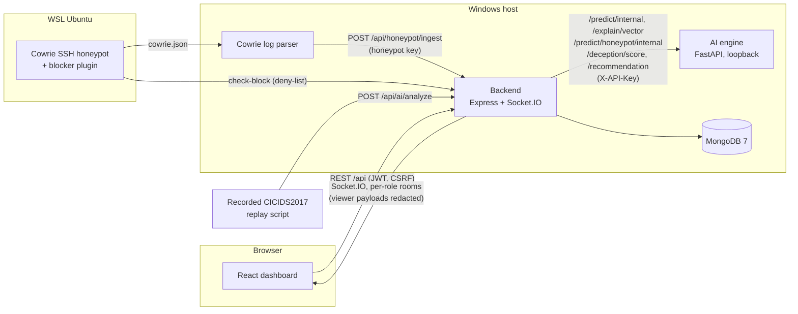

# SentinelAI final project guide (handover, 2026-11-03)

One document to understand, install, run, demonstrate and maintain SentinelAI. It links to the detailed documents
instead of repeating them. Every claim here is either visible in the code or was measured by a test run named in §11;
anything else is marked as an expectation, a limitation or untested.

| Need | Go to |
|---|---|
| Run the three demonstrations | [`DEMO_ABC_RUNBOOK.md`](DEMO_ABC_RUNBOOK.md) |
| Prepare for the viva | [`VIVA_GUIDE.md`](VIVA_GUIDE.md) |
| Performance and failure behaviour | [`PERFORMANCE_AND_RESILIENCE.md`](PERFORMANCE_AND_RESILIENCE.md) |
| Model evaluation detail | [`../audit/ML_EVAL_PLAN.md`](../audit/ML_EVAL_PLAN.md), [`C1_EVALUATION_PLAN_AND_RESULTS.md`](C1_EVALUATION_PLAN_AND_RESULTS.md) |
| Findings and fixes, batch by batch | [`../audit/FINDINGS.md`](../audit/FINDINGS.md), [`../audit/FIXES.md`](../audit/FIXES.md), [`../audit/LEDGER.md`](../audit/LEDGER.md) |

## 1. System architecture

SentinelAI is a security-operations prototype with four services and one database:

| Service | Technology | Port (dev / demo) | Role |
|---|---|---|---|
| Frontend | React 18 + Vite | 3000 | SOC dashboard: threats, honeypot analytics, AI analytics, settings; role-based views (admin, analyst, viewer) |
| Backend | Node.js 24, Express, Socket.IO | 5000 | API gateway, authentication (JWT + rotating refresh cookie + CSRF), RBAC and redaction, threat/alert pipeline, containment state machine, real-time events |
| AI engine | Python 3.11, FastAPI, XGBoost, scikit-learn, SHAP | 8000 (loopback only) | Flow classification (XGBoost) + anomaly detection (Isolation Forest), per-threat SHAP explanations, honeypot session scoring, Q-learning persona recommender |
| Honeypot | Cowrie SSH in WSL Ubuntu + `honeypot/parsers/log_parser.py` | 2222 | Real SSH honeypot with fabricated shell; parser ships its JSON log to the backend; blocker plugin enforces the deny-list |
| Database | MongoDB 7.0 | 27017 | Users, sessions, threats, predictions (with the 53-feature vector), alerts, honeypot sessions, deception decisions, containment actions, audit log |

## 2. Component communication

- Every browser call goes through the backend; the engine binds to 127.0.0.1 and requires the shared service key.
- The backend calls the engine with a 10 s timeout, retries only stateless calls, and has a circuit breaker (5
  failures, reset after 30 s). When the engine is down a flow is stored as `DEGRADED` (MEDIUM, never blocked).
- Socket.IO rooms are joined only after the server re-verifies the session; privileged rooms get raw events, the
  viewer room gets redacted copies (last IPv4 octet masked, commands replaced).

## 3. AI/ML: models and metrics

**Served model** `xgb_cicids_v1` (`ai-engine/models/registry.json`): an XGBoost multi-class classifier plus an
Isolation Forest anomaly detector, both behind one 53-feature schema (`utils/features.py`, version `v2.1_53feat`).
- At startup the engine verifies each model file's SHA-256 against the registry and reproduces a 20-row golden set;
  it refuses to serve on any mismatch.
- **Threat score** combines the classifier's attack probability with the anomaly signal. A non-BENIGN prediction at
  or above the **alert line 0.90** becomes a ThreatLog (HIGH); at or above the **block line 0.92** it is CRITICAL and,
  only if an admin enabled auto-block, contained.
- Each request runs single-threaded (PERF-001, `INFERENCE_N_JOBS`), which leaves the CPU for the other services.

**Metrics (CICIDS2017; measured, see `README.md` and `audit/ML_EVAL_PLAN.md`)**

| Evaluation | Result | Meaning |
|---|---|---|
| Random 80/20 split, de-duplicated (served recipe) | accuracy 98.97 %, macro F1 0.874; attack recall 99.8 % (95.2 % at the 0.90 line), benign FPR 0.36 % (0.23 % at the line) | Same capture sessions in train and test: optimistic |
| Train Mon–Wed, test Thu+Fri | attack recall 50.6 %, benign FPR 0.12 % | Forward in time; 5 test attack classes never trained on |
| Leave one capture day out (4 attack days) | attack recall 3.1–33.4 % | Unseen days and tools are mostly missed |
| Alert line on held-out later traffic | 78.6 % of attacks alerted, 0.154 % of benign flows | Chosen for a 0.1 % benign-alert target on validation |

**The model does not generalise to attack days or tools it has not seen.** It is a strong in-distribution
classifier, not a detector of novel attacks. Cross-dataset (CSE-CIC-IDS2018) development experiments did not produce
a deployable model; four 2018 days are kept untouched for an external test that has not been run.

**Explanations (SHAP).** For a stored prediction the backend sends its saved 53-feature vector to `/explain/vector`;
the engine re-scores it, refuses if class, score or model version differ (so the explanation always belongs to that
prediction), and returns TreeSHAP contributions for the predicted class in log-odds. Contributions plus the base value
add up to the classifier margin (tested). SHAP covers the XGBoost classifier only, not the anomaly term.

## 4. Honeypot and reinforcement-learning architecture

1. Cowrie (WSL) accepts SSH logins with lab credentials and serves a fabricated shell; nothing executes on a real
   host. It writes `cowrie.json`.
2. The parser ships session events to `/api/honeypot/ingest` (idempotent, keyed by Cowrie event ids). Live sessions
   and commands reach the dashboard over Socket.IO.
3. When a session closes, the backend runs rule-based analysis (`honeypot_rules`: MITRE ATT&CK techniques, intent),
   scores it with the engine (`/predict/honeypot/internal`) and credits the persona that served it
   (`/deception/score`, never retried because it updates the Q-table).
4. **Persona learner.** Six personas (Ubuntu 22.04, Debian 11, CentOS 7, Windows Server 2019, Amazon Linux 2,
   Raspbian); `windows_srv` is never recommended because Cowrie only emulates a Linux shell. Tabular Q-learning:
   state = the previously served persona, action = next persona, alpha 0.1, gamma 0.9, epsilon 0.2 decaying to a
   floor of 0.05. Reward per session: log-scaled duration, 0.3 per command, intent bonuses (malware download 3.0,
   reverse shell 2.5, persistence 2.0, credential harvest and privilege escalation 1.5), 0.5 per IOC, 2.0 for a
   successful login, minus 5.0 if the attacker ran honeypot-fingerprinting commands; clipped to [-10, 20].
5. One decision is drawn per served persona and persisted (`deceptiondecisions`); `honeypot/deception_rotator.py`
   applies it (rewrites `cowrie.cfg` from a template, restarts Cowrie, records `APPLIED`).

**Not proven:** whether learned rotation keeps attackers engaged longer than a fixed persona. No controlled
experiment with real attackers has been run.

## 5. Autonomous response architecture

- **Policy first** (`containmentPolicyService`): loopback, link-local and `CONTAINMENT_PROTECTED_TARGETS` are refused;
  degraded or incomplete predictions are never auto-blocked; auto-block is off by default.
- **State machine** (`ContainmentAction`): `REQUESTED → VALIDATING → APPROVED → APPLYING → ACTIVE`, then
  `EXPIRING`/`ROLLING_BACK → ROLLED_BACK`; `ROLLBACK_FAILED` is retried by reconciliation; `FAILED` and `REJECTED`
  are final. One active action per target (lock); every action has a TTL; operators roll back from Settings.
- **Enforcement** goes through an adapter. The default **mock adapter records a simulated rule; no firewall change
  is made.** The Windows Firewall adapter exists but is disabled (`ENABLE_REAL_WINDOWS_FIREWALL_ENFORCEMENT`) and has
  never been run live. The only real enforcement is the honeypot's own deny-list check.
- Every step writes an audit record and emits `ip_blocked` / `ip_unblocked`.

## 6. Security controls and limitations

Implemented and tested: short-lived JWT access tokens in memory, rotating refresh token in an `httpOnly`,
`SameSite=Strict` cookie (`Secure` in production or over HTTPS), CSRF tokens on every auth mutation, session
revocation that also disconnects sockets, RBAC with per-role redaction (REST and Socket.IO), rate limiting, CSP and
security headers, startup refusal of placeholder secrets, model hash verification, a secret scanner in CI.

Limitations (see §13): SEC-001 (credentials once committed to history; risk accepted by the owner, not rotated),
no TLS termination in the repository, raw data unencrypted at rest, single-host deployment only.

## 7. Installation requirements (verified from a clean clone, 2026-11-03)

| Requirement | Verified version | Notes |
|---|---|---|
| Windows 10/11 | Windows 11 | Linux/macOS work for backend, engine and frontend (CI runs on Ubuntu); the demo scripts are Windows PowerShell |
| Node.js / npm | 24.14 / 11.9 | `npm ci` in `backend/` and `frontend/` |
| Python | 3.11.9 | only version tested; `py -3.11 -m venv .venv`; `pip install -r ai-engine/requirements.txt` took 4–7 min |
| MongoDB Community | 7.0.45 | service on 127.0.0.1:27017 |
| WSL 2 Ubuntu + Cowrie | WSL 2.7 | only for Demo A; Cowrie in `~/sentinelai-cowrie-test/cowrie` (see [`COWRIE_COMPLETE_GUIDE.md`](COWRIE_COMPLETE_GUIDE.md)) |
| CICIDS2017 CSVs | — | git-ignored; needed for Demo B replay and the integration harness, not for running the system |
| Disk | ~3 GB | venv ≈ 1.5 GB, `node_modules` ≈ 0.8 GB |

**Windows path length:** clone into a short folder. In a folder about 145 characters deep the checkout fails
("Filename too long") and the venv cannot load scikit-learn's DLLs (measured).

**Environment variables.** Copy `backend/.env.example` and `ai-engine/.env.example` and replace every `CHANGE_ME`
value; the backend refuses to start otherwise. Optional variables the code reads that are not in the examples (all
have safe defaults):

| Variable | Default | Effect |
|---|---|---|
| `CONTAINMENT_BACKEND` | `mock` | enforcement adapter |
| `ENABLE_REAL_WINDOWS_FIREWALL_ENFORCEMENT` | off | must stay off for demos |
| `CONTAINMENT_PROTECTED_TARGETS` | empty | extra addresses/CIDRs never contained |
| `HOST` | `127.0.0.1` | backend bind address; the demo script sets the WSL-visible address so Cowrie can reach it |
| `INFERENCE_N_JOBS` | `1` | engine threads per request (`-1` = all cores, the old behaviour) |
| `Q_TABLE_PATH` | per-user runtime copy seeded from `models/q_table.json` | where the engine keeps the learned Q-table; the seed file is never written |
| `AI_CIRCUIT_FAILURES` / `AI_CIRCUIT_RESET_MS` | 5 / 30000 | engine circuit breaker |
| `RETENTION_ENABLED`, `RETENTION_INTERVAL_HOURS`, `RETENTION_DAYS_*` | off | data retention job; runs only when both of the first two are set |

## 8. Startup procedure

Development (each in its own terminal, after §7): `backend: npm run dev`, `ai-engine: uvicorn inference.main:app
--host 127.0.0.1 --port 8000 --env-file .env`, `frontend: npm run dev`, then http://localhost:3000. On a brand-new
database create the first admin once: `npm run seed -- --confirm=<database>` (it deletes that database's data).

Demonstration: `scripts\demo\start-demo.ps1` (engine, backend on the `sentinel-demo` database, frontend, Cowrie
parser; expects three `UP` lines), then in WSL `bash scripts/demo/cowrie-demo-mode.sh on`. Stop with
`scripts\demo\stop-demo.ps1` and `cowrie-demo-mode.sh off`. Full procedure: [`DEMO_ABC_RUNBOOK.md`](DEMO_ABC_RUNBOOK.md) §1.

## 9. Demo A/B/C runbooks

[`DEMO_ABC_RUNBOOK.md`](DEMO_ABC_RUNBOOK.md) is authoritative. Validation status for this handover is in §11.

## 10. Troubleshooting

| Symptom | Cause | Fix |
|---|---|---|
| Backend exits: "insecure default/placeholder value" | a `CHANGE_ME` value left in `backend/.env` | replace all five secrets (README step 3) |
| `git clone` "Filename too long"; engine "DLL load failed … filename too long" | clone path too deep on Windows | clone into a short folder |
| Engine `/ready` 503 | model hash or golden-set check failed, or venv incomplete | read the engine log; models must match `registry.json` |
| `seed` prints `[BLOCKED]` | safety guard | add `-- --confirm=<database name>` |
| Dashboard live feed stops after a MongoDB outage | (fixed in batches 13–14) | it reconnects by itself and catches up the threats it missed (up to 20; all remain in Threat Logs) |
| Demo-specific symptoms | — | [`DEMO_ABC_RUNBOOK.md`](DEMO_ABC_RUNBOOK.md) §5 |

## 11. Performance and test evidence

Measured 2026-11-03 on the project laptop (Windows 11, 16 logical cores, 7.7 GB RAM, other apps running):

| Check | Result |
|---|---|
| Clean clone → install → build → seed → start → login → analyze (throwaway MongoDB 7.0) | all steps pass; services up in ~65 s |
| Integration harness with live Cowrie (Demos A, A-live, B, C, auth, outage) | **42 passed, 0 failed** |
| Demo scripts (`start-demo.ps1`, `cowrie-demo-mode.sh on/off`, `stop-demo.ps1`) | three services UP; blocker check-block 200; clean stop |
| Backend Jest / ESLint | 1,176 passed, 13 skipped / clean |
| AI engine pytest | 653 passed |
| Model registry and golden set | OK; hashes unchanged |
| Frontend unit / lint / production build | 70 passed / clean / OK |
| Playwright, Chromium + Firefox + WebKit (+ device projects) | **240 passed, 0 failed, 0 skipped** |
| Secret scan | 0 findings |
| Load and failure recovery | [`PERFORMANCE_AND_RESILIENCE.md`](PERFORMANCE_AND_RESILIENCE.md) (batch 13) |

Details per batch: [`../audit/FIXES.md`](../audit/FIXES.md).

## 12. Deployment-readiness assessment

| Area | Status | Evidence / gap |
|---|---|---|
| Native Windows single-host (services + MongoDB 7 + WSL Cowrie) | **Verified** | clean clone, demo scripts, integration harness (§11) |
| Production frontend build | **Verified** | `npm run build`; served by `vite preview` with CSP in the clean-clone test |
| Health and readiness | **Verified** | backend `/health` (503 when DB or engine down), engine `/ready` (models verified) and `/health`, `/metrics` on both |
| Environment separation | **Verified** | demo uses `sentinel-demo` and its own Q-table; tests use throwaway databases; startup refuses placeholder secrets |
| Restart and recovery | **Verified** (native) | engine/MongoDB outage and recovery, socket reconnect (`PERFORMANCE_AND_RESILIENCE.md` §4) |
| CORS, cookies, origins | **Verified** (loopback) | `CLIENT_URL` allow-list; cookies `httpOnly`, `SameSite=Strict`, `Secure` in production; non-loopback HTTP refused |
| Docker Compose (`docker-compose.yml`, three Dockerfiles, Prometheus, Grafana) | **Implemented, untested** | Docker is not installed; the 2026-10-15 acceptance attempt was blocked at preflight |
| nginx (`frontend/nginx.conf`) | **Implemented, untested** | serves the built SPA on 8080 with CSP; runs only in the container |
| HTTPS/TLS | **Missing** | no certificate or TLS termination config in the repository; compose expects TLS in front; `TRUST_PROXY` must list explicit proxy addresses |
| Monitoring (Prometheus rules, Grafana dashboard) | **Implemented, partly tested** | rules unit-tested in CI (`promtool`); never run against live services |
| Database backup and restore | **Missing** (procedure only) | no scheduled backup; manual `mongodump`/`mongorestore` only |
| Real firewall enforcement | **Blocked by design** | adapter disabled; must not be enabled for demos |
| Multi-host / public deployment | **Missing** | not designed or tested; would need TLS, secrets management and SEC-001 resolved |

## 13. Known limitations

- The model does not detect attack days or tools it has not seen (§3); several classes have too little data.
- Network flows in Demo B are **recorded CICIDS2017 records replayed**, not live capture.
- Enforcement is **simulated** (mock adapter) except the honeypot's own deny-list.
- The persona learner's benefit is unmeasured; its state is only the previous persona (close to a bandit problem).
- Auto-block acts on a single flow at or above 0.92; there is no multi-event correlation.
- Single process engine (~120–130 requests/s); dashboard analytics and text search scale linearly with stored threats.
- SEC-001 open (risk accepted); no TLS, no backups, Docker untested.
- Open test findings: TEST-008 (browser stalls under memory pressure on this laptop), E2E-002 (one Firefox triage
  failure in 39 runs, not reproduced since).

## 14. Maintenance and recovery

| Task | How |
|---|---|
| Verify models before a demo | `ai-engine\.venv\Scripts\python ai-engine\training\register_model.py --check` |
| Full automated check (~5 min) | `node scripts/integration/run_integration.cjs --cowrie` (throwaway database; restores Cowrie) |
| Reset demo activity | `scripts\demo\reset-demo-db.ps1` (keeps users and settings; refuses `sentinel-db`) |
| Engine, backend or MongoDB died | restart its window / `Start-Service MongoDB`; dashboards reconnect by themselves |
| Restore Cowrie persona | `cowrie.cfg.pre-demo` backup, then `cowrie-demo-mode.sh restart` (runbook §2) |
| Back up a database (manual) | `mongodump --uri mongodb://127.0.0.1:27017/sentinel-demo --out <folder>`; restore with `mongorestore` |
| Upgrade dependencies | change lock files, then run the full regression set (§11) and CI |
| Never | retrain or replace models without the registry procedure, enable the firewall adapter for a demo, run `seed` against a database you need |
