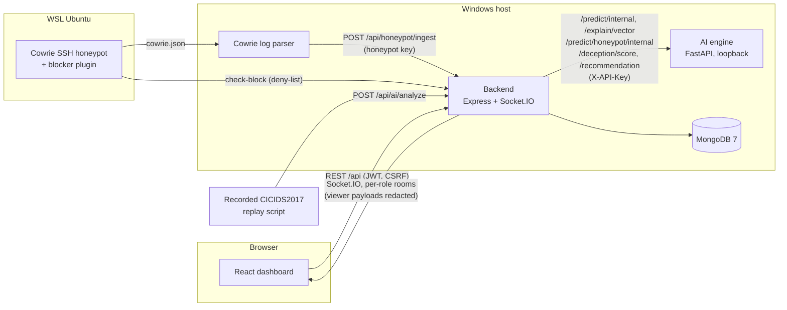

# SentinelAI final project guide (handover, 2026-11-03)

One document to understand, install, run, demonstrate and maintain SentinelAI. It links to the detailed documents
instead of repeating them. Every claim here is either visible in the code or was measured by a test run named in §11;
anything else is marked as an expectation, a limitation or untested.

| Need | Go to |
|---|---|
| Run the three demonstrations | [`DEMO_ABC_RUNBOOK.md`](DEMO_ABC_RUNBOOK.md) (short), [`DEMO_REHEARSAL_SCRIPT.md`](DEMO_REHEARSAL_SCRIPT.md) (presenter's script, rehearsed outputs, recovery) |
| Prepare for the viva | [`VIVA_GUIDE.md`](VIVA_GUIDE.md) |
| Presentation slides content and screenshots | [`PRESENTATION_CONTENT.md`](PRESENTATION_CONTENT.md), [`presentation/screenshots/`](presentation/screenshots/) |
| All metrics with sources | [`PROJECT_METRICS.md`](PROJECT_METRICS.md) |
| Deployment, TLS, backup and restore | [`DEPLOYMENT_AND_BACKUP_PLAN.md`](DEPLOYMENT_AND_BACKUP_PLAN.md) |
| Performance and failure behaviour | [`PERFORMANCE_AND_RESILIENCE.md`](PERFORMANCE_AND_RESILIENCE.md) |
| Model evaluation detail | [`../audit/ML_EVAL_PLAN.md`](../audit/ML_EVAL_PLAN.md), [`C1_EVALUATION_PLAN_AND_RESULTS.md`](C1_EVALUATION_PLAN_AND_RESULTS.md) |
| Findings and fixes, batch by batch | [`../audit/FINDINGS.md`](../audit/FINDINGS.md), [`../audit/FIXES.md`](../audit/FIXES.md), [`../audit/LEDGER.md`](../audit/LEDGER.md) |

## 1. System architecture

SentinelAI is a security-operations prototype with four services and one database:

| Service | Technology | Port (dev / demo) | Role |
|---|---|---|---|
| Frontend | React 18 + Vite | 3000 | SOC dashboard: threats, honeypot analytics, AI analytics, settings; role-based views (admin, analyst, viewer) |
| Backend | Node.js 24, Express, Socket.IO | 5000 | API gateway, authentication (JWT + rotating refresh cookie + CSRF), RBAC and redaction, threat/alert pipeline, containment state machine, real-time events |
| AI engine | Python 3.11, FastAPI, XGBoost, scikit-learn, SHAP | 8000 (loopback only) | Flow classification (XGBoost) + anomaly detection (Isolation Forest), per-threat SHAP explanations, honeypot session scoring, Q-learning persona recommender |
| Honeypot | Cowrie SSH in WSL Ubuntu + `honeypot/parsers/log_parser.py` | 2222 | Real SSH honeypot with fabricated shell; parser ships its JSON log to the backend; blocker plugin enforces the deny-list |
| Database | MongoDB 7.0 | 27017 | Users, sessions, threats, predictions (with the 53-feature vector), alerts, honeypot sessions, deception decisions, containment actions, audit log |

### What is real, replayed, simulated or experimental

| Capability | Classification |
|---|---|
| Cowrie SSH sessions, commands, MITRE mapping, honeypot deny-list refusal | **Real** |
| XGBoost + Isolation Forest inference, threat storage, alerts, SHAP explanations | **Real** computation |
| Network flows used in Demo B | **Replayed** recorded CICIDS2017 records (not live capture) |
| Host-firewall containment | **Simulated** (mock adapter); Windows Firewall adapter disabled, never run live |
| Q-learning persona recommender | **Real mechanism, experimental**: warm-started from a synthetic seed; benefit unmeasured |
| Cross-dataset (CSE-CIC-IDS2018) models | **Experimental, not deployed** |
| Attack Time Machine replay | **Real** recorded session events; MITRE mappings and summaries **derived**; linked containment labelled **simulated** |
| AI Trust Meter assessment | **Derived** from stored prediction fields; flow capture source (live vs replayed) recorded as **unknown** |
| Deception Arena experiments | **Scripted or simulated** attackers against a temporary copy of the Q-learner; no real-attacker evidence |
| Docker Compose, nginx, Prometheus/Grafana stack | **Implemented, untested** |

## 2. Component communication

- Every browser call goes through the backend; the engine binds to 127.0.0.1 and requires the shared service key.
- The backend calls the engine with a 10 s timeout, retries only stateless calls, and has a circuit breaker (5
  failures, reset after 30 s). When the engine is down a flow is stored as `DEGRADED` (MEDIUM, never blocked).
- Socket.IO rooms are joined only after the server re-verifies the session; privileged rooms get raw events, the
  viewer room gets redacted copies (last IPv4 octet masked, commands replaced).

**Real-time communication (Socket.IO).** A socket is authenticated at the handshake with the access token, joins
rooms only after the server re-verifies its session, and is re-checked every 15 s; revocation disconnects it at once.
Events: `new_threat`, `ai_prediction`, `new_alert`, `honeypot_*`, `ip_blocked` / `ip_unblocked`, `live_feed_event`,
`system_health`. After a server-side disconnect (e.g. database outage) the dashboard retries with backoff, rejoins its
rooms and fetches the threats it missed (at most 20, de-duplicated by id).

**Role-based access control.** Three roles: **admin** (users, settings, auto-block, everything), **analyst** (threats,
triage, explanations, block/unblock, honeypot recommendations), **viewer** (read-only, redacted). Enforced on the
server per route (`restrictTo`, `requirePermission`) and per socket room; viewer responses mask the last IPv4 octet and
replace honeypot commands. Verified: viewer explanation request → 403; viewer dashboard shows `198.51.100.xxx`.

**Monitoring and auditing.** Health endpoints (`/health`, `/ready`), Prometheus metrics (`/metrics`), rotating
application logs (`backend\logs\sentinel*.log`) including structured `[AUDIT]` containment lines, and the `auditlogs`
collection (Settings → audit log) for sign-ins, permission denials, settings changes and manual block/unblock.

## 3. AI/ML: models and metrics

**Served model** `xgb_cicids_v1` (`ai-engine/models/registry.json`): an XGBoost multi-class classifier plus an
Isolation Forest anomaly detector, both behind one 53-feature schema (`utils/features.py`, version `v2.1_53feat`).
- At startup the engine verifies each model file's SHA-256 against the registry and reproduces a 20-row golden set;
  it refuses to serve on any mismatch.
- **Threat score** combines the classifier's attack probability with the anomaly signal. A non-BENIGN prediction at
  or above the **alert line 0.90** becomes a ThreatLog (HIGH); at or above the **block line 0.92** it is CRITICAL and,
  only if an admin enabled auto-block, contained.
- Each request runs single-threaded (PERF-001, `INFERENCE_N_JOBS`), which leaves the CPU for the other services.

**Metrics (CICIDS2017; measured, see `README.md` and `audit/ML_EVAL_PLAN.md`)**

| Evaluation | Result | Meaning |
|---|---|---|
| Random 80/20 split, de-duplicated (served recipe) | accuracy 98.97 %, macro F1 0.874; attack recall 99.8 % (95.2 % at the 0.90 line), benign FPR 0.36 % (0.23 % at the line) | Same capture sessions in train and test: optimistic |
| Train Mon–Wed, test Thu+Fri | attack recall 50.6 %, benign FPR 0.12 % | Forward in time; 5 test attack classes never trained on |
| Leave one capture day out (4 attack days) | attack recall 3.1–33.4 % | Unseen days and tools are mostly missed |
| Alert line on held-out later traffic | 78.6 % of attacks alerted, 0.154 % of benign flows | Chosen for a 0.1 % benign-alert target on validation |

**The model does not generalise to attack days or tools it has not seen.** It is a strong in-distribution
classifier, not a detector of novel attacks. Cross-dataset (CSE-CIC-IDS2018) development experiments did not produce
a deployable model; four 2018 days are kept untouched for an external test that has not been run.

**Explanations (SHAP).** For a stored prediction the backend sends its saved 53-feature vector to `/explain/vector`;
the engine re-scores it, refuses if class, score or model version differ (so the explanation always belongs to that
prediction), and returns TreeSHAP contributions for the predicted class in log-odds. Contributions plus the base value
add up to the classifier margin (tested). SHAP covers the XGBoost classifier only, not the anomaly term.

## 4. Honeypot and reinforcement-learning architecture

1. Cowrie (WSL) accepts SSH logins with lab credentials and serves a fabricated shell; nothing executes on a real
   host. It writes `cowrie.json`.
2. The parser ships session events to `/api/honeypot/ingest` (idempotent, keyed by Cowrie event ids). Live sessions
   and commands reach the dashboard over Socket.IO.
3. When a session closes, the backend runs rule-based analysis (`honeypot_rules`: MITRE ATT&CK techniques, intent),
   scores it with the engine (`/predict/honeypot/internal`) and credits the persona that served it
   (`/deception/score`, never retried because it updates the Q-table).
4. **Persona learner.** Six personas (Ubuntu 22.04, Debian 11, CentOS 7, Windows Server 2019, Amazon Linux 2,
   Raspbian); `windows_srv` is never recommended because Cowrie only emulates a Linux shell. Tabular Q-learning:
   state = the previously served persona, action = next persona, alpha 0.1, gamma 0.9, epsilon 0.2 decaying to a
   floor of 0.05. Reward per session: log-scaled duration, 0.3 per command, intent bonuses (malware download 3.0,
   reverse shell 2.5, persistence 2.0, credential harvest and privilege escalation 1.5), 0.5 per IOC, 2.0 for a
   successful login, minus 5.0 if the attacker ran honeypot-fingerprinting commands; clipped to [-10, 20].
5. One decision is drawn per served persona and persisted (`deceptiondecisions`); `honeypot/deception_rotator.py`
   applies it (rewrites `cowrie.cfg` from a template, restarts Cowrie, records `APPLIED`).

**Not proven:** whether learned rotation keeps attackers engaged longer than a fixed persona. No controlled
experiment with real attackers has been run.

## 5. Autonomous response architecture

- **Policy first** (`containmentPolicyService`): loopback, link-local and `CONTAINMENT_PROTECTED_TARGETS` are refused;
  degraded or incomplete predictions are never auto-blocked; auto-block is off by default.
- **State machine** (`ContainmentAction`): `REQUESTED → VALIDATING → APPROVED → APPLYING → ACTIVE`, then
  `EXPIRING`/`ROLLING_BACK → ROLLED_BACK`; `ROLLBACK_FAILED` is retried by reconciliation; `FAILED` and `REJECTED`
  are final. One active action per target (lock); every action has a TTL; operators roll back from Settings.
- **Enforcement** goes through an adapter. The default **mock adapter records a simulated rule; no firewall change
  is made.** The Windows Firewall adapter exists but is disabled (`ENABLE_REAL_WINDOWS_FIREWALL_ENFORCEMENT`) and has
  never been run live. The only real enforcement is the honeypot's own deny-list check.
- Every step writes an audit record and emits `ip_blocked` / `ip_unblocked`.

## 6. Security controls and limitations

Implemented and tested: short-lived JWT access tokens in memory, rotating refresh token in an `httpOnly`,
`SameSite=Strict` cookie (`Secure` in production or over HTTPS), CSRF tokens on every auth mutation, session
revocation that also disconnects sockets, RBAC with per-role redaction (REST and Socket.IO), rate limiting, CSP and
security headers, startup refusal of placeholder secrets, model hash verification, a secret scanner in CI.

Limitations (see §13): SEC-001 (credentials once committed to history; risk accepted by the owner, not rotated),
no TLS termination in the repository, raw data unencrypted at rest, single-host deployment only.

## 7. Installation requirements (verified from a clean clone, 2026-11-03)

| Requirement | Verified version | Notes |
|---|---|---|
| Windows 10/11 | Windows 11 | Linux/macOS work for backend, engine and frontend (CI runs on Ubuntu); the demo scripts are Windows PowerShell |
| Node.js / npm | 24.14 / 11.9 | `npm ci` in `backend/` and `frontend/` |
| Python | 3.11.9 | only version tested; `py -3.11 -m venv .venv`; `pip install -r ai-engine/requirements.txt` took 4–7 min |
| MongoDB Community | 7.0.45 | service on 127.0.0.1:27017 |
| WSL 2 Ubuntu + Cowrie | WSL 2.7 | only for Demo A; Cowrie in `~/sentinelai-cowrie-test/cowrie` (see [`COWRIE_COMPLETE_GUIDE.md`](COWRIE_COMPLETE_GUIDE.md)) |
| CICIDS2017 CSVs | — | git-ignored; needed for Demo B replay and the integration harness, not for running the system |
| Disk | ~3 GB | venv ≈ 1.5 GB, `node_modules` ≈ 0.8 GB |

**Windows path length:** clone into a short folder. In a folder about 145 characters deep the checkout fails
("Filename too long") and the venv cannot load scikit-learn's DLLs (measured).

**Environment variables.** Copy `backend/.env.example` and `ai-engine/.env.example` and replace every `CHANGE_ME`
value; the backend refuses to start otherwise. Optional variables the code reads that are not in the examples (all
have safe defaults):

| Variable | Default | Effect |
|---|---|---|
| `CONTAINMENT_BACKEND` | `mock` | enforcement adapter |
| `ENABLE_REAL_WINDOWS_FIREWALL_ENFORCEMENT` | off | must stay off for demos |
| `CONTAINMENT_PROTECTED_TARGETS` | empty | extra addresses/CIDRs never contained |
| `HOST` | `127.0.0.1` | backend bind address; the demo script sets the WSL-visible address so Cowrie can reach it |
| `INFERENCE_N_JOBS` | `1` | engine threads per request (`-1` = all cores, the old behaviour) |
| `Q_TABLE_PATH` | per-user runtime copy seeded from `models/q_table.json` | where the engine keeps the learned Q-table; the seed file is never written |
| `AI_CIRCUIT_FAILURES` / `AI_CIRCUIT_RESET_MS` | 5 / 30000 | engine circuit breaker |
| `RETENTION_ENABLED`, `RETENTION_INTERVAL_HOURS`, `RETENTION_DAYS_*` | off | data retention job; runs only when both of the first two are set |

## 8. Startup procedure

Development (each in its own terminal, after §7): `backend: npm run dev`, `ai-engine: uvicorn inference.main:app
--host 127.0.0.1 --port 8000 --env-file .env`, `frontend: npm run dev`, then http://localhost:3000. On a brand-new
database create the first admin once: `npm run seed -- --confirm=<database>` (it deletes that database's data).

Demonstration: `scripts\demo\start-demo.ps1` (engine, backend on the `sentinel-demo` database, frontend, Cowrie
parser; expects three `UP` lines), then in WSL `bash scripts/demo/cowrie-demo-mode.sh on`. Stop with
`scripts\demo\stop-demo.ps1` and `cowrie-demo-mode.sh off`. Full procedure: [`DEMO_ABC_RUNBOOK.md`](DEMO_ABC_RUNBOOK.md) §1.

## 9. Demo A/B/C runbooks

[`DEMO_ABC_RUNBOOK.md`](DEMO_ABC_RUNBOOK.md) is authoritative. Validation status for this handover is in §11.

## 10. Troubleshooting

| Symptom | Cause | Fix |
|---|---|---|
| Backend exits: "insecure default/placeholder value" | a `CHANGE_ME` value left in `backend/.env` | replace all five secrets (README step 3) |
| `git clone` "Filename too long"; engine "DLL load failed … filename too long" | clone path too deep on Windows | clone into a short folder |
| Engine `/ready` 503 | model hash or golden-set check failed, or venv incomplete | read the engine log; models must match `registry.json` |
| `seed` prints `[BLOCKED]` | safety guard | add `-- --confirm=<database name>` |
| Dashboard live feed stops after a MongoDB outage | (fixed in batches 13–14) | it reconnects by itself and catches up the threats it missed (up to 20; all remain in Threat Logs) |
| Demo-specific symptoms | — | [`DEMO_ABC_RUNBOOK.md`](DEMO_ABC_RUNBOOK.md) §5 |

## 11. Performance and test evidence

Measured 2026-11-03 on the project laptop (Windows 11, 16 logical cores, 7.7 GB RAM, other apps running):

| Check | Result |
|---|---|
| Clean clone → install → build → seed → start → login → analyze (throwaway MongoDB 7.0) | all steps pass; services up in ~65 s |
| Integration harness with live Cowrie (Demos A, A-live, B, C, auth, outage) | **42 passed, 0 failed** |
| Demo scripts (`start-demo.ps1`, `cowrie-demo-mode.sh on/off`, `stop-demo.ps1`) | three services UP; blocker check-block 200; clean stop |
| Backend Jest / ESLint | 1,176 passed, 13 skipped / clean (batch 15: 1,178 passed with the CONT-001 tests) |
| AI engine pytest | 653 passed |
| Model registry and golden set | OK; hashes unchanged |
| Frontend unit / lint / production build | 70 passed / clean / OK |
| Playwright, Chromium + Firefox + WebKit (+ device projects) | **240 passed, 0 failed, 0 skipped** |
| Secret scan | 0 findings |
| Load and failure recovery | [`PERFORMANCE_AND_RESILIENCE.md`](PERFORMANCE_AND_RESILIENCE.md) (batch 13) |
| Demo A/B/C rehearsal on the real stack (batch 15) | all steps passed after one fix; [`DEMO_REHEARSAL_SCRIPT.md`](DEMO_REHEARSAL_SCRIPT.md) §7 |
| Backup → restore round trip (batch 15) | 12/12 collections identical in documents and indexes |

Details per batch: [`../audit/FIXES.md`](../audit/FIXES.md).

## 12. Deployment-readiness assessment

| Area | Status | Evidence / gap |
|---|---|---|
| Native Windows single-host (services + MongoDB 7 + WSL Cowrie) | **Verified** | clean clone, demo scripts, integration harness (§11) |
| Production frontend build | **Verified** | `npm run build`; served by `vite preview` with CSP in the clean-clone test |
| Health and readiness | **Verified** | backend `/health` (503 when DB or engine down), engine `/ready` (models verified) and `/health`, `/metrics` on both |
| Environment separation | **Verified** | demo uses `sentinel-demo` and its own Q-table; tests use throwaway databases; startup refuses placeholder secrets |
| Restart and recovery | **Verified** (native) | engine/MongoDB outage and recovery, socket reconnect (`PERFORMANCE_AND_RESILIENCE.md` §4) |
| CORS, cookies, origins | **Verified** (loopback) | `CLIENT_URL` allow-list; cookies `httpOnly`, `SameSite=Strict`, `Secure` in production; non-loopback HTTP refused |
| Docker Compose (`docker-compose.yml`, three Dockerfiles, Prometheus, Grafana) | **Implemented, untested** | Docker is not installed; the 2026-10-15 acceptance attempt was blocked at preflight |
| nginx (`frontend/nginx.conf`) | **Implemented, untested** | serves the built SPA on 8080 with CSP; runs only in the container |
| HTTPS/TLS | **Missing** | no certificate or TLS termination config in the repository; compose expects TLS in front; `TRUST_PROXY` must list explicit proxy addresses |
| Monitoring (Prometheus rules, Grafana dashboard) | **Implemented, partly tested** | rules unit-tested in CI (`promtool`); never run against live services |
| Database backup and restore | **Implemented and tested** (manual, Node scripts); scheduling **missing** | batch 15 round trip 12/12 collections identical after fixing dropped index options; `mongodump` needs the Database Tools (not installed); see [`DEPLOYMENT_AND_BACKUP_PLAN.md`](DEPLOYMENT_AND_BACKUP_PLAN.md) |
| Real firewall enforcement | **Blocked by design** | adapter disabled; must not be enabled for demos |
| Multi-host / public deployment | **Missing** | not designed or tested; would need TLS, secrets management and SEC-001 resolved |

## 13. Known limitations

- The model does not detect attack days or tools it has not seen (§3); several classes have too little data.
- Network flows in Demo B are **recorded CICIDS2017 records replayed**, not live capture.
- Enforcement is **simulated** (mock adapter) except the honeypot's own deny-list.
- The persona learner's benefit for real attackers is unestablished; its state is only the previous persona (close to a
  bandit problem). The Deception Arena's scripted runs cannot show an engagement effect by construction, and a 12-pair
  simulated run found no difference (commands per session, 95 % CI −0.42 to 1.42). Live Cowrie experiments are not
  supported because scored sessions update the deployed Q-table and persona changes restart Cowrie.
- The deployed model caught 15.2 % of attack flows on six CSE-CIC-IDS2018 development days at the 0.90 line (0.24 %
  benign false alarms; diagnostic, 2026-11-11). The AI Trust Meter states this as a dataset-level limitation.
- The AI Trust Meter can verify input completeness only for predictions stored after 2026-11-12 (`defaultedFeatures`).
- Reloading a page again while its session-restore request is still in flight logs the user out (refresh-token replay
  protection). Wait for the page to finish loading before reloading during a demo.
- Auto-block acts on a single flow at or above 0.92; there is no multi-event correlation.
- Single process engine (~120–130 requests/s); dashboard analytics and text search scale linearly with stored threats.
- SEC-001 open (risk accepted); no TLS, no backups, Docker untested.
- Open test findings: TEST-008 (browser stalls under memory pressure on this laptop), E2E-002 (one Firefox triage
  failure in 39 runs, not reproduced since).

## 14. Maintenance and recovery

| Task | How |
|---|---|
| Verify models before a demo | `ai-engine\.venv\Scripts\python ai-engine\training\register_model.py --check` |
| Full automated check (~5 min) | `node scripts/integration/run_integration.cjs --cowrie` (throwaway database; restores Cowrie) |
| Reset demo activity | `scripts\demo\reset-demo-db.ps1` (keeps users and settings; refuses `sentinel-db`) |
| Engine, backend or MongoDB died | restart its window / `Start-Service MongoDB`; dashboards reconnect by themselves |
| Restore Cowrie persona | `cowrie.cfg.pre-demo` backup, then `cowrie-demo-mode.sh restart` (runbook §2) |
| Back up a database (manual) | `$env:MONGO_URI='mongodb://127.0.0.1:27017/sentinel-demo'; node scratch\backup_sentinel_db.mjs`; restore into a new database first ([`DEPLOYMENT_AND_BACKUP_PLAN.md`](DEPLOYMENT_AND_BACKUP_PLAN.md) §4) |
| Engine window died during a demo | `scripts\demo\restart-engine.ps1` (about 11 s) |
| Upgrade dependencies | change lock files, then run the full regression set (§11) and CI |
| Never | retrain or replace models without the registry procedure, enable the firewall adapter for a demo, run `seed` against a database you need |

## 15. Feature-completion checklist (verified 2026-11-03)

| Feature | Status | Verified by |
|---|---|---|
| Cowrie session capture, live dashboard updates | ✔ complete | rehearsal A1–A3; integration A-live |
| MITRE ATT&CK mapping, rule-based session classification | ✔ complete | rehearsal A4 (5 techniques) |
| Engagement and deception scoring | ✔ complete | rehearsal A5 |
| Q-learning persona decision, persistence, rotation, credit | ✔ mechanism complete; benefit unmeasured | rehearsal A6–A8; integration A-live |
| 53-feature validation, XGBoost + Isolation Forest, threat score | ✔ complete | rehearsal B (10/10); pytest |
| Threat logs, alerts, severity lines 0.90 / 0.92 | ✔ complete | rehearsal B2–B3 |
| Per-threat SHAP explanation tied to the stored prediction | ✔ complete | rehearsal B5 (reproduced, additivity) |
| Role-based access and viewer redaction (REST and sockets) | ✔ complete | rehearsal B6; E2E live-feed viewer test |
| Containment policy, state machine, mock adapter, audit, TTL, rollback | ✔ complete (enforcement simulated) | rehearsal C1–C9; integration C |
| Honeypot deny-list enforcement | ✔ complete (real) | rehearsal C6–C7 |
| Engine-outage fail-safe and recovery | ✔ complete | rehearsal C10–C11 |
| Live feed reconnect and catch-up | ✔ complete | E2E live-feed spec |
| Backup and restore | ✔ manual, tested; scheduling not implemented | batch 15 round trip |
| Docker / TLS / multi-host deployment | ✘ not validated | see §12 |
| Live packet capture | ✘ not implemented (replay only) | — |
| Real firewall enforcement | ✘ deliberately disabled | — |
| Attack Time Machine (session replay) | ✔ complete (2026-11-11, PR #22) | `e2e/attack-time-machine.spec.js`; `backend/tests/attackTimeline.test.js` |
| AI Trust Meter (per-prediction assessment) | ✔ complete (2026-11-12, PR #23) | `e2e/ai-trust-meter.spec.js`; `backend/tests/trustMeter.test.js` |
| Deception Arena (static vs adaptive, reproducible mode) | ✔ complete; live mode not supported; no real-attacker benefit established | `e2e/deception-arena.spec.js`; `backend/tests/deceptionArena.test.js` (runs the real runner) |
| All three features together, every role, desktop and phone | ✔ verified 2026-11-12 | `e2e/feature-integration.spec.js` |

## 16. Final technical readiness assessment

**Ready for the final-year demonstration and viva**, on the project laptop, with the documented limitations stated
up front. Evidence: a full Demo A/B/C rehearsal on the real stack (all steps passed after one fix), 42/42 integration
checks with live Cowrie, all automated suites green (CI 7/7 on the last pushed commit), clean-clone installation, and
recovery procedures exercised live.

**Not ready for production use.** Blockers: no TLS, untested containers, SEC-001, simulated enforcement, and above
all a detector that does not generalise to unseen attack days or tools.

Documentation versus implementation: the batch 15 rehearsal found four inconsistencies and corrected them —
containment audit lines are in the backend log, not the Settings audit table; the auto-block requester field is
`requestedByName`; the replay script described recorded flows as "live network traffic"; there was no single-command
engine recovery. One real defect (CONT-001) and one backup-tool defect (dropped index options) were fixed with tests.
